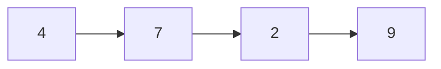
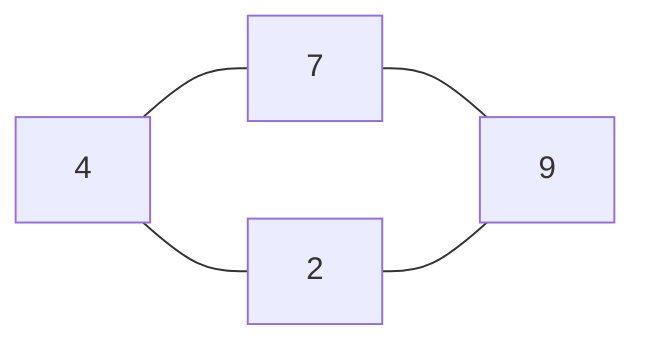
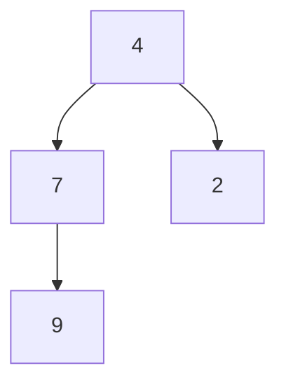

# Structuri de date și algoritmi

Cum stocăm datele?

Cum îi spunem unui calculator ce să facă cu ele?

---

## Ce este un algoritm?

**Dă câteva exemple.**

- Gândește-te la viața de zi cu zi sau la un program.
- Alege un exemplu. Care sunt pașii lui?

Gândește-te puțin. Apoi prezintă răspunsul tău.

---

## Un algoritm

**Definiție:**

Un algoritm este un set finit de reguli clare care rezolvă un tip de problemă
și se termină după un număr finit de pași.

Sursă: Donald Knuth, [The Art of Computer Programming, Vol. 1, Secțiunea 1.1: Algoritmi](https://www.informit.com/articles/article.aspx?p=2221792).

**Caracteristici:**

- **Finitudine:** Algoritmul trebuie să se termine întotdeauna după un număr finit de pași.
- **Precizie:** Fiecare pas trebuie definit exact. Acțiunile trebuie specificate clar, fără ambiguități, pentru fiecare caz.
- **Input:** Un algoritm are zero sau mai multe date de intrare, alese dintr-un set specificat de obiecte.
- **Output:** Un algoritm produce unul sau mai multe rezultate, care au o relație specificată cu datele de intrare.
- **Efectivitate:** Toate operațiile trebuie să fie suficient de simple pentru ca, în principiu, o persoană să le poată executa exact, doar cu creion și hârtie.

---

## Adunarea a patru numere

**Input:** `[4, 7, 2, 9]`

Începe cu un total de `0`. Citește fiecare număr și adaugă-l la total.

```text
Pornire     0
Adună 4     4
Adună 7    11
Adună 2    13
Adună 9    22
```

**Output:** `22`

Ce trebuie să returneze acest algoritm pentru un input gol?

---

## Găsirea unui număr

**Găsește** `2`**.** Verifică fiecare număr de la stânga la dreapta. Oprește-te când îl găsești sau când ajungi la sfârșit.

```text
Numere        4     7     2     9
Egal?         nu    nu    da
```

Dacă îl căutăm pe `5`, când ne oprim?

Lectură suplimentară: Donald Knuth, [The Art of Computer Programming, Vol. 3](https://www.informit.com/store/art-of-computer-programming-volume-3-sorting-and-searching-9780201896855), Secțiunile 6.1: Căutare secvențială și 5.2.3: Sortare prin selecție.

---

## Ordonarea numerelor

**Input:** `[4, 7, 2, 9]`

Elimină, în mod repetat, unul dintre cele mai mici numere rămase și adaugă-l la sfârșitul
unei secvențe noi.

```text
După pasul 1     [2]
După pasul 2     [2, 4]
După pasul 3     [2, 4, 7]
După pasul 4     [2, 4, 7, 9]
```

**Output:** `[2, 4, 7, 9]`

---

## Ce este o structură de date?

**Dă câteva exemple.**

- Pe care le-ai folosit într-un program?
- Cum organizează datele?

Gândește-te puțin. Apoi prezintă răspunsul tău.

---

## O structură de date

[Open Data Structures, Secțiunea 1.2: Interfețe](https://opendatastructures.org/ods-python/1_2_Interfaces.html).

Definiție:

**O structură de date organizează și stochează datele pentru a le putea folosi eficient.**

Organizarea ei influențează modul în care găsim, citim, adăugăm și eliminăm valori.

---

## Lists, maps și graphs

**Trei moduri utile de a organiza datele.**

| Grup | Ideea principală | Exemple |
| --- | --- | --- |
| Lists (secvențe) | Elementele au poziții într-o secvență. | Array, linked list |
| Maps | Fiecare key identifică o singură value. | Hash map |
| Graphs | Elementele numite nodes au conexiuni. | Graph general, tree |

Aceste grupuri ne ghidează introducerea. Există și alte structuri.

Sursă: [Open Data Structures, Capitolul 12: Graphs](https://opendatastructures.org/ods-python/12_Graphs.html).


---


## Un array

**Elemente într-o secvență. Fiecare element are un index, adică o poziție.**

```text
Index      0     1     2     3
        +-----+-----+-----+-----+
Valoare |  4  |  7  |  2  |  9  |
        +-----+-----+-----+-----+
```

Ce valoare se află la index-ul `2`?\
De ce încep array-urile de la index-ul `0`?

Sursă: [Open Data Structures, Capitolul 2: Liste bazate pe array-uri](https://opendatastructures.org/ods-python/2_Array_Based_Lists.html).

---

## Un linked list

**Fiecare node conține o valoare și o legătură către următorul node.**



Ultimul node nu are un node următor.

Pornind de la `4`, ce legături ai urma ca să ajungi la `2`?

Sursă: [Open Data Structures, Secțiunea 3.1: Un singly linked list](https://opendatastructures.org/ods-python/3_1_SLList_Singly_Linked_Li.html).

---

## Un hash map

**Găsește o value (valoare) folosind key-ul (cheia) ei.**

```text
Key     Value
 4        7
 2        9
```

- Fiecare key are o singură value asociată.
- Un hash map folosește o hash function pentru a alege o locație de stocare pentru un key.
- Un hash map este un mod de a implementa un map.

Ce value corespunde key-ului `2`?

Sursă: Open Data Structures, [Capitolul 5: Hash tables](https://opendatastructures.org/ods-python/5_Hash_Tables.html).


---


## Un graph

**Nodes și conexiunile dintre ele.**



- Un node se numește și **vertex**.
- O conexiune se numește **edge**.
- Aici, fiecare conexiune funcționează în ambele direcții.

Poți să pleci de la `4` și să revii la el fără să folosești un edge de două ori?


---


## Un tree

**Un tree este un graph conex, fără cicluri.**

Alege un root (rădăcină) pentru a descrie relațiile dintre părinți și copii.



- `4` este root-ul. Nu are părinte.
- Fiecare alt node are un singur părinte.

Care nodes sunt copiii lui `4`?

Sursă: [Open Data Structures, Capitolul 6: Binary trees](https://opendatastructures.org/ods-python/6_Binary_Trees.html).

<br><br><br><br><br><br>

---

<br><br><br><br><br><br>

## Programa cursului

1. **Array-uri și complexitate:** memorie, array-uri cu capacitate fixă și array-uri dinamice, linear search, costuri de timp și memorie, append cu cost amortizat.
2. **Structuri înlănțuite:** linked lists, stacks, queues, LIFO și FIFO.
3. **Sortare și recursion:** insertion sort, prezentare generală pentru bubble sort și selection sort, recursion, merge sort.
4. **Quicksort și binary search:** partitioning, alegerea unui pivot, căutare în date sortate.
5. **Hash sets și maps:** hashing, collisions, load factor, resize, costuri de căutare.
6. **Graphs:** trees, adjacency lists, DFS, BFS, shortest paths după numărul de muchii.
7. **Aplicații:** reunirea rezervărilor de săli, numărarea insulelor, găsirea rutelor prin campus.
8. **Studiu suplimentar:** trees și indexes, drumuri cu ponderi, dynamic programming, backtracking, structuri specializate.

[Materialele cursului](../readme.md).

<br><br><br><br><br><br>

---

<br><br><br><br><br><br>

## Organizarea cursului

- **Lecții:** 8.
- **Laboratoare:** 5.
- **Nota finală:** examen **60%**, laboratoare **40%**.
- Toate laboratoarele se vor baza pe [LeetCode](https://leetcode.com/).

**Înainte de primul laborator, creează un cont LeetCode.**

<br><br><br><br><br><br>

---

<br><br><br><br><br><br>

## Obiective și obiective excluse

**Obiective**

- Construirea unei baze mai formale pentru programare.
- Dezvoltarea intuiției despre funcționarea calculatoarelor.
- Învățarea conceptelor de bază: complexitatea Big-O, sortare, trees și aplicații de bază pentru trees.
- Prezentarea mai multor teme pentru studiu individual.

**Obiective excluse**

- Predarea bazelor programării. Trebuie să le cunoști deja.
- Pregătirea pentru programare competitivă.
- Studierea fiecărei teme în profunzime.

**Citește sursele din linkuri. Explorează și dincolo de lecții!**

<br><br><br><br><br><br>

---

<br><br><br><br><br><br>

## Unde se află un array?

```text
[4, 7, 2, 9]
```

Scriem patru numere. Calculatorul trebuie să le stocheze undeva.

- Cum arată un număr în memorie?
- Cum găsește calculatorul valoarea de la index-ul `2`?
- Unde ar putea fi stocată a cincea valoare?

**Prezintă ideile tale înainte să privim în interior.**

<br><br><br><br><br><br>

---

<br><br><br><br><br><br>

## Biți și bytes

- Un **bit** are una dintre două valori: `0` sau `1`.
- Pe calculatoarele pe care le folosim, **un byte are 8 biți**.
- În sistemul binar, fiecare poziție are o valoare pozițională.

```text
Val. poziție  128  64  32  16   8   4   2   1
Bit             0   0   0   0   0   1   0   0

00000100 = 4
```

**Care biți trebuie să fie `1` pentru a reprezenta `7`?**

Sursă: [CS50: Numere binare](https://cs50.harvard.edu/x/2025/notes/0/#computer-science-and-problem-solving).

<br><br><br><br><br><br>

---

<br><br><br><br><br><br>

## Cât poate stoca un byte?

```text
00000111 =   4 + 2 + 1 = 7

00000000 =   0
11111111 = 255
```

- Opt biți dau `2^8 = 256` configurații diferite.
- Ca **unsigned integer (număr întreg fără semn)**, un byte poate reprezenta valori de la `0` la `255`.
- Tipul de date îi spune programului cum să interpreteze biții.

**Putem stoca valoarea `256` ca unsigned integer într-un byte?**

<br><br><br><br><br><br>

---

<br><br><br><br><br><br>

## Un număr întreg pe 32 de biți

**Un byte este prea mic pentru multe numere. Putem folosi mai mulți bytes.**

- `i32` înseamnă un număr întreg cu semn, pe 32 de biți.
- În C, folosim `int32_t` din `<stdint.h>`.
- Cu 8 biți într-un byte, avem `32 / 8 = 4` bytes pentru un număr întreg.
- Cu semn înseamnă că tipul acceptă numere negative, zero și numere pozitive.

```text
Configurația de 32 de biți pentru 4, cu valoarea pozițională maximă la stânga:

00000000 00000000 00000000 00000100
<--------------- 32 biți ------------->
```

`int32_t` folosește patru bytes chiar și pentru o valoare mică, precum `4`.
Tipul C `int` poate avea o altă dimensiune pe un alt calculator.

**De câți bytes au nevoie patru valori `int32_t`?**

Sursă: [GNU C Library: Tipuri de numere întregi cu lățime exactă](https://sourceware.org/glibc/manual/latest/html_node/Integers.html).

<br><br><br><br><br><br>

---

<br><br><br><br><br><br>

## RAM și adrese de memorie

**Imaginează-ți RAM-ul ca pe un array mare de bytes, cu capacitate fixă.**

```text
Adresă     0x1000  0x1001  0x1002  0x1003  0x1004  0x1005  ...
          +-------+-------+-------+-------+-------+-------+
Byte      |       |       |       |       |       |       | ...
          +-------+-------+-------+-------+-------+-------+
```

- Adresele folosesc **sistemul hexazecimal (baza 16)**, cu prefixul `0x`.
- În acest model, fiecare adresă identifică un byte.
- O valoare de patru bytes ocupă patru locații consecutive de câte un byte.
- O **base address (adresă de bază)** este adresa de la care începe un array.

Acestea sunt adrese de exemplu pentru calcule.
Un program C vede, de obicei, **adrese virtuale**. Sistemul de operare le mapează la memoria fizică.

Sursă: [GNU C Library: Concepte despre memoria unui proces](https://sourceware.org/glibc/manual/latest/html_node/Memory-Concepts.html).

<br><br><br><br><br><br>

---

<br><br><br><br><br><br>

## Un array de numere întregi în memorie

```c
int32_t values[4] = {4, 7, 2, 9};
```

**Patru numere întregi ocupă `4 * 4 = 16` bytes.**

```text
Index            0               1               2               3
Valoare          4               7               2               9
          +---------------+---------------+---------------+---------------+
Bytes     | 0x1000-0x1003 | 0x1004-0x1007 | 0x1008-0x100B | 0x100C-0x100F |
          +---------------+---------------+---------------+---------------+
```

- Fiecare element are același tip și aceeași dimensiune.
- Elementele sunt **contigue**: se află unul după altul, fără spații între ele.
- În acest exemplu, adresa de bază este `0x1000`.

<br><br><br><br><br><br>

---

<br><br><br><br><br><br>

## Citirea prin index

**Cum găsește C valoarea `values[2]`?**

```text
Offset byte = index * element size
Adresă      = base address + byte offset

Index 2:    0x1000 + 2 * 4 = 0x1008
Citește acolo patru bytes ca int32_t -> 2
```

- Index-ul numără **elemente**. Offset-ul numără **bytes**.
- C cunoaște dimensiunea elementului din tipul lui.
- Adunarea cu pointeri în C, precum `values + 2`, ține deja cont de această dimensiune.
- Index-ul `0` are offset-ul `0`: începe de la adresa de bază.

Calculatorul poate găsi index-ul `2` fără să citească mai întâi index-urile `0` și `1`.

**Care este offset-ul în bytes pentru index-ul `3`?**

<br><br><br><br><br><br>

---

<br><br><br><br><br><br>

## Text ASCII într-un array de caractere

**Offset-ul pentru index-ul `3` într-un array de numere întregi era de `12` bytes. Ce se schimbă pentru caractere?**

```c
char text[] = "A4b!";
```

```text
Index        0       1       2       3       4
Caracter    'A'     '4'     'b'     '!'     '\0'
Val. byte    65      52      98      33      0
Adresă     0x2000  0x2001  0x2002  0x2003  0x2004
```

- ASCII acceptă litere, cifre și simboluri. Fiecare caracter încape într-un byte (coduri de la `0` la `127`).
- C adaugă `\0`, un byte cu valoarea zero, pentru a marca sfârșitul acestui string.
- Patru caractere de text și marcajul de sfârșit ocupă **cinci bytes**.
- Caracterul `'4'` are codul `52`. Numărul întreg `4` are valoarea `4`.

Aici, offset-ul pentru `text[3]` este de `3 * 1 = 3` bytes.
Alte codificări de text, precum UTF-8, pot folosi mai mulți bytes pentru un caracter.

Surse: CS50, [ASCII](https://cs50.harvard.edu/x/2025/notes/0/#ascii) și [String-uri în C](https://cs50.harvard.edu/x/2025/notes/2/#strings).

<br><br><br><br><br><br>

---

<br><br><br><br><br><br>

## Un array de string-uri

**Un byte pentru fiecare caracter ASCII nu înseamnă un byte pentru fiecare string.**

Un mod de organizare în C folosește un array de array-uri de caractere:

```c
char words[2][4] = {"cat", "dog"};
```

```text
Adresă de exemplu  0x3000  0x3001  0x3002  0x3003 |  0x3004  0x3005  0x3006  0x3007
Caracter             c       a       t       \0   |    d       o       g       \0
                  <---------- words[0] ---------->| <---------- words[1] ---------->
```

- Fiecare rând are patru bytes: trei litere și un marcaj de sfârșit.
- Rândul următor începe cu `4` bytes mai departe. Caracterul următor începe cu `1` byte mai departe.
- Întregul array ocupă `2 * 4 = 8` bytes.

**Unde se află `words[1][2]` în acest exemplu?**

<br><br><br><br><br><br>

---

<br><br><br><br><br><br>

## Demonstrație C: un array de numere întregi

Deschide [demonstrația C](examples/01-array-memory.c): `int32_t values[4] = {4, 7, 2, 9};`.

- `&values` și `&values[0]` au aceeași adresă de început, dar tipuri diferite de pointeri.
- `values + 1` avansează cu un element: `sizeof(int32_t)` bytes. Aici, înseamnă patru bytes.
- Toate elementele unui array C au **un singur tip declarat**. Aici, fiecare element este `int32_t`.

**Ce se întâmplă dacă citim `values[4]`?** Rulează din folderul repository-ului:

```sh
cc -std=c11 -g -fsanitize=undefined -fno-sanitize-recover=all \
  slides/examples/01-array-memory.c -o /tmp/dsa-array-memory
/tmp/dsa-array-memory
```

Ultima linie citește intenționat în afara array-ului. **UndefinedBehaviorSanitizer raportează eroarea și oprește programul.**
Fără acest instrument, C nu verifică limita: comportamentul este nedefinit. Programul nu se oprește neapărat cu o eroare.

<br><br><br><br><br><br>

---

<br><br><br><br><br><br>

## Array-uri cu capacitate fixă

**Aici, un static array înseamnă un array cu un număr fix de locuri.**

```c
int32_t values[4] = {4, 7, 2, 9};
```

- **Capacity (capacitate):** patru locuri alocate pentru elemente.
- **Length (lungime):** patru valori în secvența noastră.
- Ultimul index valid este `3`, nu `4`.
- Putem înlocui valorile. Nu putem mări același array C.

Cuvântul-cheie C `static` are un sens separat: nu este necesar pentru acest exemplu.

**Cum putem citi fiecare valoare și calcula suma?**

<br><br><br><br><br><br>

---

<br><br><br><br><br><br>

## Citirea fiecărui element

```c
size_t length = 4;
int32_t total = 0;

for (size_t i = 0; i < length; i++) {
    total += values[i];
}
```

```text
Index vizitat     0     1     2     3
Valoare citită    4     7     2     9
Total curent      4    11    13    22
```

- Începe de la `0`. Oprește-te **înainte de** `length`.
- Pentru length `0`, bucla nu citește niciun element, iar totalul rămâne `0`.
- Pentru a aduna `n` elemente, acest algoritm citește toate cele `n` elemente.

**De ce poate accesul direct să sară peste valorile anterioare, dar calcularea acestei sume nu poate?**

<br><br><br><br><br><br>

---

<br><br><br><br><br><br>

## De unde știm lungimea?

**Un array C simplu nu are un câmp suplimentar de lungime lângă elementele sale.**

- Am ales patru locuri în declarația `values[4]`.
- Păstrăm numărul de valori folosite în propria variabilă `length`.
- Pentru acest array plin, putem calcula numărul de elemente acolo unde îl declarăm:

```c
size_t length = sizeof(values) / sizeof(values[0]);
```

```text
16 bytes / 4 bytes per element = 4 elemente
```

Când transmitem un array unei funcții C, de obicei transmitem și lungimea lui.
În acea funcție, formula cu `sizeof` nu funcționează pentru parametrul array: acesta este un pointer.

<br><br><br><br><br><br>

---

<br><br><br><br><br><br>

## Scrierea prin index

**Înlocuiește valoarea de la index-ul `2` cu `20`.**

```c
values[2] = 20;
```

```text
Adresă  = 0x1000 + 2 * 4 = 0x1008

Înainte   [4, 7,  2, 9]
După      [4, 7, 20, 9]
```

- C folosește același calcul al adresei ca la citire.
- Noul număr întreg înlocuiește cei patru bytes ai acelui element.
- Array-ul are în continuare patru elemente. Nicio valoare nu se deplasează.

**Care patru locații de câte un byte conțin elementul actualizat?**

<br><br><br><br><br><br>

---

<br><br><br><br><br><br>

## Putem adăuga a cincea valoare?

Pornim din nou de la array-ul inițial:

```text
[4, 7, 2, 9]
```

**Vrem să adăugăm `5` la sfârșit.**

- De ce adresă ar avea nevoie index-ul `4`?
- Am alocat bytes pentru acel element?
- Dacă următorii bytes aparțin deja altui obiect?

Gândește-te puțin înainte de slide-ul următor.

<br><br><br><br><br><br>

---

<br><br><br><br><br><br>

## Următorii bytes sunt în afara array-ului nostru

```text
Exemplu de organizare:

Adresă      0x1000    0x1004    0x1008    0x100C   | 0x1010
Valoare       4         7         2         9      |   42
          <----------- array-ul nostru ---------->  | alt obiect

Index propus 4: 0x1000 + 4 * 4 = 0x1010
```

- Al cincilea număr întreg ar avea nevoie de bytes de la `0x1010` la `0x1013`.
- Acei bytes sunt în afara array-ului nostru cu patru elemente.
- Scrierea în `values[4]` este **undefined behavior (comportament nedefinit)** în C. Poate deteriora alte date sau poate opri programul cu o eroare.
- Chiar dacă următorii bytes nu sunt folosiți, ei nu fac parte din acest array.

**Avem nevoie de un bloc alocat mai mare. Cum putem păstra valorile vechi?**

<br><br><br><br><br><br>

---

<br><br><br><br><br><br>

## Ideea unui array dinamic

**Un array dinamic gestionează un backing array (array de stocare), pe care îl poate înlocui când are nevoie de mai mult spațiu.**

```text
Array dinamic
  adresă bază -------> [4, 7, 2, 9]
  length = 4
  capacity = 4
```

- Backing array-ul are în continuare o capacitate fixă.
- Array-ul dinamic ține evidența spațiului alocat și a numărului de elemente folosite.
- Când backing array-ul este plin, obține mai mult spațiu și păstrează valorile.

Sursă: [Open Data Structures, Secțiunea 2.1: ArrayStack](https://opendatastructures.org/ods-python/2_1_ArrayStack_Fast_Stack_O.html), inclusiv mărirea și micșorarea capacității.

<br><br><br><br><br><br>

---

<br><br><br><br><br><br>

## Length și capacity

**Patru valori pot ocupa un backing array cu opt locuri.**

```text
Index       0   1   2   3   4   5   6   7
Stocare    [4,  7,  2,  9,  _,  _,  _,  _]
           <-- folosite -> <- nefolosite ->

length = 4                 capacity = 8
```

- **Length:** numărul de elemente folosite. Unele API-uri îl numesc **size**.
- **Capacity:** numărul de locuri alocate pentru elemente.
- **Spațiul ocupat în bytes:** `capacity * element size`. Aici, `8 * 4 = 32` bytes pentru backing array.

Păstrează întotdeauna `0 <= length <= capacity`. Locurile `_` nu sunt elemente ale secvenței.

**Care este index-ul ultimului element? Este egal cu length?**

<br><br><br><br><br><br>

---

<br><br><br><br><br><br>

## Length, ultimul index și ultima adresă

**Length este un număr de elemente. Nu este o adresă de memorie.**

Pentru numere întregi de patru bytes, la adresa de bază de exemplu `0x1000`:

```text
Length               = 4 elemente
Index ultim element  = length - 1 = 3
Adresă ultim element = base + (length - 1) * element size
                     = 0x1000 + 3 * 4 = 0x100C
```

- Index-urile valide ale elementelor sunt de la `0` la `length - 1`.
- Capacity poate fi mai mare decât length. Ultimul element folosit este în continuare la index-ul `3`.
- Dacă length este `0`, nu există un ultim element.

**Dacă capacity crește, dar length rămâne la fel, se schimbă ultimul index?**

<br><br><br><br><br><br>

---

<br><br><br><br><br><br>

## Crearea unui array dinamic

**Un container gol are length `0`, chiar dacă rezervă spațiu.**

| Limbaj | Crearea unui container gol | Length inițial |
| --- | --- | ---: |
| Python | `a = []` | `len(a) == 0` |
| Java | `new ArrayList<Integer>()` | `size() == 0` |
| C++ | `std::vector<int> a;` | `a.size() == 0` |
| JavaScript | `const a = [];` | `a.length === 0` |

- În Python, `[4, 7, 2, 9]` începe cu length `4`, deoarece furnizăm patru valori.
- În Java, `new ArrayList<Integer>(8)` rezervă loc pentru opt elemente, dar are în continuare length `0`.
- Capacitatea inițială depinde de constructor și de implementare. Nu există o singură valoare implicită pentru toate limbajele.

Pentru modelul nostru, putem alege **length = 0, capacity = 4**: `[_, _, _, _]`.

Referințe pentru limbaje: [Liste Python](https://docs.python.org/3/tutorial/datastructures.html), [Constructori Java ArrayList](https://docs.oracle.com/en/java/javase/21/docs/api/java.base/java/util/ArrayList.html), [Constructori C++ vector](https://eel.is/c++draft/vector.cons) și [Array-uri JavaScript](https://tc39.es/ecma262/multipage/indexed-collections.html#sec-array-constructor).

<br><br><br><br><br><br>

---

<br><br><br><br><br><br>

## Push: adaugă o valoare la sfârșit

**Ce se schimbă când facem push cu `5` și există un loc liber?**

```text
Înainte   [4, 7, 2, 9, _, _, _, _]   length = 4, capacity = 8
push(5)
După      [4, 7, 2, 9, 5, _, _, _]   length = 5, capacity = 8
```

1. Scrie valoarea la index-ul `length`, care aici este `4`.
2. Mărește length cu unu.

- Capacitatea și adresa de bază rămân la fel.
- Elementele existente nu se deplasează.
- Python numește această operație `append`: `a.append(5)`.

**Cum putem anula acest push și obține înapoi valoarea `5`?**

<br><br><br><br><br><br>

---

<br><br><br><br><br><br>

## Pop: elimină și returnează ultima valoare

```text
Înainte   [4, 7, 2, 9, 5, _, _, _]   length = 5, capacity = 8
pop() -> 5
După      [4, 7, 2, 9, _, _, _, _]   length = 4, capacity = 8
```

1. Citește elementul de la index-ul `length - 1`.
2. Micșorează length cu unu și returnează valoarea.

- În acest exemplu, capacity rămâne `8`. Niciun element nu se deplasează.
- `_` înseamnă că locul nu mai este folosit. Nu înseamnă că bytes de acolo au fost șterși.
- Un array gol nu are o valoare pentru pop. În acest caz, Python `a.pop()` produce eroarea `IndexError`.

**Ce trebuie să facă push când nu mai există locuri libere?**

<br><br><br><br><br><br>

---

<br><br><br><br><br><br>

## Push când backing array-ul este plin

Acest exemplu începe cu **length = capacity = 4**. Vrem să facem push cu `5`.

```text
Bloc vechi:  0x1000    [4, 7, 2, 9]               4 locuri, 16 bytes
                       |  |  |  |
                       v  v  v  v
Bloc nou:    0x2000    [4, 7, 2, 9, 5, _, _, _]   8 locuri, 32 bytes
```

**Adresa de bază se schimbă de la `0x1000` la `0x2000`.** Index-ul `0` se referă acum la adresa `0x2000`.

1. Alocă un backing array nou, cu `2 * capacity` locuri.
2. Copiază în el cele patru valori existente, în aceeași ordine.
3. Folosește noua adresă de bază și eliberează memoria alocată anterior.
4. Scrie `5` la index-ul `4`. Setează length la `5` și capacity la `8`.

În modelul nostru, primul push la capacity `0` alocă un loc. Dublarea începe după acest pas.

**De ce alegem opt locuri în loc de doar cinci?**

<br><br><br><br><br><br>

---

<br><br><br><br><br><br>

## De ce dublăm capacitatea?

**Spațiul suplimentar reduce frecvența cu care copiem toate elementele existente.**

Începe cu un array gol și capacity `1`. Fă push cu opt valori:

```text
Creștere cu un loc:
  Capacități       1, 2, 3, 4, 5, 6, 7, 8
  Valori copiate   1 + 2 + 3 + 4 + 5 + 6 + 7 = 28

Dublarea capacității:
  Capacități       1, 2, 4, 8
  Valori copiate   1 + 2 + 4 = 7
```

- Ambele metode scriu și cele opt valori noi.
- Dublarea lasă locuri nefolosite, dar necesită mai puține alocări și copieri.
- Un push poate încă să copieze fiecare element existent. Multe alte operații push au nevoie doar de o scriere.

Dublarea este regula de creștere pe care o folosim în acest curs.

**După ce length devine `5` și capacity devine `8`, câte operații push mai încap înainte de următorul resize?**

<br><br><br><br><br><br>

---

<br><br><br><br><br><br>

## Reguli de creștere în biblioteci reale

**Își dublează fiecare array dinamic capacitatea?**

Exemple din codul sursă al bibliotecilor, pentru adăugarea valorilor la sfârșit:

| Container și implementare | Mod de creștere |
| --- | --- |
| Python `list` ([CPython 3.14.0](https://github.com/python/cpython/blob/v3.14.0/Objects/listobject.c#L117-L138)) | Aproximativ `1.125 * new_length`, plus spațiu suplimentar și rotunjire. |
| Java `ArrayList` ([OpenJDK 25](https://github.com/openjdk/jdk/blob/jdk-25%2B36/src/java.base/share/classes/java/util/ArrayList.java#L232-L245)) | Preferă aproximativ `1.5 * old_capacity`. |
| C++ `std::vector` ([GCC 15.2](https://github.com/gcc-mirror/gcc/blob/releases/gcc-15.2.0/libstdc%2B%2B-v3/include/bits/stl_vector.h#L2194-L2204)) | Dublează capacitatea pentru un singur push într-un vector plin. |
| C++ `std::vector` ([MSVC 17.14](https://github.com/microsoft/STL/blob/vs-2022-17.14/stl/inc/vector#L2005-L2022)) | Preferă aproximativ `1.5 * old_capacity`. |
| JavaScript `Array` ([V8 13.8](https://github.com/v8/v8/blob/13.8.258.32/src/objects/js-objects.h#L654-L670)) | Pentru array-uri dense, folosește o regulă de creștere de aproximativ `1.5 * new_length + 16` locuri. |

- `new_length` include valorile adăugate. `1.125x` înseamnă aproximativ 12.5% în plus. `1.5x` înseamnă aproximativ 50% în plus.
- Factorii de creștere mai mici lasă mai puțin spațiu nefolosit, dar de obicei necesită mai multe operații resize.
- **Acestea sunt alegeri de implementare, nu garanții ale limbajelor.** Array-urile mici, inserările multiple și limitele de memorie pot schimba rezultatul.

<br><br><br><br><br><br>

---

<br><br><br><br><br><br>

## Câtă muncă necesită o operație pe un array?

Începe cu `[4, 7, 2, 9]`. Acum imaginează-ți un array cu **un milion de valori**.

- Citește valoarea de la ultimul index.
- Calculează suma tuturor valorilor.
- Inserează o valoare la început și păstrează ordinea valorilor vechi.
- Fă push cu o valoare când backing array-ul este plin.

**Care operații necesită mai multă muncă atunci când array-ul crește? De ce?**

Gândește-te puțin înainte de slide-ul următor.

<br><br><br><br><br><br>

---

<br><br><br><br><br><br>

## Complexitatea algoritmilor

**Complexitatea descrie cum cresc resursele necesare unui algoritm odată cu dimensiunea input-ului.**

În exemplele noastre cu array-uri, `n` este numărul de elemente folosite.

| Măsură | Ce numărăm? |
| --- | --- |
| Time complexity | Operații de bază, precum citiri, scrieri, comparații și copieri. |
| Space complexity | Memoria folosită, precum variabile și array-uri alocate. |
| Auxiliary space | Memoria auxiliară de lucru, în plus față de input și output. |

- Vom folosi **notația Big O** pentru a descrie creșterea costurilor de timp și memorie.
- Complexitatea nu dă o durată exactă în secunde. Hardware-ul și implementarea influențează și ele timpul de execuție.

Sursă: [Open Data Structures, Secțiunea 1.5: Corectitudine, time complexity și space complexity](https://opendatastructures.org/ods-python/1_5_Correctness_Time_Comple.html).

Lectură suplimentară: Donald Knuth, [The Art of Computer Programming, Vol. 1](https://www.informit.com/store/art-of-computer-programming-volume-1-fundamental-algorithms-9780201896831), Secțiunile 1.2.10: Analiza unui algoritm și 1.2.11: Reprezentări asimptotice.

<br><br><br><br><br><br>

---

<br><br><br><br><br><br>

## Big O: o limită a creșterii

**`O(f(n))` dă o limită superioară pentru creșterea costului.**

Pentru `n` suficient de mare, costul este cel mult o constantă fixă înmulțită cu `f(n)`.

```text
Muncă numărată        Big O
5 operații            O(1)
3n + 7 operații       O(n)
n^2 + 4n operații     O(n^2)
```

- Păstrează termenul care crește cel mai repede. În această notație, ignoră factorii constanți.
- `O(1)` înseamnă o limită fixă pe măsură ce `n` crește, nu exact o instrucțiune.
- Dă cea mai strânsă limită utilă: dacă numești o parcurgere simplă `O(n^2)`, ascunzi informație utilă.

Sursă: [Open Data Structures, Secțiunea 1.3: Baze matematice](https://opendatastructures.org/ods-python/1_3_Mathematical_Background.html), în special notația asimptotică, exponențiale și logaritmi, și factoriale.

<br><br><br><br><br><br>

---

<br><br><br><br><br><br>

## Ce cost descriem?

**Același algoritm poate efectua cantități diferite de muncă.**

Pentru o căutare de la stânga la dreapta în `[4, 7, 2, 9]`:

```text
Caută 4:  1 comparație     Un input de best case
Caută 5:  4 comparații     Un input de worst case
```

| Descriere | Sens |
| --- | --- |
| Best case | Cea mai puțină muncă pentru un input de dimensiune `n`. |
| Worst case | Cea mai multă muncă pentru un input de dimensiune `n`. |
| Average case | O medie pentru input-uri, cu probabilități specificate. |
| Amortized cost | O limită a muncii totale pentru o secvență de operații, împărțită între acele operații. |

Căutarea este **`O(1)` în best case** și **`O(n)` în worst case**.
Big O nu alege cazul pentru noi. Precizează ce cost descrie limita.

<br><br><br><br><br><br>

---

<br><br><br><br><br><br>

## Citirea și scrierea prin index: O(1)

**Pentru a citi ultimul element, trebuie să citim toate elementele anterioare?**

```text
Adresa lui values[i] = base + i * element size

Index 2:  0x1000 + 2 * 4 = 0x1008
```

- Calculează o adresă. Citește sau înlocuiește o valoare.
- Numărul de pași nu crește odată cu lungimea array-ului.
- Acest lucru se aplică atât array-urilor cu capacitate fixă, cât și array-urilor dinamice.
- Presupunem un index valid și valori de dimensiune fixă, precum numerele noastre întregi de patru bytes.

**Citire prin index: `O(1)`. Scriere prin index: `O(1)`.**

În acest model, considerăm că aritmetica de bază și un acces la memorie necesită o cantitate constantă de muncă.
Timpii reali de acces pot varia.

Sursă: [Open Data Structures, Secțiunea 1.4: Modelul de calcul](https://opendatastructures.org/ods-python/1_4_Model_Computation.html).

<br><br><br><br><br><br>

---

<br><br><br><br><br><br>

## O parcurgere completă: O(n)

**Pentru a calcula suma, trebuie să citim fiecare valoare.**

```text
Input                 Valori citite
[4, 7, 2, 9]          4
8 valori              8
n valori              n
```

- Fiecare iterație citește o valoare și o adaugă la total.
- Un număr dublu de valori înseamnă un număr dublu de iterații.
- Acesta este **timp liniar: `O(n)`**.
- Căutarea unei valori care lipsește necesită și ea o parcurgere completă: `O(n)`.

**Suma are nevoie de un al doilea array sau doar de un total curent și un index?**

<br><br><br><br><br><br>

---

<br><br><br><br><br><br>

## Inserarea și eliminarea la sfârșit: O(1)

**Presupunem că nu este necesar un resize.** În acest model, pop nu micșorează backing array-ul.

```text
Înainte     [4, 7, 2, 9, _, _, _, _]   length = 4
Push 5      [4, 7, 2, 9, 5, _, _, _]   length = 5
Pop -> 5    [4, 7, 2, 9, _, _, _, _]   length = 4
```

- Inserare la sfârșit: scrie o valoare și mărește length. **`O(1)` dacă există un loc liber.**
- Eliminarea ultimei valori: citește-o și micșorează length. **`O(1)` fără micșorarea capacității.**
- Nicio valoare existentă nu se deplasează. Adresa de bază rămâne aceeași.

Acești pași funcționează și pentru o secvență într-un array cu capacitate fixă, dacă ținem evidența lungimii și avem un loc liber.

**Ce se schimbă dacă trebuie să inserăm sau să eliminăm o valoare din mijloc și să păstrăm ordinea?**

<br><br><br><br><br><br>

---

<br><br><br><br><br><br>

## Inserarea și eliminarea din mijloc: O(n)

**Păstrează valorile rămase în aceeași ordine.** Începe fiecare exemplu cu `[4, 7, 2, 9]`.

```text
Inserează 5 la index-ul 2:
  Înainte   [4, 7, 2, 9, _, _]
  Mută 9 la dreapta, apoi mută 2 la dreapta. Scrie 5.
  După      [4, 7, 5, 2, 9, _]

Elimină valoarea de la index-ul 1:
  Înainte   [4, 7, 2, 9, _, _]
  Mută 2 la stânga, apoi mută 9 la stânga. Micșorează length.
  După      [4, 2, 9, _, _, _]
```

- Inserarea la index-ul `i` deplasează `n - i` valori, chiar dacă există capacitate liberă.
- Eliminarea de la index-ul `i` deplasează `n - i - 1` valori. Index-ul este deja cunoscut.
- În mijloc, numărul de deplasări crește cu `n`: **timp `O(n)`**.
- Aproape de început, putem deplasa aproape toate valorile. Mai multă capacitate liberă nu elimină acest cost.

<br><br><br><br><br><br>

---

<br><br><br><br><br><br>

## Push într-un array plin: O(n)

**Push are două moduri de lucru.**

| Înainte de push | Muncă | Timp |
| --- | --- | --- |
| Există un loc liber. | Scrie o valoare și actualizează length. | `O(1)` |
| Backing array-ul este plin. | Alocă un array mai mare, copiază `n` valori, apoi adaugă valoarea nouă. | `O(n)` |

```text
Array plin:    [4, 7, 2, 9]          n = 4
Resize:       copiază 4 valori vechi
Apoi:         scrie 5 la sfârșit
```

- Un resize poate schimba adresa de bază, ca în exemplul nostru `0x1000 -> 0x2000`.
- Prin urmare, **un push are time complexity `O(n)` în worst case**.

**Dar fiecare dintre cele opt operații push copiază întregul array? Să numărăm.**

<br><br><br><br><br><br>

---

<br><br><br><br><br><br>

## Opt operații push: numărăm copierile și scrierile

Începe cu un array gol și capacity `1`. Dublează capacitatea când array-ul este plin.

```text
Număr push           1  2  3  4  5  6  7  8
Capacity după push   1  2  4  4  8  8  8  8
Valori vechi copiate 0  1  2  0  4  0  0  0
Valori noi scrise    1  1  1  1  1  1  1  1
Copieri + scrieri    1  2  3  1  5  1  1  1
```

- Opt operații push copiază în total **șapte** valori vechi.
- Ele scriu și opt valori noi: **15 copieri și scrieri** în total.
- Unele operații push sunt costisitoare. Cele mai multe scriu doar valoarea nouă.

**Cum crește acest total când efectuăm mai multe operații push?**

<br><br><br><br><br><br>

---

<br><br><br><br><br><br>

## Push cu cost amortizat O(1)

**Amortized analysis împarte costul total între operațiile unei secvențe.**

Efectuează `m` operații push pornind de la un array gol cu capacity `1`. Dublează capacitatea când array-ul este plin:

```text
Valori vechi copiate: 1 + 2 + 4 + ... < 2m
Valori noi scrise:                    m
Total copieri și scrieri:           < 3m

O(m) timp total / m operații push = O(1) timp amortizat per push
```

- Dimensiunea totală a blocurilor alocate este și ea `O(m)` în modelul nostru.
- **Un push rămâne `O(n)` în worst case.** Amortized analysis nu elimină operația resize.
- Această limită se aplică fiecărei astfel de secvențe de operații push. Nu presupune input-uri aleatorii.
- Creșterea cu un singur loc ar copia `1 + 2 + ... + (m - 1)` valori: `O(m^2)` în total.

<br><br><br><br><br><br>

---

<br><br><br><br><br><br>

## Operații pe array-uri: time complexity

Fie `n` lungimea curentă. Folosește index-uri valide și valori de dimensiune fixă. Păstrează ordinea elementelor.

| Operație | Timp | Condiție |
| --- | --- | --- |
| Citire sau înlocuire prin index | `O(1)` | Array cu capacitate fixă sau array dinamic. |
| Citirea fiecărei valori sau căutarea unei valori care lipsește | `O(n)` | Vizitează toate cele `n` elemente. |
| Inserare la sfârșit | `O(1)` | Există un loc liber. |
| Eliminarea ultimei valori | `O(1)` | Fără micșorare automată a capacității. |
| Inserare sau eliminare din mijloc | `O(n)` | Deplasează valori pentru a păstra ordinea. |
| Push, worst case | `O(n)` | Mărește și copiază un backing array plin. |
| Push, cost amortizat | `O(1)` | Dublează capacitatea. Numără o secvență de operații push pornind de la un array gol. |


<br><br><br><br><br><br>

---

<br><br><br><br><br><br>

## Timpul și memoria pot crește diferit

**O operație cu timp `O(n)` are întotdeauna nevoie de memorie suplimentară `O(n)`?**

| Sarcină | Timp | Memorie în plus față de input |
| --- | --- | --- |
| Adună `n` numere întregi de dimensiune fixă | `O(n)` | `O(1)`: un total curent și un index. |
| Copiază `n` numere întregi într-un array nou | `O(n)` | Array de output `O(n)` și auxiliary space `O(1)`. |
| Fă resize unui array plin de la `n` la `2n` locuri | `O(n)` | Spațiu nou de stocare `O(n)`, în timp ce blocul vechi încă există. |

- Precizează dacă spațiul include output-ul sau doar memoria de lucru.
- Spațiul ocupat de un array depinde de **capacity**, nu doar de length: `capacity * element size` bytes.
- Eliminarea valorilor fără micșorarea capacității poate lăsa multe locuri nefolosite.

<br><br><br><br><br><br>

---

<br><br><br><br><br><br>

## Rate de creștere uzuale

**Ce mod de lucru produce fiecare rată de creștere?**

| Big O | Nume | Exemplu sau mod de lucru |
| --- | --- | --- |
| `O(1)` | Constant | Citește un element dintr-un array prin index. |
| `O(log n)` | Logarithmic | Înjumătățește repetat intervalul de căutare rămas. |
| `O(n)` | Linear | Citește toate cele `n` valori o singură dată. |
| `O(n log n)` | Linearithmic | Merge sort, pe care îl vom studia mai târziu. |
| `O(n^2)` | Quadratic | Compară fiecare valoare cu fiecare valoare: `n * n` comparații. |
| `O(2^n)` | Exponential | Explorează două ramuri la fiecare dintre cele `n` niveluri, cu muncă constantă pentru fiecare node. |
| `O(n!)` | Factorial | Efectuează muncă constantă pentru fiecare dintre cele `n!` ordonări posibile ale celor `n` valori distincte. |

`n! = 1 * 2 * ... * n`. Aceste limite descriu creșterea, nu durate în secunde.

<br><br><br><br><br><br>

---

<br><br><br><br><br><br>

## Muncă logaritmică: O(log n)

**De câte ori putem înjumătăți 16 până când rămâne doar unu?**

```text
Candidați rămași       16 -> 8 -> 4 -> 2 -> 1
Înjumătățiri             1    2    3    4

2^4 = 16, deci log2(16) = 4
```

- Înjumătățirea a 1,024 de candidați necesită 10 pași.
- Înjumătățirea a 1,048,576 de candidați necesită 20 de pași.
- Dublarea intervalului inițial adaugă doar un pas de înjumătățire.
- Binary search folosește această idee pe un array **sortat**. Îl vom studia mai târziu.

Dacă fiecare pas efectuează muncă constantă, înjumătățirea repetată dă timp `O(log n)`.
Schimbarea bazei fixe a logaritmului schimbă doar un factor constant.

<br><br><br><br><br><br>

---

<br><br><br><br><br><br>

## Cât de repede cresc aceste funcții?

**Compară valorile funcțiilor pe măsură ce `n` crește.** Aici, `log` înseamnă `log2`.

| Funcție | `n = 8` | `n = 16` | `n = 32` |
| --- | ---: | ---: | ---: |
| `1` | 1 | 1 | 1 |
| `log n` | 3 | 4 | 5 |
| `n` | 8 | 16 | 32 |
| `n log n` | 24 | 64 | 160 |
| `n^2` | 64 | 256 | 1,024 |
| `2^n` | 256 | 65,536 | 4,294,967,296 |

- Aceste numere arată modele de creștere, nu numere exacte de operații sau timpi de execuție.
- Munca exponențială se poate dubla când `n` crește cu doar **unu**.
- Dublarea capacității array-ului nu face push să fie `O(2^n)`: `n` numără valorile stocate, nu operațiile resize.
- Constantele contează și ele. O limită Big O mai mică nu garantează cod mai rapid pentru fiecare input mic.

<br><br><br><br><br><br>

---

<br><br><br><br><br><br>

## Verifică-ți intuiția

Pentru array-ul nostru dinamic cu `n` valori de dimensiune fixă, cu dublare la creștere și fără micșorare automată:

1. Citirea index-ului `n - 1` necesită timp `O(1)` sau `O(n)`? De ce?
2. De ce poate fi ieftină înlocuirea valorii de la index-ul `0`, dar costisitoare inserarea la index-ul `0`?
3. Capacitatea liberă face ca inserarea în mijloc să fie `O(1)`?
4. Poate un singur push să copieze un milion de valori, chiar dacă push are cost amortizat `O(1)`?
5. Dacă input-ul se dublează, ce se întâmplă cu munca liniară? Dar cu cea pătratică?

**Explică fiecare răspuns numărând munca efectuată.**

<br><br><br><br><br><br>

---

<br><br><br><br><br><br>

## Recapitularea lecției

**Modul în care stocăm datele influențează costul folosirii lor.**

- **Algoritmi și structuri de date:** pașii clari rezolvă o problemă. Structurile organizează datele. Lists, maps și graphs sunt puncte de pornire utile.
- **Memorie:** biții formează bytes. Tipurile determină cum interpretăm bytes și cum calculăm offset-urile elementelor. Caracterele ASCII și numerele întregi au reprezentări diferite.
- **Array-uri cu capacitate fixă:** elementele ocupă locații consecutive. Capacitatea este fixă. Un index ne dă direct o adresă.
- **Array-uri dinamice:** țin evidența length și capacity. Push și pop schimbă length. Creșterea poate copia valori și poate schimba adresa de bază.
- **Complexitate:** numărăm timpul și memoria pe măsură ce dimensiunea input-ului crește. Folosim Big O și precizăm cazul și ipotezele.
- **Costurile unui array:** accesul prin index este `O(1)`. Modificările din mijloc care păstrează ordinea sunt `O(n)`. Push este `O(n)` în worst case și are cost amortizat `O(1)` cu dublarea capacității.

**Explică fiecare cost pornind de la muncă: calculul adresei, parcurgere, deplasare sau resize.**

<br><br><br><br><br><br>

---

<br><br><br><br><br><br>

## Lectură suplimentară: CS50

**Alege această sursă când vrei o explicație vizuală sau un exemplu C.**

[CS50x: Introduction to Computer Science](https://cs50.harvard.edu/x/) de la Harvard oferă lecții, notițe și videoclipuri scurte gratuite.

| Începe aici | Ce urmărim pentru această lecție |
| --- | --- |
| [Săptămâna 2: Array-uri](https://cs50.harvard.edu/x/weeks/2/) | Index-uri în array-uri, caractere și string-uri. |
| [Săptămâna 3: Algoritmi](https://cs50.harvard.edu/x/weeks/3/) | Linear search, binary search și rate de creștere. Lasă studiul detaliat al sortării pentru mai târziu. |
| [Săptămâna 4: Memorie](https://cs50.harvard.edu/x/weeks/4/) | Pointeri, alocare de memorie și acces invalid la memorie. |

Dacă biții și numerele binare sunt încă neclare, revino mai întâi la acea parte din Săptămâna 0.
Folosește notițele sau un videoclip scurt pentru a repeta câte o temă.

**Obiectivul lecturii:** explică de ce aritmetica pointerilor folosește tipul elementului pentru a calcula un offset.

<br><br><br><br><br><br>

---

<br><br><br><br><br><br>

## Lectură suplimentară: Open Data Structures

**Începe aici pentru a lega diagramele noastre cu array-uri de operații și cod.**

[Open Data Structures](https://opendatastructures.org/ods-python/) de **Pat Morin** este principala noastră referință pentru structuri de date.

| Citește | Ce să urmărești pas cu pas |
| --- | --- |
| Secțiunea 2.1.1: Bazele | Urmărește pas cu pas accesul prin index, inserarea și eliminarea în ArrayStack. Numără deplasările. |
| Secțiunea 2.1.2: Mărirea și micșorarea capacității | Urmărește un resize pas cu pas. Urmărește argumentul despre numărul total de copieri înainte să studiezi demonstrația lui. |
| Secțiunea 1.3.3: Notație asimptotică | Recapitulează sensul unei limite de creștere. |
| Secțiunea 1.4: Modelul de calcul | Verifică ce operații considerăm că necesită muncă constantă. |

- Începe cu Secțiunea 2.1. Folosește Capitolul 1 când un simbol sau o ipoteză necesită o explicație.
- Cartea micșorează și backing array-ul. Exemplul nostru simplu cu pop a păstrat capacitatea neschimbată.

**Obiectivul lecturii:** explică de ce capacitatea liberă ajută push, dar nu elimină costul deplasării valorilor din mijloc.

<br><br><br><br><br><br>

---

<br><br><br><br><br><br>

## Lectură suplimentară: Introduction to Algorithms

**Alege această sursă pentru o abordare mai formală a proiectării și analizei algoritmilor.**

[Introduction to Algorithms, ediția a 4-a](https://mitpress.mit.edu/9780262046305/introduction-to-algorithms/)
de **Thomas H. Cormen, Charles E. Leiserson, Ronald L. Rivest și Clifford Stein**.
Numită adesea **CLRS**.

- **Secțiunea 2.2: Analiza algoritmilor.** Vezi cum numărul de operații descrie timpul de execuție. Exemplul folosește insertion sort, pe care îl vom studia mai târziu.
- **Secțiunile 3.1-3.3: Caracterizarea timpilor de execuție.** Leagă exemplele noastre de creștere de notații și definiții precise.
- **Secțiunile 16.1 și 16.4: Analiză agregată și tabele dinamice.** Revino la ele după ce poți urmări pas cu pas cele opt operații push. Ele dezvoltă amortized analysis mai detaliat.

Aceste numere de secțiuni se referă la **ediția a 4-a**.

**Obiectivul lecturii:** explică cum o secvență de operații poate avea un cost mic pentru fiecare operație, chiar dacă o operație este costisitoare.

<br><br><br><br><br><br>

---

<br><br><br><br><br><br>

## Lectură suplimentară: Knuth

**Alege această sursă pentru definiții atente și analiză matematică mai aprofundată.**

[The Art of Computer Programming](https://www-cs-faculty.stanford.edu/~knuth/taocp.html)
de **Donald E. Knuth**.

Pentru această lecție, folosește **Volumul 1: Fundamental Algorithms, ediția a 3-a**:

- **Secțiunea 1.1: Algoritmi.** Revizuiește ce face ca un set de pași să fie un algoritm.
- **Secțiunea 1.2.10: Analiza unui algoritm.** Studiază cum o numărare precisă susține o analiză.
- **Secțiunea 1.2.11: Reprezentări asimptotice.** Explorează această secțiune după ce exemplele Big O îți sunt clare.

Așteaptă-te la mai multă matematică și la exemple mai apropiate de limbajul mașinii decât în slide-urile noastre.
Citește exemple și exerciții selectate. Poți reveni la părțile mai grele pe măsură ce îți consolidezi baza.

**Obiectivul lecturii:** identifică operațiile de bază numărate și explică ipotezele pe care se bazează numărarea.

<br><br><br><br><br><br>

---

<br><br><br><br><br><br>

## Cum faci lectura utilă

**Alege o întrebare la care încă nu poți explica răspunsul.**

1. Folosește **CS50** pentru o explicație vizuală sau **Open Data Structures** pentru a urmări o operație simplă pas cu pas.
2. Închide sursa. Desenează singur exemplul cu `[4, 7, 2, 9]`.
3. Numără munca. Precizează dimensiunea input-ului, cazul și limita Big O.
4. Schimbă input-ul sau capacitatea. Prezice ce se schimbă înainte să verifici.
5. Folosește **CLRS** sau **Knuth** când vrei o explicație mai precisă.

Păstrează o notiță scurtă: **o diagramă, un cost cu condițiile lui și o întrebare deschisă**.
Alege secțiunile care răspund la întrebarea ta. Acestea sunt opțiuni pentru studiu suplimentar.
