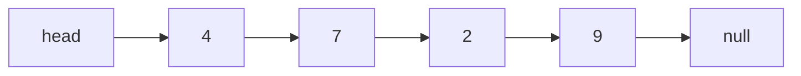
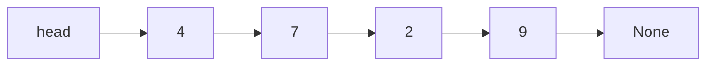

# Structuri de date și algoritmi

**Lecția 2: Structuri înlănțuite, stacks și queues**

<br><br><br><br><br><br>

## Ce îți amintești despre array-uri?

Începe cu `[4, 7, 2, 9]`.

1. Cum găsește calculatorul index-ul `2`?
2. Ce se întâmplă când eliminăm prima valoare?


<br><br><br><br><br><br>

---

<br><br><br><br><br><br>

## Eliminarea primei valori din array

**Păstrează valorile rămase în aceeași ordine.**

Presupune că `length > 0`. Păstrează valoarea eliminată, apoi deplasează valorile spre stânga.

**Python**

```python
values = [4, 7, 2, 9]
length = len(values)

value = values[0]
for i in range(1, length):
    values[i - 1] = values[i]
length -= 1

print("Removed:", value)
print(values[:length])
```

```text
Înainte      [4, 7, 2, 9]
Elimină 4    [_, 7, 2, 9]
Spre stânga  [7, 2, 9, _]

length nou = 3
```

- Accesul prin index calculează o singură adresă: **`O(1)`**.
- Eliminarea de la început deplasează `n - 1` valori: **`O(n)`**.

<br><br><br><br><br><br>

---

<br><br><br><br><br><br>

## Eliminarea primei valori din array: C

Începe cu `[4, 7, 2, 9]`. Elimină `4`, apoi afișează valorile rămase.

**C**

```c
#include <stdio.h>
#include <stdint.h>

int main(void) {
    int32_t values[] = {4, 7, 2, 9};
    size_t length = sizeof values / sizeof values[0];

    int32_t value = values[0];
    for (size_t i = 1; i < length; i++) {
        values[i - 1] = values[i];
    }
    length--;

    printf("Removed: %d\n", (int)value);
    for (size_t i = 0; i < length; i++) {
        printf("%d ", (int)values[i]);
    }
    printf("\n");

    return 0;
}
```

<br><br><br><br><br><br>

---

<br><br><br><br><br><br>

## Trebuie ca valorile să fie una lângă alta?

Imaginează-ți patru cartonașe cu valorile `4`, `7`, `2` și `9`.

- Fiecare cartonaș poate fi în alt loc.
- Tot trebuie să știm care cartonaș urmează.
- Trebuie să știm și unde începe și unde se termină secvența.

**Cum o putem stoca în memorie?**

<br><br><br><br><br><br>

---

<br><br><br><br><br><br>

## Un singly linked list

**Un linked list stochează o secvență în nodes. Fiecare node conține o valoare și o legătură către următorul node.**



**Python**

```python
class Node:
    def __init__(self, value):
        self.value = value
        self.next = None

node = Node(4)
print(node.value)
```

- `value` stochează numărul. `next` face legătura cu următorul node.
- `head` este o referință sau un pointer separat către primul node.
- Ultima legătură este `None` în Python sau `NULL` în C: nu există un node următor.
- **Singly** înseamnă o singură legătură înainte pentru fiecare node.

**Unde ar trebui să stocăm referințele către primul și ultimul node?**

Sursă: [Open Data Structures, Secțiunea 3.1: Singly Linked Lists](https://opendatastructures.org/ods-python/3_1_SLList_Singly_Linked_Li.html).
Pentru structura C, vezi [CS50: Linked Lists](https://cs50.harvard.edu/x/notes/5/#linked-lists).

<br><br><br><br><br><br>

---

<br><br><br><br><br><br>

## Un singly linked list: C

Definește un node, creează unul cu valoarea `4`, apoi afișează valoarea lui.

**C**

```c
#include <stdio.h>
#include <stdint.h>

struct Node {
    int32_t value;
    struct Node *next;
};

int main(void) {
    struct Node node = {4, NULL};
    printf("%d\n", (int)node.value);

    return 0;
}
```

<br><br><br><br><br><br>

---

<br><br><br><br><br><br>

## Un NodeList stochează head și tail

**Folosește un singur container pentru întreaga listă. Numim tipul nostru `NodeList`.**

**Python**

```python
class Node:
    def __init__(self, value):
        self.value = value
        self.next = None

class NodeList:
    def __init__(self):
        self.head = None
        self.tail = None

items = NodeList()
print(items.head is None, items.tail is None)
```

- Un `Node` stochează o valoare și o legătură către următorul node.
- Un `NodeList` stochează cele două legături de la capete. Nodes sunt obiecte separate.
- Listă goală: ambele câmpuri sunt `None` în Python sau `NULL` în C.
- În diagramele listei, `head` și `tail` reprezintă aceste câmpuri din `items`.

Sursă: [Open Data Structures, Secțiunea 3.1: Singly Linked Lists](https://opendatastructures.org/ods-python/3_1_SLList_Singly_Linked_Li.html).

<br><br><br><br><br><br>

---

<br><br><br><br><br><br>

## Un NodeList stochează head și tail: C

Creează o listă goală. Programul afișează `1 1`: ambele legături de la capete sunt `NULL`.

**C**

```c
#include <stdio.h>
#include <stdint.h>

struct Node {
    int32_t value;
    struct Node *next;
};

struct NodeList {
    struct Node *head;
    struct Node *tail;
};

int main(void) {
    struct NodeList items = {NULL, NULL};
    printf("%d %d\n", items.head == NULL, items.tail == NULL);

    return 0;
}
```

<br><br><br><br><br><br>

---

<br><br><br><br><br><br>

## Un node C în memorie

**Exemplu de organizare:** bytes de 8 biți, un pointer de 8 bytes și alinierea pointerului la 8 bytes.

```text
Offset bytes    0-3          4-7             8-15
             +-----------+-----------+----------------+
             | value: 4  | padding   | next: 0x3000   |
             +-----------+-----------+----------------+
Mărime          4 bytes     4 bytes       8 bytes

sizeof(struct Node) = 16 bytes în acest exemplu
```

- `next: 0x3000` înseamnă că următorul node începe la adresa de exemplu `0x3000`.
- Compilatorul adaugă **padding** pentru ca pointerul să înceapă la un offset potrivit.
- Fiecare node ocupă un bloc continuu. Nodes diferite pot fi departe unul de altul.
- Mărimea pointerului, padding-ul și mărimea totală depind de sistem și de compilator.

Sursă: [Manualul GNU C: Organizarea structurilor în memorie](https://www.gnu.org/software/c-intro-and-ref/manual/html_node/Structure-Layout.html).

<br><br><br><br><br><br>

---

<br><br><br><br><br><br>

## Poziții din array și nodes înlănțuite

**Aceleași valori, stocate în două exemple separate de organizare în memorie.**

```text
Array: int32_t values[4] = {4, 7, 2, 9};

Adresă        0x1000  0x1004  0x1008  0x100C
             +-------+-------+-------+-------+
Valoare      |   4   |   7   |   2   |   9   |
             +-------+-------+-------+-------+

Container NodeList la 0x0800:
             +----------------+----------------+
             | head: 0x1000   | tail: 0x5000   |
             +----------------+----------------+

Nodes separate, în ordinea adreselor; padding-ul nu este afișat:

Adresă node  0x1000             0x2000             0x3000             0x5000
             +------------+     +------------+     +------------+     +------------+
             |value: 4    | ... |value: 2    | ... |value: 7    | ... |value: 9    |
             |next: 0x3000|     |next: 0x5000|     |next: 0x2000|     |next: null  |
             +------------+     +------------+     +------------+     +------------+

... = alte date sau memorie nefolosită. Spațiile nu sunt desenate la scară.

items.head = 0x1000; items.tail = 0x5000
Ordine 0x1000 -> 0x3000 -> 0x2000 -> 0x5000 -> null
```

- **Array:** valori alăturate de 4 bytes. Patru valori folosesc **16 bytes**.
- **Listă:** nodes nu trebuie să fie alăturate. Legăturile dau ordinea.
- În exemplul nostru C, patru nodes de 16 bytes folosesc **64 bytes**. `NodeList`, cu doi pointeri, adaugă **16 bytes**.
- În total, **80 bytes** înainte de memoria suplimentară necesară pentru alocare. Mărimile obiectelor Python diferă.

**Care node urmează după cel de la adresa `0x3000`?**

<br><br><br><br><br><br>

---

<br><br><br><br><br><br>

## Creează un node

**Python**

```python
class Node:
    def __init__(self, value):
        self.value = value
        self.next = None

node = Node(5)
print(node.value)
```

- `node.value` este `5`. `node.next` este `None`.
- Python gestionează memoria pentru nodes în locul nostru.
- Următorul slide creează aceeași valoare în C.

<br><br><br><br><br><br>

---

<br><br><br><br><br><br>

## Creează un node: C

Creează un node local cu valoarea `5`, apoi afișează valoarea lui.

- Un node local folosește de obicei memoria **stack**. Nu este nevoie de `malloc` sau `free`.
- Este valid până când execuția părăsește blocul lui. Nu folosi adresa lui după aceea.

**C: o variabilă locală în `main`**

```c
#include <stdio.h>
#include <stdint.h>

struct Node {
    int32_t value;
    struct Node *next;
};

int main(void) {
    struct Node node = {5, NULL};
    printf("%d\n", (int)node.value);

    return 0;
}
```

Sursă: [CS50: Memorie](https://cs50.harvard.edu/x/2026/notes/4/#memory).

<br><br><br><br><br><br>

---

<br><br><br><br><br><br>

## Creează un node în memoria heap

Exemplele C de mai târziu folosesc această funcție auxiliară pentru a crea nodes care pot exista și după încheierea unui apel de funcție.

```c
#include <stdio.h>
#include <stdint.h>
#include <stdlib.h>

struct Node {
    int32_t value;
    struct Node *next;
};

struct Node *new_node(int32_t value) {
    struct Node *node = malloc(sizeof *node);
    if (node == NULL) {
        exit(EXIT_FAILURE);
    }
    node->value = value;
    node->next = NULL;
    return node;
}

int main(void) {
    struct Node *node = new_node(5);
    printf("%d\n", (int)node->value);
    free(node);

    return 0;
}
```

- În C, apelează `new_node(5)` pentru a crea același node.
- `malloc` rezervă memorie. Codul C trebuie să o elibereze mai târziu cu `free`.
- Această funcție auxiliară C se oprește cu `exit(EXIT_FAILURE)` dacă alocarea eșuează.

<br><br><br><br><br><br>

---

<br><br><br><br><br><br>

## Construiește aceeași listă

Creează un `NodeList`, apoi conectează nodes. Fiecare program include toate definițiile și afișează lista.

**Python**

```python
class Node:
    def __init__(self, value):
        self.value = value
        self.next = None

class NodeList:
    def __init__(self):
        self.head = None
        self.tail = None

items = NodeList()
items.head = Node(4)
items.head.next = Node(7)
items.head.next.next = Node(2)
items.head.next.next.next = Node(9)
items.tail = items.head.next.next.next

current = items.head
while current is not None:
    print(current.value, end=" ")
    current = current.next
print()
```

- `items.head` se referă la node-ul cu `4`. `items.tail` se referă la node-ul cu `9`.
- În C, `items.head` citește un câmp din container. `items.head->next` urmează un pointer către un node.
- Atribuirea unei referințe sau a unui pointer către un node nu copiază acel node.

Aceste legături dau aceeași ordine ca `[4, 7, 2, 9]`.

<br><br><br><br><br><br>

---

<br><br><br><br><br><br>

## Construiește aceeași listă: C

Creează și conectează nodes. Output: `4 7 2 9`.

**C**

```c
#include <stdio.h>
#include <stdint.h>
#include <stdlib.h>

struct Node {
    int32_t value;
    struct Node *next;
};

struct NodeList {
    struct Node *head;
    struct Node *tail;
};

struct Node *new_node(int32_t value) {
    struct Node *node = malloc(sizeof *node);
    if (node == NULL) {
        exit(EXIT_FAILURE);
    }
    node->value = value;
    node->next = NULL;
    return node;
}

int main(void) {
    struct NodeList items = {NULL, NULL};
    items.head = new_node(4);
    items.head->next = new_node(7);
    items.head->next->next = new_node(2);
    items.head->next->next->next = new_node(9);
    items.tail = items.head->next->next->next;

    for (struct Node *current = items.head; current != NULL;
         current = current->next) {
        printf("%d ", (int)current->value);
    }
    printf("\n");

    while (items.head != NULL) {
        struct Node *next = items.head->next;
        free(items.head);
        items.head = next;
    }
    items.tail = NULL;

    return 0;
}
```

<br><br><br><br><br><br>

---

<br><br><br><br><br><br>

## Cum putem citi toate valorile?



Vrem suma: `4 + 7 + 2 + 9`.

- De unde ar trebui să începem?
- Cum trecem la următoarea valoare?
- Cum știm când să ne oprim?


<br><br><br><br><br><br>

---

<br><br><br><br><br><br>

## Traversal: urmează fiecare legătură next

**Traversal înseamnă să vizităm nodes în ordine.**

**Python**

```python
class Node:
    def __init__(self, value):
        self.value = value
        self.next = None

class NodeList:
    def __init__(self):
        self.head = None
        self.tail = None

items = NodeList()
items.head = Node(4)
items.head.next = Node(7)
items.head.next.next = Node(2)
items.head.next.next.next = Node(9)
items.tail = items.head.next.next.next

current = items.head
total = 0
while current is not None:
    total += current.value
    current = current.next

print(total)
```

Output: `22`.

```text
Valoare citită   4    7    2    9
Total curent     4   11   13   22
```

`current` trece prin nodes. `items.head` și `items.tail` rămân neschimbate.

Sursă: [CS50, Săptămâna 5: Linked Lists](https://cs50.harvard.edu/x/notes/5/#linked-lists).

<br><br><br><br><br><br>

---

<br><br><br><br><br><br>

## Traversal: urmează fiecare legătură next: C

Urmează fiecare legătură și adună valorile. Output: `22`.

C folosește `->` pentru a accesa un câmp printr-un pointer. `NULL` marchează sfârșitul.

**C**

```c
#include <stdio.h>
#include <stdint.h>
#include <stdlib.h>

struct Node {
    int32_t value;
    struct Node *next;
};

struct NodeList {
    struct Node *head;
    struct Node *tail;
};

struct Node *new_node(int32_t value) {
    struct Node *node = malloc(sizeof *node);
    if (node == NULL) {
        exit(EXIT_FAILURE);
    }
    node->value = value;
    node->next = NULL;
    return node;
}

int main(void) {
    struct NodeList items = {NULL, NULL};
    items.head = new_node(4);
    items.head->next = new_node(7);
    items.head->next->next = new_node(2);
    items.head->next->next->next = new_node(9);
    items.tail = items.head->next->next->next;

    struct Node *current = items.head;
    int total = 0;
    while (current != NULL) {
        total += current->value;
        current = current->next;
    }

    printf("%d\n", total);

    while (items.head != NULL) {
        struct Node *next = items.head->next;
        free(items.head);
        items.head = next;
    }
    items.tail = NULL;

    return 0;
}
```

<br><br><br><br><br><br>

---


<br><br><br><br><br><br>

## Putem ajunge direct la index-ul 2?

```text
Poziție        0        1        2        3
head -------> [4] ----> [7] ----> [2] ----> [9] -> None
               început  1 link   2 links
```

- Un array calculează adresa unei poziții pe baza index-ului.
- Acest linked list trebuie să urmeze legăturile de la `head`.
- Pentru a ajunge la index-ul `i`, facem `i` pași prin legături: **timp `O(i + 1)`**.
- Accesul după poziție și căutarea după valoare au cost **`O(n)` în worst case**.

**Dacă îl căutăm pe `5`, cum știm că lipsește?**

<br><br><br><br><br><br>

---

<br><br><br><br><br><br>

## Putem adăuga o valoare fără deplasări?

Adaugă `5` la început.

```text
Înainte   head -> [4] -> [7] -> [2] -> [9] -> None

Node nou         [5 | None]
```

- Ce legătură trebuie să stocheze noul node?
- Ce variabilă trebuie să se schimbe după aceea?
- Trebuie să se mute cele patru nodes vechi?

**Desenează rezultatul și numește cele două modificări ale referințelor.**

<br><br><br><br><br><br>

---

<br><br><br><br><br><br>

## Inserare la head

**Python**

```python
class Node:
    def __init__(self, value):
        self.value = value
        self.next = None

class NodeList:
    def __init__(self):
        self.head = None
        self.tail = None

items = NodeList()
items.head = Node(4)
items.head.next = Node(7)
items.head.next.next = Node(2)
items.head.next.next.next = Node(9)
items.tail = items.head.next.next.next

node = Node(5)
node.next = items.head
items.head = node
if items.tail is None:
    items.tail = node

current = items.head
while current is not None:
    print(current.value, end=" ")
    current = current.next
print()
```

```text
După      head -> [5] -> [4] -> [7] -> [2] -> [9] -> None
```

- Mai întâi, conectează noul node la vechiul head.
- Apoi fă noul node să fie head.
- Vechile nodes rămân pe loc: **cost `O(1)` pentru modificarea legăturilor**.
- Dacă lista era goală, noul node devine atât head, cât și tail.
- În caz contrar, tail rămâne neschimbat.

<br><br><br><br><br><br>

---

<br><br><br><br><br><br>

## Inserare la head: C

Inserează `5` la head. Output: `5 4 7 2 9`.

**C**

```c
#include <stdio.h>
#include <stdint.h>
#include <stdlib.h>

struct Node {
    int32_t value;
    struct Node *next;
};

struct NodeList {
    struct Node *head;
    struct Node *tail;
};

struct Node *new_node(int32_t value) {
    struct Node *node = malloc(sizeof *node);
    if (node == NULL) {
        exit(EXIT_FAILURE);
    }
    node->value = value;
    node->next = NULL;
    return node;
}

int main(void) {
    struct NodeList items = {NULL, NULL};
    items.head = new_node(4);
    items.head->next = new_node(7);
    items.head->next->next = new_node(2);
    items.head->next->next->next = new_node(9);
    items.tail = items.head->next->next->next;

    struct Node *node = new_node(5);
    node->next = items.head;
    items.head = node;
    if (items.tail == NULL) {
        items.tail = node;
    }

    for (struct Node *current = items.head; current != NULL;
         current = current->next) {
        printf("%d ", (int)current->value);
    }
    printf("\n");

    while (items.head != NULL) {
        struct Node *next = items.head->next;
        free(items.head);
        items.head = next;
    }
    items.tail = NULL;

    return 0;
}
```

<br><br><br><br><br><br>

---

<br><br><br><br><br><br>

## Inserare după un node cunoscut

Începe din nou cu `4 -> 7 -> 2 -> 9` în `items`. `previous` se referă la node-ul cu `7`.

**Python**

```python
class Node:
    def __init__(self, value):
        self.value = value
        self.next = None

class NodeList:
    def __init__(self):
        self.head = None
        self.tail = None

items = NodeList()
items.head = Node(4)
items.head.next = Node(7)
items.head.next.next = Node(2)
items.head.next.next.next = Node(9)
items.tail = items.head.next.next.next

previous = items.head.next
node = Node(5)
node.next = previous.next
previous.next = node
if items.tail is previous:
    items.tail = node

current = items.head
while current is not None:
    print(current.value, end=" ")
    current = current.next
print()
```

```text
Înainte   4 -> 7 ------> 2 -> 9 -> None
După      4 -> 7 -> 5 -> 2 -> 9 -> None
```

- **Node anterior cunoscut:** cost `O(1)` pentru modificarea legăturilor.
- **Găsește mai întâi poziția:** `O(n)` în worst case.
- Salvează vechea legătură next înainte să o înlocuiești.
- Dacă `previous` era tail, noul node devine tail.

<br><br><br><br><br><br>

---

<br><br><br><br><br><br>

## Inserare după un node cunoscut: C

`previous` indică node-ul cu `7`. Output: `4 7 5 2 9`.

**C**

```c
#include <stdio.h>
#include <stdint.h>
#include <stdlib.h>

struct Node {
    int32_t value;
    struct Node *next;
};

struct NodeList {
    struct Node *head;
    struct Node *tail;
};

struct Node *new_node(int32_t value) {
    struct Node *node = malloc(sizeof *node);
    if (node == NULL) {
        exit(EXIT_FAILURE);
    }
    node->value = value;
    node->next = NULL;
    return node;
}

int main(void) {
    struct NodeList items = {NULL, NULL};
    items.head = new_node(4);
    items.head->next = new_node(7);
    items.head->next->next = new_node(2);
    items.head->next->next->next = new_node(9);
    items.tail = items.head->next->next->next;

    struct Node *previous = items.head->next;
    struct Node *node = new_node(5);
    node->next = previous->next;
    previous->next = node;
    if (items.tail == previous) {
        items.tail = node;
    }

    for (struct Node *current = items.head; current != NULL;
         current = current->next) {
        printf("%d ", (int)current->value);
    }
    printf("\n");

    while (items.head != NULL) {
        struct Node *next = items.head->next;
        free(items.head);
        items.head = next;
    }
    items.tail = NULL;

    return 0;
}
```


<br><br><br><br><br><br>

---

<br><br><br><br><br><br>

## Creștere cu o referință tail

**`tail` se referă la ultimul node. Ne permite să facem append fără să parcurgem lista.**

```text
Înainte   head -> [4] -> [7] -> [2] -> None
                              tail

Adaugă 9  head -> [4] -> [7] -> [2] -> [9] -> None
                                     tail
```

- Creează un node. Conectează vechiul tail la el. Actualizează `tail`.
- Nodes existente rămân pe loc. Nu trebuie copiat niciun backing array.
- Noul node are totuși nevoie de memorie.
- Fără `tail`, găsirea ultimului node poate dura `O(n)`.

În modelul nostru de cost, presupunem că alocarea unui node de mărime fixă durează `O(1)`.
Timpul real de alocare poate varia.

<br><br><br><br><br><br>

---

<br><br><br><br><br><br>

## Append cu o referință tail

Începe cu `4 -> 7 -> 2` în `items`. Adaugă `9`. Pentru o listă goală, ambele legături de la capete încep ca `None` sau `NULL`.

**Python**

```python
class Node:
    def __init__(self, value):
        self.value = value
        self.next = None

class NodeList:
    def __init__(self):
        self.head = None
        self.tail = None

items = NodeList()
items.head = Node(4)
items.head.next = Node(7)
items.head.next.next = Node(2)
items.tail = items.head.next.next

node = Node(9)
if items.head is None:
    items.head = node
else:
    items.tail.next = node
items.tail = node

current = items.head
while current is not None:
    print(current.value, end=" ")
    current = current.next
print()
```

Legătura next a noului tail este goală. Niciun node existent nu se mută.

<br><br><br><br><br><br>

---

<br><br><br><br><br><br>

## Append cu o referință tail: C

Fă append cu `9` la `4 -> 7 -> 2`. Output: `4 7 2 9`.

**C**

```c
#include <stdio.h>
#include <stdint.h>
#include <stdlib.h>

struct Node {
    int32_t value;
    struct Node *next;
};

struct NodeList {
    struct Node *head;
    struct Node *tail;
};

struct Node *new_node(int32_t value) {
    struct Node *node = malloc(sizeof *node);
    if (node == NULL) {
        exit(EXIT_FAILURE);
    }
    node->value = value;
    node->next = NULL;
    return node;
}

int main(void) {
    struct NodeList items = {NULL, NULL};
    items.head = new_node(4);
    items.head->next = new_node(7);
    items.head->next->next = new_node(2);
    items.tail = items.head->next->next;

    struct Node *node = new_node(9);
    if (items.head == NULL) {
        items.head = node;
    } else {
        items.tail->next = node;
    }
    items.tail = node;

    for (struct Node *current = items.head; current != NULL;
         current = current->next) {
        printf("%d ", (int)current->value);
    }
    printf("\n");

    while (items.head != NULL) {
        struct Node *next = items.head->next;
        free(items.head);
        items.head = next;
    }
    items.tail = NULL;

    return 0;
}
```

<br><br><br><br><br><br>

---

<br><br><br><br><br><br>

## Tail face eliminarea de la sfârșit ușoară?

```text
head -> [4] -> [7] -> [2] -> [9] -> None
                            tail
```

Vrem să eliminăm `9`.

- Care node trebuie să devină noul tail?
- Care node trebuie să își schimbe legătura `next`?
- Putem urma o legătură înapoi de la `9`?

**Dacă știm ultimul node, îl știm și pe cel anterior?**

<br><br><br><br><br><br>

---

<br><br><br><br><br><br>

## Tot avem nevoie de node-ul anterior

```text
Înainte   head -> [4] -> [7] -> [2] -> [9] -> None
                                      tail

După      head -> [4] -> [7] -> [2] -> None
                               tail
```

- Începe de la `head`. Găsește node-ul aflat imediat înaintea vechiului tail.
- Setează câmpul lui `next` la `None` și fă-l noul tail.
- Cu doar head, tail și legături înainte, costul este **`O(n)` în worst case**.

Pentru un singur node, eliminarea lasă o listă goală. Ambele referințe trebuie să devină `None`.

Sursă: [Open Data Structures, Secțiunea 3.1.2: Rezumat](https://opendatastructures.org/ods-python/3_1_SLList_Singly_Linked_Li.html).

<br><br><br><br><br><br>

---

<br><br><br><br><br><br>

## Elimină tail: Python

Respinge o listă goală. Pentru un singur node, golește ambele referințe.

```python
class Node:
    def __init__(self, value):
        self.value = value
        self.next = None

class NodeList:
    def __init__(self):
        self.head = None
        self.tail = None

items = NodeList()
items.head = Node(4)
items.head.next = Node(7)
items.head.next.next = Node(2)
items.head.next.next.next = Node(9)
items.tail = items.head.next.next.next

if items.head is None:
    raise IndexError("remove from empty list")
if items.head is items.tail:
    items.head = None
    items.tail = None
else:
    previous = items.head
    while previous.next is not items.tail:
        previous = previous.next
    previous.next = None
    items.tail = previous

current = items.head
while current is not None:
    print(current.value, end=" ")
    current = current.next
print()
```

Pentru mai multe nodes, bucla găsește node-ul aflat imediat înaintea vechiului tail.

<br><br><br><br><br><br>

---

<br><br><br><br><br><br>

## Elimină tail: C

Folosește nodes create cu `new_node`. Păstrează vechiul tail pentru a-l putea elibera.

```c
#include <stdio.h>
#include <stdint.h>
#include <stdlib.h>

struct Node {
    int32_t value;
    struct Node *next;
};

struct NodeList {
    struct Node *head;
    struct Node *tail;
};

struct Node *new_node(int32_t value) {
    struct Node *node = malloc(sizeof *node);
    if (node == NULL) {
        exit(EXIT_FAILURE);
    }
    node->value = value;
    node->next = NULL;
    return node;
}

int main(void) {
    struct NodeList items = {NULL, NULL};
    items.head = new_node(4);
    items.head->next = new_node(7);
    items.head->next->next = new_node(2);
    items.head->next->next->next = new_node(9);
    items.tail = items.head->next->next->next;

    if (items.head == NULL) {
        exit(EXIT_FAILURE);
    }
    struct Node *old_tail = items.tail;
    if (items.head == items.tail) {
        items.head = NULL;
        items.tail = NULL;
    } else {
        struct Node *previous = items.head;
        while (previous->next != items.tail) {
            previous = previous->next;
        }
        previous->next = NULL;
        items.tail = previous;
    }
    free(old_tail);

    for (struct Node *current = items.head; current != NULL;
         current = current->next) {
        printf("%d ", (int)current->value);
    }
    printf("\n");

    while (items.head != NULL) {
        struct Node *next = items.head->next;
        free(items.head);
        items.head = next;
    }
    items.tail = NULL;

    return 0;
}
```

Schimbă legăturile înainte de a apela `free`. Nu citi niciodată node-ul eliberat.

<br><br><br><br><br><br>

---

<br><br><br><br><br><br>

## Array-uri și linked lists: costurile operațiilor

Fie `n` lungimea curentă. Păstrează ordinea secvenței.

| Operație | Array dinamic | Linked list |
| --- | --- | --- |
| Acces după poziție | `O(1)` | `O(n)` în worst case |
| Căutarea unei valori care lipsește | `O(n)` | `O(n)` |
| Inserare sau eliminare la început | `O(n)` | `O(1)` |
| Append la sfârșit | `O(1)` amortized | `O(1)` cu tail |
| Eliminare de la sfârșit | `O(1)` fără micșorarea capacității | `O(1)` pentru un doubly linked list cu tail |

- Array-ul își dublează capacitatea când crește. O singură operație append poate totuși dura `O(n)`.
- Costurile listei presupun alocarea unui node în timp constant și valori de mărime fixă.
- Un doubly linked list are atât legături `next`, cât și legături `previous`.
- Codul nostru folosește un singly linked list. Acolo, eliminarea de la sfârșit are cost `O(n)` în worst case.

**De ce operații are nevoie programul tău cel mai des?**

<br><br><br><br><br><br>

---

<br><br><br><br><br><br>

## Ce cost au legăturile?

**Fiecare node are nevoie de memorie pentru o valoare și o referință next.**

| Array dinamic | Linked list |
| --- | --- |
| Un singur bloc de stocare, cu posibile poziții nefolosite. | Un node pentru fiecare element, cu o legătură next. |
| Creșterea poate copia valorile existente. | Creșterea poate aloca un singur node. |
| Pozițiile sunt una lângă alta. | Nodes pot fi departe unul de altul. |

- O listă evită nevoia unui singur bloc mare și continuu.
- Nodes pot necesita și memorie suplimentară pentru alocare.
- Memoria totală pentru nodes crește ca **`O(n)`**.

**Același cost de timp Big O înseamnă aceeași viteză în secunde?**

<br><br><br><br><br><br>

---

<br><br><br><br><br><br>

## Stocarea în locații apropiate poate accelera parcurgerea

**O memorie cache a CPU-ului păstrează blocuri mici de memorie pentru acces rapid.**

```text
Poziții array:   [4][7][2][9]     citiri apropiate

Nodes legate:    [4] ... [2] ... [7] ... [9]
                 urmează fiecare legătură next pentru următoarea citire
```

- Citirea unei poziții din array poate aduce și pozițiile apropiate în cache.
- Nodes împrăștiate pot necesita mai multe încărcări separate din memorie.
- Ambele parcurgeri complete au cost `O(n)`. Array-urile sunt adesea parcurse mai repede în practică.

În CPython, un `list` stochează **referințe către obiecte** în locații alăturate. Obiectele pot fi în altă parte.

Surse:

- **Cache locality:** [OSTEP, versiunea 1.10, Secțiunea 10.1, pp. 2-3](https://pages.cs.wisc.edu/~remzi/OSTEP/cpu-sched-multi.pdf#page=2). Citește explicația despre memoria cache a CPU-ului și spatial locality, care folosește parcurgerea unui array ca exemplu.
- **Stocarea în Python:** [Cum sunt implementate listele în CPython](https://docs.python.org/3/faq/design.html#how-are-lists-implemented-in-cpython). Această sursă susține detaliul despre referințele către obiecte de mai sus.

<br><br><br><br><br><br>

---

<br><br><br><br><br><br>

## Utilizări frecvente pentru linked lists

| Utilizare | Modificări necesare | Ce element poate fi eliminat? |
| --- | --- | --- |
| **Task-uri în așteptare** | Adaugă la sfârșit. Elimină de la început. | Task-ul care așteaptă de cel mai mult timp. |
| **Stack de memorie (call stack)** | Salvează starea unui apel de funcție la top. Elimin-o la revenire. | Cel mai recent apel care nu a revenit încă. |

O structură queue pentru task-uri folosește capete opuse. Stack-ul de memorie adaugă și elimină la același capăt.

**Ce operații trebuie să fie rapide în fiecare caz? Are fiecare caz nevoie de acces prin index?**

Surse: [OpenJDK 25: queue înlănțuită pentru task-uri](https://github.com/openjdk/jdk/blob/jdk-25-ga/src/java.base/share/classes/java/util/concurrent/LinkedBlockingQueue.java#L196-L222), [Runestone: Stack Frames](https://runestone.academy/ns/books/published/pythonds3/Recursion/StackFramesImplementingRecursion.html).

<br><br><br><br><br><br>

---

<br><br><br><br><br><br>

## Un stack: ultimul intrat, primul ieșit

**Un stack adaugă și elimină valori la un singur capăt, numit top.**

Valoarea adăugată cel mai recent este extrasă prima: **LIFO**.

Undo elimină mai întâi C, apoi B.

| Operație | Semnificație |
| --- | --- |
| `push(value)` | Adaugă o valoare la top. |
| `pop()` | Elimină și returnează valoarea de la top. |
| `peek()` | Returnează valoarea de la top fără să o elimine. |
| `is_empty()` | Returnează dacă nu există valori. |


Sursă: [Open Data Structures, Secțiunea 1.2.1: Interfețe queue și stack](https://opendatastructures.org/ods-python/1_2_Interfaces.html).

<br><br><br><br><br><br>

---

<br><br><br><br><br><br>

## Pașii operațiilor pe stack

Top este în dreapta.

```text
Operație        Returnează     Stack, de la bază la top
push(4)         -              [4]
push(7)         -              [4, 7]
peek()          7              [4, 7]
pop()           7              [4]
push(2)         -              [4, 2]
pop()           2              [4]
pop()           4              []
```

`peek` citește top. `pop` îl și elimină.

<br><br><br><br><br><br>

---

<br><br><br><br><br><br>

## Cum știe o funcție unde să revină?

**Pseudocod**

```text
FUNCTION main()
    CALL show_total()
    RETURN

FUNCTION show_total()
    total = CALL add(4, 7)
    PRINT total
    RETURN

FUNCTION add(a, b)
    RETURN a + b
```

- Fiecare apel adaugă un **stack frame** cu date locale și un loc unde să revină.
- O revenire normală elimină frame-ul de la top și continuă execuția funcției apelante.
- Mediul de execuție al programului gestionează aceste frames în locul nostru.

**Care funcție revine prima? Ce afișează programul?**


<br><br><br><br><br><br>

---

<br><br><br><br><br><br>

## Call stack: apelurile adaugă, revenirile elimină

Sunt afișate doar cele trei apeluri de funcție ale noastre. Top este în dreapta.

```text
Eveniment                     Call stack, de la bază la top
main începe                   [main]
main apelează show_total      [main, show_total]
show_total apelează add       [main, show_total, add]
add returnează 11             [main, show_total]
show_total afișează 11        [main, show_total]
show_total revine             [main]
main revine                   []
```

- `add` revine prima: **ultimul intrat, primul ieșit**.
- `show_total` primește `11` în `total`, apoi îl afișează.
- Fiecare funcție apelantă continuă după apelul care tocmai a revenit.

<br><br><br><br><br><br>

---

<br><br><br><br><br><br>

## O structură queue: primul intrat, primul ieșit

**O structură FIFO queue adaugă valori la sfârșit și elimină valori de la început.**

Valoarea care așteaptă de cel mai mult timp este extrasă prima: **FIFO**.


| Operație | Semnificație |
| --- | --- |
| `enqueue(value)` | Adaugă o valoare la sfârșit. |
| `dequeue()` | Elimină și returnează valoarea de la început. |
| `front()` | Returnează valoarea de la început fără să o elimine. |
| `is_empty()` | Returnează dacă nu există valori. |

În interfața noastră, `dequeue` și `front` pe o structură queue goală produc o eroare.

Sursă: [Open Data Structures, Secțiunea 1.2.1: Interfețe queue și stack](https://opendatastructures.org/ods-python/1_2_Interfaces.html).

<br><br><br><br><br><br>

---

<br><br><br><br><br><br>

## Pașii operațiilor pe queue

Începe cu o structură goală. Front este în stânga. Back este în dreapta.

```text
Operație        Returnează     Queue, de la front la back
enqueue(4)      -              [4]
enqueue(7)      -              [4, 7]
front()         4              [4, 7]
dequeue()       4              [7]
enqueue(2)      -              [7, 2]
dequeue()       7              [2]
dequeue()       2              []
```

`front` citește valoarea de la început. `dequeue` o și elimină.

**Ce se întâmplă dacă apelăm `dequeue()` încă o dată?**

<br><br><br><br><br><br>

---

<br><br><br><br><br><br>

## Care proces în așteptare primește CPU-ul în continuare?

O **ready queue** conține procese pregătite să ruleze, care așteaptă timp de CPU.

**Model:** un CPU, planificare FIFO, fără așteptări pentru input/output. Fiecare proces rulează până se termină.

**Pseudocod** -- A, B și C devin pregătite în această ordine, înainte să înceapă planificarea.

```text
ready = EMPTY QUEUE
ENQUEUE(ready, A)
ENQUEUE(ready, B)
ENQUEUE(ready, C)

WHILE NOT IS_EMPTY(ready)
    process = DEQUEUE(ready)
    RUN process până se termină
```

**Care proces rulează primul? Care rulează ultimul?**

Sursă: [OSTEP, versiunea 1.10, Secțiunea 7.3: First In, First Out](https://pages.cs.wisc.edu/~remzi/OSTEP/cpu-sched.pdf#page=2).

<br><br><br><br><br><br>

---

<br><br><br><br><br><br>

## Queue de procese: urmează ordinea de așteptare

Front este în stânga. Un proces care rulează se află în afara structurii ready queue.

```text
Eveniment              Ready queue, front - back      CPU
A, B, C sunt pregătite [A, B, C]                      liber
dequeue returnează A   [B, C]                         A
A se termină           [B, C]                         liber
dequeue returnează B   [C]                            B
B se termină           [C]                            liber
dequeue returnează C   []                             C
C se termină           []                             liber
```

- Ordinea de rulare: **A, B, C** -- primul intrat, primul ieșit.
- O structură ready queue goală înseamnă că niciun proces nu așteaptă timp de CPU.
- CPU-ul poate încă să ruleze C când structura queue este goală.

<br><br><br><br><br><br>

---

<br><br><br><br><br><br>

## O utilizare reală: task-uri în așteptare

Un server are un număr fix de worker threads. Task-urile noi așteaptă când toți workers sunt ocupați.

```text
Workers preiau aici                 Task-urile noi intră aici
head -> [Task A] -> [Task B] -> [Task C] <- tail
```

- `Executors.newFixedThreadPool` din OpenJDK 25 folosește un `LinkedBlockingQueue`.
- Conectează task-urile noi la sfârșit și preia task-urile în așteptare de la început.
- Implementarea completă folosește și locks și un node head auxiliar.
- Workers pot termina într-o ordine diferită de ordinea extragerii din queue.

Diagrama noastră arată doar task-urile în așteptare. Costul `O(1)` pentru modificarea legăturilor nu include așteptarea unui lock.

Surse: OpenJDK 25, [`Executors`](https://github.com/openjdk/jdk/blob/jdk-25-ga/src/java.base/share/classes/java/util/concurrent/Executors.java#L88-L92), [`LinkedBlockingQueue`](https://github.com/openjdk/jdk/blob/jdk-25-ga/src/java.base/share/classes/java/util/concurrent/LinkedBlockingQueue.java#L196-L222).

<br><br><br><br><br><br>

---

<br><br><br><br><br><br>

## Se închid corect aceste paranteze?

LeetCode: [20. Paranteze valide](https://leetcode.com/problems/valid-parentheses/).

```text
([])
([)]
((
]
```

- Un număr egal de paranteze de deschidere și de închidere garantează un rezultat valid?
- Când citim o paranteză de închidere, cu ce paranteză de deschidere trebuie să se potrivească?
- Ce structură poate reține acea paranteză de deschidere pentru noi?

**Prezice fiecare rezultat înainte de următoarele slide-uri.**

<br><br><br><br><br><br>

---

<br><br><br><br><br><br>

## Paranteze echilibrate

**Parantezele sunt echilibrate când fiecare paranteză de deschidere are paranteza de închidere corectă, în ordinea corectă de imbricare.**

Pentru această problemă, input-ul conține doar `(`, `)`, `[`, `]`, `{` și `}`.

- `([])` este valid: închide `[` înainte de a închide `(`.
- `([)]` este invalid: `)` nu poate închide paranteza `[` încă neînchisă.
- O paranteză de închidere trebuie să se potrivească cu **cea mai recentă paranteză de deschidere încă neînchisă**.

Aceasta este regula LIFO a stack-ului.

Sursă: [Runestone, Secțiunea 3.7: Simboluri echilibrate](https://runestone.academy/ns/books/published/pythonds3/BasicDS/BalancedSymbolsAGeneralCase.html).

<br><br><br><br><br><br>

---

<br><br><br><br><br><br>

## Verificarea parantezelor cu un stack

Începe cu un stack gol. Citește input-ul de la stânga la dreapta.

```text
Paranteză de deschidere:
    fă push cu ea
Paranteză de închidere:
    dacă stack-ul este gol, returnează False
    dacă top nu se potrivește, returnează False
    fă pop pentru paranteza de deschidere corespunzătoare
Sfârșitul input-ului:
    returnează dacă stack-ul este gol
```

**De ce nu este suficient să ajungem la sfârșit pentru a returna `True`?**

<br><br><br><br><br><br>

---

<br><br><br><br><br><br>

## Rezumatul lecției

- **Nodes înlănțuite** stochează ordinea prin referințe next. Nodes pot fi la adrese separate.
- **Compromisuri:** modificarea legăturilor cunoscute poate fi ieftină. Accesul după poziție cere o parcurgere. Legăturile folosesc memorie.
- **Stacks** returnează elementul stocat cel mai recent: LIFO. Stack-ul nostru folosește sfârșitul unui array dinamic.
- **Queues** returnează elementul care așteaptă de cel mai mult timp: FIFO. Structura noastră queue înlănțuită adaugă la tail și elimină de la head.
- **Corectitudinea** depinde de ordinea stocată și de regulile pentru starea goală.
- **Opțional: verificarea parantezelor** folosește un stack pentru a reține parantezele de deschidere încă neînchise.

Lecția următoare: un stack ne va ajuta să înțelegem cum revin apelurile recursive.
Mai târziu, DFS va folosi un stack, iar BFS va folosi o structură queue.

<br><br><br><br><br><br>

---

<br><br><br><br><br><br>

## Lectură suplimentară: CS50

**Alege această sursă pentru explicații vizuale și diagrame de memorie în C.**

[CS50x, Săptămâna 5: Structuri de date](https://cs50.harvard.edu/x/weeks/5/).

- [Queues](https://cs50.harvard.edu/x/notes/5/#queues): asociază FIFO cu un șir de elemente în așteptare.
- [Stacks](https://cs50.harvard.edu/x/notes/5/#stacks): asociază LIFO cu adăugarea și eliminarea la top.
- [Linked lists](https://cs50.harvard.edu/x/notes/5/#linked-lists): desenează fiecare node și pointerul lui next înainte să citești codul C.

**Scopul lecturii:** adaugă un node la început fără să pierzi restul listei.

Concentrează-te pe aceste secțiuni. Trees și hash tables apar mai târziu în cursul nostru.

<br><br><br><br><br><br>

---

<br><br><br><br><br><br>

## Lectură suplimentară: Open Data Structures

**Alege această sursă pentru a lega diagramele de interfețe și de costurile operațiilor.**

Citește ediția Python scrisă de **Pat Morin**:

- [Secțiunea 1.2.1](https://opendatastructures.org/ods-python/1_2_Interfaces.html): compară regulile pentru stack și FIFO queue.
- [Secțiunea 2.1: ArrayStack](https://opendatastructures.org/ods-python/2_1_ArrayStack_Fast_Stack_O.html): folosește operațiile de la sfârșit pentru un stack.
- [Secțiunea 3.1: Singly Linked Lists](https://opendatastructures.org/ods-python/3_1_SLList_Singly_Linked_Li.html): urmărește head și tail prin operațiile pe queue.

ArrayStack din carte își poate micșora capacitatea. Array-ul nostru din Laboratorul 1 păstrează capacitatea la pop.
Și numele operațiilor pe queue din carte pot diferi de ale noastre.

**Scopul lecturii:** explică de ce tail ajută la append, dar nu face eliminarea tail să fie `O(1)` într-un singly linked list.

<br><br><br><br><br><br>

---

<br><br><br><br><br><br>

## Lectură suplimentară: CLRS

**Alege această sursă pentru pași exacți ai operațiilor și cazuri de limită.**

[Introduction to Algorithms, ediția a 4-a](https://mitpress.mit.edu/9780262046305/introduction-to-algorithms/)
de **Thomas H. Cormen, Charles E. Leiserson, Ronald L. Rivest și Clifford Stein**.

- **Secțiunea 10.1: Structuri simple de date bazate pe array-uri.** Concentrează-te pe stacks și queues. Structura queue bazată pe array din carte este o altă reprezentare a regulii FIFO.
- **Secțiunea 10.2: Linked lists.** Compară diagramele de legături din carte cu nodes din singly linked list-ul nostru. Unele exemple folosesc legături în ambele direcții.

**Scopul lecturii:** precizează reprezentarea înainte să afirmi că o operație este `O(1)`.

Numerele acestor secțiuni se referă la **ediția a 4-a**. Nu avem nevoie de întregul API al listei pentru Laboratorul 2.

<br><br><br><br><br><br>

---

<br><br><br><br><br><br>

## Lectură suplimentară: Knuth și exerciții

**Alege Knuth pentru un studiu mai detaliat al stocării și al regulilor operațiilor.**

Donald E. Knuth, [The Art of Computer Programming, Volume 1: Fundamental Algorithms, ediția a 3-a](https://www.informit.com/store/art-of-computer-programming-volume-1-fundamental-algorithms-9780201896831).

În **Capitolul 2: Structuri de informații**, începe cu **Liste liniare**:

- **Stacks, Queues și Deques:** compară operațiile permise.
- **Alocare secvențială** și **Alocare înlănțuită:** compară stocarea în array-uri cu legăturile.

Pentru un exemplu interactiv scurt, folosește [VisuAlgo: Linked List, Stack, Queue](https://visualgo.net/en/list). Alege o structură și urmărește câte o operație pe rând.

**Sarcină de studiu:** desenează o structură queue goală, adaugă A și B, elimină-le pe ambele, apoi adaugă C. Marchează fiecare modificare a head și tail.
