# Structuri de date și algoritmi

**Lecția 5: HashMap și HashSet**


<br><br><br><br><br><br>

---

<br><br><br><br><br><br>

## Numărarea numelor care se repetă

**O listă înregistrează persoanele care au intrat într-o sală de curs.**

```text
Nume: ["Alice", "Brad", "Alice", "Collin", "Brad", "Alice"]

Rezultat dorit:
    Alice     3
    Brad      2
    Collin    1
```

- Numără fiecare apariție a fiecărui nume.
- Apoi află câte **nume distincte apar de mai multe ori**.
- Numele trebuie să coincidă exact, inclusiv literele mari și mici.

Cum ai rezolva problema doar cu o listă și bucle?

<br><br><br><br><br><br>

---

<br><br><br><br><br><br>

## Parcurgerea listei pentru fiecare nume

```python
names = ["Alice", "Brad", "Alice", "Collin", "Brad", "Alice"]

for name in names:
    count = 0
    for other in names:
        if other == name:
            count += 1
    print(name, count)
```

```text
Alice 3    Brad 2    Alice 3    Collin 1    Brad 2    Alice 3
```

Numerele de apariții sunt corecte, dar repetăm parcurgerile și output-ul.

<br><br><br><br><br><br>

---

<br><br><br><br><br><br>

## Munca repetată

```text
Pt. Alice:   [Alice, Brad, Alice, Collin, Brad, Alice]   6 verificări
Pt. Brad:    [Alice, Brad, Alice, Collin, Brad, Alice]   6 verificări
Pt. Alice:   [Alice, Brad, Alice, Collin, Brad, Alice]   6 verificări
...                                                     ...

6 nume x 6 verificări = 36 comparații de nume
n nume x n verificări = n^2 comparații de nume
```

Timp: **`O(n^2)`**, când fiecare comparație de nume durează un timp constant.

Am putea citi fiecare apariție o singură dată și actualiza numărul salvat?

<br><br><br><br><br><br>

---

<br><br><br><br><br><br>

## Numărarea pe măsură ce citim

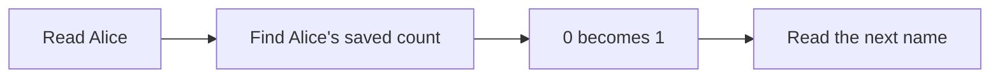

```text
Nume citit      Numere de apariții salvate după acest pas
Alice           Alice: 1
Brad            Alice: 1, Brad: 1
Alice           Alice: 2, Brad: 1
Collin          Alice: 2, Brad: 1, Collin: 1
Brad            Alice: 2, Brad: 2, Collin: 1
Alice           Alice: 3, Brad: 2, Collin: 1
```

Trebuie să găsim numărul de apariții **după nume**, fără să parcurgem toate numele salvate.

<br><br><br><br><br><br>

---

<br><br><br><br><br><br>

## HashMap: un value pentru fiecare key

**Un map stochează perechi key/value (cheie/valoare). Fiecare key are un singur value asociat.**

Un **HashMap**, numit și hash map, folosește hashing pentru a găsi poziția unei perechi.

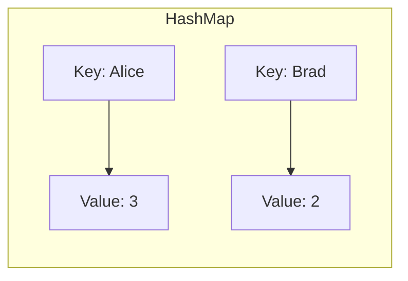

- **Key** identifică elementul: un nume.
- **Value** reprezintă datele pe care le stocăm pentru el: un număr de apariții.
- Operația set pentru un key existent înlocuiește value-ul asociat.

Sursă: [Open Data Structures (Python), Capitolul 5: Hash Tables](https://opendatastructures.org/ods-python/5_Hash_Tables.html).

<br><br><br><br><br><br>

---

<br><br><br><br><br><br>

## Numărarea numelor cu dict din Python

**`dict` din Python este un hash map. `{}` creează un dictionary gol.**

```python
def count_names(names):
    counts = {}
    for name in names:
        if name in counts:
            counts[name] += 1
        else:
            counts[name] = 1
    return counts

names = ["Alice", "Brad", "Alice", "Collin", "Brad", "Alice"]
counts = count_names(names)
print(counts)
```

```text
{'Alice': 3, 'Brad': 2, 'Collin': 1}
```

`name in counts` verifică dacă numele este un key în dictionary.

Sursă: [Python: Dictionaries](https://docs.python.org/3/tutorial/datastructures.html#dictionaries).

<br><br><br><br><br><br>

---

<br><br><br><br><br><br>

## Câte nume se repetă?

```python
repeated_names = []
for name in counts:
    if counts[name] > 1:
        repeated_names.append(name)

print(repeated_names)
print(len(repeated_names))
```

```text
['Alice', 'Brad']
2
```

**Două nume distincte se repetă.** Alice apare de trei ori, iar Brad de două ori.
Vizităm fiecare key salvat o singură dată. Nu parcurgem din nou lista inițială.

<br><br><br><br><br><br>

---

<br><br><br><br><br><br>

## Utilizarea 1: o listă de contacte

**Cum poate o aplicație de mesagerie să găsească numărul de telefon al unui contact?**

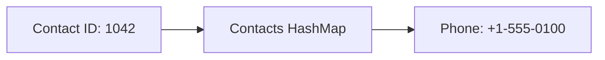

```python
contacts = {1042: "+1-555-0100", 2081: "+1-555-0101"}
phone = contacts[1042]
```

- **Key:** ID-ul contactului. **Value:** numărul de telefon.
- Folosim un ID, deoarece două persoane pot avea același nume.
- Schimbarea numărului de telefon actualizează value-ul pentru acel ID.

<br><br><br><br><br><br>

---

<br><br><br><br><br><br>

## Utilizarea 2: un coș de cumpărături

**Cum poate un magazin să păstreze o cantitate pentru fiecare produs?**

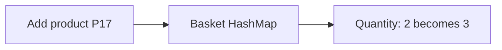

```python
basket = {"P17": 2, "P42": 1}
basket["P17"] = basket.get("P17", 0) + 1
```

- **Key:** ID-ul produsului. **Value:** cantitatea.
- Folosim același mod de numărare ca pentru numele din sala de curs.

<br><br><br><br><br><br>

---

<br><br><br><br><br><br>

## Utilizarea 3: un cache

**Poate un program să refolosească un rezultat în loc să îl calculeze din nou?**

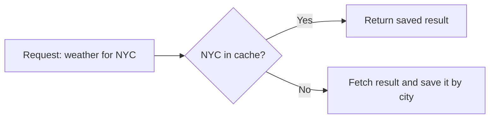

- **Key:** orașul. **Value:** un rezultat meteo salvat.
- Un cache reduce munca atunci când aceeași cerere apare din nou.
- Un cache real are nevoie și de reguli pentru expirare și dimensiune.

Aceste trei exemple arată moduri posibile de a proiecta aplicațiile.

<br><br><br><br><br><br>

---

<br><br><br><br><br><br>

## Operațiile HashMap în Python

```python
cities = {}
cities["Alice"] = "NYC"
cities["Brad"] = "Chicago"
cities["Alice"] = "Boston"

print(cities["Alice"])             # Boston
print(cities.get("Collin", "?"))   # ?
print("Brad" in cities)            # True
del cities["Brad"]
```

- `cities[key]` citește un value. Un key absent produce `KeyError`.
- `cities.get(key, default)` dă o valoare implicită pentru un key absent.
- `key in cities` verifică **keys**, nu values.
- O actualizare păstrează o singură pereche pentru acel key.

Sursă: [Python: Mapping Types - dict](https://docs.python.org/3.13/library/stdtypes.html#mapping-types-dict).

<br><br><br><br><br><br>

---

<br><br><br><br><br><br>

## HashMap: time complexity

**Fie `n` numărul de perechi stocate.**

| Operație | Expected time | Worst-case time |
| --- | --- | --- |
| Citire după key | `O(1)` | `O(n)` |
| Verificarea prezenței unui key (membership) | `O(1)` | `O(n)` |
| Actualizare value | `O(1)` | `O(n)` |
| Inserare fără resize | `O(1)` | `O(n)` |
| Ștergere fără resize | `O(1)` | `O(n)` |
| Vizitarea tuturor perechilor | `O(n)` | `O(n)` |

Presupunem hashing și comparații de keys în timp constant, o hash function potrivită
și suficient spațiu liber. Stocarea ocupă **`O(n)`** spațiu.

Cu mărirea inclusă, inserarea are cost **expected amortized `O(1)`**.
Vom analiza separat costul reconstruirii.

Sursă: [Open Data Structures (Python), Capitolul 5](https://opendatastructures.org/ods-python/5_Hash_Tables.html).

<br><br><br><br><br><br>

---

<br><br><br><br><br><br>

## Avem mereu nevoie de un value?

**La intrarea unui eveniment, trebuie să știm dacă un bilet a fost deja scanat.**

```text
Scan T17     Prima vizită: permitem intrarea
Scan T42     Prima vizită: permitem intrarea
Scan T17     Deja scanat: respingem această repetare
```

Trebuie să reținem ID-urile biletelor. Nu avem nevoie de un număr de apariții sau de un oraș.

La ce întrebare trebuie să răspundă structura?

<br><br><br><br><br><br>

---

<br><br><br><br><br><br>

## HashSet: valori unice

**Un set stochează elemente distincte. Un HashSet folosește hashing pentru membership, adică verificarea prezenței unui element.**

Tipul hash set inclus în Python este `set`.

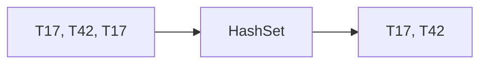

- Adăugarea aceluiași element din nou nu adaugă o a doua copie.
- Folosim un **HashMap** pentru values asociate sau pentru numărare.
- Folosim un **HashSet** ca să întrebăm: "Este prezent acest element?"
- Un set nu păstrează o ordine pe poziții.

Sursă: [Python: Sets](https://docs.python.org/3/tutorial/datastructures.html#sets).

<br><br><br><br><br><br>

---

<br><br><br><br><br><br>

## HashSet: operații și costuri

```python
scanned = set()
scanned.add("T17")
scanned.add("T42")
scanned.add("T17")
print("T17" in scanned)       # True
print(len(scanned))          # 2
scanned.discard("T42")
```

| Operație | Expected time | Worst-case time |
| --- | --- | --- |
| Membership: `x in scanned` | `O(1)` | `O(n)` |
| Adăugare: `scanned.add(x)` | Amortized `O(1)` | `O(n)` |
| Ștergere: `scanned.discard(x)` | Amortized `O(1)` | `O(n)` |

Aceleași presupuneri despre hashing ca la un HashMap. `n` elemente stocate ocupă `O(n)` spațiu.
`discard` funcționează și dacă elementul lipsește. Un set gol este `set()`, nu `{}`.

<br><br><br><br><br><br>

---

<br><br><br><br><br><br>

## Un HashMap construit cu un dynamic array

**Cum am putea stoca perechi key/value într-un array?**

- Fiecare slot, adică poziție din array, este gol sau conține o pereche key/value.
- Un index întreg ne permite să citim direct un slot.
- Mărim array-ul când avem nevoie de mai mult spațiu.

```text
Index             0          1
              +----------+----------+
Pair          | Alice: 3 | Brad: 2  |
              +----------+----------+
```

Cum putem transforma un string precum `"Alice"` într-un index de array?

<br><br><br><br><br><br>

---

<br><br><br><br><br><br>

## Hashing are două etape

**Cum poate un key de tip string să aleagă un slot din array?**

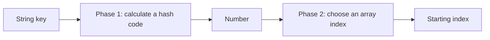

- **Etapa 1:** transformăm string-ul într-un hash code, adică un număr întreg.
- **Etapa 2:** transformăm acel număr într-un index valid de array.
- Keys identice trebuie să producă același hash code în cadrul aceluiași tabel.

Mai întâi, examinăm **etapa 2** cu keys care sunt deja numere.

Sursă: [Open Data Structures (Python), Secțiunea 5.3: Hash Codes](https://opendatastructures.org/ods-python/5_3_Hash_Codes.html).

<br><br><br><br><br><br>

---

<br><br><br><br><br><br>

## Etapa 2: un HashMap cu numere ca keys

**Stocăm un oraș pentru fiecare ID de persoană. ID-urile sunt keys de tip întreg.**

```text
HashMap dorit:
    4 -> "NYC"
    7 -> "Chicago"

Array-ul de stocare înainte de inserare:
Index      0          1
       +----------+----------+
Pair   |  gol     |  gol     |
       +----------+----------+
```

- În acest exemplu, folosim numărul însuși drept hash code.
- Avem **două slot-uri**, cu index-urile `0` și `1`.
- Folosim **`key % 2`**, deoarece array-ul are două slot-uri.

<br><br><br><br><br><br>

---

<br><br><br><br><br><br>

## Folosim % 2 pentru a stoca prima pereche

**`%` dă restul împărțirii.**

```text
Inserăm: key = 4, value = "NYC"

4 / 2 = 2 cu restul 0
4 % 2 = 0

Index      0          1
       +----------+----------+
Pair   | 4: NYC   |  gol     |
       +----------+----------+
```

Stocăm **key și value împreună** la index-ul `0`.

**Anticipează:** ce index va alege key-ul `7`?

<br><br><br><br><br><br>

---

<br><br><br><br><br><br>

## Folosim % 2 pentru a stoca a doua pereche

```text
Inserăm: key = 7, value = "Chicago"

7 / 2 = 3 cu restul 1
7 % 2 = 1

Index      0          1
       +----------+----------+
Pair   | 4: NYC   |7: Chicago|
       +----------+----------+
```

Ambele perechi au acum câte un slot. Array-ul cu două slot-uri este plin.

<br><br><br><br><br><br>

---

<br><br><br><br><br><br>

## Folosim aceeași regulă pentru a citi un value

```text
Cerere      Calcul          Citim slot    Verificăm key Returnăm value
get(4)      4 % 2 = 0       0             4 == 4        "NYC"
get(7)      7 % 2 = 1       1             7 == 7        "Chicago"
```

- Calculăm index-ul din **key**.
- Verificăm key-ul salvat, apoi returnăm value-ul asociat.
- Folosim aceeași regulă de calcul al index-ului la stocare și la citire.

**Pentru un array de lungime `m`, folosim `hash code % m`.**

<br><br><br><br><br><br>

---

<br><br><br><br><br><br>

## Etapa 1: nume ca keys, orașe ca values

**Ce număr ar putea reprezenta un nume precum `"Alice"`?**

```python
cities = HashMap()
cities.put("Alice", "NYC")
cities.put("Brad", "Chicago")
cities.put("Collin", "Seattle")
```

```text
Key       Value
Alice     NYC
Brad      Chicago
Collin    Seattle
```

Și în acest exemplu cu keys de tip string începem cu **două slot-uri**.
`put` înseamnă setarea sau actualizarea value-ului unui key. Orașul este value-ul stocat.

<br><br><br><br><br><br>

---

<br><br><br><br><br><br>

## Adunarea codurilor caracterelor

**Pentru numele noastre ASCII, adunăm codul fiecărui caracter.**

```text
"Alice"

Caracter       A     l     i     c     e
Cod ASCII     65   108   105    99   101

Sum = 65 + 108 + 105 + 99 + 101 = 478
```

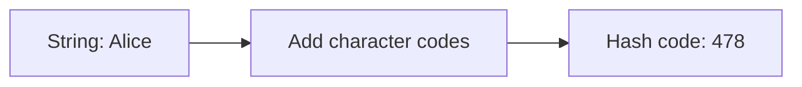

`ord(char)` din Python returnează un Unicode code point. Pentru caracterele ASCII,
acesta este codul ASCII. Literele mari și mici au coduri diferite.

Sursă: [Python: ord](https://docs.python.org/3/library/functions.html#ord).

<br><br><br><br><br><br>

---

<br><br><br><br><br><br>

## Calcularea index-ului de pornire

**Combinăm etapele: adunăm codurile caracterelor, apoi folosim `% capacity`.**

```python
def name_index(name, capacity):
    total = 0
    for char in name:
        total += ord(char)
    return total % capacity
```

```text
Nume     Suma codurilor                      % 2    % 4
Alice    65 + 108 + 105 + 99 + 101 = 478         0      2
Brad     66 + 114 + 97 + 100 = 377               1      1
Collin   67 + 111 + 108 + 108 + 105 + 110 = 609  1      1
```

Key-ul rămâne `"Alice"`. `0` sau `2` este un **index de array**, nu un key nou.
Această funcție simplă este pentru învățare. `dict` din Python folosește alt hash.

<br><br><br><br><br><br>

---

<br><br><br><br><br><br>

## Setarea orașului pentru Alice

**Începem cu un array de lungime 2.**

```text
put("Alice", "NYC")
478 % 2 = 0

Index     Înainte             După
  0       gol                 ("Alice", "NYC")
  1       gol                 gol
```

1. Calculăm index-ul de pornire din `"Alice"`.
2. Slot-ul este gol. Stocăm **key și value** împreună.
3. Creștem numărul de perechi stocate la `1`.

De ce trebuie să salvăm și key-ul, pe lângă oraș?

<br><br><br><br><br><br>

---

<br><br><br><br><br><br>

## Citirea orașului pentru Alice

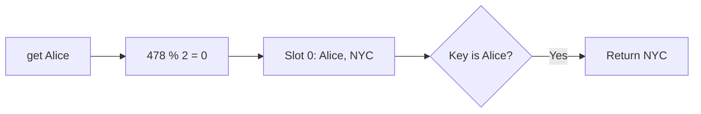

- Folosim aceeași regulă de hashing ca la inserare.
- Comparăm key-ul stocat cu key-ul cerut.
- Returnăm value-ul doar când keys coincid.

Un index identic nu dovedește singur că am găsit persoana corectă.

<br><br><br><br><br><br>

---

<br><br><br><br><br><br>

## Setarea orașului pentru Brad

```text
put("Brad", "Chicago")
377 % 2 = 1

Index     Pair
  0       ("Alice", "NYC")
  1       ("Brad", "Chicago")
```

Ambele slot-uri conțin acum câte o pereche. Array-ul este plin.

**Anticipează:** Collin are suma `609`. De la ce index pornește `609 % 2`?
Ce se întâmplă dacă îl scriem pe Collin acolo?

<br><br><br><br><br><br>

---

<br><br><br><br><br><br>

## Collision: două keys, un singur index de pornire

**Un collision apare când keys diferite aleg același slot de pornire.**

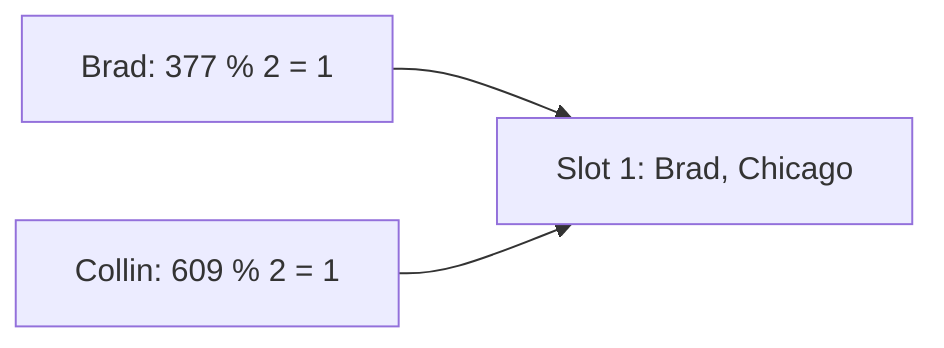

- Brad și Collin sunt keys diferite.
- Înlocuirea lui Brad ar pierde o pereche. Nu este o inserare validă.
- Avem nevoie de o regulă pentru collision. Avem nevoie și de spațiu în array.

Mai întâi, creăm mai mult spațiu. Apoi verificăm dacă a dispărut collision-ul.

Sursă: [Open Data Structures (Python), Capitolul 5: Hash Tables](https://opendatastructures.org/ods-python/5_Hash_Tables.html).

<br><br><br><br><br><br>

---

<br><br><br><br><br><br>

## Resize și rehash

**Dublăm capacitatea de la 2 la 4, ca la un dynamic array.**

Dar index-ul de pornire depinde de capacitate. Îl calculăm din nou.

```text
Array vechi, capacitate 2    Array nou, capacitate 4
0: Alice -> NYC              0: gol
1: Brad  -> Chicago          1: Brad  -> Chicago   377 % 4 = 1
                            2: Alice -> NYC       478 % 4 = 2
                            3: gol
```

- **Resize:** alocăm un array mai mare.
- **Rehash:** plasăm fiecare pereche salvată folosind noua capacitate.
- Păstrăm împreună elementele fiecărei perechi key/value.

<br><br><br><br><br><br>

---

<br><br><br><br><br><br>

## De ce eșuează copierea la același index

```text
Greșit: copiem Alice la vechiul index 0 în array-ul nou.

get("Alice") calculează acum 478 % 4 = 2.
Verifică index-ul 2, care este gol, și nu o găsește pe Alice.
```

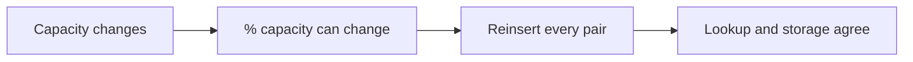

Suma codurilor caracterelor poate rămâne `478`. Index-ul din array se poate schimba.

Sursă: [Open Data Structures (Python), Secțiunea 5.2: Linear Probing](https://opendatastructures.org/ods-python/5_2_LinearHashTable_Linear_.html).

<br><br><br><br><br><br>

---

<br><br><br><br><br><br>

## Un array mai mare poate avea în continuare un collision

```text
Brad:    377 % 4 = 1
Collin:  609 % 4 = 1

Index      0        1        2        3
        +--------+--------+--------+--------+
Key     | gol    | Brad   | Alice  | gol    |
        +--------+--------+--------+--------+
                   ^
             Collin pornește de aici
```

Există spațiu liber. Resize-ul nu a separat aceste două index-uri de pornire.

Putem folosi un alt slot din **același array**?

<br><br><br><br><br><br>

---

<br><br><br><br><br><br>

## Linear probing

**La un collision, verificăm slot-ul următor. Continuăm până găsim un slot gol.**

```text
put("Collin", "Seattle")       609 % 4 = 1

Verif index 1     Brad      Key diferit: continuăm
Verif index 2     Alice     Key diferit: continuăm
Verif index 3     gol       Stocăm ("Collin", "Seattle")

Index      0        1        2        3
        +--------+--------+--------+--------+
Key     | gol    | Brad   | Alice  | Collin |
        +--------+--------+--------+--------+
```

Aceasta este metoda **open addressing cu linear probing**.
Index-ul de pornire rămâne `1`. Index-ul la care stocăm efectiv perechea este `3`.

Sursă: [Open Data Structures (Python), Secțiunea 5.2: Linear Probing](https://opendatastructures.org/ods-python/5_2_LinearHashTable_Linear_.html).

<br><br><br><br><br><br>

---

<br><br><br><br><br><br>

## Get trebuie să urmeze același traseu

**Anticipează:** ce slot-uri verifică `get("Collin")`?

```text
Index     Pair
  0       gol
  1       ("Brad", "Chicago")
  2       ("Alice", "NYC")
  3       ("Collin", "Seattle")
```

Un key diferit la index-ul `1` înseamnă că lipsește Collin?

<br><br><br><br><br><br>

---

<br><br><br><br><br><br>

## Lookup cu probing

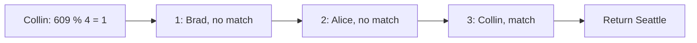

Pentru un lookup, adică o căutare după key:

1. Calculăm index-ul de pornire.
2. Comparăm keys în fiecare slot ocupat de pe traseul de probing.
3. Returnăm value-ul când găsim key-ul căutat.
4. Ne oprim la un slot gol dacă key-ul lipsește.

Traseul de lookup trebuie să coincidă cu traseul de inserare.

<br><br><br><br><br><br>

---

<br><br><br><br><br><br>

## Revenirea la început după ultimul slot

**Îl căutăm pe Bob înainte să îl inserăm. `Bob` are suma `275`.**

```text
275 % 4 = 3

Index 3     Collin     Key diferit
Index 0     gol        Stop: Bob lipsește

Index nou  = (index + 1) % capacity
           = (3 + 1) % 4 = 0
```

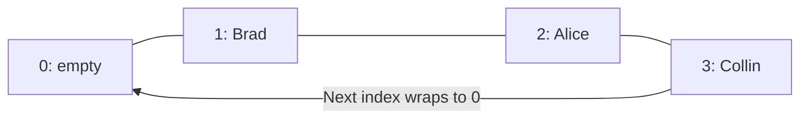

Un slot gol încheie căutarea, deoarece inserarea l-ar fi folosit.
Această regulă presupune că nu am șters perechi lăsând goluri.

<br><br><br><br><br><br>

---

<br><br><br><br><br><br>

## Alte strategii de probing

**Trebuie să verificăm mereu slot-ul următor?**

Alte forme de **open addressing** păstrează perechile în același array:

| Strategie | Cum alege slot-ul următor |
| --- | --- |
| Linear probing | Avansează cu un slot |
| Quadratic probing | Folosește salturi care cresc cu numărul de încercări |
| Double hashing | Folosește o a doua hash function pentru a alege mărimea pasului |

- Inserarea și lookup-ul trebuie să urmeze aceeași secvență.
- Regula de salt și dimensiunea tabelului trebuie să permită împreună accesul la suficiente slot-uri.

Explorează: [USF: Closed Hashing](https://www.cs.usfca.edu/~galles/visualization/ClosedHash.html).

<br><br><br><br><br><br>

---

<br><br><br><br><br><br>

## Separate chaining

**Cum ar fi dacă un slot din array ar putea păstra mai multe perechi?**

Fiecare slot din array duce la un **bucket**, adică un grup de perechi, care poate fi un linked list.

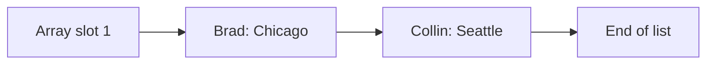

- Brad și Collin aleg amândoi bucket-ul `1`.
- Stocăm ambele perechi în acel bucket.
- Pentru a-l găsi pe Collin, alegem bucket-ul `1`, apoi comparăm keys din lista lui.

Sursă: [Open Data Structures (Python), Secțiunea 5.1: Chaining](https://opendatastructures.org/ods-python/5_1_ChainedHashTable_Hashin.html).

<br><br><br><br><br><br>

---

<br><br><br><br><br><br>

## dict din Python: CPython 3.13

**Ce hash function și ce reguli de stocare folosește Python?**

- **String hashing:** versiunile compilate uzuale folosesc **SipHash 1-3** cu un seed secret.
  Algoritmul combină bytes din string într-un hash code. Implicit, seed-ul este aleatoriu.
- **Stocare:** un array de index-uri indică poziții într-un array compact de entries.
  Un dictionary obișnuit stochează keys și values în acele entries.
- **Collisions:** open addressing. O secvență de probing care depinde de hash alege
  slot-ul următor, în loc să avanseze mereu cu un slot.
- Entries îi permit și lui `dict` să păstreze ordinea inserării.

Acestea sunt detalii de implementare din CPython 3.13. Alte tipuri de keys au alte hashes.

Surse: CPython 3.13 [alegerea hash-ului](https://github.com/python/cpython/blob/v3.13.0/Include/pyhash.h),
[string hashing](https://github.com/python/cpython/blob/v3.13.0/Python/pyhash.c)
și [stocarea în dictionary și probing](https://github.com/python/cpython/blob/v3.13.0/Objects/dictobject.c).

<br><br><br><br><br><br>

---

<br><br><br><br><br><br>

## HashMap din Java: OpenJDK 21

- **Hashing:** apelăm metoda `hashCode()` a key-ului, apoi combinăm biții rezultatului.
- **String hashing:** începem de la `0`. Pentru fiecare UTF-16 code unit, calculăm
  `h = 31 * h + code`, folosind aritmetică pe numere întregi de 32 de biți.
- **Stocare:** un array de buckets. Un bucket conține de obicei un linked list
  de nodes cu key/value.
- **Collisions:** adăugăm nodes în același bucket. Un bucket mare poate deveni
  un balanced tree când și array-ul este suficient de mare.

Java folosește **separate chaining** pentru aceste buckets.

Surse: Java 21 [String.hashCode](https://docs.oracle.com/en/java/javase/21/docs/api/java.base/java/lang/String.html#hashCode())
și OpenJDK 21 [codul sursă HashMap](https://github.com/openjdk/jdk/blob/jdk-21-ga/src/java.base/share/classes/java/util/HashMap.java).

<br><br><br><br><br><br>

---

<br><br><br><br><br><br>

## HashMap din Rust: Rust 1.90

- **Hashing implicit:** **SipHash 1-3**, cu un seed aleatoriu.
  Programele pot alege alt hasher.
- **Stocare:** un array plat de perechi key/value și câțiva **control bytes**.
  Acești bytes marchează starea slot-urilor și ajută la alegerea keys pentru comparație.
- **Collisions:** open addressing cu **quadratic probing** între grupuri
  de slot-uri. Verifică împreună control bytes pentru mai multe slot-uri.

Acest design se bazează pe **SwissTable**. Hasher-ul implicit se poate schimba între versiuni.

Surse: Rust 1.90 [documentația HashMap din codul sursă](https://github.com/rust-lang/rust/blob/1.90.0/library/std/src/collections/hash/map.rs)
și [note despre designul SwissTable](https://abseil.io/about/design/swisstables).

<br><br><br><br><br><br>

---

<br><br><br><br><br><br>

## Operația set poate și să actualizeze

**Revenim la HashMap-ul nostru nume/oraș cu linear probing.**

```text
put("Brad", "Boston")
377 % 4 = 1

Înainte:   1: ("Brad", "Chicago")
După:      1: ("Brad", "Boston")
```

- Key-ul stocat coincide. Îi înlocuim value-ul.
- Nu adăugăm un al doilea Brad.
- Numărul de perechi rămâne `3`.

**Key diferit:** continuăm probing-ul. **Același key:** actualizăm.

<br><br><br><br><br><br>

---

<br><br><br><br><br><br>

## Cât de plin ar trebui să devină array-ul?

**Load factor este numărul de perechi împărțit la capacitate.**

```text
Load factor = size / capacity

3 perechi / 4 slot-uri = 0.75
4 perechi / 4 slot-uri = 1.00    Nu mai rămâne niciun slot gol
```

- Linear probing poate forma grupuri lungi de slot-uri ocupate, numite **clusters**.
- Mai multe slot-uri ocupate înseamnă de obicei mai multe verificări.
- Clasa noastră mărește array-ul când o inserare nouă face load factor **mai mare decât 0.75**.
- Aceasta este regula noastră pentru învățare. Nu este regula de resize a lui `dict` din Python.

Tabelul anterior cu două slot-uri crește imediat ce Brad îl umple.

Sursă: [Open Data Structures (Python), Secțiunea 5.2](https://opendatastructures.org/ods-python/5_2_LinearHashTable_Linear_.html).

<br><br><br><br><br><br>

---

<br><br><br><br><br><br>

## Îl inserăm pe Bob, apoi mărim array-ul

```text
Bob: 275 % 4 = 3. Slot-ul 3 este ocupat; slot-ul 0 este gol.
Stocăm Bob la 0. Acum 4 / 4 > 0.75: mărim la 8 slot-uri.

Înainte de rehash, capacity 4 După rehash, capacity 8
0: Bob    -> Miami            0: gol
1: Brad   -> Boston           1: Brad   -> Boston
2: Alice  -> NYC              2: Collin -> Seattle
3: Collin -> Seattle          3: Bob    -> Miami
                              4: gol
                              5: gol
                              6: Alice  -> NYC
                              7: gol
```

Reinserăm în ordinea index-urilor vechi: Bob, Brad, Alice, Collin.
Brad și Collin pornesc amândoi de la `1`. Collin ajunge prin probing la `2`.
După rehashing, load factor este `4 / 8 = 0.5`.

<br><br><br><br><br><br>

---

<br><br><br><br><br><br>

## Construirea unui HashMap mic

**Un array stochează fie `None`, fie o pereche `(key, value)`.**

```python
class HashMap:
    def __init__(self):
        self.slots = [None, None]
        self.size = 0

    def _index(self, key):
        total = 0
        for char in key:
            total += ord(char)
        return total % len(self.slots)
```

- Fiecare bloc de cod adaugă metode în aceeași clasă.
- Keys sunt strings. Values pot fi orice valori Python.
- Această clasă permite set, update, get și mărire. Nu include ștergerea.

Program complet: [exemple Python](examples/05-hash-maps.py).

<br><br><br><br><br><br>

---

<br><br><br><br><br><br>

## Găsirea unui slot gol sau a key-ului căutat

```python
    def _find_slot(self, key):
        index = self._index(key)
        checked = 0
        while checked < len(self.slots):
            pair = self.slots[index]
            if pair is None or pair[0] == key:
                return index
            index = (index + 1) % len(self.slots)
            checked += 1
        raise RuntimeError("HashMap is full")
```

- `pair[0]` este key-ul, iar `pair[1]` este value-ul lui.
- Inserarea și get folosesc aceeași regulă de probing.
- Bucla verifică cel mult o parcurgere completă a array-ului.
- Regula noastră de mărire lasă slot-uri goale între operațiile publice.

<br><br><br><br><br><br>

---

<br><br><br><br><br><br>

## Setarea sau actualizarea unei perechi

```python
    def put(self, key, value):
        index = self._find_slot(key)
        if self.slots[index] is None:
            self.size += 1
        self.slots[index] = (key, value)
        if self.size * 4 > len(self.slots) * 3:
            self._resize()
```

```text
Slot gol       -> adăugăm o pereche; size crește
Key identic    -> înlocuim value-ul; size rămâne la fel

size * 4 > capacity * 3 înseamnă size / capacity > 0.75
```

Mărim array-ul după ce plasăm o pereche nouă. Operația următoare folosește array-ul mai mare.

<br><br><br><br><br><br>

---

<br><br><br><br><br><br>

## Citirea unui value sau a unei valori implicite

```python
    def get(self, key, default=None):
        index = self._find_slot(key)
        pair = self.slots[index]
        if pair is None:
            return default
        return pair[1]
```

```python
print(cities.get("Collin"))          # Seattle
print(cities.get("Bob", "Unknown"))  # Unknown, before Bob is inserted
```

`_find_slot` returnează un slot cu key-ul căutat sau primul slot gol de pe traseul lui.
Nu returnează niciodată un slot care conține alt key.

<br><br><br><br><br><br>

---

<br><br><br><br><br><br>

## Rehash pentru fiecare pereche salvată

```python
    def _resize(self):
        old_slots = self.slots
        self.slots = [None] * (2 * len(old_slots))
        self.size = 0
        for pair in old_slots:
            if pair is not None:
                self.put(pair[0], pair[1])
```

1. Păstrăm array-ul vechi cât timp îl construim pe cel nou.
2. Dublăm capacitatea. Începem cu slot-uri goale.
3. Reinserăm fiecare pereche veche cu noul calcul `% capacity`.

Resetarea lui `size` evită numărarea de două ori a fiecărei perechi reinserate.
Array-ul mai mare are suficient spațiu, deci reinserarea nu declanșează altă mărire.

<br><br><br><br><br><br>

---

<br><br><br><br><br><br>

## De ce funcționează aceste metode

```text
Traseu inserare:   start -> verificăm -> următorul -> ... -> primul slot gol
Traseu lookup:     start -> verificăm -> următorul -> ... -> același key sau gol
```

- Fiecare pereche se află pe traseul de probing al key-ului ei, înainte de primul slot gol.
- O actualizare înlocuiește perechea cu același key. Nu creează keys duplicate.
- Rehashing reconstruiește această regulă pentru noua capacitate.
- Fiecare buclă de căutare este limitată de capacitate, deci nu poate continua la infinit.

Clasa noastră nu șterge niciodată o pereche. Într-o implementare mai completă, ștergerea cere
atenție: golirea unui slot poate întrerupe traseul de căutare pentru un key aflat mai departe.

<br><br><br><br><br><br>

---

<br><br><br><br><br><br>

## Costurile de hashing și collision

```text
Munca de lookup = hashing pentru key + verificarea slot-urilor de pe traseul de probing

Distribuție bună, spațiu liber:   Puține verificări în medie
Multe keys cu același start:      Până la O(n) verificări
```

- Expected `O(1)` cere o hash function potrivită și un load factor controlat.
- Funcția noastră bazată pe sumă calculează hash-ul unui string de lungime `L` în timp `O(L)`.
- `"abc"` și `"cab"` au aceeași sumă. Resize-ul nu le poate separa sumele.
- Compararea unor keys de tip string lungi poate dura și ea mai mult decât un timp constant.

Implementarea mică explică mecanismul. Hash-ul ei slab **nu**
garantează expected `O(1)` pentru orice input. În codul obișnuit, folosim `dict` din Python.

<br><br><br><br><br><br>

---

<br><br><br><br><br><br>

## Rehashing și amortized time

**Unele inserări reconstruiesc tabelul. Majoritatea inserărilor nu îl reconstruiesc.**

```text
Capacități:          2 -> 4 -> 8 -> 16 -> ...
Muncă rehash:        2 + 4 + 8 + ... + n < 2n
```

- Cu hashing bun și prelucrarea keys în timp constant, o reconstruire are
  **expected time `O(n)`** și cere `O(n)` spațiu nou.
- Pe parcursul a `n` inserări, creșterea geometrică adaugă în total expected `O(n)` muncă de reconstruire.
- Obținem astfel **inserare expected amortized `O(1)`**, cu mărirea inclusă.
- O singură inserare poate dura totuși `O(n)`. Collisions nefavorabile pot face ca reinserarea
  în clasa noastră simplă să dureze `O(n^2)`.

**Expected** se referă la distribuția hash-urilor. **Amortized** distribuie costul măririi
pe o secvență de operații.

<br><br><br><br><br><br>

---

<br><br><br><br><br><br>

## Urmărirea metodei linear probing

**Folosește [University of San Francisco: Closed Hashing](https://www.cs.usfca.edu/~galles/visualization/ClosedHash.html).**

1. Păstrează selectate **Hash Integer** și **Linear Probing**.
2. În câmpul de lângă **Insert**, inserează `1`, apoi `30`, apoi `59`.
3. Toate trei pornesc de la index-ul `1`: instrumentul folosește **29 de slot-uri** și `% 29`.
4. Alege **Pause**, apoi **Step Forward** pentru a urmări un collision.
5. Introdu `59` în câmpul de lângă **Find**. Urmărește din nou același traseu.
6. Caută `88`. De ce se oprește căutarea la un slot gol?

```text
1 % 29 = 1     30 % 29 = 1     59 % 29 = 1     88 % 29 = 1
```

Instrumentul arată keys, fără values pentru orașele noastre. Hash-ul lui pentru strings diferă de
regula noastră cu suma codurilor ASCII. Folosește slide-urile pentru pașii exacți cu nume și orașe.

<br><br><br><br><br><br>

---

<br><br><br><br><br><br>

## Rularea exemplelor Python

**Descarcă sau clonează repository-ul cursului. Rulează din folderul lui rădăcină.**

```text
python3 slides/examples/05-hash-maps.py
```

[Programul Python complet](examples/05-hash-maps.py) conține numărarea numelor,
HashMap-ul mic și soluțiile celor două probleme de mai jos.

- Urmărește array-urile afișate când capacitatea crește de la `2` la `4`, apoi la `8`.
- Compară un key absent cu un key stocat după un collision.
- Actualizează orașul lui Brad. Crește numărul de perechi?

Repository-ul public pentru studenți are `slides/` în folderul rădăcină.

<br><br><br><br><br><br>

---

<br><br><br><br><br><br>

## Contains Duplicate

**[LeetCode 217: Contains Duplicate](https://leetcode.com/problems/contains-duplicate/description/)**

Returnează `True` dacă un număr întreg apare de mai multe ori. Altfel, returnează `False`.

```text
[1, 2, 3, 1]       True
[1, 2, 3, 4]       False
```

Trebuie să găsim doar **o singură** repetare.

Cum ne poate spune un HashMap dacă am mai întâlnit numărul curent?

<br><br><br><br><br><br>

---

<br><br><br><br><br><br>

## Detectarea duplicatelor: reținem numerele anterioare

**Folosim numărul drept key. Stocăm `True` drept value.**

```text
Input: [1, 2, 3, 1]

Citim   Keys înainte de pas     Deja prezent?       Acțiune
 1      {}                      nu                  salvăm 1
 2      {1}                     nu                  salvăm 2
 3      {1, 2}                  nu                  salvăm 3
 1      {1, 2, 3}               da                  returnăm True
```

Verificăm membership **înainte** să salvăm numărul curent.
Altfel, fiecare număr ar părea o repetare a lui însuși.

<br><br><br><br><br><br>

---

<br><br><br><br><br><br>

## Contains Duplicate: soluția cu HashMap în Python

```python
class Solution:
    def containsDuplicate(self, nums):
        seen = {}
        for number in nums:
            if number in seen:
                return True
            seen[number] = True
        return False
```

- Înainte de fiecare pas, map-ul conține exact numerele distincte întâlnite anterior.
- Un key prezent dovedește că numărul a apărut anterior.
- Bucla se încheie la prima repetare sau după toate numerele.

Programul complet numește această clasă `DuplicateSolution`, astfel încât ambele soluții
să poată sta în același fișier. Folosește `Solution` în editorul LeetCode.

<br><br><br><br><br><br>

---

<br><br><br><br><br><br>

## Contains Duplicate: costuri și o variantă cu set

**Pentru `n` numere întregi de dimensiune fixă:**

- Expected time: **`O(n)`** pentru parcurgerea completă.
- Spațiu suplimentar: cel mult **`O(n)`**.
- Cel mai devreme returnăm în `O(1)`, când primele două numere coincid.
- Worst-case time cu collisions nefavorabile: `O(n^2)`.

Nu citim niciodată values `True` salvate. Un HashSet este suficient:

```python
seen = set()
for number in nums:
    if number in seen:
        return True
    seen.add(number)
return False
```

Acest corp alternativ se pune în `containsDuplicate` și are aceleași limite de complexitate.

<br><br><br><br><br><br>

---

<br><br><br><br><br><br>

## Valid Anagram

**[LeetCode 242: Valid Anagram](https://leetcode.com/problems/valid-anagram/description/)**

O anagramă folosește aceleași caractere de același număr de ori,
eventual într-o ordine diferită.

```text
"aab" și  "aba"       True
"aab" și  "abb"       False
```

Problema de bază folosește litere mici din alfabetul englez.

Ar fi suficient să comparăm două sets de caractere?

<br><br><br><br><br><br>

---

<br><br><br><br><br><br>

## Anagramele au nevoie de numărare

```text
String      Set de litere       Apariții
"aab"       {a, b}              a: 2, b: 1
"abb"       {a, b}              a: 1, b: 2
```

**Sets egale și lungimi egale nu sunt suficiente.**

Folosim un HashMap: **caracter -> număr de apariții**.

1. Respingem lungimile diferite.
2. Numărăm fiecare caracter din primul string.
3. Folosim câte o apariție salvată pentru fiecare caracter din al doilea string.
4. Respingem un caracter dacă numărul lui salvat este deja zero sau lipsește.

Este aceeași idee de numărare a frecvențelor ca la lista noastră de nume.

<br><br><br><br><br><br>

---

<br><br><br><br><br><br>

## Pașii pentru o anagramă

```text
s = "aab", t = "aba"

Numărăm în s:             a: 2, b: 1

Citim din t      Modificare         Apariții după pas
a                a: 2 -> 1         a: 1, b: 1
b                b: 1 -> 0         a: 1, b: 0
a                a: 1 -> 0         a: 0, b: 0

Fiecare caracter necesar a fost disponibil. Returnăm True.
```

Pentru `t = "abb"`, al doilea `b` găsește un număr de apariții egal cu `0`.
Returnăm `False` la acel pas.

<br><br><br><br><br><br>

---

<br><br><br><br><br><br>

## Valid Anagram: numărarea în primul string

```python
class Solution:
    def isAnagram(self, s, t):
        if len(s) != len(t):
            return False
        counts = {}
        for char in s:
            counts[char] = counts.get(char, 0) + 1
```

În acest punct, `counts[char]` este numărul de apariții ale lui `char` în `s`.

Continuăm în aceeași metodă. Folosim numerele de apariții când citim `t`.

<br><br><br><br><br><br>

---

<br><br><br><br><br><br>

## Valid Anagram: folosirea numerelor de apariții salvate

```python
        for char in t:
            if counts.get(char, 0) == 0:
                return False
            counts[char] -= 1
        return True
```

- Fiecare număr rămas indică aparițiile din `s` pe care `t` nu le-a folosit încă.
- Nu lăsăm niciun număr de apariții să devină negativ.
- Lungimile egale înseamnă că o parcurgere completă a folosit fiecare apariție exact o dată.
- Ambele bucle se termină, deoarece prelucrează strings finite.

Programul complet combină cele două blocuri de cod în `AnagramSolution`.
Folosește `Solution` când trimiți soluția problemei.

<br><br><br><br><br><br>

---

<br><br><br><br><br><br>

## Valid Anagram: timp și spațiu

**Fie `p = len(s)`, `q = len(t)`, iar `k` numărul de litere distincte din `s`.**

```text
Numărăm în s    p actualizări
Citim t         Cel mult q verificări și actualizări

Expected time   O(p + q)
Spațiu supl     O(k)
```

- Problema de bază are doar 26 de keys posibile, deci `k <= 26`, iar spațiul este **`O(1)`**.
- Cu acest alfabet fix, chiar și verificarea tuturor keys stocate este limitată la 26.
  Worst-case time este tot **`O(p + q)`**, dacă prelucrarea unui key durează un timp constant.
- Pentru un alfabet variabil, spațiul `O(k)` poate crește. Collisions nefavorabile pot mări
  timpul la `O((p + q) * k)`.

**Nume, produse, litere: același mod de utilizare a unui HashMap numără fiecare key.**
