# Structuri de date și algoritmi

**Lecția 6: Trees și Binary Search Trees**

Un linked list dă fiecărui node o legătură către următorul node.

Ce putem construi când un node are mai mult de un child (node copil)?

<br><br><br><br><br><br>

---

<br><br><br><br><br><br>

## Node-uri și edges într-un linked list

**Ce stochează fiecare casetă? Ce înseamnă fiecare săgeată?**


- Un **node** (nod) stochează o valoare și o legătură.
- Un **edge** conectează două node-uri. Aici, o referință `next` îl reprezintă.
- `None` înseamnă că nu există un node următor. Nu este un node cu date.

Săgețile arată direcția în care putem urma legăturile.

<br><br><br><br><br><br>

---

<br><br><br><br><br><br>

## Un node cu doi children

**Cum am putea conecta încă un node sub `1`?**

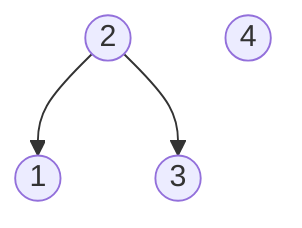

Păstrează ambele legături existente. Adaugă o legătură nouă.

Care node-uri nu vor avea children după schimbare?

<br><br><br><br><br><br>

---

<br><br><br><br><br><br>

## Un rooted tree

Un **rooted tree** (arbore cu rădăcină) are aceste caracteristici:

- Exact un **root** (rădăcină), fără parent.
- Exact un **parent** (părinte) pentru fiecare alt node.
- Exact un **path** (drum) de la root la fiecare node.
- Fără **cycles** (cicluri).

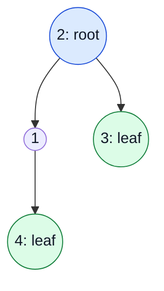

- Desenează **root-ul** sus. Nu are parent.
- Un **leaf** (frunză) nu are children. Acest tree are două leaf-uri: `3` și `4`.
- Leaf-urile pot fi la distanțe diferite de root.

Sursă: [Open Data Structures (Python), Capitolul 6](https://opendatastructures.org/ods-python/6_Binary_Trees.html).

Ce relație conectează `1` și `3`?

<br><br><br><br><br><br>

---

<br><br><br><br><br><br>

## Parents, children și siblings

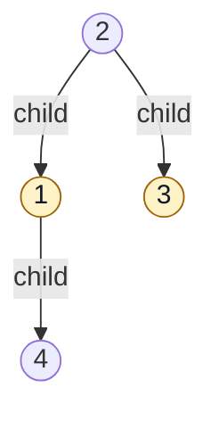

- Un **parent** se conectează direct la un **child** al său.
- `2` este parent pentru `1` și `3`.
- `1` și `3` sunt **siblings**: au același parent.
- `1` este atât child pentru `2`, cât și parent pentru `4`.

Sursă: [Open Data Structures (Python), Capitolul 6](https://opendatastructures.org/ods-python/6_Binary_Trees.html).

<br><br><br><br><br><br>

---

<br><br><br><br><br><br>

## Legăturile merg de la parent la child

**Node-urile noastre vor stoca doar legături către children.**

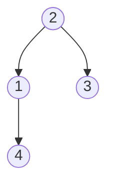

- Pornește de la `2`. Urmează o legătură către child-ul `1`, apoi către `4`.
- În această reprezentare, un child nu stochează o legătură înapoi către parent-ul său.
- Nicio legătură către un child nu duce înapoi la un node anterior de pe drum: **fără cycles**.
- Două node-uri parent nu pot avea același child într-un tree.

Alte implementări pot stoca și o referință către parent.

<br><br><br><br><br><br>

---

<br><br><br><br><br><br>

## Cât de departe este un node de root?


- Câte edges conectează root-ul la `4`?
- Câte edges conectează root-ul la `3`?
- Dar root-ul însuși?

Numără **edges**, nu node-uri.

<br><br><br><br><br><br>

---

<br><br><br><br><br><br>

## Depth numără edges de la root

**Depth** pentru un node este numărul de edges pe drumul de la root la acel node.

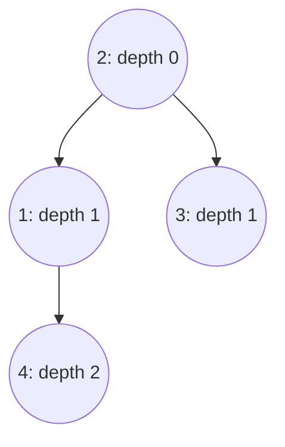

```text
Drum la 4:    2 -> 1 -> 4     2 edges     depth 2
Drum la 3:    2 -> 3          1 edge      depth 1
```

Sursă: [Open Data Structures (Python), Capitolul 6](https://opendatastructures.org/ods-python/6_Binary_Trees.html).

<br><br><br><br><br><br>

---

<br><br><br><br><br><br>

## Height numără edges până la cel mai îndepărtat leaf

**Cât de departe putem coborî din fiecare node?**

**Height** pentru un node este numărul de edges pe cel mai lung drum descendent
până la un leaf. Height pentru întregul tree este height pentru root.

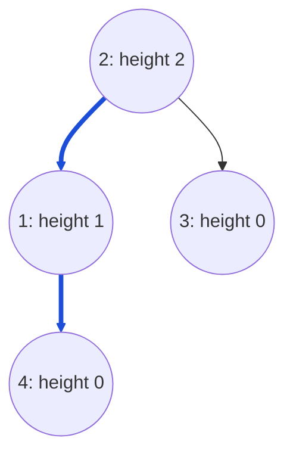

- Fiecare leaf are height `0`.
- Un tree cu un singur node are height `0`. Root-ul său este și leaf.
- În această prezentare, atât depth, cât și height numără **edges**.

Sursă: [Open Data Structures (Python), Capitolul 6](https://opendatastructures.org/ods-python/6_Binary_Trees.html).

<br><br><br><br><br><br>

---

<br><br><br><br><br><br>

## Depth și height: rândul tău

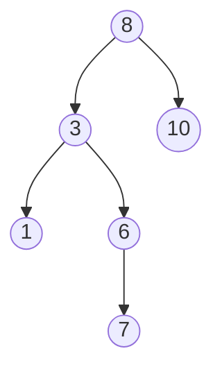

- Care sunt depth și height pentru `3`?
- Care sunt depth și height pentru `10`?
- Care este height pentru întregul tree?

<br><br><br><br><br><br>

---

<br><br><br><br><br><br>

## Depth și height: răspunsuri

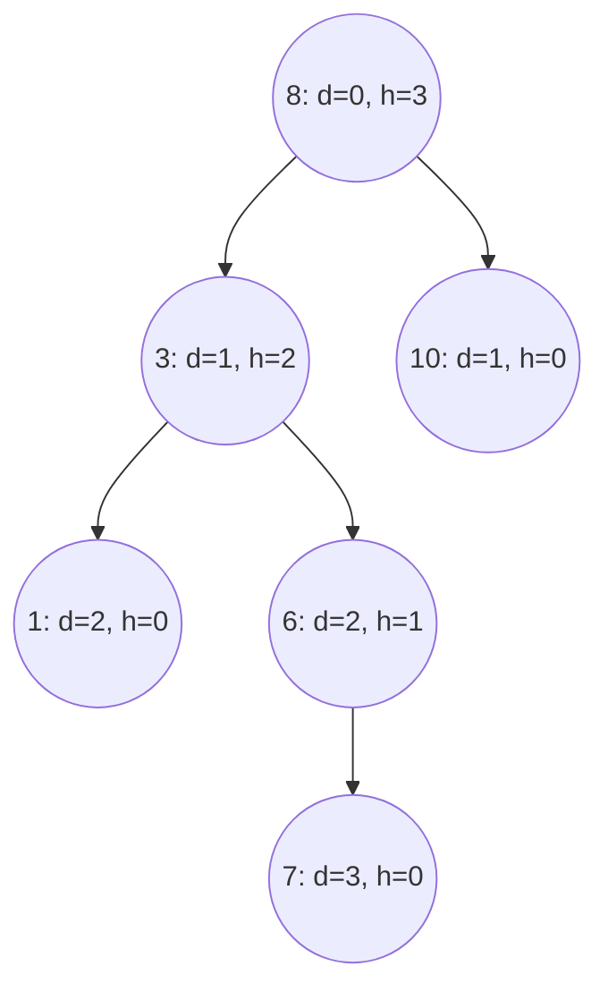

- Pentru depth la `3`, numără de la root: `8 -> 3`.
- Pentru height, numără până la cel mai îndepărtat leaf al său: `3 -> 6 -> 7`.
- Întregul tree are height `3`: `8 -> 3 -> 6 -> 7`.

<br><br><br><br><br><br>

---

<br><br><br><br><br><br>

## Relații de-a lungul unui drum

**Care node-uri apar înainte de `4` pe drumul de la root?**

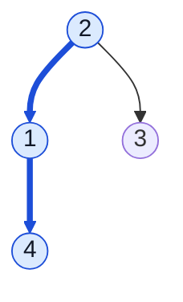

- La care node-uri putem ajunge sub `2`?
- Este `3` pe drumul către `4`?

<br><br><br><br><br><br>

---

<br><br><br><br><br><br>

## Ancestors și descendants

- Un **ancestor** (strămoș) apare mai devreme pe drumul de la root la un node.
- Un **descendant** (descendent) se află sub un node, prin una sau mai multe legături către children.
- Aici, excludem node-ul însuși din ambii termeni.

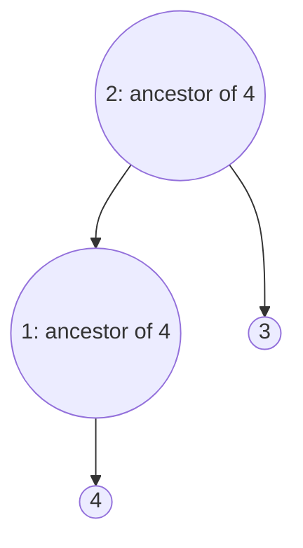

- Ancestors pentru `4`: `2` și `1`. Doar `1` este **parent-ul** său.
- Descendants pentru `2`: `1`, `3` și `4`.
- `3` nu este ancestor pentru `4`.

Sursă: [Open Data Structures (Python), Capitolul 6](https://opendatastructures.org/ods-python/6_Binary_Trees.html).

<br><br><br><br><br><br>

---

<br><br><br><br><br><br>

## Câți children poate avea un node?

**Ar putea `2` să aibă un al treilea child?**

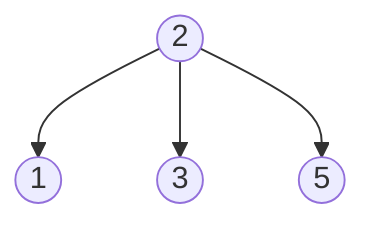

Un tree general poate avea un node cu trei children.

Ce restricție ar face un tree **binary**?

<br><br><br><br><br><br>

---

<br><br><br><br><br><br>

## Un binary tree

Un **binary tree** (arbore binar) dă fiecărui node cel mult doi children:
un **left child** (în stânga) și un **right child** (în dreapta).

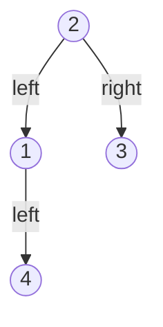

- Un node poate avea `0`, `1` sau `2` children.
- Un singur child poate fi pe oricare parte.
- Acest tree este binary. Valorile sale nu trebuie să fie în ordine sortată.

Sursă: [Open Data Structures (Python), Capitolul 6](https://opendatastructures.org/ods-python/6_Binary_Trees.html).

<br><br><br><br><br><br>

---

<br><br><br><br><br><br>

## Un node de binary tree în Python

<table>
<tr>
<td width="55%" valign="top">

```python
class TreeNode:
    def __init__(self, value):
        self.value = value
        self.left = None
        self.right = None
```

</td>
<td width="45%" valign="top">

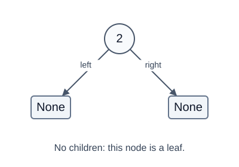

</td>
</tr>
</table>

- Node de linked list: `value` și `next`.
- Node de binary tree: `value`, `left` și `right`.
- `None` înseamnă că nu există un child. Un node nou începe ca leaf.

Clasa stochează legături. Trebuie să le conectăm astfel încât să formeze un tree.

<br><br><br><br><br><br>

---

<br><br><br><br><br><br>

## Construiește tree-ul cu patru node-uri

<table>
<tr>
<td width="55%" valign="top">

```python
root = TreeNode(2)
root.left = TreeNode(1)
root.right = TreeNode(3)
root.left.left = TreeNode(4)

print(root.left.left.value)
print(root.right.left is None)
```

</td>
<td width="45%" valign="top">


</td>
</tr>
</table>

```text
4
True
```

`root` se referă la node-ul din vârf. Un tree gol folosește `root = None`.
Leaf-urile `3` și `4` au fiecare `left = None` și `right = None`.

<br><br><br><br><br><br>

---

<br><br><br><br><br><br>

## Un tree mai mic în interiorul tree-ului

**Dacă pornim de la `1`, care node-uri aparțin tree-ului său?**

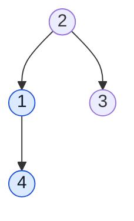

Un **subtree cu root-ul într-un node** conține acel node și toate node-urile descendant ale sale.
Node-urile evidențiate formează subtree-ul cu root-ul în `1`.

Vom folosi termenii **left subtree** (subtree din stânga) și **right subtree** (subtree din dreapta) pentru a formula o
regulă de căutare.

Sursă: [Open Data Structures (Python), Capitolul 6](https://opendatastructures.org/ods-python/6_Binary_Trees.html).

<br><br><br><br><br><br>

---

<br><br><br><br><br><br>

## Ar putea valorile să ghideze o căutare?

**Găsește `6`. Ce child al lui `4` ar trebui să urmăm mai întâi?**

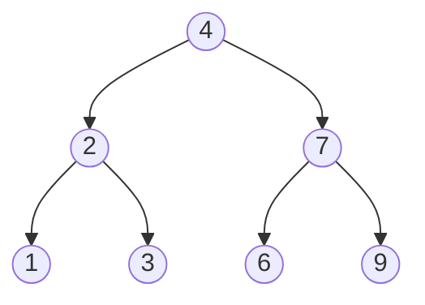

Privește toate valorile din stânga lui `4`. Apoi privește toate valorile din dreapta sa.

Ce regulă ne-ar permite să omitem un subtree întreg?

<br><br><br><br><br><br>

---

<br><br><br><br><br><br>

## Un Binary Search Tree

Un **Binary Search Tree (BST)** este un binary tree cu această regulă la **fiecare node**:

- Fiecare valoare din **left subtree este mai mică** decât valoarea node-ului.
- Fiecare valoare din **right subtree este mai mare** decât valoarea node-ului.

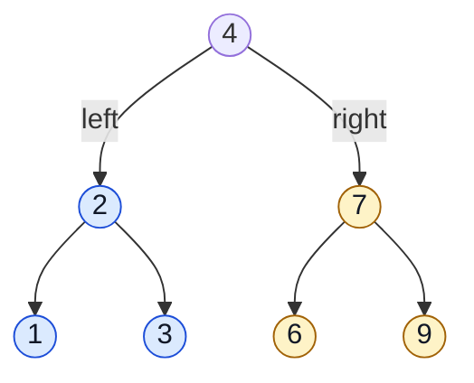

Exemplele noastre folosesc **numere întregi distincte**. Nu stocăm valori duplicate.

Sursă: [Open Data Structures (Python), Secțiunea 6.2](https://opendatastructures.org/ods-python/6_2_BinarySearchTree_Unbala.html).

<br><br><br><br><br><br>

---

<br><br><br><br><br><br>

## Este acesta un BST valid?

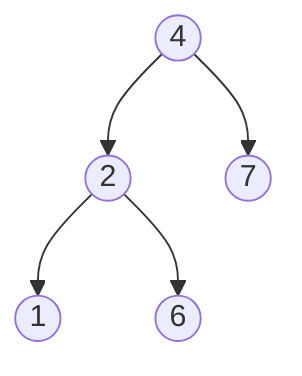

- `2 < 4` și `7 > 4`.
- `1 < 2` și `6 > 2`.

Fiecare child trece verificarea față de parent-ul său direct.

Este suficient?

<br><br><br><br><br><br>

---

<br><br><br><br><br><br>

## Regula se aplică întregului subtree

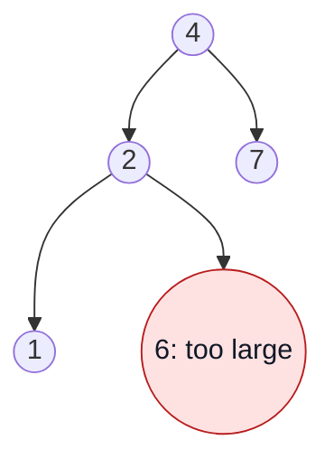

**Acesta este un binary tree, dar încalcă regula BST.**

- `6` este în **left subtree al lui `4`**. Trebuie să fie mai mic decât `4`.
- Ca right child al lui `2`, trebuie să fie și mai mare decât `2`.
- Ambele condiții se aplică: `2 < value < 4`.

O verificare doar față de parent-ul direct poate rata o eroare.

<br><br><br><br><br><br>

---

<br><br><br><br><br><br>

## Căutarea lui 6: prima comparație

**Pornește de la root: `4`.**

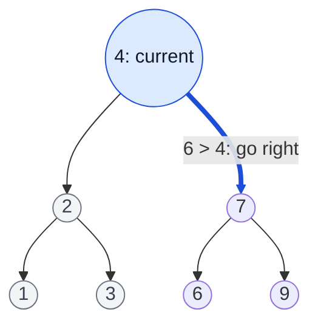

`6 > 4`. Fiecare valoare din left subtree este prea mică. Omite acel subtree.

La `7`, ce legătură ar trebui să urmăm?

<br><br><br><br><br><br>

---

<br><br><br><br><br><br>

## Căutarea lui 6: la stânga, apoi găsim valoarea

```mermaid
flowchart TD
    A((4)) --> B((2))
    A --> C((7))
    B --> D((1))
    B --> E((3))
    C -->|"6 < 7: go left"| F(("6: found"))
    C --> G((9))
    classDef found fill:#dcfce7,stroke:#15803d,color:#111827;
    class F found;
    linkStyle 1,4 stroke:#1d4ed8,stroke-width:4px;
```

```text
Valoare curentă  Compară cu 6        Acțiune
4                6 > 4               Mergi la dreapta
7                6 < 7               Mergi la stânga
6                6 == 6              Returnează True
```

Verificăm **3 node-uri**. Nu vizităm `1`, `2`, `3` sau `9`.

<br><br><br><br><br><br>

---

<br><br><br><br><br><br>

## Ce se întâmplă dacă valoarea căutată lipsește?

**Prezice drumul de căutare pentru `5`. Unde se oprește?**

```mermaid
flowchart TD
    A((4)) --> B((2))
    A --> C((7))
    B --> D((1))
    B --> E((3))
    C --> F((6))
    C --> G((9))
```

Ce ar trebui să returneze o căutare într-un tree gol?

<br><br><br><br><br><br>

---

<br><br><br><br><br><br>

## Căutarea lui 5 ajunge la None

```mermaid
flowchart TD
    A((4)) --> B((2))
    A -->|"5 > 4"| C((7))
    B --> D((1))
    B --> E((3))
    C -->|"5 < 7"| F((6))
    C --> G((9))
    F -->|"5 < 6"| N["None: return False"]
    classDef absent fill:#fee2e2,stroke:#b91c1c,color:#111827;
    class N absent;
    linkStyle 1,4,6 stroke:#1d4ed8,stroke-width:4px;
```

```text
drum căutare:   4 -> 7 -> 6 -> None
rezultat:       False
```

`None` înseamnă că subtree-ul rămas este gol. Un tree gol returnează tot `False`.

<br><br><br><br><br><br>

---

<br><br><br><br><br><br>

## Construiește BST-ul din exemplu

**Folosește aceeași clasă `TreeNode`. Conectează aceste șapte node-uri.**

<table>
<tr>
<td width="55%" valign="top">

```python
bst = TreeNode(4)
bst.left = TreeNode(2)
bst.right = TreeNode(7)
bst.left.left = TreeNode(1)
bst.left.right = TreeNode(3)
bst.right.left = TreeNode(6)
bst.right.right = TreeNode(9)
```

</td>
<td width="45%" valign="top">


</td>
</tr>
</table>

Clasa pentru node-uri rămâne aceeași. **Poziționarea valorilor** face acest tree un BST.

<br><br><br><br><br><br>

---

<br><br><br><br><br><br>

## Căutare recursivă într-un BST în Python

<table>
<tr>
<td width="60%" valign="top">

```python
def search(root, target):
    if root is None:
        return False
    if target == root.value:
        return True
    if target < root.value:
        return search(root.left, target)
    return search(root.right, target)
```

</td>
<td width="40%" valign="top">


</td>
</tr>
</table>

- Fiecare apel caută în subtree-ul cu root-ul indicat de parametrul curent `root`.
- Un apel recursiv transmite un child. Valoarea căutată rămâne aceeași.
- `return` trimite rezultatul apelului pentru child înapoi către apelant.

Sursă: [Open Data Structures (Python), Secțiunea 6.2.1](https://opendatastructures.org/ods-python/6_2_BinarySearchTree_Unbala.html#SECTION00921000000000000000).

<br><br><br><br><br><br>

---

<br><br><br><br><br><br>

## Căutarea durează O(h)

**Ce determină numărul de node-uri pe care le vizităm?**


- Fie `h` valoarea **height** pentru tree. Căutarea urmează un singur drum descendent.
- Un drum are cel mult `h + 1` node-uri cu date. Scriem creșterea costului ca **`O(h)`**.
- Căutarea recursivă folosește și **`O(h)` memorie suplimentară în stack** în worst case.

Căutările într-un tree gol sau cu un singur node durează `O(1)`. Presupunem comparații cu timp constant.

Sursă: [Open Data Structures (Python), Secțiunea 6.2](https://opendatastructures.org/ods-python/6_2_BinarySearchTree_Unbala.html).

<br><br><br><br><br><br>

---

<br><br><br><br><br><br>

## Worst case: o singură ramură până jos

**Găsește `9` în acest BST. Câte node-uri trebuie să verificăm?**

<table>
<tr>
<td width="45%" valign="top">

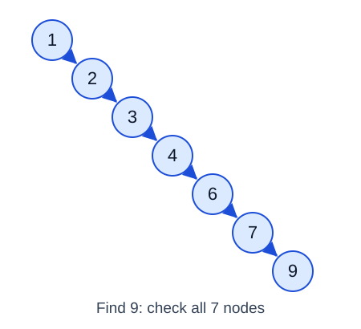

</td>
<td width="55%" valign="top">

- Acesta este un BST valid. Fiecare valoare este mai mare decât valoarea de deasupra sa.
- Are `n = 7` node-uri și height `h = 6`.
- Căutarea lui `9` verifică toate cele `7` node-uri.
- În general, un lanț are `h = n - 1`: **căutarea durează `O(n)` în worst case**.

</td>
</tr>
</table>

Cum am putea păstra drumurile scurte pe măsură ce tree-ul crește?

<br><br><br><br><br><br>

---

<br><br><br><br><br><br>

## Un balanced Binary Search Tree

Un **balanced BST** (BST echilibrat) păstrează height proporțional cu `log n`.
Valorile respectă în continuare aceeași regulă de ordonare BST.


- Drumurile scurte dau **căutare în `O(log n)`**.
- Un **self-balancing BST** (BST care își menține singur echilibrul) păstrează această limită pentru height după inserări și ștergeri.
- AVL trees și red-black trees sunt exemple. Vom folosi doar ideea.

Funcțiile Python de mai jos implementează un BST obișnuit. Ele nu refac echilibrul.

Sursă: [Open Data Structures (Python), Capitolul 9: Red-Black Trees](https://opendatastructures.org/ods-python/9_Red_Black_Trees.html).

<br><br><br><br><br><br>

---

<br><br><br><br><br><br>

## De ce să folosim trees dacă putem căuta și în array-uri?

**Un array sortat ne oferă deja binary search în `O(log n)`.**

```text
[1, 2, 3, 4, 6, 7, 9]
```

- Ce se întâmplă când inserăm `5` și păstrăm array-ul sortat?
- Ce se întâmplă când ștergem `3` și păstrăm valorile rămase în ordine?
- Ar face un linked list aceste schimbări mai ușoare?

Gândește-te atât la **găsirea poziției**, cât și la **schimbarea structurii**.

<br><br><br><br><br><br>

---

<br><br><br><br><br><br>

## Actualizările unui array pot deplasa multe elemente

**Păstrează array-ul în ordine.**

```text
Adaugă 5:
Înainte   [1, 2, 3, 4,    6, 7, 9]
                         Deplasează 6, 7, 9 spre dreapta.
După      [1, 2, 3, 4, 5, 6, 7, 9]

Apoi șterge 3:
Înainte   [1, 2, 3, 4, 5, 6, 7, 9]
                   Deplasează 4, 5, 6, 7, 9 spre stânga.
După      [1, 2,    4, 5, 6, 7, 9]
```

- Binary search găsește poziția în `O(log n)`.
- Inserarea sau ștergerea unui element poate dura tot **`O(n)`** din cauza deplasărilor.
- La sfârșitul unui array dinamic, append și ștergerea au timp amortizat `O(1)`.
  Append păstrează ordinea sortată doar când noua valoare aparține sfârșitului.

Sursă: [Open Data Structures (Python), Secțiunea 2.1: ArrayStack](https://opendatastructures.org/ods-python/2_1_ArrayStack_Fast_Stack_O.html).

<br><br><br><br><br><br>

---

<br><br><br><br><br><br>

## Actualizările unui linked list schimbă legăturile

**Presupune că avem deja node-ul care conține `4`.**

```mermaid
flowchart LR
    A["4"] --> B["6"]
    B --> C["7"]
```

Inserează `5` după `4`:

```mermaid
flowchart LR
    A["4"] --> N["5: new"]
    N --> B["6"]
    B --> C["7"]
```

- Inserarea are nevoie de **`O(1)` schimbări de legături**. Celelalte node-uri rămân pe loc.
- Ștergerea are nevoie tot de `O(1)` schimbări de legături când avem referințele necesare.
  Într-un singly linked list, ștergerea unui node din mijloc cere **predecessor-ul** său (node-ul anterior).
- Găsirea unei poziții sau a unei valori poate dura **`O(n)`**. Schimbarea head-ului durează `O(1)`.

Sursă: [Open Data Structures (Python), Secțiunea 3.1: Singly Linked Lists](https://opendatastructures.org/ods-python/3_1_SLList_Singly_Linked_Li.html).

<br><br><br><br><br><br>

---

<br><br><br><br><br><br>

## Căutare și actualizări împreună

**Pentru `n` valori distincte, compară timpul în worst case.**

| Structură | Găsește o valoare | Inserează o valoare | Șterge o valoare |
| --- | --- | --- | --- |
| Array dinamic sortat | `O(log n)` | `O(n)` | `O(n)` |
| Singly linked list sortat | `O(n)` | `O(n)` | `O(n)` |
| Balanced BST cu menținerea echilibrului | `O(log n)` | `O(log n)` | `O(log n)` |

- Tabelul include găsirea poziției. Pentru un linked list, schimbările de legături
  pot dura singure `O(1)` când avem deja referințele necesare.
- Un balanced BST combină drumuri scurte de căutare cu schimbări ale legăturilor dintre node-uri.
- Pentru date care se schimbă rar, un array sortat poate fi o alegere bună.

Cum putem adăuga sau șterge un node din BST și păstra regula de ordonare?

<br><br><br><br><br><br>

---

<br><br><br><br><br><br>

## Inserarea lui 5: unde aparține?

```mermaid
flowchart TD
    A((4)) --> B((2))
    A --> C((7))
    B --> D((1))
    B --> E((3))
    C --> F((6))
    C --> G((9))
```

- Ce drum ar urma o căutare pentru `5`?
- Ce legătură goală către un child ar trebui să conțină noul node?
- Trebuie să se deplaseze vreo valoare existentă?

<br><br><br><br><br><br>

---

<br><br><br><br><br><br>

## Inserează 5 la legătura goală

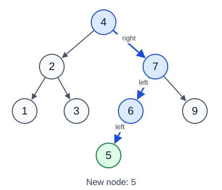

```text
5 > 4     Mergi la dreapta.
5 < 7     Mergi la stânga.
5 < 6     Mergi la stânga.
None      Creează aici un node care conține 5.
```

Noul node începe ca leaf. Node-urile existente își păstrează valorile.
Dacă valoarea există deja, implementarea noastră lasă tree-ul neschimbat.

Sursă: [Open Data Structures (Python), Secțiunea 6.2.2: Inserare](https://opendatastructures.org/ods-python/6_2_BinarySearchTree_Unbala.html#SECTION00922000000000000000).

<br><br><br><br><br><br>

---

<br><br><br><br><br><br>

## Inserare în Python

<table>
<tr>
<td width="60%" valign="top">

```python
def insert(root, value):
    if root is None:
        return TreeNode(value)
    if value < root.value:
        root.left = insert(root.left, value)
    elif value > root.value:
        root.right = insert(root.right, value)
    return root
```

</td>
<td width="40%" valign="top">


</td>
</tr>
</table>

- Fiecare apel returnează root-ul **subtree-ului actualizat**.
- Salvează acel rezultat în legătura `left` sau `right` a parent-ului.
- Valorile egale ajung la `return root`. Nu creăm duplicate.

<br><br><br><br><br><br>

---

<br><br><br><br><br><br>

## Root-ul se poate schimba

**Ce ar trebui să se întâmple dacă inserăm într-un tree gol?**

```mermaid
flowchart LR
    A["None"] -->|"insert 5"| B(("5: new root"))
```

```python
tree = None
tree = insert(tree, 5)
print(tree.value)
```

```text
5
```

Folosește **`tree = insert(tree, value)`** pentru a păstra root-ul returnat.
Aceeași regulă se va aplica la ștergere.

<br><br><br><br><br><br>

---

<br><br><br><br><br><br>

## Ștergerea are trei cazuri

**Continuă cu tree-ul după inserarea lui `5`.**


1. Șterge `3`: este un **leaf**.
2. Apoi șterge `6`: are **un singur child**, `5`.
3. Apoi șterge `4`: are **doi children**.

Ce trebuie să se întâmple cu children rămași în fiecare caz?

<br><br><br><br><br><br>

---

<br><br><br><br><br><br>

## Șterge un leaf

**Șterge `3`. Nu are children.**

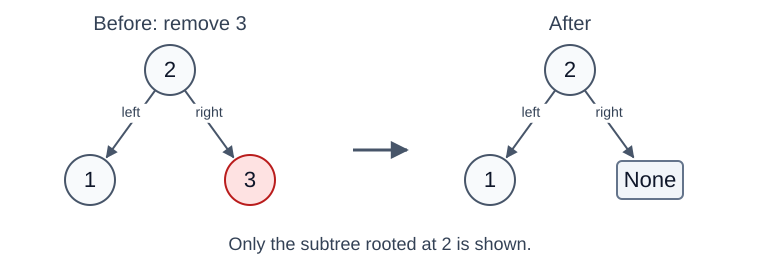

- Găsește `3` cu regula obișnuită de căutare.
- Înlocuiește legătura din dreapta a parent-ului său cu `None`.
- Celelalte node-uri și legături rămân la fel.

Apelul recursiv pentru `3` returnează `None` către parent-ul său, `2`.

Sursă: [Open Data Structures (Python), Secțiunea 6.2.3: Ștergere](https://opendatastructures.org/ods-python/6_2_BinarySearchTree_Unbala.html#SECTION00923000000000000000).

<br><br><br><br><br><br>

---

<br><br><br><br><br><br>

## Șterge un node cu un singur child

**Apoi șterge `6`. Singurul său child este `5`.**


- Înlocuiește legătura către `6` cu o legătură către `5`.
- Apelul recursiv returnează child-ul ca nou root al subtree-ului.
- Aceasta funcționează și când singurul child este în dreapta.

Fiecare valoare din subtree-ul promovat era deja în intervalul corect.

<br><br><br><br><br><br>

---

<br><br><br><br><br><br>

## Returnează child-ul rămas

**Aceste ramuri rulează după ce găsim valoarea de șters.**

```python
if root.left is None:
    return root.right
if root.right is None:
    return root.left
```

```text
Fără left child    Returnează right child.
Fără right child   Returnează left child.
Fără children      Prima ramură returnează None.
```

Apelantul salvează referința returnată în legătura sa către child.
Dacă ștergem root-ul întregului tree, apelantul actualizează variabila root.

<br><br><br><br><br><br>

---

<br><br><br><br><br><br>

## Șterge un node cu doi children

**Acum șterge `4`. Ce valoare l-ar putea înlocui?**

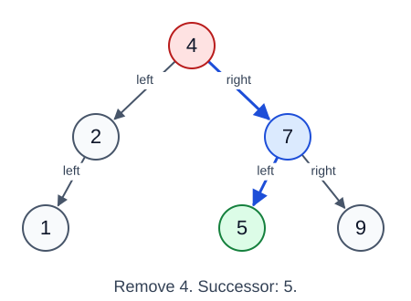

- Valoarea de înlocuire trebuie să fie mai mare decât fiecare valoare din left subtree.
- Trebuie să fie mai mică decât fiecare valoare care rămâne în right subtree.

Ar păstra această regulă copierea valorii din right child, `7`?

<br><br><br><br><br><br>

---

<br><br><br><br><br><br>

## Successor este următoarea valoare mai mare

Pentru un node cu doi children, **successor-ul** său este cea mai mică valoare
din right subtree al său.


- Pornește de la right child, `7`. Urmează legăturile din stânga până când nu mai există.
- Aici, successor este **`5`**.
- Copierea lui `7` ar lăsa `5` în right subtree al său, ceea ce încalcă regula BST.

Sursă: [Open Data Structures (Python), Secțiunea 6.2.3: Ștergere](https://opendatastructures.org/ods-python/6_2_BinarySearchTree_Unbala.html#SECTION00923000000000000000).

<br><br><br><br><br><br>

---

<br><br><br><br><br><br>

## Găsește node-ul cu valoarea minimă

**Subtree-ul primit ca input trebuie să fie nevid.**

<table>
<tr>
<td width="60%" valign="top">

```python
def min_node(root):
    current = root
    while current.left is not None:
        current = current.left
    return current
```

</td>
<td width="40%" valign="top">


</td>
</tr>
</table>

- Mersul spre stânga ajunge întotdeauna la o valoare mai mică.
- Oprește-te la primul node al cărui `left` este `None`.
- Returnează **node-ul**, astfel încât apelantul să poată citi câmpul său `value`.

La ștergerea unui node cu doi children, `root.right` este garantat nevid.

<br><br><br><br><br><br>

---

<br><br><br><br><br><br>

## Copiază successor, apoi șterge node-ul său vechi

**Înlocuiește valoarea `4` cu `5`. Apoi șterge vechiul `5` din right subtree.**


1. Păstrează node-ul root și legăturile sale. Schimbă valoarea stocată în `5`.
2. Șterge node-ul original al successor-ului din right subtree.

Successor-ul nu are left child. Ștergerea sa folosește unul dintre cazurile mai simple.
Dacă are un right child, păstrează acel child.

<br><br><br><br><br><br>

---

<br><br><br><br><br><br>

## Ștergere în Python

<table>
<tr>
<td width="65%" valign="top">

```python
def remove(root, value):
    if root is None:
        return None
    if value < root.value:
        root.left = remove(root.left, value)
    elif value > root.value:
        root.right = remove(root.right, value)
    else:
        if root.left is None:
            return root.right
        if root.right is None:
            return root.left
        successor = min_node(root.right)
        root.value = successor.value
        root.right = remove(root.right, successor.value)
    return root
```

</td>
<td width="35%" valign="top">


</td>
</tr>
</table>

Fiecare apel returnează root-ul subtree-ului actualizat. O valoare absentă ajunge la `None`
și lasă tree-ul existent neschimbat.

- Primele două ramuri tratează zero sau un child, inclusiv ștergerea successor-ului.
- Pasul pentru successor rulează doar când există ambii children.

<br><br><br><br><br><br>

---

<br><br><br><br><br><br>

## Inserarea și ștergerea durează O(h)

**Height determină și costul acestor operații.**

| Operație | Munca principală | Timp în worst case |
| --- | --- | --- |
| Inserare | Găsește o valoare sau o legătură goală către un child | `O(h)` |
| Ștergere | Găsește node-ul, apoi eventual successor-ul său | `O(h)` |

- Găsirea successor-ului rămâne pe un singur drum descendent. Nu parcurge
  fiecare node din right subtree.
- Implementările noastre recursive folosesc **`O(h)` memorie suplimentară în stack**.
- Un lanț face ca aceste operații să dureze **`O(n)`** în worst case.
- Un self-balancing BST menține `h = O(log n)`, cu menținerea echilibrului
  inclusă în limitele `O(log n)` pentru actualizări.

Funcțiile noastre păstrează regula de ordonare. Nu garantează height logarithmic.
Operațiile pe un tree gol durează `O(1)`.

Surse: [Operații BST](https://opendatastructures.org/ods-python/6_2_BinarySearchTree_Unbala.html),
[limite pentru red-black trees](https://opendatastructures.org/ods-python/9_Red_Black_Trees.html).

<br><br><br><br><br><br>

---

<br><br><br><br><br><br>

## Urmărește căutarea și actualizările

**[University of San Francisco: Vizualizare Binary Search Tree](https://www.cs.usfca.edu/~galles/visualization/BST.html)**

1. Pe o pagină nouă, folosește **Insert** pentru `4`, `2`, `7`, `1`, `3`, `6`, `9`, în această ordine.
2. Folosește **Find** pentru `6`, apoi pentru `5`. Folosește **Pause** și **Step Forward** pentru a urmări drumurile.
3. Folosește **Insert** pentru `5`. Apoi **Delete** pentru `3` și **Delete** pentru `6`.
4. Înainte de ștergerea lui `4`, prezice cazul cu doi children.

Instrumentul folosește **cea mai mare valoare din left subtree** la ștergerea cu doi children.
Codul nostru Python folosește **cea mai mică valoare din right subtree**.
Ambele alegeri păstrează regula BST, dar root-ul final poate fi diferit.

Sursă: [Implementarea vizualizării USF](https://www.cs.usfca.edu/~galles/visualization/AlgorithmLibrary/BST.js).
Folosește codul și diagramele noastre pentru pașii exacți ai successor-ului.

<br><br><br><br><br><br>

---

<br><br><br><br><br><br>

## Cum putem vizita fiecare node?

**Căutarea a urmat un singur drum. Cum am putea afișa toate cele șapte valori?**

```mermaid
%%{init: {"themeVariables": {"fontSize": "26px"}}}%%
flowchart TD
    A((4)) --> B((2))
    A --> C((7))
    B --> D((1))
    B --> E((3))
    C --> F((6))
    C --> G((9))
```

Folosește din nou BST-ul original, înainte de inserare și ștergere.

- De unde ar trebui să pornim?
- Ce child ar trebui să urmăm mai întâi?
- Când ar trebui să afișăm node-ul curent?

<br><br><br><br><br><br>

---

<br><br><br><br><br><br>

## Depth-first traversal (DFS)

Un **traversal** procesează fiecare node o singură dată, într-o ordine aleasă.
**Depth-first search (DFS)** parcurge complet subtree-ul unui child înainte de următorul.

```mermaid
flowchart LR
    A["Enter the current node's call"] --> B["Traverse the left subtree"]
    B --> C["Traverse the right subtree"]
    C --> D["Return to the caller"]
```

- Funcțiile noastre recursive folosesc **call stack** pentru a ține minte unde să revină.
- Aici, **visit** înseamnă afișarea valorii node-ului. Un apel poate începe înainte să afișeze.
- Plasează visit înaintea, între sau după cele două apeluri pentru children.

Aceste traversals funcționează pe orice binary tree. Un BST adaugă regula de ordonare.

Sursă: [Open Data Structures (Python), Secțiunea 6.1.2](https://opendatastructures.org/ods-python/6_1_BinaryTree_Basic_Binary.html#SECTION00912000000000000000).

<br><br><br><br><br><br>

---

<br><br><br><br><br><br>

## Inorder: când ar trebui să afișăm root-ul?

**Regulă: left subtree, node-ul curent, right subtree.**

```mermaid
%%{init: {"themeVariables": {"fontSize": "26px"}}}%%
flowchart TD
    A((4)) --> B((2))
    A --> C((7))
    B --> D((1))
    B --> E((3))
    C --> F((6))
    C --> G((9))
```

Aplică aceeași regulă în interiorul fiecărui subtree.

Prezice output-ul complet. Ce valoare apare prima? Unde apare `4`?

Sursă: [Inorder traversal](https://visualgo.net/en/bst).

<br><br><br><br><br><br>

---

<br><br><br><br><br><br>

## Inorder în Python

**Stânga, node, dreapta.** Fiecare marcaj albastru mic arată pasul de vizitare.

<table>
<tr>
<td width="60%" valign="top">

```python
def inorder(root):
    if root is None:
        return
    inorder(root.left)
    print(root.value, end=" ")
    inorder(root.right)
```

</td>
<td width="40%" valign="top">


</td>
</tr>
</table>

```text
inorder(bst) scrie:   1 2 3 4 6 7 9
```

`None` revine fără output. `end=" "` păstrează valorile pe o singură linie.

<br><br><br><br><br><br>

---

<br><br><br><br><br><br>

## Urmărește primele apeluri inorder

**Un apel începe la `4`, dar prima valoare afișată este `1`.**

```text
inorder(4)
    inorder(2)
        inorder(1)
            inorder(None) -> return
            print 1
            inorder(None) -> return
        print 2
        inorder(3)        -> print 3, apoi return
    print 4
    inorder(7)            -> print 6, apoi 7, apoi 9
```

- Apelul pentru `4` așteaptă cât timp rulează întregul său left subtree.
- Fiecare revenire continuă apelantul de la următoarea sa linie.
- Nicio legătură către children nu se schimbă în timpul traversal-ului.

<br><br><br><br><br><br>

---

<br><br><br><br><br><br>

## Preorder: ce se întâmplă dacă afișăm mai întâi?

**Regulă: node-ul curent, left subtree, right subtree.**

```mermaid
%%{init: {"themeVariables": {"fontSize": "26px"}}}%%
flowchart TD
    A((4)) --> B((2))
    A --> C((7))
    B --> D((1))
    B --> E((3))
    C --> F((6))
    C --> G((9))
```

Prima valoare este `4`. Prezice următoarele șase valori.

Parcurge complet left subtree înainte de a începe right subtree.

Sursă: [Preorder traversal](https://visualgo.net/en/bst).

<br><br><br><br><br><br>

---

<br><br><br><br><br><br>

## Preorder în Python

**Node, stânga, dreapta.** Vizitarea are loc înaintea oricărui apel pentru children.

<table>
<tr>
<td width="60%" valign="top">

```python
def preorder(root):
    if root is None:
        return
    print(root.value, end=" ")
    preorder(root.left)
    preorder(root.right)
```

</td>
<td width="40%" valign="top">

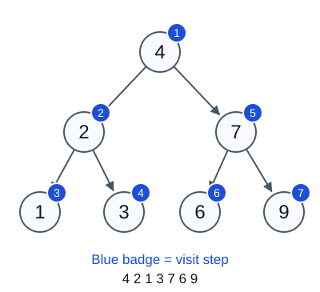

</td>
</tr>
</table>

```text
preorder(bst) scrie:   4 2 1 3 7 6 9
```

Fiecare parent își afișează valoarea înaintea node-urilor descendant ale sale.

<br><br><br><br><br><br>

---

<br><br><br><br><br><br>

## Postorder: ce se întâmplă dacă afișăm la final?

**Regulă: left subtree, right subtree, node-ul curent.**

```mermaid
%%{init: {"themeVariables": {"fontSize": "26px"}}}%%
flowchart TD
    A((4)) --> B((2))
    A --> C((7))
    B --> D((1))
    B --> E((3))
    C --> F((6))
    C --> G((9))
```

Ce valoare se afișează ultima? Prezice mai întâi output-ul fiecărui subtree.

Sursă: [Postorder traversal](https://visualgo.net/en/bst).

<br><br><br><br><br><br>

---

<br><br><br><br><br><br>

## Postorder în Python

**Stânga, dreapta, node.** Vizitarea are loc după ce ambele apeluri pentru children revin.

<table>
<tr>
<td width="60%" valign="top">

```python
def postorder(root):
    if root is None:
        return
    postorder(root.left)
    postorder(root.right)
    print(root.value, end=" ")
```

</td>
<td width="40%" valign="top">

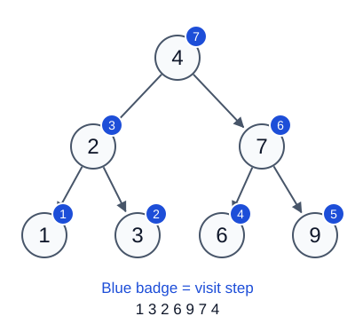

</td>
</tr>
</table>

```text
postorder(bst) scrie:   1 3 2 6 9 7 4
```

Fiecare parent își afișează valoarea după node-urile descendant ale sale.

<br><br><br><br><br><br>

---

<br><br><br><br><br><br>

## Compară cele trei ordini DFS

**Poziția vizitării dă numele traversal-ului.**

| Ordine | Regulă | Output pentru BST-ul nostru |
| --- | --- | --- |
| Preorder | Node, stânga, dreapta | `4 2 1 3 7 6 9` |
| Inorder | Stânga, node, dreapta | `1 2 3 4 6 7 9` |
| Postorder | Stânga, dreapta, node | `1 3 2 6 9 7 4` |

**De ce este inorder sortat pentru un BST?**

- Fiecare valoare din left subtree este mai mică decât valoarea curentă.
- Fiecare valoare din right subtree este mai mare.
- Inorder aplică această regulă la fiecare node.

Inorder funcționează și pe un binary tree fără regula BST, dar output-ul său
nu este garantat sortat.

<br><br><br><br><br><br>

---

<br><br><br><br><br><br>

## Cum am putea vizita câte un nivel?

**Afișează root-ul, apoi depth 1, apoi depth 2.**

```mermaid
%%{init: {"themeVariables": {"fontSize": "26px"}}}%%
flowchart TD
    A((4)) --> B((2))
    A --> C((7))
    B --> D((1))
    B --> E((3))
    C --> F((6))
    C --> G((9))
```

Prezice output-ul, cu stânga înainte de dreapta la fiecare nivel.

Ce structură poate păstra node-urile în așteptare în ordinea **primul intrat, primul ieșit**?

<br><br><br><br><br><br>

---

<br><br><br><br><br><br>

## Breadth-first traversal (BFS)

**Breadth-first search (BFS)** vizitează node-urile după depth, pornind de la root.
Se mai numește **level-order traversal** (parcurgere pe niveluri).

<table>
<tr>
<td width="50%" valign="top">

- Folosește o **FIFO queue**. Pornește cu root-ul.
- Extrage node-ul din front (începutul queue-ului) și vizitează-l.
- Adaugă left child, apoi right child, la back (sfârșitul queue-ului), dacă există.

</td>
<td width="50%" valign="top">

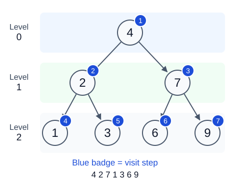

</td>
</tr>
</table>

Sursă: [Open Data Structures (Python), Secțiunea 6.1.2](https://opendatastructures.org/ods-python/6_1_BinaryTree_Basic_Binary.html#SECTION00912000000000000000).

<br><br><br><br><br><br>

---

<br><br><br><br><br><br>

## Urmărește queue-ul BFS

**Front-ul este în stânga.** Acestea sunt valorile node-urilor; queue-ul stochează referințe către node-uri.

```text
Visit       Queue după adăugarea node-urilor child
-----       -------------------------------------
(start)     [4]
4           [2, 7]
2           [7, 1, 3]
7           [1, 3, 6, 9]
1           [3, 6, 9]
3           [6, 9]
6           [9]
9           []
```

`7` aștepta înainte de `1` și `3`, deci iese primul.
Queue-ul gol încheie traversal-ul.

<br><br><br><br><br><br>

---

<br><br><br><br><br><br>

## BFS în Python

<table>
<tr>
<td width="60%" valign="top">

```python
from collections import deque

def bfs(root):
    if root is None:
        return
    queue = deque([root])
    while queue:
        current = queue.popleft()
        print(current.value, end=" ")
        if current.left is not None:
            queue.append(current.left)
        if current.right is not None:
            queue.append(current.right)
```

</td>
<td width="40%" valign="top">


</td>
</tr>
</table>

```text
bfs(bst) scrie:   4 2 7 1 3 6 9
```

Folosește `popleft()` pentru a extrage din front și `append()` pentru a adăuga la back.
Ambele durează `O(1)`. Operația `pop(0)` pe o listă Python cere `O(n)` deplasări.

Sursă: [Documentația Python: deque](https://docs.python.org/3/library/collections.html#collections.deque).

<br><br><br><br><br><br>

---

<br><br><br><br><br><br>

## Cum poate BFS să marcheze fiecare nivel?

**La începutul unui nivel, queue-ul conține exact node-urile acelui nivel.**

```text
Nivel    Queue la început     Salvăm level_size  Queue după acest nivel
-----    -----------------    ---------------    ----------------------
0        [4]                  1                  [2, 7]
1        [2, 7]               2                  [1, 3, 6, 9]
2        [1, 3, 6, 9]         4                  []
```

1. Salvează `level_size = len(queue)` înainte de procesarea nivelului.
2. Extrage exact `level_size` node-uri. Adaugă node-urile child ale lor ca de obicei.
3. Acei children formează nivelul următor. Mărește `level` cu `1`.

De ce trebuie să rămână fix numărul de extrageri în timp ce queue-ul se schimbă?

<br><br><br><br><br><br>

---

<br><br><br><br><br><br>

## BFS pe niveluri în Python

<table>
<tr>
<td width="60%" valign="top">

```python
def bfs_levels(root):
    if root is None:
        return
    queue = deque([root])
    level = 0
    while queue:
        level_size = len(queue)
        print("Level", level, end=": ")
        for _ in range(level_size):
            current = queue.popleft()
            print(current.value, end=" ")
            if current.left is not None:
                queue.append(current.left)
            if current.right is not None:
                queue.append(current.right)
        print()
        level += 1
```

</td>
<td width="40%" valign="top">


</td>
</tr>
</table>

Folosește același import pentru `deque`. `_` înseamnă că nu folosim contorul buclei.
Valoarea salvată `level_size` păstrează node-urile child nou adăugate pentru următoarea iterație a buclei `while`.

<br><br><br><br><br><br>

---

<br><br><br><br><br><br>

## Timpul unui traversal și memoria suplimentară

Fie `n` numărul de node-uri, `h` valoarea height și `w` numărul maxim de node-uri pe un nivel.

| Traversal complet | Timp | Memorie suplimentară de lucru |
| --- | --- | --- |
| DFS recursiv | `O(n)` | `O(h)` call stack |
| BFS | `O(n)` | `O(w)` queue |

- Fiecare node își afișează valoarea o singură dată. Chiar și un balanced BST are nevoie de `O(n)` pentru un traversal complet.
- Un lanț poate folosi `O(n)` memorie în stack. Un tree lat poate folosi `O(n)` memorie în queue.
- Salvarea tuturor valorilor într-o listă rezultat adaugă `O(n)` memorie pentru output.

Height numără edges. Apelurile pe un tree gol sau cu un singur node folosesc `O(1)` memorie.
Python limitează adâncimea apelurilor recursive. Un tree foarte adânc poate provoca `RecursionError`.

Surse: [Tree traversal și adâncimea recursion](https://opendatastructures.org/ods-python/6_1_BinaryTree_Basic_Binary.html#SECTION00912000000000000000),
[limita recursion în Python](https://docs.python.org/3/library/sys.html#sys.getrecursionlimit).

<br><br><br><br><br><br>

---

<br><br><br><br><br><br>

## Urmărește cele trei ordini DFS

**[VisuAlgo: Binary Search Tree](https://visualgo.net/en/bst)** animă inorder, preorder și postorder.

1. Folosește **Exploration Mode** și view-ul obișnuit **BST**.
2. Folosește același tree afișat pentru toate cele trei animații de traversal.
3. Prezice următoarea valoare afișată, apoi avansează un pas.
4. Compară momentul în care fiecare traversal afișează root-ul.

Tree-ul poate fi diferit de exemplul nostru cu șapte node-uri. Folosește valorile sale curente
când prezici output-ul.

Pentru BFS, urmărește pașii queue-ului și rulează `bfs` sau `bfs_levels` în exemplul nostru Python.

<br><br><br><br><br><br>

---

<br><br><br><br><br><br>

## Rulează exemplul Python

Descarcă sau clonează repository-ul cursului. Rulează din folderul său rădăcină:

```text
python3 slides/examples/06-trees.py
```

[Programul Python complet](examples/06-trees.py) construiește cele două tree-uri și rulează
căutarea, inserarea, ștergerea și toate cele patru ordini de traversal.
Reconstruiește BST-ul original cu șapte node-uri înainte de apelurile de traversal.

Compară ordinea valorilor afișate pentru fiecare traversal:

```text
Inorder:    1 2 3 4 6 7 9
Preorder:   4 2 1 3 7 6 9
Postorder:  1 3 2 6 9 7 4
BFS:        4 2 7 1 3 6 9

Level 0: 4
Level 1: 2 7
Level 2: 1 3 6 9
```

Repository-ul public pentru studenți are `slides/` în rădăcină.

<br><br><br><br><br><br>

---

<br><br><br><br><br><br>

## LeetCode: tree traversals

- [94. Binary Tree Inorder Traversal](https://leetcode.com/problems/binary-tree-inorder-traversal/) - **Easy**.
  Returnează valorile node-urilor în inorder.
- [144. Binary Tree Preorder Traversal](https://leetcode.com/problems/binary-tree-preorder-traversal/) - **Easy**.
  Returnează valorile node-urilor în preorder.
- [145. Binary Tree Postorder Traversal](https://leetcode.com/problems/binary-tree-postorder-traversal/) - **Easy**.
  Returnează valorile node-urilor în postorder.
- [102. Binary Tree Level Order Traversal](https://leetcode.com/problems/binary-tree-level-order-traversal/) - **Medium**.
  Returnează valorile nivel cu nivel, cu o listă pentru fiecare nivel.

<br><br><br><br><br><br>

---

<br><br><br><br><br><br>

## LeetCode: căutare și actualizări BST

- [700. Search in a Binary Search Tree](https://leetcode.com/problems/search-in-a-binary-search-tree/) - **Easy**.
  Returnează node-ul corespunzător sau `None` dacă valoarea lipsește.
- [701. Insert into a Binary Search Tree](https://leetcode.com/problems/insert-into-a-binary-search-tree/) - **Medium**.
  Inserează o valoare nouă și returnează root-ul actualizat.
- [450. Delete Node in a BST](https://leetcode.com/problems/delete-node-in-a-bst/) - **Medium**.
  Șterge o valoare și returnează root-ul actualizat.

<br><br><br><br><br><br>

---

<br><br><br><br><br><br>

## LeetCode: depth și ordinea BST

- [104. Maximum Depth of Binary Tree](https://leetcode.com/problems/maximum-depth-of-binary-tree/) - **Easy**.
  Găsește numărul de **node-uri** de pe cel mai lung drum de la root la leaf.
  Această problemă numără node-uri; height din lecția noastră numără edges.
- [98. Validate Binary Search Tree](https://leetcode.com/problems/validate-binary-search-tree/) - **Medium**.
  Verifică dacă întregul tree respectă regula strictă BST.
- [230. Kth Smallest Element in a BST](https://leetcode.com/problems/kth-smallest-element-in-a-bst/) - **Medium**.
  Returnează a `k`-a cea mai mică valoare. Numărarea începe de la `1`.
