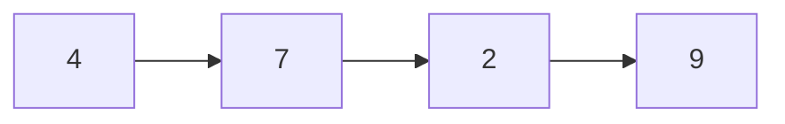
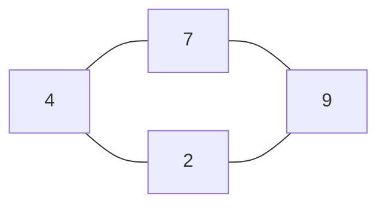
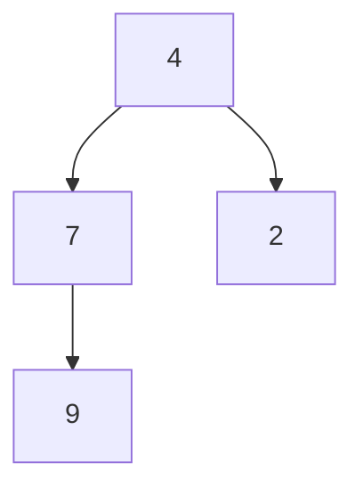

# Data Structures and Algorithms

How do we store data?

How do we tell a computer what to do with it?

---

## What is an algorithm?

**Give a few examples.**

- Think of daily life or a computer program.
- Choose one example. What are its steps?

Take a moment to think. Then share your answer.

---

## An algorithm

**Definition:**

An algorithm is a finite set of clear rules that solves a type of problem
and finishes after a finite number of steps.

Source: Donald Knuth, [The Art of Computer Programming, Vol. 1, Section 1.1: Algorithms](https://www.informit.com/articles/article.aspx?p=2221792).

**Characteristics:**

- **Finiteness:** The algorithm must always terminate after a finite number of steps.
- **Definiteness:** Each step must be precisely defined, with actions rigorously and unambiguously specified for every case.
- **Input:** An algorithm has zero or more inputs, taken from a specified set of objects.
- **Output:** An algorithm has one or more outputs, which share a specified relation to the inputs.
- **Effectiveness:** All operations must be basic enough that they can be performed exact and in principle by a person using just pencil and paper.

---

## Adding four numbers

**Input:** `[4, 7, 2, 9]`

Start with a total of `0`. Read each number and add it to the total.

```text
Start       0
Add 4       4
Add 7      11
Add 2      13
Add 9      22
```

**Output:** `22`

What should this algorithm return for an empty input?

---

## Finding a number

**Find** `2`**.** Check each number from left to right. Stop at a match or at the end.

```text
Numbers       4     7     2     9
Match?        no    no    yes
```

If we search for `5`, when do we stop?

Further reading: Donald Knuth, [The Art of Computer Programming, Vol. 3](https://www.informit.com/store/art-of-computer-programming-volume-3-sorting-and-searching-9780201896855), Sections 6.1: Sequential Searching and 5.2.3: Sorting by Selection.

---

## Putting numbers in order

**Input:** `[4, 7, 2, 9]`

Repeatedly remove one smallest remaining number and add it to the end
of a new sequence.

```text
After step 1     [2]
After step 2     [2, 4]
After step 3     [2, 4, 7]
After step 4     [2, 4, 7, 9]
```

**Output:** `[2, 4, 7, 9]`

---

## What is a data structure?

**Give a few examples.**

- Which ones have you used in a program?
- How do they organize the data?

Take a moment to think. Then share your answer.

---

## A data structure

[Open Data Structures, Section 1.2: Interfaces](https://opendatastructures.org/ods-python/1_2_Interfaces.html).

Definition:

**A data structure organizes and stores data so that we can use it effectively.**

Its organization affects how we find, read, add, and remove values.

---

## Lists, maps, and graphs

**Three useful ways to organize data.**

| Group | Main idea | Examples |
| --- | --- | --- |
| Lists (sequences) | Elements have positions in a sequence. | Array, linked list |
| Maps | Each key identifies one value. | Hash map |
| Graphs | Nodes have connections. | General graph, tree |

These groups guide this introduction. Other structures also exist.

Source: [Open Data Structures, Chapter 12: Graphs](https://opendatastructures.org/ods-python/12_Graphs.html).

  
  
  
  
  
  


---

  
  
  
  
  
  


## An array

**Elements in a sequence. Each element has an index.**

```text
Index      0     1     2     3
        +-----+-----+-----+-----+
Value   |  4  |  7  |  2  |  9  |
        +-----+-----+-----+-----+
```

Which value is at index `2`?  
Why arrays start at index `0`?

Source: [Open Data Structures, Chapter 2: Array-Based Lists](https://opendatastructures.org/ods-python/2_Array_Based_Lists.html).

---

## A linked list

**Each node holds a value and a link to the next node.**



The last node has no next node.

Starting at `4`, which links would you follow to reach `2`?

Source: [Open Data Structures, Section 3.1: A Singly-Linked List](https://opendatastructures.org/ods-python/3_1_SLList_Singly_Linked_Li.html).

---

## A hash map

**Look up a value by its key.**

```text
Key     Value
 4        7
 2        9
```

- Each key has one associated value.
- A hash map uses a hash function to choose a storage location for a key.
- A hash map is one way to implement a map.

Which value belongs to key `2`?

Source: Open Data Structures, [Chapter 5: Hash Tables](https://opendatastructures.org/ods-python/5_Hash_Tables.html).

  
  
  
  
  
  


---

  
  
  
  
  
  


## A graph

**Nodes and the connections between them.**



- A node is also called a **vertex**.
- A connection is called an **edge**.
- Here, each connection works in both directions.

Can you leave `4` and return to it without using an edge twice?

  
  
  
  
  
  


---

  
  
  
  
  
  


## A tree

**A tree is a connected graph with no cycles.**

Choose a root to describe parent and child relationships.



- `4` is the root. It has no parent.
- Each other node has one parent.

Which nodes are the children of `4`?

Source: [Open Data Structures, Chapter 6: Binary Trees](https://opendatastructures.org/ods-python/6_Binary_Trees.html).

<br><br><br><br><br><br>

---

<br><br><br><br><br><br>

## Course syllabus

1. **Arrays and complexity:** memory, static and dynamic arrays, linear search, time and space costs, amortized append.
2. **Linked structures:** linked lists, stacks, queues, LIFO and FIFO.
3. **Sorting and recursion:** insertion sort, bubble and selection sort overview, recursion, merge sort.
4. **Quicksort and binary search:** partitioning, pivot choice, search in sorted data.
5. **Hash sets and maps:** hashing, collisions, load factor, resize, lookup costs.
6. **Graphs:** trees, adjacency lists, DFS, BFS, shortest paths by edge count.
7. **Applications:** merge room bookings, count islands, find campus routes.
8. **Further study:** trees and indexes, weighted paths, dynamic programming, backtracking, specialized structures.

[Course materials](../readme.md).

<br><br><br><br><br><br>

---

<br><br><br><br><br><br>

## Course organization

- **Lectures:** 8.
- **Labs:** 5.
- **Final grade:** exam **60%**, labs **40%**.
- All labs will be based on [LeetCode](https://leetcode.com/).

**Before the first lab, create a LeetCode account.**

<br><br><br><br><br><br>

---

<br><br><br><br><br><br>

## Goals and non-goals

**Goals**

- Build a more formal foundation for programming.
- Develop intuition about how computers work.
- Learn core concepts: Big-O complexity, sorting, trees, and basic tree applications.
- See a wider range of topics for independent study.

**Non-goals**

- Teach programming basics. You should already know them.
- Train for competitive programming.
- Study every topic in depth.

**Read the linked sources. Explore beyond the lectures!**

<br><br><br><br><br><br>

---

<br><br><br><br><br><br>

## Where does an array live?

```text
[4, 7, 2, 9]
```

We write four numbers. The computer must store them somewhere.

- What does one number look like in memory?
- How does the computer find the value at index `2`?
- Where could a fifth value go?

**Share your ideas before we look inside.**

<br><br><br><br><br><br>

---

<br><br><br><br><br><br>

## Bits and bytes

- A **bit** has one of two values: `0` or `1`.
- On the computers we use, **one byte is 8 bits**.
- In binary, each position has a place value.

```text
Place value   128  64  32  16   8   4   2   1
Bit             0   0   0   0   0   1   0   0

00000100 = 4
```

**Which bits must be `1` to represent `7`?**

Source: [CS50: Binary numbers](https://cs50.harvard.edu/x/2025/notes/0/#computer-science-and-problem-solving).

<br><br><br><br><br><br>

---

<br><br><br><br><br><br>

## How much can one byte store?

```text
00000111 =   4 + 2 + 1 = 7

00000000 =   0
11111111 = 255
```

- Eight bits give `2^8 = 256` different patterns.
- As an **unsigned integer**, one byte can represent `0` through `255`.
- The data type tells the program how to interpret the bits.

**Can we store the unsigned integer `256` in one byte?**

<br><br><br><br><br><br>

---

<br><br><br><br><br><br>

## A 32-bit integer

**One byte is too small for many numbers. We can use more bytes.**

- `i32` means a signed integer with 32 bits.
- In C, we use `int32_t` from `<stdint.h>`.
- With 8 bits per byte, `32 / 8 = 4` bytes per integer.
- Signed means that the type supports negative numbers as well as zero and positive numbers.

```text
The 32-bit pattern for 4, highest place value on the left:

00000000 00000000 00000000 00000100
<--------------- 32 bits ------------->
```

`int32_t` uses four bytes even for a small value such as `4`.
Plain C `int` can have a different size on a different machine.

**How many bytes do four `int32_t` values need?**

Source: [GNU C Library: Exact-width integer types](https://sourceware.org/glibc/manual/latest/html_node/Integers.html).

<br><br><br><br><br><br>

---

<br><br><br><br><br><br>

## RAM and memory addresses

**Think of RAM as a large array of bytes with a fixed capacity.**

```text
Address    0x1000  0x1001  0x1002  0x1003  0x1004  0x1005  ...
          +-------+-------+-------+-------+-------+-------+
Byte      |       |       |       |       |       |       | ...
          +-------+-------+-------+-------+-------+-------+
```

- Addresses use **hexadecimal (base 16)**, with the prefix `0x`.
- Each address identifies one byte in this model.
- A four-byte value uses four consecutive byte locations.
- A **base address** is the address where an array starts.

These are example addresses for calculation.
A C program normally sees **virtual addresses**. The operating system maps them to physical memory.

Source: [GNU C Library: Process memory concepts](https://sourceware.org/glibc/manual/latest/html_node/Memory-Concepts.html).

<br><br><br><br><br><br>

---

<br><br><br><br><br><br>

## An integer array in memory

```c
int32_t values[4] = {4, 7, 2, 9};
```

**Four integers use `4 * 4 = 16` bytes.**

```text
Index            0               1               2               3
Value            4               7               2               9
          +---------------+---------------+---------------+---------------+
Bytes     | 0x1000-0x1003 | 0x1004-0x1007 | 0x1008-0x100B | 0x100C-0x100F |
          +---------------+---------------+---------------+---------------+
```

- Each element has the same type and size.
- The elements are **contiguous**: they follow each other with no gaps.
- The base address in this example is `0x1000`.

<br><br><br><br><br><br>

---

<br><br><br><br><br><br>

## Reading by index

**How does C find `values[2]`?**

```text
Byte offset = index * element size
Address     = base address + byte offset

Index 2:    0x1000 + 2 * 4 = 0x1008
Read four bytes there as an int32_t -> 2
```

- The index counts **elements**. The offset counts **bytes**.
- C knows the element size from its type.
- C pointer addition, such as `values + 2`, already applies that size.
- Index `0` has offset `0`: it starts at the base address.

The computer can locate index `2` without reading indexes `0` and `1` first.

**What is the byte offset for index `3`?**

<br><br><br><br><br><br>

---

<br><br><br><br><br><br>

## ASCII text in a character array

**The offset for integer index `3` was `12` bytes. What changes for characters?**

```c
char text[] = "A4b!";
```

```text
Index        0       1       2       3       4
Character   'A'     '4'     'b'     '!'     '\0'
Byte value   65      52      98      33      0
Address    0x2000  0x2001  0x2002  0x2003  0x2004
```

- ASCII supports letters, digits, and symbols. Each character fits in one byte (codes `0` through `127`).
- C adds `\0`, a zero byte, to mark the end of this string.
- Four text characters plus the end marker use **five bytes**.
- The character `'4'` has code `52`; the integer `4` has value `4`.

Here, the offset for `text[3]` is `3 * 1 = 3` bytes.
Other text encodings, such as UTF-8, can use several bytes for one character.

Sources: CS50, [ASCII](https://cs50.harvard.edu/x/2025/notes/0/#ascii) and [C strings](https://cs50.harvard.edu/x/2025/notes/2/#strings).

<br><br><br><br><br><br>

---

<br><br><br><br><br><br>

## An array of strings

**One byte per ASCII character does not mean one byte per string.**

One C layout uses an array of character arrays:

```c
char words[2][4] = {"cat", "dog"};
```

```text
Example address    0x3000  0x3001  0x3002  0x3003 |  0x3004  0x3005  0x3006  0x3007
Character            c       a       t       \0   |    d       o       g       \0
                  <---------- words[0] ---------->| <---------- words[1] ---------->
```

- Each row has four bytes: three letters and an end marker.
- The next row starts `4` bytes later. The next character starts `1` byte later.
- The whole array uses `2 * 4 = 8` bytes.

**Where is `words[1][2]` in this example?**

<br><br><br><br><br><br>

---

<br><br><br><br><br><br>

## C live demo: one integer array

Open the [C demo](examples/01-array-memory.c): `int32_t values[4] = {4, 7, 2, 9};`.

- `&values` and `&values[0]` have the same starting address, but different pointer types.
- `values + 1` moves by one element: `sizeof(int32_t)` bytes. Here, that is four bytes.
- All elements of a C array have **one declared type**. Here, every element is `int32_t`.

**What happens if we read `values[4]`?** Run from the repository folder:

```sh
cc -std=c11 -g -fsanitize=undefined -fno-sanitize-recover=all \
  slides/examples/01-array-memory.c -o /tmp/dsa-array-memory
/tmp/dsa-array-memory
```

The last line deliberately reads outside the array. **UndefinedBehaviorSanitizer reports the error and stops the program.**
Without this tool, C does not check the boundary: the behavior is undefined. A crash is not guaranteed.

<br><br><br><br><br><br>

---

<br><br><br><br><br><br>

## Static arrays: fixed capacity

**Here, a static array means an array with a fixed number of slots.**

```c
int32_t values[4] = {4, 7, 2, 9};
```

- **Capacity:** four allocated element slots.
- **Length:** four values in our sequence.
- The last valid index is `3`, not `4`.
- We can replace values. We cannot grow this same C array.

The C keyword `static` has a separate meaning: it is not needed for this example.

**How can we read every value and calculate the sum?**

<br><br><br><br><br><br>

---

<br><br><br><br><br><br>

## Reading every element

```c
size_t length = 4;
int32_t total = 0;

for (size_t i = 0; i < length; i++) {
    total += values[i];
}
```

```text
Index visited     0     1     2     3
Value read        4     7     2     9
Running total     4    11    13    22
```

- Start at `0`. Stop **before** `length`.
- For length `0`, the loop reads no elements and the total stays `0`.
- To sum `n` elements, this algorithm reads all `n` elements.

**Why can direct access skip earlier values, but this sum cannot?**

<br><br><br><br><br><br>

---

<br><br><br><br><br><br>

## Where does the length come from?

**A plain C array has no extra length field beside its elements.**

- We chose four slots in the declaration `values[4]`.
- We keep the number of meaningful values in our own `length` variable.
- For this full array, we can calculate the element count where it is declared:

```c
size_t length = sizeof(values) / sizeof(values[0]);
```

```text
16 bytes / 4 bytes per element = 4 elements
```

When we pass an array to a C function, we normally pass its length too.
Inside that function, this `sizeof` formula does not work on the array parameter: it is a pointer.

<br><br><br><br><br><br>

---

<br><br><br><br><br><br>

## Writing by index

**Replace the value at index `2` with `20`.**

```c
values[2] = 20;
```

```text
Address = 0x1000 + 2 * 4 = 0x1008

Before    [4, 7,  2, 9]
After     [4, 7, 20, 9]
```

- C uses the same address calculation as for a read.
- The new integer replaces the four bytes for that element.
- The array still has four elements. Nothing shifts.

**Which four byte locations hold the updated element?**

<br><br><br><br><br><br>

---

<br><br><br><br><br><br>

## Can we add a fifth value?

Start again with our original array:

```text
[4, 7, 2, 9]
```

**We want to add `5` at the end.**

- What address would index `4` need?
- Did we allocate bytes for that element?
- What if the next bytes already belong to something else?

Take a moment to think before the next slide.

<br><br><br><br><br><br>

---

<br><br><br><br><br><br>

## The next bytes are outside our array

```text
Example layout:

Address     0x1000    0x1004    0x1008    0x100C   | 0x1010
Value         4         7         2         9      |   42
          <------------- our array ------------->  | another object

Proposed index 4: 0x1000 + 4 * 4 = 0x1010
```

- A fifth integer would need bytes `0x1010` through `0x1013`.
- Those bytes are outside our four-element array.
- Writing `values[4]` is **undefined behavior** in C. It can damage other data or crash.
- Even if the next bytes are unused, they are not part of this array.

**We need a larger allocated block. How can we keep the old values?**

<br><br><br><br><br><br>

---

<br><br><br><br><br><br>

## The idea of a dynamic array

**A dynamic array manages a backing array that it can replace when more room is needed.**

```text
Dynamic array
  base address ------> [4, 7, 2, 9]
  length = 4
  capacity = 4
```

- The backing array still has a fixed capacity.
- The dynamic array tracks its storage and the number of elements in use.
- When the backing array is full, it obtains more space and keeps the values.

Source: [Open Data Structures, Section 2.1: ArrayStack](https://opendatastructures.org/ods-python/2_1_ArrayStack_Fast_Stack_O.html), including Growing and Shrinking.

<br><br><br><br><br><br>

---

<br><br><br><br><br><br>

## Length and capacity

**Four values can occupy a backing array with eight slots.**

```text
Index       0   1   2   3   4   5   6   7
Storage    [4,  7,  2,  9,  _,  _,  _,  _]
           <--- in use --> <--- unused --->

length = 4                 capacity = 8
```

- **Length:** the number of elements in use. Some APIs call this **size**.
- **Capacity:** the number of allocated element slots.
- **Storage in bytes:** `capacity * element size`. Here, `8 * 4 = 32` bytes for the backing array.

Always keep `0 <= length <= capacity`. The `_` slots are not sequence elements.

**What is the index of the last element? Is it the same as the length?**

<br><br><br><br><br><br>

---

<br><br><br><br><br><br>

## Length, last index, and last address

**Length is a count. It is not a memory address.**

For four-byte integers at example base address `0x1000`:

```text
Length               = 4 elements
Last element's index = length - 1 = 3
Last element starts  = base + (length - 1) * element size
                     = 0x1000 + 3 * 4 = 0x100C
```

- Valid element indexes are `0` through `length - 1`.
- Capacity can be larger than length; the last element in use is still at index `3`.
- If length is `0`, there is no last element.

**If capacity increases but length stays the same, does the last index change?**

<br><br><br><br><br><br>

---

<br><br><br><br><br><br>

## Creating a dynamic array

**An empty container has length `0`, even if it reserves space.**

| Language | Create an empty container | Starting length |
| --- | --- | ---: |
| Python | `a = []` | `len(a) == 0` |
| Java | `new ArrayList<Integer>()` | `size() == 0` |
| C++ | `std::vector<int> a;` | `a.size() == 0` |
| JavaScript | `const a = [];` | `a.length === 0` |

- Python `[4, 7, 2, 9]` starts with length `4` because we supply four values.
- Java `new ArrayList<Integer>(8)` reserves room for eight elements but still has length `0`.
- Initial capacity depends on the constructor and implementation. There is no single default for all languages.

For our model, we can choose **length = 0, capacity = 4**: `[_, _, _, _]`.

Language references: [Python lists](https://docs.python.org/3/tutorial/datastructures.html), [Java ArrayList constructors](https://docs.oracle.com/en/java/javase/21/docs/api/java.base/java/util/ArrayList.html), [C++ vector constructors](https://eel.is/c++draft/vector.cons), and [JavaScript arrays](https://tc39.es/ecma262/multipage/indexed-collections.html#sec-array-constructor).

<br><br><br><br><br><br>

---

<br><br><br><br><br><br>

## Push: add a value at the end

**What changes when we push `5` and there is a free slot?**

```text
Before    [4, 7, 2, 9, _, _, _, _]   length = 4, capacity = 8
push(5)
After     [4, 7, 2, 9, 5, _, _, _]   length = 5, capacity = 8
```

1. Write the value at index `length`, which is `4` here.
2. Increase length by one.

- The capacity and base address stay the same.
- Existing elements do not move.
- Python calls this operation `append`: `a.append(5)`.

**How can we undo this push and get `5` back?**

<br><br><br><br><br><br>

---

<br><br><br><br><br><br>

## Pop: remove and return the last value

```text
Before    [4, 7, 2, 9, 5, _, _, _]   length = 5, capacity = 8
pop() -> 5
After     [4, 7, 2, 9, _, _, _, _]   length = 4, capacity = 8
```

1. Read the element at index `length - 1`.
2. Decrease length by one and return the value.

- In this example, capacity stays `8`. No elements shift.
- `_` means the slot is no longer in use. It does not mean that its bytes were erased.
- An empty array has no value to pop. Python `a.pop()` raises `IndexError` in this case.

**What must push do when there are no unused slots?**

<br><br><br><br><br><br>

---

<br><br><br><br><br><br>

## Push when the backing array is full

This example starts with **length = capacity = 4**. We want to push `5`.

```text
Old block at 0x1000    [4, 7, 2, 9]               4 slots, 16 bytes
                       |  |  |  |
                       v  v  v  v
New block at 0x2000    [4, 7, 2, 9, 5, _, _, _]   8 slots, 32 bytes
```

**The base address changes from `0x1000` to `0x2000`.** Index `0` now refers to address `0x2000`.

1. Allocate a new backing array with `2 * capacity` slots.
2. Copy the four existing values into it, in the same order.
3. Use the new base address and release the old allocation.
4. Write `5` at index `4`. Set length to `5` and capacity to `8`.

In our model, a first push at capacity `0` allocates one slot; doubling starts after that.

**Why choose eight slots instead of just five?**

<br><br><br><br><br><br>

---

<br><br><br><br><br><br>

## Why double the capacity?

**Extra room reduces how often we copy all existing elements.**

Start empty with capacity `1`. Push eight values:

```text
Grow by one slot:
  Capacities       1, 2, 3, 4, 5, 6, 7, 8
  Existing copies  1 + 2 + 3 + 4 + 5 + 6 + 7 = 28

Double the capacity:
  Capacities       1, 2, 4, 8
  Existing copies  1 + 2 + 4 = 7
```

- Both methods also write the eight new values.
- Doubling leaves unused slots, but needs fewer allocations and copies.
- One push can still copy every existing element. Many other pushes need only one write.

Doubling is our growth rule for this course.

**After length becomes `5` and capacity becomes `8`, how many more pushes fit before the next resize?**

<br><br><br><br><br><br>

---

<br><br><br><br><br><br>

## Growth rules in real libraries

**Does every dynamic array double its capacity?**

Examples from library source code, when adding values at the end:

| Container and implementation | Growth approach |
| --- | --- |
| Python `list` ([CPython 3.14.0](https://github.com/python/cpython/blob/v3.14.0/Objects/listobject.c#L117-L138)) | About `1.125 * new_length`, plus padding and rounding. |
| Java `ArrayList` ([OpenJDK 25](https://github.com/openjdk/jdk/blob/jdk-25%2B36/src/java.base/share/classes/java/util/ArrayList.java#L232-L245)) | Prefers about `1.5 * old_capacity`. |
| C++ `std::vector` ([GCC 15.2](https://github.com/gcc-mirror/gcc/blob/releases/gcc-15.2.0/libstdc%2B%2B-v3/include/bits/stl_vector.h#L2194-L2204)) | Doubles capacity for a single push into a full vector. |
| C++ `std::vector` ([MSVC 17.14](https://github.com/microsoft/STL/blob/vs-2022-17.14/stl/inc/vector#L2005-L2022)) | Prefers about `1.5 * old_capacity`. |
| JavaScript `Array` ([V8 13.8](https://github.com/v8/v8/blob/13.8.258.32/src/objects/js-objects.h#L654-L670)) | For dense arrays, uses a growth rule of about `1.5 * new_length + 16` slots. |

- `new_length` includes the values being added. `1.125x` means about 12.5% more; `1.5x` means about 50% more.
- Smaller growth factors leave less unused space but usually need more resize operations.
- **These are implementation choices, not language guarantees.** Small arrays, bulk inserts, and memory limits can change the result.

<br><br><br><br><br><br>

---

<br><br><br><br><br><br>

## How much work does an array operation need?

Start with `[4, 7, 2, 9]`. Now imagine an array with **one million values**.

- Read the value at the last index.
- Calculate the sum of all values.
- Insert a value at the start and keep the old values in order.
- Push a value when the backing array is full.

**Which operations need more work when the array gets larger? Why?**

Take a moment to think before the next slide.

<br><br><br><br><br><br>

---

<br><br><br><br><br><br>

## Algorithm complexity

**Complexity describes how the resources an algorithm needs grow with its input size.**

For our array examples, `n` is the number of elements in use.

| Measure | What do we count? |
| --- | --- |
| Time complexity | Basic operations, such as reads, writes, comparisons, and copies. |
| Space complexity | Memory used, such as variables and allocated arrays. |
| Auxiliary space | Extra working memory beyond the input and output. |

- We will use **Big O notation** to describe growth in time and space.
- Complexity does not give an exact duration in seconds. Hardware and implementation also affect runtime.

Source: [Open Data Structures, Section 1.5: Correctness, Time Complexity, and Space Complexity](https://opendatastructures.org/ods-python/1_5_Correctness_Time_Comple.html).

Further reading: Donald Knuth, [The Art of Computer Programming, Vol. 1](https://www.informit.com/store/art-of-computer-programming-volume-1-fundamental-algorithms-9780201896831), Sections 1.2.10: Analysis of an Algorithm and 1.2.11: Asymptotic Representations.

<br><br><br><br><br><br>

---

<br><br><br><br><br><br>

## Big O: a bound on growth

**`O(f(n))` gives an upper bound on how the cost grows.**

For large enough `n`, the cost is at most a fixed constant times `f(n)`.

```text
Counted work          Big O
5 operations          O(1)
3n + 7 operations     O(n)
n^2 + 4n operations   O(n^2)
```

- Keep the fastest-growing term. Ignore fixed multipliers in this notation.
- `O(1)` means a fixed bound as `n` grows, not exactly one instruction.
- Give the tightest useful bound: calling a simple scan `O(n^2)` hides useful information.

Source: [Open Data Structures, Section 1.3: Mathematical Background](https://opendatastructures.org/ods-python/1_3_Mathematical_Background.html), especially Asymptotic Notation, Exponentials and Logarithms, and Factorials.

<br><br><br><br><br><br>

---

<br><br><br><br><br><br>

## Which cost are we describing?

**The same algorithm can do different amounts of work.**

For a left-to-right search in `[4, 7, 2, 9]`:

```text
Find 4:   1 comparison     A best-case input
Find 5:   4 comparisons    A worst-case input
```

| Description | Meaning |
| --- | --- |
| Best case | The least work for an input of size `n`. |
| Worst case | The most work for an input of size `n`. |
| Average case | An average over inputs, with stated probabilities. |
| Amortized cost | A bound on total work across a sequence of operations, spread over those operations. |

Search is **`O(1)` in the best case** and **`O(n)` in the worst case**.
Big O does not choose the case for us. State which cost the bound describes.

<br><br><br><br><br><br>

---

<br><br><br><br><br><br>

## Read and write by index: O(1)

**Does reading the last element require reading all earlier elements?**

```text
Address of values[i] = base + i * element size

Index 2:  0x1000 + 2 * 4 = 0x1008
```

- Calculate one address. Read or replace one value.
- The number of steps does not grow with the array length.
- This applies to both static arrays and dynamic arrays.
- Assume a valid index and fixed-size values, such as our four-byte integers.

**Read by index: `O(1)`. Write by index: `O(1)`.**

We count basic arithmetic and one memory access as constant work in this model.
Real access times can still vary.

Source: [Open Data Structures, Section 1.4: The Model of Computation](https://opendatastructures.org/ods-python/1_4_Model_Computation.html).

<br><br><br><br><br><br>

---

<br><br><br><br><br><br>

## A full scan: O(n)

**To calculate the sum, we must read every value.**

```text
Input                 Values read
[4, 7, 2, 9]          4
8 values              8
n values              n
```

- Each iteration reads one value and adds it to the total.
- Twice as many values means twice as many iterations.
- This is **linear time: `O(n)`**.
- Searching for a missing value also requires a full scan: `O(n)`.

**Does the sum need a second array, or only a running total and an index?**

<br><br><br><br><br><br>

---

<br><br><br><br><br><br>

## Insert and remove at the end: O(1)

**Assume no resize is needed.** In this model, pop does not shrink the backing array.

```text
Before      [4, 7, 2, 9, _, _, _, _]   length = 4
Push 5      [4, 7, 2, 9, 5, _, _, _]   length = 5
Pop -> 5    [4, 7, 2, 9, _, _, _, _]   length = 4
```

- Insert at the end: write one value and increase length. **`O(1)` with a free slot.**
- Remove the last value: read it and decrease length. **`O(1)` without shrinking.**
- No existing values shift. The base address stays the same.

These steps also work for a sequence in a fixed-capacity array when we track its length and have a free slot.

**What changes if we must insert or remove a value in the middle and keep the order?**

<br><br><br><br><br><br>

---

<br><br><br><br><br><br>

## Insert and remove in the middle: O(n)

**Keep the remaining values in the same order.** Start each example with `[4, 7, 2, 9]`.

```text
Insert 5 at index 2:
  Before    [4, 7, 2, 9, _, _]
  Move 9 right, then move 2 right. Write 5.
  After     [4, 7, 5, 2, 9, _]

Remove the value at index 1:
  Before    [4, 7, 2, 9, _, _]
  Move 2 left, then move 9 left. Decrease length.
  After     [4, 2, 9, _, _, _]
```

- Inserting at index `i` shifts `n - i` values, even with free capacity.
- Removing at index `i` shifts `n - i - 1` values. The index is already known.
- In the middle, the number of shifts grows with `n`: **`O(n)` time**.
- Near the start, we can move almost all values. More spare capacity does not remove this cost.

<br><br><br><br><br><br>

---

<br><br><br><br><br><br>

## Push into a full array: O(n)

**Push has two different paths.**

| Before push | Work | Time |
| --- | --- | --- |
| There is a free slot. | Write one value and update length. | `O(1)` |
| The backing array is full. | Allocate a larger array, copy `n` values, then add the new value. | `O(n)` |

```text
Full array:    [4, 7, 2, 9]          n = 4
Resize:       copy 4 old values
Then:         write 5 at the end
```

- A resize can change the base address, as in our `0x1000 -> 0x2000` example.
- Therefore, **one push has worst-case time `O(n)`**.

**But do eight pushes each copy the whole array? Let's count.**

<br><br><br><br><br><br>

---

<br><br><br><br><br><br>

## Eight pushes: count copies and writes

Start empty with capacity `1`. Double capacity when full.

```text
Push number          1  2  3  4  5  6  7  8
Capacity after push  1  2  4  4  8  8  8  8
Old values copied    0  1  2  0  4  0  0  0
New values written   1  1  1  1  1  1  1  1
Copies + writes      1  2  3  1  5  1  1  1
```

- Eight pushes copy **seven** old values in total.
- They also write eight new values: **15 copies and writes** in total.
- Some pushes are expensive. Most only write the new value.

**How does this total grow when we perform more pushes?**

<br><br><br><br><br><br>

---

<br><br><br><br><br><br>

## Amortized O(1) push

**Amortized analysis spreads the total cost across the operations in a sequence.**

Perform `m` pushes from an empty array with capacity `1`, doubling when full:

```text
Old values copied:   1 + 2 + 4 + ... < 2m
New values written:                  m
Total copies and writes:           < 3m

O(m) total time / m pushes = O(1) amortized time per push
```

- The total size of the allocated blocks is also `O(m)` in our model.
- **One push is still `O(n)` in the worst case.** Amortized analysis does not remove the resize.
- This bound applies to every such push sequence. It does not assume random inputs.
- Growing by only one slot would copy `1 + 2 + ... + (m - 1)` values: `O(m^2)` total.

<br><br><br><br><br><br>

---

<br><br><br><br><br><br>

## Array operations: time complexity

Let `n` be the current length. Use valid indexes and fixed-size values. Keep element order.

| Operation | Time | Condition |
| --- | --- | --- |
| Read or replace by index | `O(1)` | Static or dynamic array. |
| Read every value or search for a missing value | `O(n)` | Visit all `n` elements. |
| Insert at the end | `O(1)` | A free slot is available. |
| Remove the last value | `O(1)` | No automatic shrinking. |
| Insert or remove in the middle | `O(n)` | Shift values to keep order. |
| Push, worst case | `O(n)` | Grow and copy a full backing array. |
| Push, amortized | `O(1)` | Double capacity; count a sequence of pushes from empty. |


<br><br><br><br><br><br>

---

<br><br><br><br><br><br>

## Time and memory can grow differently

**Does an `O(n)`-time operation always need `O(n)` extra memory?**

| Task | Time | Memory beyond the input |
| --- | --- | --- |
| Sum `n` fixed-size integers | `O(n)` | `O(1)`: a running total and an index. |
| Copy `n` integers to a new array | `O(n)` | `O(n)` output array; `O(1)` auxiliary space. |
| Resize a full array from `n` to `2n` slots | `O(n)` | `O(n)` new backing storage while the old block still exists. |

- State whether space includes the output or only working memory.
- Array storage depends on **capacity**, not only length: `capacity * element size` bytes.
- Removing values without shrinking can leave many unused slots.

<br><br><br><br><br><br>

---

<br><br><br><br><br><br>

## Common growth rates

**What pattern in the work produces each growth rate?**

| Big O | Name | Example or work pattern |
| --- | --- | --- |
| `O(1)` | Constant | Read one array element by index. |
| `O(log n)` | Logarithmic | Repeatedly halve the remaining search range. |
| `O(n)` | Linear | Read all `n` values once. |
| `O(n log n)` | Linearithmic | Merge sort, which we will study later. |
| `O(n^2)` | Quadratic | Compare every value with every value: `n * n` comparisons. |
| `O(2^n)` | Exponential | Explore two branches at each of `n` levels, with constant work per node. |
| `O(n!)` | Factorial | Do constant work for each of the `n!` possible orders of `n` distinct values. |

`n! = 1 * 2 * ... * n`. These bounds describe growth, not durations in seconds.

<br><br><br><br><br><br>

---

<br><br><br><br><br><br>

## Logarithmic work: O(log n)

**How many times can we halve 16 until only one remains?**

```text
Remaining candidates   16 -> 8 -> 4 -> 2 -> 1
Halvings                 1    2    3    4

2^4 = 16, so log2(16) = 4
```

- Halving 1,024 candidates takes 10 steps.
- Halving 1,048,576 candidates takes 20 steps.
- Doubling the initial range adds only one halving step.
- Binary search uses this idea on a **sorted** array. We will study it later.

If each step does constant work, repeated halving gives `O(log n)` time.
Changing the logarithm's fixed base changes only a constant factor.

<br><br><br><br><br><br>

---

<br><br><br><br><br><br>

## How fast do these functions grow?

**Compare the function values as `n` grows.** Here, `log` means `log2`.

| Function | `n = 8` | `n = 16` | `n = 32` |
| --- | ---: | ---: | ---: |
| `1` | 1 | 1 | 1 |
| `log n` | 3 | 4 | 5 |
| `n` | 8 | 16 | 32 |
| `n log n` | 24 | 64 | 160 |
| `n^2` | 64 | 256 | 1,024 |
| `2^n` | 256 | 65,536 | 4,294,967,296 |

- These numbers show growth patterns, not exact operation counts or runtime.
- Exponential work can double when `n` increases by just **one**.
- Doubling array capacity does not make push `O(2^n)`: our `n` counts stored values, not resize events.
- Constants still matter. A smaller Big O bound does not guarantee faster code on every small input.

<br><br><br><br><br><br>

---

<br><br><br><br><br><br>

## Check your intuition

For our dynamic array with `n` fixed-size values, doubling on growth and no automatic shrinking:

1. Does reading index `n - 1` take `O(1)` or `O(n)` time? Why?
2. Why can replacing index `0` be cheap while inserting at index `0` is expensive?
3. Does spare capacity make insertion in the middle `O(1)`?
4. Can one push copy a million values even though push is amortized `O(1)`?
5. If the input doubles, what happens to linear work? To quadratic work?

**Explain each answer by counting the work.**

<br><br><br><br><br><br>

---

<br><br><br><br><br><br>

## Lecture summary

**The way we store data affects the cost of using it.**

- **Algorithms and data structures:** clear steps solve a problem; structures organize the data. Lists, maps, and graphs are useful starting points.
- **Memory:** bits form bytes. Types determine how we interpret bytes and calculate element offsets. ASCII characters and integers have different representations.
- **Static arrays:** elements occupy consecutive locations. The capacity is fixed; an index gives us an address directly.
- **Dynamic arrays:** track length and capacity. Push and pop change length; growth can copy values and change the base address.
- **Complexity:** count time and memory as input size grows. Use Big O and state the case and assumptions.
- **Array costs:** indexed access is `O(1)`; ordered middle changes are `O(n)`. Push is worst-case `O(n)` and amortized `O(1)` with doubling.

**Explain each cost from the work: address calculation, scan, shift, or resize.**

<br><br><br><br><br><br>

---

<br><br><br><br><br><br>

## Further reading: CS50

**Choose this when you want a visual explanation or a C example.**

[CS50x: Introduction to Computer Science](https://cs50.harvard.edu/x/) from Harvard offers free lectures, notes, and short videos.

| Start here | Focus for this lecture |
| --- | --- |
| [Week 2: Arrays](https://cs50.harvard.edu/x/weeks/2/) | Array indexes, characters, and strings. |
| [Week 3: Algorithms](https://cs50.harvard.edu/x/weeks/3/) | Linear search, binary search, and growth rates. Leave detailed sorting study for later. |
| [Week 4: Memory](https://cs50.harvard.edu/x/weeks/4/) | Pointers, memory allocation, and invalid memory access. |

If bits and binary numbers are still unclear, revisit that part of Week 0 first.
Use the notes or a short video to review one topic at a time.

**Reading goal:** explain why pointer arithmetic uses the element type to calculate an offset.

<br><br><br><br><br><br>

---

<br><br><br><br><br><br>

## Further reading: Open Data Structures

**Start here to connect our array diagrams to operations and code.**

[Open Data Structures](https://opendatastructures.org/ods-python/) by **Pat Morin** is our main data structure reference.

| Read | What to work through |
| --- | --- |
| Section 2.1.1: The Basics | Trace indexed access, insertion, and removal in ArrayStack. Count the shifts. |
| Section 2.1.2: Growing and Shrinking | Trace a resize. Follow the total-copy argument before studying its proof. |
| Section 1.3.3: Asymptotic Notation | Review the meaning of a growth bound. |
| Section 1.4: The Model of Computation | Check which operations we treat as constant work. |

- Start with Section 2.1. Use Chapter 1 when a symbol or assumption needs explanation.
- The book also shrinks its backing array. Our simple pop example kept capacity unchanged.

**Reading goal:** explain why spare capacity helps push but does not remove the cost of shifting values in the middle.

<br><br><br><br><br><br>

---

<br><br><br><br><br><br>

## Further reading: Introduction to Algorithms

**Choose this for a more formal approach to algorithm design and analysis.**

[Introduction to Algorithms, 4th edition](https://mitpress.mit.edu/9780262046305/introduction-to-algorithms/)
by **Thomas H. Cormen, Charles E. Leiserson, Ronald L. Rivest, and Clifford Stein**.
Often called **CLRS**.

- **Section 2.2: Analyzing algorithms.** See how operation counts describe running time. The example uses insertion sort, which we will study later.
- **Sections 3.1-3.3: Characterizing Running Times.** Connect our growth examples to precise notation and definitions.
- **Sections 16.1 and 16.4: Aggregate analysis and Dynamic tables.** Return to these after you can trace our eight pushes. They develop amortized analysis in more detail.

These section numbers refer to the **4th edition**.

**Reading goal:** explain how a sequence of operations can have a small cost per operation even when one operation is expensive.

<br><br><br><br><br><br>

---

<br><br><br><br><br><br>

## Further reading: Knuth

**Choose this for careful definitions and deeper mathematical analysis.**

[The Art of Computer Programming](https://www-cs-faculty.stanford.edu/~knuth/taocp.html)
by **Donald E. Knuth**.

For this lecture, use **Volume 1: Fundamental Algorithms, 3rd edition**:

- **Section 1.1: Algorithms.** Revisit what makes a set of steps an algorithm.
- **Section 1.2.10: Analysis of an Algorithm.** Study how a precise count supports an analysis.
- **Section 1.2.11: Asymptotic Representations.** Explore this after the Big O examples feel clear.

Expect more mathematics and lower-level machine examples than in our slides.
Read selected examples and exercises. You can return to harder parts as your foundation grows.

**Reading goal:** identify the basic operations being counted and explain the assumptions behind the count.

<br><br><br><br><br><br>

---

<br><br><br><br><br><br>

## Make the reading useful

**Choose one question you still cannot explain.**

1. Use **CS50** for a visual explanation or **Open Data Structures** for a small operation trace.
2. Close the source. Draw the example yourself with `[4, 7, 2, 9]`.
3. Count the work. State the input size, the case, and the Big O bound.
4. Change the input or capacity. Predict what changes before checking.
5. Use **CLRS** or **Knuth** when you want to make the explanation more precise.

Keep a short note: **one diagram, one cost with its conditions, and one open question**.
Choose the sections that answer your question; these are options for further study.
