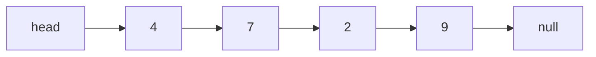
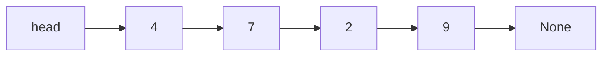

# Data Structures and Algorithms

**Lecture 2: Linked structures, stacks, and queues**

<br><br><br><br><br><br>

## What do you remember about arrays?

Start with `[4, 7, 2, 9]`.

1. How does the computer find index `2`?
2. What changes when we remove the first value and keep the order?
3. What can happen when we append to a full dynamic array?


<br><br><br><br><br><br>

---

<br><br><br><br><br><br>

## Removing the first array value

**Keep the remaining values in the same order.**

Assume `length > 0`. Keep the removed value, then shift left.

**Python**

```python
value = values[0]
for i in range(1, length):
    values[i - 1] = values[i]
length -= 1
```

**C**

```c
int32_t value = values[0];
for (size_t i = 1; i < length; i++) {
    values[i - 1] = values[i];
}
length--;
```

```text
Before       [4, 7, 2, 9]
Remove 4     [_, 7, 2, 9]
Shift left   [7, 2, 9, _]

New length = 3
```

- Indexed access calculates one address: **`O(1)`**.
- Front removal shifts `n - 1` values: **`O(n)`**.
- A full-array append can copy `n` values: **`O(n)` worst case**.

Spare capacity helps append. It does not remove the shifts at the front.

<br><br><br><br><br><br>

---

<br><br><br><br><br><br>

## Must the values live next to each other?

Imagine four cards with the values `4`, `7`, `2`, and `9`.

- Each card can be in a different place.
- We still need to know which card comes next.
- We also need to know where the sequence starts and ends.

**How can we store it in memory?**

<br><br><br><br><br><br>

---

<br><br><br><br><br><br>

## A singly linked list

**A linked list stores a sequence in nodes. Each node has a value and a link to the next node.**



**Python**

```python
class Node:
    def __init__(self, value):
        self.value = value
        self.next = None
```

**C**

```c
#include <stdint.h>

struct Node {
    int32_t value;
    struct Node *next;
};
```

- `value` stores the number. `next` links to the next node.
- `head` is a separate reference or pointer to the first node.
- The last link is `None` in Python or `NULL` in C: no next node.
- **Singly** means one forward link per node.

**Where should we store the first and last node references?**

Source: [Open Data Structures, Section 3.1: Singly Linked Lists](https://opendatastructures.org/ods-python/3_1_SLList_Singly_Linked_Li.html).
For the C structure, see [CS50: Linked Lists](https://cs50.harvard.edu/x/notes/5/#linked-lists).

<br><br><br><br><br><br>

---

<br><br><br><br><br><br>

## A NodeList stores head and tail

**Use one container for the whole list. We call our type `NodeList`.**

**Python**

```python
class NodeList:
    def __init__(self):
        self.head = None
        self.tail = None

items = NodeList()
```

**C**

```c
#include <stddef.h>

struct NodeList {
    struct Node *head;
    struct Node *tail;
};

struct NodeList items = {NULL, NULL};
```

- A `Node` stores one value and one next link.
- A `NodeList` stores the two end links. Its nodes are separate objects.
- Empty list: both fields are `None` in Python or `NULL` in C.
- In list diagrams, `head` and `tail` mean these fields in `items`.

Source: [Open Data Structures, Section 3.1: Singly Linked Lists](https://opendatastructures.org/ods-python/3_1_SLList_Singly_Linked_Li.html).

<br><br><br><br><br><br>

---

<br><br><br><br><br><br>

## One C node in memory

**Example layout:** 8-bit bytes, an 8-byte pointer, and 8-byte pointer alignment.

```text
Byte offset     0-3          4-7             8-15
             +-----------+-----------+----------------+
             | value: 4  | padding   | next: 0x3000   |
             +-----------+-----------+----------------+
Size            4 bytes     4 bytes       8 bytes

sizeof(struct Node) = 16 bytes in this example
```

- `next: 0x3000` means the next node starts at example address `0x3000`.
- The compiler inserts **padding** so the pointer starts at a suitable offset.
- Each node occupies one continuous block. Different nodes can be far apart.
- Pointer size, padding, and total size depend on the system and compiler.

Source: [GNU C manual: Structure Layout](https://www.gnu.org/software/c-intro-and-ref/manual/html_node/Structure-Layout.html).

<br><br><br><br><br><br>

---

<br><br><br><br><br><br>

## Array slots and linked nodes

**The same values, stored in two separate example layouts.**

```text
Array: int32_t values[4] = {4, 7, 2, 9};

Address       0x1000  0x1004  0x1008  0x100C
             +-------+-------+-------+-------+
Value        |   4   |   7   |   2   |   9   |
             +-------+-------+-------+-------+

NodeList container at 0x0800:
             +----------------+----------------+
             | head: 0x1000   | tail: 0x5000   |
             +----------------+----------------+

Separate nodes in address order; padding is not shown:

Node address 0x1000             0x2000             0x3000             0x5000
             +------------+     +------------+     +------------+     +------------+
             |value: 4    | ... |value: 2    | ... |value: 7    | ... |value: 9    |
             |next: 0x3000|     |next: 0x5000|     |next: 0x2000|     |next: null  |
             +------------+     +------------+     +------------+     +------------+

... = other data or unused memory. Gaps are not to scale.

items.head = 0x1000; items.tail = 0x5000
Order: 0x1000 -> 0x3000 -> 0x2000 -> 0x5000 -> null
```

- **Array:** adjacent 4-byte values. Four values use **16 bytes**.
- **List:** nodes do not need to be adjacent. Links give the order.
- In our C example, four 16-byte nodes use **64 bytes**. The two-pointer `NodeList` adds **16 bytes**.
- That is **80 bytes** before allocation overhead. Python object sizes differ.

**Which node follows the node at address `0x3000`?**

<br><br><br><br><br><br>

---

<br><br><br><br><br><br>

## Create one node

**Python**

```python
node = Node(5)
```

**C: a helper used in the next examples**

```c
#include <stdlib.h>

struct Node *new_node(int32_t value) {
    struct Node *node = malloc(sizeof *node);
    if (node == NULL) {
        exit(EXIT_FAILURE);
    }
    node->value = value;
    node->next = NULL;
    return node;
}
```

- In C, call `new_node(5)` to create the same node.
- `malloc` reserves memory. C code must later release it with `free`.
- Python manages node memory for us.
- Our C examples stop with `exit(EXIT_FAILURE)` on allocation failure or an empty read or removal. Python raises an exception.

<br><br><br><br><br><br>

---

<br><br><br><br><br><br>

## Build the same list

Create a `NodeList`, then connect its nodes. Use the C `new_node` helper from earlier.

**Python**

```python
items = NodeList()
items.head = Node(4)
items.head.next = Node(7)
items.head.next.next = Node(2)
items.head.next.next.next = Node(9)
items.tail = items.head.next.next.next
```

**C**

```c
struct NodeList items = {NULL, NULL};
items.head = new_node(4);
items.head->next = new_node(7);
items.head->next->next = new_node(2);
items.head->next->next->next = new_node(9);
items.tail = items.head->next->next->next;
```

- `items.head` refers to the node with `4`. `items.tail` refers to the node with `9`.
- In C, `items.head` reads a container field. `items.head->next` follows a node pointer.
- Assigning a node reference or pointer does not copy that node.

These links give the same order as `[4, 7, 2, 9]`.

<br><br><br><br><br><br>

---

<br><br><br><br><br><br>

## How can we read all the values?



We want the sum: `4 + 7 + 2 + 9`.

- Where should we start?
- How do we move to the next value?
- How do we know when to stop?


<br><br><br><br><br><br>

---

<br><br><br><br><br><br>

## Traversal: follow each next link

**Traversal means visiting the nodes in order.**

**Python**

```python
current = items.head
total = 0
while current is not None:
    total += current.value
    current = current.next
```

**C**

```c
#include <stddef.h>

struct Node *current = items.head;
int total = 0;
while (current != NULL) {
    total += current->value;
    current = current->next;
}
```

C uses `->` to access a field through a pointer. `NULL` marks the end.

```text
Value read       4    7    2    9
Running total    4   11   13   22
```

`current` moves through the nodes. `items.head` and `items.tail` stay unchanged.

Source: [CS50, Week 5: Linked Lists](https://cs50.harvard.edu/x/notes/5/#linked-lists).

<br><br><br><br><br><br>

---


<br><br><br><br><br><br>

## Can we jump to index 2?

```text
Position       0        1        2        3
head -------> [4] ----> [7] ----> [2] ----> [9] -> None
               start    1 link   2 links
```

- An array calculates a slot address from its index.
- This linked list must follow links from `head`.
- Reaching index `i` takes `i` link steps: **`O(i + 1)` time**.
- Access by position and search by value are **`O(n)` in the worst case**.

**If we search for `5`, how do we know it is absent?**

<br><br><br><br><br><br>

---

<br><br><br><br><br><br>

## Can we add a value without shifting?

Add `5` at the start.

```text
Before    head -> [4] -> [7] -> [2] -> [9] -> None

New node         [5 | None]
```

- Which link must the new node store?
- Which variable must change after that?
- Do the four old nodes need to move?

**Draw the result and name the two reference changes.**

<br><br><br><br><br><br>

---

<br><br><br><br><br><br>

## Insertion at the head

**Python**

```python
node = Node(5)
node.next = items.head
items.head = node
if items.tail is None:
    items.tail = node
```

**C**

```c
struct Node *node = new_node(5);
node->next = items.head;
items.head = node;
if (items.tail == NULL) {
    items.tail = node;
}
```

```text
After     head -> [5] -> [4] -> [7] -> [2] -> [9] -> None
```

- First connect the new node to the old head.
- Then make the new node the head.
- The old nodes stay in place: **`O(1)` link work**.
- If the list was empty, the new node becomes both head and tail.
- Otherwise, the tail stays unchanged.

<br><br><br><br><br><br>

---

<br><br><br><br><br><br>

## Insertion after a known node

Start again with `4 -> 7 -> 2 -> 9` in `items`. `previous` refers to its node with `7`.

**Python**

```python
node = Node(5)
node.next = previous.next
previous.next = node
if items.tail is previous:
    items.tail = node
```

**C**

```c
struct Node *node = new_node(5);
node->next = previous->next;
previous->next = node;
if (items.tail == previous) {
    items.tail = node;
}
```

```text
Before    4 -> 7 ------> 2 -> 9 -> None
After     4 -> 7 -> 5 -> 2 -> 9 -> None
```

- **Known previous node:** `O(1)` link work.
- **Find the position first:** `O(n)` in the worst case.
- Save the old next link before replacing it.
- If `previous` was the tail, the new node becomes the tail.


<br><br><br><br><br><br>

---

<br><br><br><br><br><br>

## Growth with a tail reference

**`tail` refers to the last node. It lets us append without a scan.**

```text
Before    head -> [4] -> [7] -> [2] -> None
                              tail

Add 9     head -> [4] -> [7] -> [2] -> [9] -> None
                                     tail
```

- Create one node. Connect the old tail to it. Update `tail`.
- Existing nodes stay in place. No backing array needs copying.
- The new node still needs memory.
- Without `tail`, finding the last node can take `O(n)` time.

Assume fixed-size node allocation takes `O(1)` time in our cost model.
Actual allocation time can vary.

<br><br><br><br><br><br>

---

<br><br><br><br><br><br>

## Append with a tail reference

Add `9` to `items`. An empty `NodeList` already has both end links set to `None` or `NULL`.

**Python**

```python
node = Node(9)
if items.head is None:
    items.head = node
else:
    items.tail.next = node
items.tail = node
```

**C**

```c
struct Node *node = new_node(9);
if (items.head == NULL) {
    items.head = node;
} else {
    items.tail->next = node;
}
items.tail = node;
```

The new tail's next link is empty. No existing node moves.

<br><br><br><br><br><br>

---

<br><br><br><br><br><br>

## Does tail make removal at the back easy?

```text
head -> [4] -> [7] -> [2] -> [9] -> None
                            tail
```

We want to remove `9`.

- Which node must become the new tail?
- Which node must change its `next` link?
- Can we follow a link backward from `9`?

**Does knowing the last node also give us the previous node?**

<br><br><br><br><br><br>

---

<br><br><br><br><br><br>

## We still need the previous node

```text
Before    head -> [4] -> [7] -> [2] -> [9] -> None
                                      tail

After     head -> [4] -> [7] -> [2] -> None
                               tail
```

- Start at `head`. Find the node just before the old tail.
- Set its `next` to `None` and make it the new tail.
- With only head, tail, and forward links, this is **`O(n)` worst case**.

For one node, removal leaves an empty list. Both references must become `None`.

Source: [Open Data Structures, Section 3.1.2: Summary](https://opendatastructures.org/ods-python/3_1_SLList_Singly_Linked_Li.html).

<br><br><br><br><br><br>

---

<br><br><br><br><br><br>

## Remove the tail: Python

Reject an empty list. With one node, clear both references.

```python
if items.head is None:
    raise IndexError("remove from empty list")
if items.head is items.tail:
    items.head = None
    items.tail = None
else:
    previous = items.head
    while previous.next is not items.tail:
        previous = previous.next
    previous.next = None
    items.tail = previous
```

For several nodes, the loop finds the node just before the old tail.

<br><br><br><br><br><br>

---

<br><br><br><br><br><br>

## Remove the tail: C

Use nodes made by `new_node`. Save the old tail so we can release it.

```c
if (items.head == NULL) {
    exit(EXIT_FAILURE);
}
struct Node *old_tail = items.tail;
if (items.head == items.tail) {
    items.head = NULL;
    items.tail = NULL;
} else {
    struct Node *previous = items.head;
    while (previous->next != items.tail) {
        previous = previous->next;
    }
    previous->next = NULL;
    items.tail = previous;
}
free(old_tail);
```

Change the links before calling `free`. Never read the released node.

<br><br><br><br><br><br>

---

<br><br><br><br><br><br>

## Arrays and linked lists: operation costs

Let `n` be the current length. Keep the sequence order.

| Operation | Dynamic array | Linked list |
| --- | --- | --- |
| Access by position | `O(1)` | `O(n)` worst case |
| Search for a missing value | `O(n)` | `O(n)` |
| Insert or remove at the front | `O(n)` | `O(1)` |
| Append at the back | `O(1)` amortized | `O(1)` with tail |
| Remove at the back | `O(1)` without shrinking | `O(1)` for a doubly linked list with tail |

- Array growth doubles capacity. One append can still take `O(n)`.
- List costs assume constant-time node allocation and fixed-size values.
- A doubly linked list has both `next` and `previous` links.
- Our code uses a singly linked list. Back removal is `O(n)` worst case there.

**Which operations does your program need most often?**

<br><br><br><br><br><br>

---

<br><br><br><br><br><br>

## What do we pay for the links?

**Each node needs storage for a value and its next reference.**

| Dynamic array | Linked list |
| --- | --- |
| One backing block, with possible unused slots. | One node per item, with a next link. |
| Growth can copy existing values. | Growth can allocate one node. |
| Slots are next to each other. | Nodes can be far apart. |

- A list avoids the need for one large continuous block.
- Nodes can also have allocation overhead.
- Total node storage grows as **`O(n)`**.

**Does the same Big O time mean the same speed in seconds?**

<br><br><br><br><br><br>

---

<br><br><br><br><br><br>

## Nearby storage can make scans faster

**A CPU cache holds small blocks of memory for fast access.**

```text
Array slots:     [4][7][2][9]     nearby reads

Linked nodes:    [4] ... [2] ... [7] ... [9]
                 follow each next link to find the next read
```

- Reading an array slot can also bring nearby slots into the cache.
- Scattered nodes can need more separate memory loads.
- Both full scans are `O(n)`. Arrays often scan faster in practice.

In CPython, a `list` stores adjacent **object references**. The objects can be elsewhere.

Sources:

- **Cache locality:** [OSTEP, version 1.10, Section 10.1, pp. 2-3](https://pages.cs.wisc.edu/~remzi/OSTEP/cpu-sched-multi.pdf#page=2). Read the CPU cache and spatial locality explanation, which uses an array scan as an example.
- **Python storage:** [How lists are implemented in CPython](https://docs.python.org/3/faq/design.html#how-are-lists-implemented-in-cpython). This supports the object-reference detail above.

<br><br><br><br><br><br>

---

<br><br><br><br><br><br>

## Common use cases for linked lists

| Use case | Required changes | Which item can leave? |
| --- | --- | --- |
| **Waiting tasks** | Add at the back. Remove from the front. | The oldest waiting task. |
| **Memory stack (call stack)** | Save a function call's state at the top. Remove it on return. | The most recent call that has not returned. |

A task queue uses opposite ends. The memory stack adds and removes at the same end.

**Which operations must be fast in each case? Does each case need access by index?**

Sources: [OpenJDK 25: linked task queue](https://github.com/openjdk/jdk/blob/jdk-25-ga/src/java.base/share/classes/java/util/concurrent/LinkedBlockingQueue.java#L196-L222), [Runestone: Stack Frames](https://runestone.academy/ns/books/published/pythonds3/Recursion/StackFramesImplementingRecursion.html).

<br><br><br><br><br><br>

---

<br><br><br><br><br><br>

## A stack: last in, first out

**A stack adds and removes values at one end, called the top.**

The most recently added value comes out first: **LIFO**.

Undo removes C first, then B.

| Operation | Meaning |
| --- | --- |
| `push(value)` | Add a value at the top. |
| `pop()` | Remove and return the top value. |
| `peek()` | Return the top value without removing it. |
| `is_empty()` | Return whether there are no values. |


Source: [Open Data Structures, Section 1.2.1: Queue and Stack Interfaces](https://opendatastructures.org/ods-python/1_2_Interfaces.html).

<br><br><br><br><br><br>

---

<br><br><br><br><br><br>

## Stack trace

The top is on the right.

```text
Operation       Returns        Stack, bottom to top
push(4)         -              [4]
push(7)         -              [4, 7]
peek()          7              [4, 7]
pop()           7              [4]
push(2)         -              [4, 2]
pop()           2              [4]
pop()           4              []
```

`peek` reads the top. `pop` also removes it.

<br><br><br><br><br><br>

---

<br><br><br><br><br><br>

## How does a function know where to return?

**Pseudocode**

```text
FUNCTION main()
    CALL show_total()
    RETURN

FUNCTION show_total()
    total = CALL add(4, 7)
    PRINT total
    RETURN

FUNCTION add(a, b)
    RETURN a + b
```

- Each call adds a **stack frame** with local data and a place to return to.
- A normal return removes the top frame and continues the caller.
- The program runtime manages these frames for us.

**Which function returns first? What does the program print?**

Source: [Runestone, Section 4.6: Stack Frames](https://runestone.academy/ns/books/published/pythonds3/Recursion/StackFramesImplementingRecursion.html).

<br><br><br><br><br><br>

---

<br><br><br><br><br><br>

## Call stack: calls add, returns remove

Only our three function calls are shown. The top is on the right.

```text
Event                         Call stack, bottom to top
main starts                   [main]
main calls show_total         [main, show_total]
show_total calls add          [main, show_total, add]
add returns 11                [main, show_total]
show_total prints 11          [main, show_total]
show_total returns            [main]
main returns                  []
```

- `add` returns first: **last in, first out**.
- `show_total` receives `11` in `total`, then prints it.
- Each caller continues after the call that has just returned.

<br><br><br><br><br><br>

---

<br><br><br><br><br><br>

## A queue: first in, first out

**A FIFO queue adds values at the back and removes values from the front.**

The oldest waiting value comes out first: **FIFO**.


| Operation | Meaning |
| --- | --- |
| `enqueue(value)` | Add a value at the back. |
| `dequeue()` | Remove and return the front value. |
| `front()` | Return the front value without removing it. |
| `is_empty()` | Return whether there are no values. |

In our interface, `dequeue` and `front` on an empty queue raise an error.

Source: [Open Data Structures, Section 1.2.1: Queue and Stack Interfaces](https://opendatastructures.org/ods-python/1_2_Interfaces.html).

<br><br><br><br><br><br>

---

<br><br><br><br><br><br>

## Queue trace

Start empty. The front is on the left. The back is on the right.

```text
Operation       Returns        Queue, front to back
enqueue(4)      -              [4]
enqueue(7)      -              [4, 7]
front()         4              [4, 7]
dequeue()       4              [7]
enqueue(2)      -              [7, 2]
dequeue()       7              [2]
dequeue()       2              []
```

`front` reads the front value. `dequeue` also removes it.

**What happens if we call `dequeue()` once more?**

<br><br><br><br><br><br>

---

<br><br><br><br><br><br>

## Which waiting process gets the CPU next?

A **ready queue** holds processes that are ready to run and wait for CPU time.

**Model:** one CPU, FIFO scheduling, no input/output waits. Each process runs to completion.

**Pseudocode** -- A, B, and C become ready in that order before scheduling starts.

```text
ready = EMPTY QUEUE
ENQUEUE(ready, A)
ENQUEUE(ready, B)
ENQUEUE(ready, C)

WHILE NOT IS_EMPTY(ready)
    process = DEQUEUE(ready)
    RUN process until it finishes
```

**Which process runs first? Which runs last?**

Source: [OSTEP, version 1.10, Section 7.3: First In, First Out](https://pages.cs.wisc.edu/~remzi/OSTEP/cpu-sched.pdf#page=2).

<br><br><br><br><br><br>

---

<br><br><br><br><br><br>

## Process queue: follow the waiting order

The front is on the left. A running process is outside the ready queue.

```text
Event                  Ready queue, front to back     CPU
A, B, C are ready      [A, B, C]                      idle
dequeue returns A      [B, C]                         A
A finishes             [B, C]                         idle
dequeue returns B      [C]                            B
B finishes             [C]                            idle
dequeue returns C      []                             C
C finishes             []                             idle
```

- Run order: **A, B, C** -- first in, first out.
- An empty ready queue means no process is waiting for CPU time.
- The CPU can still be running C when the queue is empty.

<br><br><br><br><br><br>

---

<br><br><br><br><br><br>

## A real use: waiting tasks

A server has a fixed number of worker threads. New tasks wait when all workers are busy.

```text
Workers take here                    New tasks enter here
head -> [Task A] -> [Task B] -> [Task C] <- tail
```

- OpenJDK 25's `Executors.newFixedThreadPool` uses a `LinkedBlockingQueue`.
- It links new tasks at the back and takes waiting tasks from the front.
- Its full implementation also uses locks and a dummy head node.
- Workers can finish in a different order from the queue's removal order.

Our diagram shows only the waiting tasks. `O(1)` link work does not include waiting for a lock.

Sources: OpenJDK 25, [`Executors`](https://github.com/openjdk/jdk/blob/jdk-25-ga/src/java.base/share/classes/java/util/concurrent/Executors.java#L88-L92), [`LinkedBlockingQueue`](https://github.com/openjdk/jdk/blob/jdk-25-ga/src/java.base/share/classes/java/util/concurrent/LinkedBlockingQueue.java#L196-L222).

<br><br><br><br><br><br>

---

<br><br><br><br><br><br>

## Do these brackets close correctly?

LeetCode: [20. Valid Parentheses](https://leetcode.com/problems/valid-parentheses/).

```text
([])
([)]
((
]
```

- Do equal numbers of opening and closing brackets guarantee a valid result?
- When we read a closing bracket, which opening bracket must it match?
- Which structure can remember that opening bracket for us?

**Predict each result before the next slides.**

<br><br><br><br><br><br>

---

<br><br><br><br><br><br>

## Balanced brackets

**Brackets are balanced when every opening bracket has the correct closing bracket, in the correct nesting order.**

For this task, the input contains only `(`, `)`, `[`, `]`, `{`, and `}`.

- `([])` is valid: close `[` before closing `(`.
- `([)]` is invalid: `)` cannot close the unmatched `[`.
- A closing bracket must match the **latest unmatched opening bracket**.

That is the stack's LIFO rule.

Source: [Runestone, Section 3.7: Balanced Symbols](https://runestone.academy/ns/books/published/pythonds3/BasicDS/BalancedSymbolsAGeneralCase.html).

<br><br><br><br><br><br>

---

<br><br><br><br><br><br>

## A stack-based bracket check

Start with an empty stack. Read the input from left to right.

```text
Opening bracket:
    push it
Closing bracket:
    if the stack is empty, return False
    if the top does not match, return False
    pop the matching opening bracket
End of input:
    return whether the stack is empty
```

**Why is reaching the end not enough to return `True`?**

<br><br><br><br><br><br>

---

<br><br><br><br><br><br>

## Lecture summary

- **Linked nodes** store order through next references. Nodes can be at separate addresses.
- **Tradeoffs:** known-link updates can be cheap. Access by position needs a scan. Links use memory.
- **Stacks** return the latest stored item: LIFO. Our stack uses the end of a dynamic array.
- **Queues** return the oldest waiting item: FIFO. Our linked queue adds at tail and removes at head.
- **Correctness** depends on the stored order and the empty-state rules.
- **Optional: bracket checking** uses a stack to remember unmatched openings.

Next lecture: a stack will help us understand how recursive calls return.
Later, DFS will use a stack and BFS will use a queue.

<br><br><br><br><br><br>

---

<br><br><br><br><br><br>

## Further reading: CS50

**Choose this for visual explanations and C memory diagrams.**

[CS50x, Week 5: Data Structures](https://cs50.harvard.edu/x/weeks/5/).

- [Queues](https://cs50.harvard.edu/x/notes/5/#queues): connect FIFO to a line of waiting items.
- [Stacks](https://cs50.harvard.edu/x/notes/5/#stacks): connect LIFO to adding and removing at the top.
- [Linked lists](https://cs50.harvard.edu/x/notes/5/#linked-lists): draw each node and its next pointer before reading the C code.

**Reading goal:** add a node at the front without losing the rest of the list.

Focus on these sections. Trees and hash tables come later in our course.

<br><br><br><br><br><br>

---

<br><br><br><br><br><br>

## Further reading: Open Data Structures

**Choose this to connect the diagrams to interfaces and operation costs.**

Read the Python edition by **Pat Morin**:

- [Section 1.2.1](https://opendatastructures.org/ods-python/1_2_Interfaces.html): compare stack and FIFO queue rules.
- [Section 2.1: ArrayStack](https://opendatastructures.org/ods-python/2_1_ArrayStack_Fast_Stack_O.html): use end operations for a stack.
- [Section 3.1: Singly Linked Lists](https://opendatastructures.org/ods-python/3_1_SLList_Singly_Linked_Li.html): trace head and tail through queue operations.

The book's ArrayStack can shrink. Our Lab 1 array keeps capacity on pop.
The book's queue operation names can also differ from ours.

**Reading goal:** explain why tail helps append but does not make tail removal `O(1)` in a singly linked list.

<br><br><br><br><br><br>

---

<br><br><br><br><br><br>

## Further reading: CLRS

**Choose this for precise operation steps and boundary cases.**

[Introduction to Algorithms, 4th edition](https://mitpress.mit.edu/9780262046305/introduction-to-algorithms/)
by **Thomas H. Cormen, Charles E. Leiserson, Ronald L. Rivest, and Clifford Stein**.

- **Section 10.1: Simple array-based data structures.** Focus on stacks and queues. Its array queue is another representation of FIFO.
- **Section 10.2: Linked lists.** Compare its link diagrams with our singly linked nodes. Some examples use links in both directions.

**Reading goal:** state the representation before claiming an operation is `O(1)`.

These section numbers refer to the **4th edition**. We do not need the full list API for Lab 2.

<br><br><br><br><br><br>

---

<br><br><br><br><br><br>

## Further reading: Knuth and practice

**Choose Knuth for a deeper study of storage and operation rules.**

Donald E. Knuth, [The Art of Computer Programming, Volume 1: Fundamental Algorithms, 3rd edition](https://www.informit.com/store/art-of-computer-programming-volume-1-fundamental-algorithms-9780201896831).

In **Chapter 2: Information Structures**, start with **Linear Lists**:

- **Stacks, Queues, and Deques:** compare the allowed operations.
- **Sequential Allocation** and **Linked Allocation:** compare array storage with links.

For a small interactive trace, use [VisuAlgo: Linked List, Stack, Queue](https://visualgo.net/en/list). Select one structure and trace one operation at a time.

**Study task:** draw an empty queue, add A and B, remove both, then add C. Mark every head and tail change.
