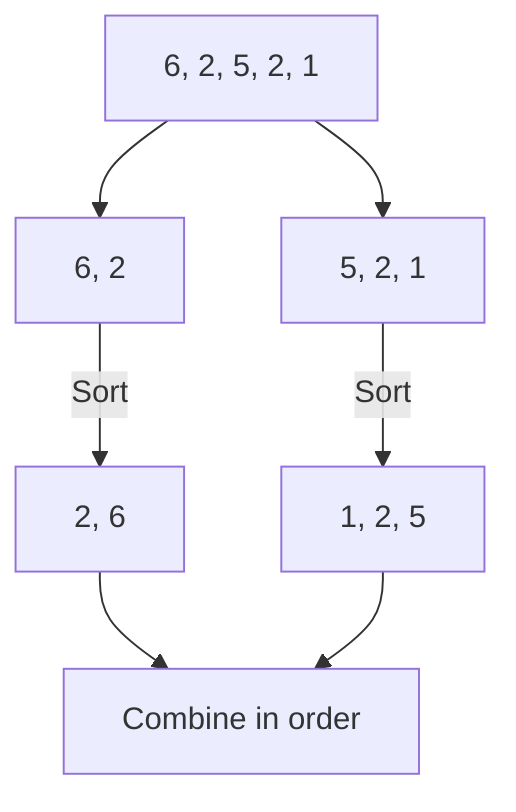
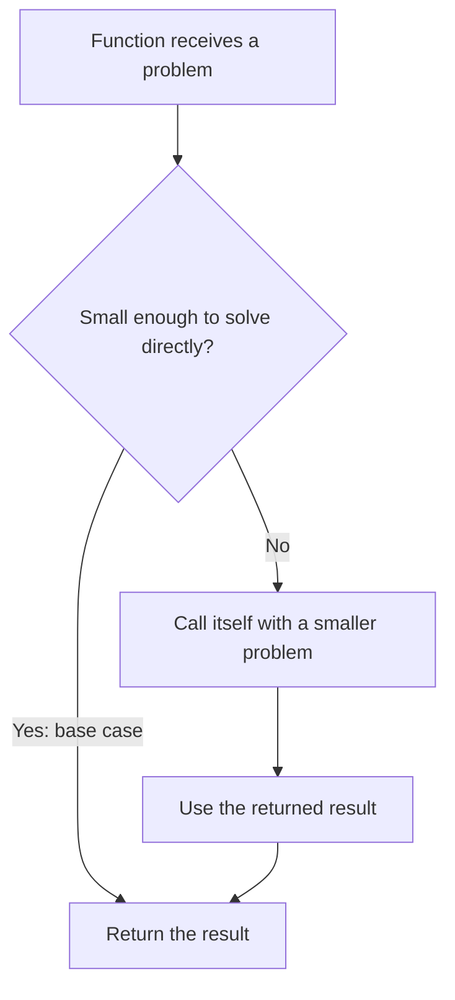
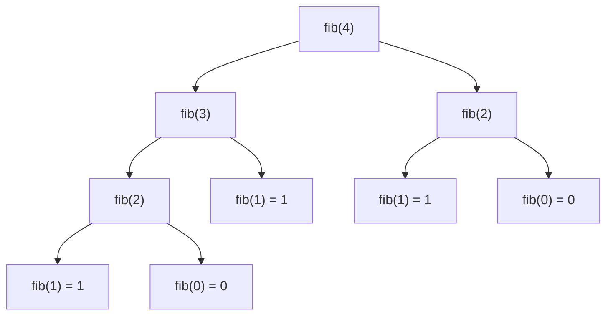
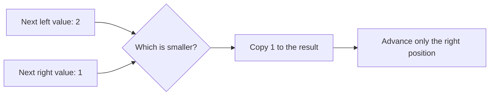
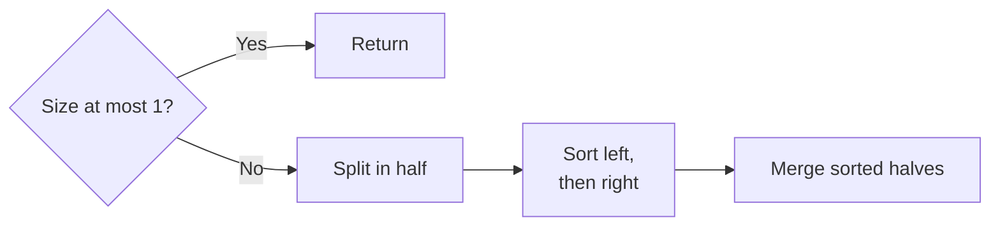
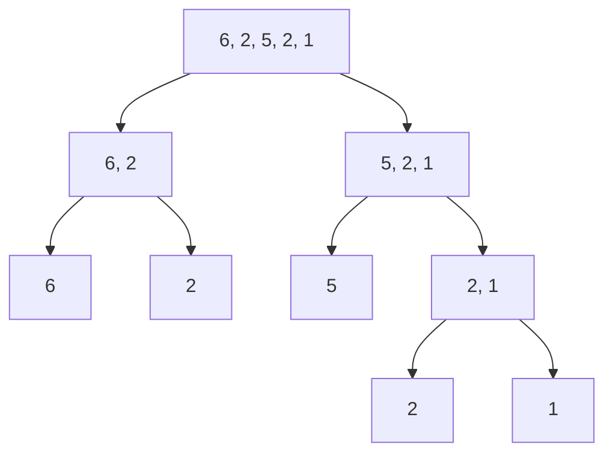
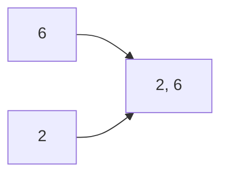
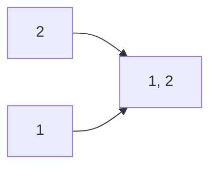
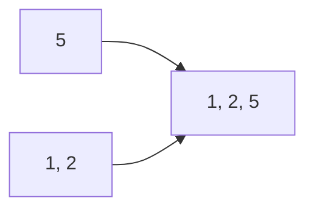
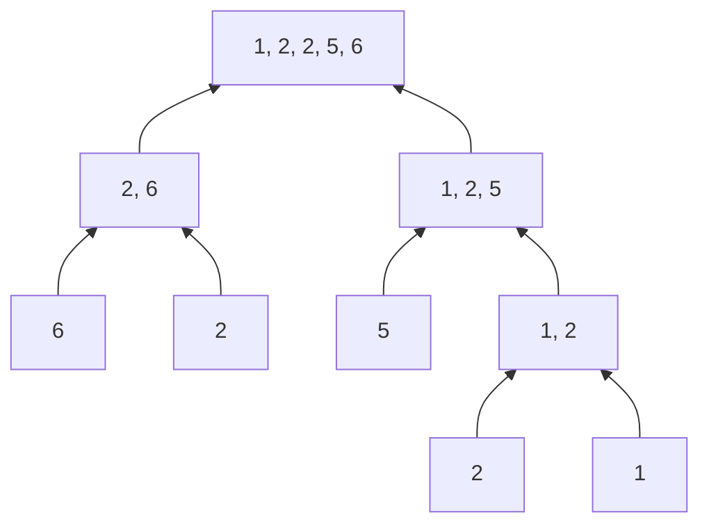

# Data Structures and Algorithms

**Lecture 3: Sorting, recursion, and merge sort**

How can order help us find what we need?

<br><br><br><br><br><br>

---

<br><br><br><br><br><br>

## Finding a book

**Find the book called DUNE. Where do you look first?**

Imagine a small library shelf with books arranged by title.

```text
Before     [MOON] [BIRDS] [RIVERS] [DUNE]

In order   [BIRDS] [DUNE] [MOON] [RIVERS]
                     ^
                   target
```

- With no order, you may need to check every title.
- With titles in order, you know which direction to look.

How can a computer compare two titles?

<br><br><br><br><br><br>

---

<br><br><br><br><br><br>

## Searching and sorting

- **Searching:** Find a target, or report that it is absent.
- **Sorting:** Put items in a chosen order.


Sorting prepares the order. Searching uses the data to find a target.

Source: [CS50x: Algorithms](https://cs50.harvard.edu/x/notes/3/).

<br><br><br><br><br><br>

---

<br><br><br><br><br><br>

## Letters have number codes

**ASCII assigns a number to each character in its character set.**

```text
Letter          A     B     C     D     ...     M     ...     Z
ASCII code     65    66    67    68     ...    77     ...    90

               B comes before D because 66 < 68.
```

We already know how to compare numbers.

For this example, use **uppercase English letters** and ASCII code

Source: [RFC 20: ASCII code table](https://www.rfc-editor.org/rfc/rfc20.html#section-2).

<br><br><br><br><br><br>

---

<br><br><br><br><br><br>

## Comparing two titles

**Compare one character at a time, from left to right.**

```text
Title       B    I    R    D
Code       66   73   82   68
            =    <
Code       66   79   79   75
Title       B    O    O    K

First difference: I = 73, O = 79.
73 < 79, so BIRD comes before BOOK.
```

- If all compared characters match, the shorter title comes first.
- Example: `BOOK` comes before `BOOKS`.


Source: [Python: lexicographic sequence comparison](https://docs.python.org/3/tutorial/datastructures.html#comparing-sequences-and-other-types).

<br><br><br><br><br><br>

---

<br><br><br><br><br><br>

## What must a sort produce?

**Put the values in nondecreasing order: each value is at least the one before it.**

```text
Input      [6, 2, 5, 2, 1]

Output     [1, 2, 2, 5, 6]
            1 <= 2 <= 2 <= 5 <= 6
```

- Keep every original value.
- Keep both copies of `2`.
- An empty array and a one-value array are already sorted.

Source: [Open Data Structures: Comparison-Based Sorting](https://opendatastructures.org/ods-python/11_1_Comparison_Based_Sorti.html).

<br><br><br><br><br><br>


---

<br><br><br><br><br><br>

## Insertion sort

**Insertion sort grows a sorted part at the start of the array.**

For each next value:

1. Save the value.
2. Shift larger values one place right.
3. Put the saved value in the open place.

```text
Before     [2, 6 | 5, 2, 1]
Save 5     [2, 6 | _, 2, 1]     saved = 5
Shift 6    [2, _ | 6, 2, 1]
Insert 5   [2, 5, 6 | 2, 1]
```

`_` marks a place we can overwrite. The value is safe in `saved`.

Source: [Runestone, 3rd edition: Insertion Sort](https://runestone.academy/ns/books/published/pythonds3/SortSearch/TheInsertionSort.html).

<br><br><br><br><br><br>

---

<br><br><br><br><br><br>

## One example, four passes

**Start again with the original input.**

```text
Index        0    1    2    3    4
          +----+----+----+----+----+
Value     | 6  | 2  | 5  | 2  | 1  |
          +----+----+----+----+----+

Start       [6 | 2, 5, 2, 1]
             ^
        sorted part
```

- One value is already sorted.
- `|` separates the sorted part from values not yet processed.
- Each pass adds one value to the sorted part.

<br><br><br><br><br><br>

---

<br><br><br><br><br><br>

## Pass 1: insert 2

```text
Start        [6 | 2, 5, 2, 1]

Save 2       [6 | _, 5, 2, 1]     saved = 2
6 > 2        [_ | 6, 5, 2, 1]     shift 6 right
No left value                    stop
Insert 2     [2, 6 | 5, 2, 1]
```

The first two values are now in order.

The saved value fills the open place. No value is lost.

<br><br><br><br><br><br>

---

<br><br><br><br><br><br>

## Pass 2: insert 5

```text
Start        [2, 6 | 5, 2, 1]

Save 5       [2, 6 | _, 2, 1]     saved = 5
6 > 5        [2, _ | 6, 2, 1]     shift 6 right
2 > 5? No                         stop
Insert 5     [2, 5, 6 | 2, 1]
```

The first three values are now in order.

We only shift values that are **greater than** the saved value.

<br><br><br><br><br><br>

---

<br><br><br><br><br><br>

## Predict pass 3

**Insert the second `2` into the sorted part.**

```text
[2, 5, 6 | 2, 1]
          ^
       next value
```

1. Which values shift right?
2. Do we shift the first `2`?
3. What does the array look like after this pass?

<br><br><br><br><br><br>

---

<br><br><br><br><br><br>

## Pass 3: insert the second 2

```text
Start        [2, 5, 6 | 2, 1]

Save 2       [2, 5, 6 | _, 1]     saved = 2
6 > 2        [2, 5, _ | 6, 1]     shift 6 right
5 > 2        [2, _, 5 | 6, 1]     shift 5 right
2 > 2? No                         stop
Insert 2     [2, 2, 5, 6 | 1]
```

The first `2` stays before the second `2`.

The sorted part now has four values.

<br><br><br><br><br><br>

---

<br><br><br><br><br><br>

## Pass 4: insert 1

```text
Start        [2, 2, 5, 6 | 1]

Save 1       [2, 2, 5, 6 | _]     saved = 1
6 > 1        [2, 2, 5, _ | 6]     shift 6 right
5 > 1        [2, 2, _, 5 | 6]     shift 5 right
2 > 1        [2, _, 2, 5 | 6]     shift 2 right
2 > 1        [_, 2, 2, 5 | 6]     shift 2 right
No left value                    stop
Insert 1     [1, 2, 2, 5, 6 |]
```

All five values are now in order.

<br><br><br><br><br><br>

---

<br><br><br><br><br><br>

## The sorted part grows

```text
Start      [6 | 2, 5, 2, 1]
Pass 1     [2, 6 | 5, 2, 1]
Pass 2     [2, 5, 6 | 2, 1]
Pass 3     [2, 2, 5, 6 | 1]
Pass 4     [1, 2, 2, 5, 6 |]
```

**Why does this work?**

- Before a pass, the part on the left is sorted.
- Inserting the next value in its place keeps that part sorted.
- After `n - 1` passes, that part is the whole array.

The rule that stays true after every pass is an **invariant**.

<br><br><br><br><br><br>

---

<br><br><br><br><br><br>

## Insertion sort: Python

```python
def insertion_sort(values):
    for i in range(1, len(values)):
        saved = values[i]
        position = i

        while position > 0 and values[position - 1] > saved:
            values[position] = values[position - 1]
            position -= 1

        values[position] = saved


values = [6, 2, 5, 2, 1]
insertion_sort(values)
print(values)
```

Output: `[1, 2, 2, 5, 6]`.

The function changes the original array.

<br><br><br><br><br><br>

---

<br><br><br><br><br><br>

## Insertion sort: C

```c
#include <stddef.h>
#include <stdio.h>

void insertion_sort(int values[], size_t length) {
    for (size_t i = 1; i < length; i++) {
        int saved = values[i];
        size_t position = i;
        while (position > 0 && values[position - 1] > saved) {
            values[position] = values[position - 1];
            position--;
        }
        values[position] = saved;
    }
}

int main(void) {
    int values[] = {6, 2, 5, 2, 1};
    size_t length = sizeof values / sizeof values[0];
    insertion_sort(values, length);
    for (size_t i = 0; i < length; i++) {
        printf("%d%s", values[i], i + 1 < length ? " " : "\n");
    }
    return 0;
}
```

Output: `1 2 2 5 6`.

<br><br><br><br><br><br>

---

<br><br><br><br><br><br>

## How much work can insertion sort do?

**What if each next value must go all the way to the front?**

```text
Pass                  1       2       3       4
Maximum shifts        1       2       3       4

For 5 values:  1 + 2 + 3 + 4 = 10 shifts
For n values:  1 + 2 + ... + (n - 1) = n(n - 1) / 2
```

- Distinct values in reverse order cause this case.
- The work grows with `n^2`: **worst-case time `O(n^2)`**.

This counts possible shifts, not the exact running time in seconds.

<br><br><br><br><br><br>

---

<br><br><br><br><br><br>

## What if the array is already sorted?

```text
[1, 2, 2, 5, 6]

Next value       Compare with its left neighbor       Shifts
    2                      1 > 2? No                    0
    2                      2 > 2? No                    0
    5                      2 > 5? No                    0
    6                      5 > 6? No                    0
```

- One value comparison per pass: **best-case time `O(n)`**.
- A few variables, with no second array: **extra space `O(1)`**.
- Insertion sort is useful for small or nearly sorted arrays.

Source: [Runestone: Insertion Sort analysis](https://runestone.academy/ns/books/published/pythonds3/SortSearch/TheInsertionSort.html).

<br><br><br><br><br><br>

---

<br><br><br><br><br><br>

## Another simple sort: selection sort

**Selection sort repeatedly finds the smallest remaining value and puts it next.**

One pass scans the unsorted part, then swaps its minimum into place.

```text
Start       [6, 2, 5, 2, 1]
Scan         6  2  5  2  1       minimum = 1
Swap 6, 1   [1 | 2, 5, 2, 6]
```

Unlike insertion sort, it selects from the whole unsorted part.

The usual version makes `n(n - 1) / 2` value comparisons: **`O(n^2)` time**.

Source: [CS50x: Selection Sort](https://cs50.harvard.edu/x/notes/3/#sorting-and-selection-sort).

<br><br><br><br><br><br>

---

<br><br><br><br><br><br>

## Another simple sort: bubble sort

**Bubble sort repeatedly swaps adjacent values that are in the wrong order.**

One pass moves the largest remaining value to the right end.

```text
Compare 6, 2     [6, 2, 5, 2, 1] -> [2, 6, 5, 2, 1]
Compare 6, 5     [2, 6, 5, 2, 1] -> [2, 5, 6, 2, 1]
Compare 6, 2     [2, 5, 6, 2, 1] -> [2, 5, 2, 6, 1]
Compare 6, 1     [2, 5, 2, 6, 1] -> [2, 5, 2, 1 | 6]
```

Repeat passes until the array is sorted. **Worst-case time: `O(n^2)`**.

Source: [CS50x: Bubble Sort](https://cs50.harvard.edu/x/notes/3/#bubble-sort).

<br><br><br><br><br><br>

---

<br><br><br><br><br><br>

## Can smaller problems reduce the work?

**What if we sort two smaller parts, then combine them?**



Each smaller part still needs sorting. Could it use the same method again?

<br><br><br><br><br><br>

---

<br><br><br><br><br><br>

## Fewer comparisons after one split

**For this reverse-sorted input, 28 value comparisons become 16.**

```text
Input           [8, 7, 6, 5, 4, 3, 2, 1]

Split           [8, 7, 6, 5]           [4, 3, 2, 1]
                      |                     |
Insertion sort  1 + 2 + 3 = 6          1 + 2 + 3 = 6
                      |                     |
Sorted halves   [5, 6, 7, 8]           [1, 2, 3, 4]

Merge           Compare 5 with 1, 2, 3, 4: take 1, 2, 3, 4.
                Then copy 5, 6, 7, 8. No more value comparisons.
Result          [1, 2, 3, 4, 5, 6, 7, 8]
```

| Method | Value comparisons |
| --- | ---: |
| Insertion sort on the whole array | `1 + 2 + 3 + 4 + 5 + 6 + 7 = 28` |
| Insertion sort on each half, then merge | `6 + 6 + 4 = 16` |

Merging also copies values and needs storage. These counts measure
value comparisons, not exact running time.

**What happens if we split each half again?**

Source: [Runestone: Insertion Sort](https://runestone.academy/ns/books/published/pythonds3/SortSearch/TheInsertionSort.html).

<br><br><br><br><br><br>

---

<br><br><br><br><br><br>

## Recursion

**Recursion solves a problem by calling the same function on a smaller problem.**



The **base case** stops the calls. Each recursive call must move toward it.

Source: [Runestone, 3rd edition: The Three Laws of Recursion](https://runestone.academy/ns/books/published/pythonds3/Recursion/TheThreeLawsofRecursion.html).

<br><br><br><br><br><br>

---

<br><br><br><br><br><br>

## The Fibonacci sequence

**How can we calculate a value from the values before it?**

```text
n         0   1   2   3   4   5   6
F(n)      0   1   1   2   3   5   8

F(0) = 0
F(1) = 1
F(n) = F(n - 1) + F(n - 2)    for n >= 2
```

Each value after the first two is the sum of the previous two.

To calculate `F(4)`, we need `F(3)` and `F(2)`.

Source: [Python tutorial: Fibonacci numbers](https://docs.python.org/3/tutorial/controlflow.html#defining-functions).

<br><br><br><br><br><br>

---

<br><br><br><br><br><br>

## Recursive Fibonacci: Python

**Which calls finish first when we calculate `fib(4)`?**

```python
def fib(n):
    if n < 2:
        return n

    left = fib(n - 1)
    right = fib(n - 2)
    return left + right


print(fib(4))
```

Use small, nonnegative inputs in these examples: `0 <= n <= 20`.

The function waits for both results, then adds them.

<br><br><br><br><br><br>

---

<br><br><br><br><br><br>

## Recursive Fibonacci: C

```c
#include <stdio.h>

int fib(int n) {
    if (n < 2) {
        return n;
    }

    int left = fib(n - 1);
    int right = fib(n - 2);
    return left + right;
}

int main(void) {
    printf("%d\n", fib(4));
    return 0;
}
```

This program follows the same calls as the Python version.

<br><br><br><br><br><br>

---

<br><br><br><br><br><br>

## The calls for fib(4)



The program finishes the left call before it starts the right call.

The leaves reach a base case: `fib(0)` or `fib(1)`.

How many separate calls calculate `fib(2)`?

<br><br><br><br><br><br>

---

<br><br><br><br><br><br>

## Calls go down, results come back

```text
fib(4)
  fib(3)
    fib(2)
      fib(1) -> 1
      fib(0) -> 0
    return 1 + 0 = 1
    fib(1) -> 1
  return 1 + 1 = 2
  fib(2)
    fib(1) -> 1
    fib(0) -> 0
  return 1 + 0 = 1
return 2 + 1 = 3
```

Both programs print `3`.

Each caller resumes where it was waiting and uses the returned value.

<br><br><br><br><br><br>

---

<br><br><br><br><br><br>

## The call stack remembers the waiting work

**Snapshot: the first call to `fib(1)` has just started.**

```text
Top       +--------------------------------------+
          | fib(1): n = 1                        | <- active
          | Return 1                             |
          +--------------------------------------+
          | fib(2): waiting for left = fib(1)     |
          | Next: calculate right = fib(0)       |
          +--------------------------------------+
          | fib(3): waiting for left = fib(2)     |
          | Next: calculate right = fib(1)       |
          +--------------------------------------+
          | fib(4): waiting for left = fib(3)     |
          | Next: calculate right = fib(2)       |
Bottom    +--------------------------------------+
```

- Each call has its own local state.
- The most recent call returns first: **LIFO**.
- After a return, the caller continues after its call statement.

Source: [Runestone, 3rd edition: Stack Frames](https://runestone.academy/ns/books/published/pythonds3/Recursion/StackFramesImplementingRecursion.html).

<br><br><br><br><br><br>

---

<br><br><br><br><br><br>

## Why do the recursive calls stop?

```text
One call path      4 -> 3 -> 2 -> 1
                                 ^
                              base case
```

- The base cases return `0` for `n = 0` and `1` for `n = 1`.
- For `n >= 2`, the calls use `n - 1` and `n - 2`.
- Both arguments are smaller and remain nonnegative.

A base case alone is not enough. The calls must reach it.

<br><br><br><br><br><br>

---

<br><br><br><br><br><br>

## Recursion can repeat work

**The call tree calculates `fib(2)` twice.**

```text
fib(4) -> fib(2)
fib(4) -> fib(3) -> fib(2)
```

- This simple Fibonacci version repeats many calls as `n` grows.
- Its time grows exponentially. `O(2^n)` is an upper bound.
- Its active call stack uses `O(n)` space.

Recursion does not automatically make a program faster.
For merge sort, we will count the work in its own call tree.

<br><br><br><br><br><br>

---

<br><br><br><br><br><br>

## How can we combine sorted parts?

**Both parts below are already sorted. What comes first in the result?**

```text
Left       [2, 6]
            ^

Right      [1, 2, 5]
            ^

Result     [                  ]
```

Do we need to compare every value with every other value?

<br><br><br><br><br><br>

---

<br><br><br><br><br><br>

## Merging two sorted parts

**Merging combines two sorted parts into one sorted result.**



- Compare the first unused value in each part.
- Copy the smaller one. On a tie, take the left one.
- When one part is empty, copy the rest of the other part.

Each front value is the smallest unused value in its own sorted part.

Source: [Open Data Structures, Section 11.1.1: Merge-Sort](https://opendatastructures.org/ods-python/11_1_Comparison_Based_Sorti.html#SECTION001411000000000000000).

<br><br><br><br><br><br>

---

<br><br><br><br><br><br>

## Merge sort

**Merge sort splits the input, sorts both halves recursively, then merges them.**



Splitting alone does not put values in order. The merges do that work.

Source: [Open Data Structures, Section 11.1.1: Merge-Sort](https://opendatastructures.org/ods-python/11_1_Comparison_Based_Sorti.html#SECTION001411000000000000000).

<br><br><br><br><br><br>

---

<br><br><br><br><br><br>

## Split the same input

**Start again with `[6, 2, 5, 2, 1]`.**



- For five values, the halves have sizes `2` and `3`.
- Every leaf has one value and is already sorted.

This tree shows the subproblems. The program finishes the left call before
it starts the right call.

<br><br><br><br><br><br>

---

<br><br><br><br><br><br>

## First merge: sort the left half

The calls for `[6]` and `[2]` return immediately.

```text
Left       Right      Action                 Result
[6]        [2]        2 < 6: take right       [2]
[6]        []         copy remaining 6       [2, 6]
```



The left half is sorted. Return to the call for all five values.

That call now starts sorting the right half: `[5, 2, 1]`.

<br><br><br><br><br><br>

---

<br><br><br><br><br><br>

## Inside the right half: merge 2 and 1

In `[5, 2, 1]`, the left part `[5]` is already sorted.

The right part `[2, 1]` still needs sorting.

```text
Left       Right      Action                 Result
[2]        [1]        1 < 2: take right       [1]
[2]        []         copy remaining 2       [1, 2]
```



Return `[1, 2]` to the call for `[5, 2, 1]`.

<br><br><br><br><br><br>

---

<br><br><br><br><br><br>

## Finish sorting the right half

**Merge `[5]` with `[1, 2]`.**

```text
Left       Right      Action                 Result
[5]        [1, 2]     1 < 5: take right       [1]
[5]        [2]        2 < 5: take right       [1, 2]
[5]        []         copy remaining 5       [1, 2, 5]
```



Now both original halves are sorted:

```text
[2, 6]     [1, 2, 5]
```

<br><br><br><br><br><br>

---

<br><br><br><br><br><br>

## Predict the final merge

```text
Left       [2, 6]
            ^
Right      [1, 2, 5]
            ^

Result     []
```

1. Which value goes first?
2. Which part supplies the next `2` when the front values are equal?
3. What happens when the right part becomes empty?

<br><br><br><br><br><br>

---

<br><br><br><br><br><br>

## Final merge: the first three values

```text
Step 1
Left [2, 6]   Right [1, 2, 5]   Result []
Compare 2, 1 -> take right 1    Result [1]

Step 2
Left [2, 6]   Right [2, 5]      Result [1]
Compare 2, 2 -> take left 2     Result [1, 2]

Step 3
Left [6]      Right [2, 5]      Result [1, 2]
Compare 6, 2 -> take right 2    Result [1, 2, 2]
```

Only the position in the chosen part moves forward.

Both copies of `2` stay in the result.

<br><br><br><br><br><br>

---

<br><br><br><br><br><br>

## Final merge: finish the result

```text
Step 4
Left [6]      Right [5]        Result [1, 2, 2]
Compare 6, 5 -> take right 5   Result [1, 2, 2, 5]

Step 5
Left [6]      Right []         Result [1, 2, 2, 5]
Right is empty -> copy 6       Result [1, 2, 2, 5, 6]
```

```text
Original input      [6, 2, 5, 2, 1]
Final output        [1, 2, 2, 5, 6]
```

We used four value comparisons and copied five values in this merge.

<br><br><br><br><br><br>

---

<br><br><br><br><br><br>

## The merge results



Each parent result combines two sorted child results.

The same method works at every size.

<br><br><br><br><br><br>

---

<br><br><br><br><br><br>

## Why is merge sort correct?

- **Base case:** Zero or one value is already sorted.
- **Recursive step:** Sort both smaller halves.
- **Merge:** Repeatedly copy the smallest unused value.

```text
Sorted left + sorted right -> sorted result with all original values
```

**Why does it finish?**

Every range with at least two values splits into smaller ranges.
Eventually, every call reaches size `0` or `1`.

The merge also finishes: each copy uses up one value.

<br><br><br><br><br><br>

---

<br><br><br><br><br><br>

## Complete merge-sort programs

Follow the same steps in [Python](examples/03-merge-sort.py)
or [C](examples/03-merge-sort.c).

```text
One input array + one shared buffer

Sort left range
Sort right range
Merge both ranges into the buffer
Copy the merged range back
```

- Both programs sort `[6, 2, 5, 2, 1]`.
- Both produce `1, 2, 2, 5, 6` in the original array.
- The buffer is allocated once and reused by all calls.
- A range `[lo, hi)` includes index `lo` and excludes index `hi`.

Run from the student repository's root folder:

```text
python3 slides/examples/03-merge-sort.py
cc -std=c11 -Wall -Wextra slides/examples/03-merge-sort.c -o /tmp/merge-sort
/tmp/merge-sort
```

<br><br><br><br><br><br>

---

<br><br><br><br><br><br>

## How much work does one merge do?

**Merge parts with `a` and `b` values. Let `m = a + b`.**

```text
Left      a values --+
                     +--> m values in the result
Right     b values --+
```

- Each value is copied to the result once: `m` copies.
- At most `m - 1` value comparisons when both parts are nonempty.
- Copying the result back adds another `m` copies.

**Time: `O(m)`**, or `O(a + b)`.

Copying back changes the amount of work, but not its growth rate.

Source: [Open Data Structures: Merge-Sort analysis](https://opendatastructures.org/ods-python/11_1_Comparison_Based_Sorti.html#SECTION001411000000000000000).

<br><br><br><br><br><br>

---

<br><br><br><br><br><br>

## How many times can we halve the size?

**For eight values, follow one path down the tree.**

```text
Size      8 -> 4 -> 2 -> 1
Halving        1    2    3

2^3 = 8, so log2(8) = 3.
```

`log2(n)` asks: how many halvings take size `n` down to `1`?

For other sizes, round the depth up:

```text
Our five-value input: longest path 5 -> 3 -> 2 -> 1
                                            3 splits
```

The number of split steps along the longest path grows as **`O(log n)`**.

<br><br><br><br><br><br>

---

<br><br><br><br><br><br>

## Work across one level

**For eight values, each merge level handles eight values in total.**

```text
Size-1 parts    [1] [1] [1] [1] [1] [1] [1] [1]
                 \ /     \ /     \ /     \ /
Merge level 1   [ 2 ]    [ 2 ]   [ 2 ]   [ 2 ]     4 x 2 = 8
                   \      /         \      /
Merge level 2      [  4  ]           [  4  ]         2 x 4 = 8
                         \           /
Merge level 3            [     8     ]              1 x 8 = 8
```

The numbers in brackets are **part sizes**, not array values.

- More parts near the bottom; larger parts near the top.
- Total merge work at each level is **`O(n)`**.
- For uneven splits, each level still handles at most `n` values.

<br><br><br><br><br><br>

---

<br><br><br><br><br><br>

## Merge-sort time complexity

```text
Work per level       O(n)
Number of levels     O(log n)
                     -----------
Total time           O(n log n)
```

- Balanced splits keep the depth small.
- Merging handles the values in a forward scan.
- This version still splits and merges an already sorted array.

**Best-case and worst-case time: `O(n log n)`** for this version.

Here, `log` means base `2`. We do not need a formal recurrence to count the levels.

Source: [Open Data Structures: Merge-Sort analysis](https://opendatastructures.org/ods-python/11_1_Comparison_Based_Sorti.html#SECTION001411000000000000000).

<br><br><br><br><br><br>

---

<br><br><br><br><br><br>

## Merge-sort memory cost

**What must be stored at the same time?**

```text
Input        [6, 2, 5, 2, 1]
Buffer       [_, _, _, _, _]       n extra positions

Active call path
sort(5 values)
  sort(3 values)
    sort(2 values)
      sort(1 value)                O(log n) stack frames
```

- One shared buffer: **`O(n)` extra space**.
- Active recursive calls: **`O(log n)` stack space**.
- Total extra space: **`O(n)`**.

The whole recursion tree is not on the call stack at once.

<br><br><br><br><br><br>

---

<br><br><br><br><br><br>

## Comparing growth rates

| Number of values `n` | `n^2` | `n log2(n)` |
| ---: | ---: | ---: |
| 8 | 64 | 24 |
| 128 | 16,384 | 896 |
| 1,024 | 1,048,576 | 10,240 |

These are **growth expressions**, not exact comparison counts or seconds.

- `n^2` grows much faster as the input gets large.
- Small inputs can still favor a simpler algorithm.

Merge sort gives a predictable `O(n log n)` time bound for large inputs.

<br><br><br><br><br><br>

---

<br><br><br><br><br><br>

## Insertion sort and merge sort

| Property | Insertion sort | Merge sort used here |
| --- | --- | --- |
| Main idea | Insert into a sorted prefix | Sort halves, then merge |
| Best-case time | `O(n)` | `O(n log n)` |
| Worst-case time | `O(n^2)` | `O(n log n)` |
| Extra space | `O(1)` | `O(n)` |

Insertion sort keeps the code and memory needs small.

Merge sort limits the growth of the work, using an extra buffer.

<br><br><br><br><br><br>

---

<br><br><br><br><br><br>

## Watch the same input move

**Use [VisuAlgo: Sorting](https://visualgo.net/en/sorting).**

1. If it opens in e-Lecture Mode, press `Esc` for Exploration Mode.
2. Choose **Insertion Sort** from the top row, possibly shown as `INS`.
3. Open **Create(A)**. Enter `6,2,5,2,1` in the `A =` field, then choose **Go**.
4. Choose **Sort**. Use pause and the previous/next-frame controls.
5. Choose **Merge Sort** (`MER`). Create the same input again.
6. Choose **Sort**, then **Show depth** to see the recursive levels.

Predict each shift or copied value before moving to the next frame.

For odd sizes, the visualizer can give the extra value to the left half.
Our trace gives it to the right half. Both produce the same sorted result.

<br><br><br><br><br><br>

---

<br><br><br><br><br><br>

## Check your understanding

1. Why must insertion sort save the next value before shifting?
2. Why can a merge compare only the two front values?
3. Why does merge sort stop at size `0` or `1`?
4. Why is merge sort `O(n log n)` instead of `O(n^2)`?
5. What extra memory does this merge-sort version use?

Try to explain each answer with one diagram from this lesson.

<br><br><br><br><br><br>

---

<br><br><br><br><br><br>

## Check your answers

1. Shifting can overwrite its original place. The saved copy keeps the value safe.
2. Each front value is the smallest unused value in its sorted part.
3. An empty range or a one-value range is already sorted.
4. Each level does `O(n)` work, and there are `O(log n)` levels.
5. One `O(n)` buffer plus `O(log n)` active stack frames: `O(n)` extra space.

