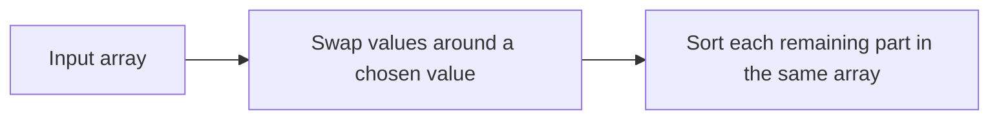
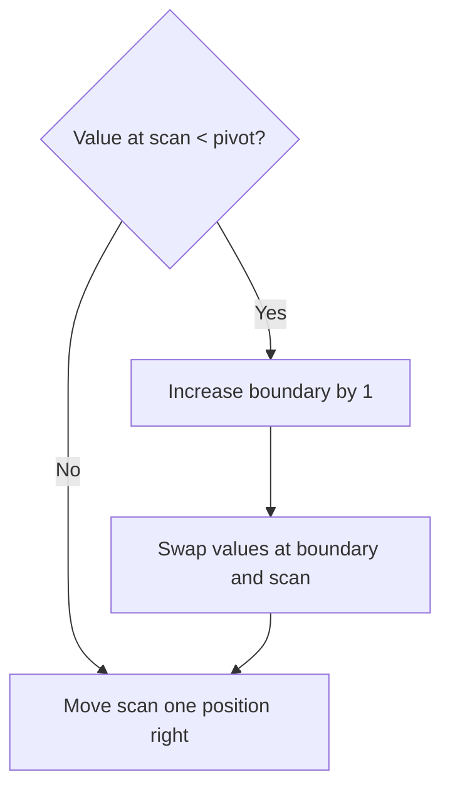
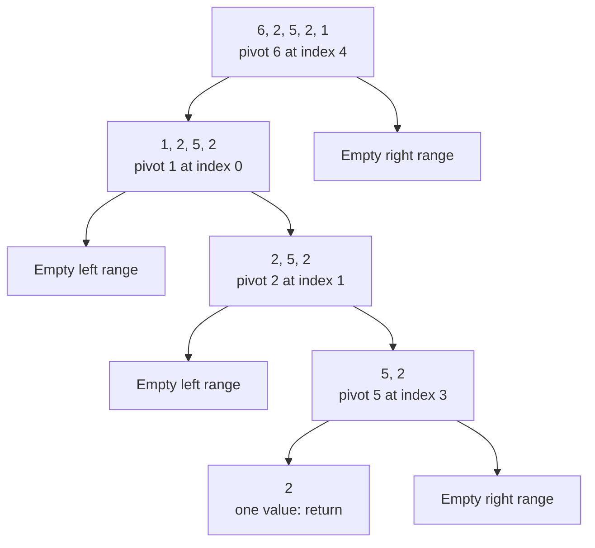
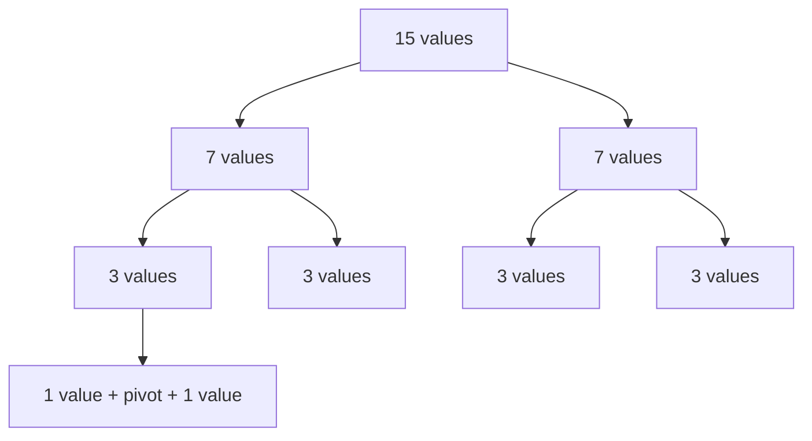
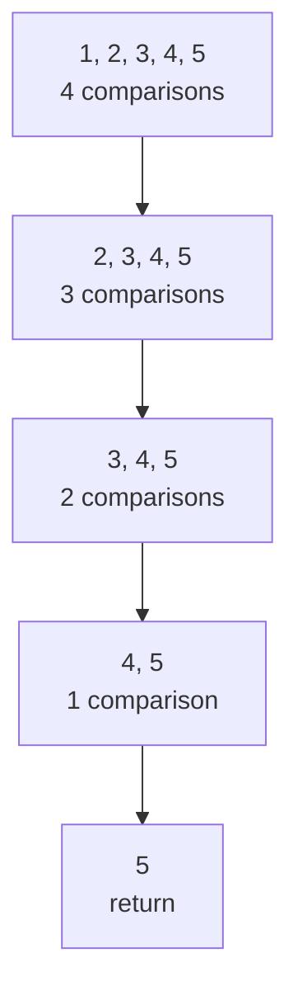
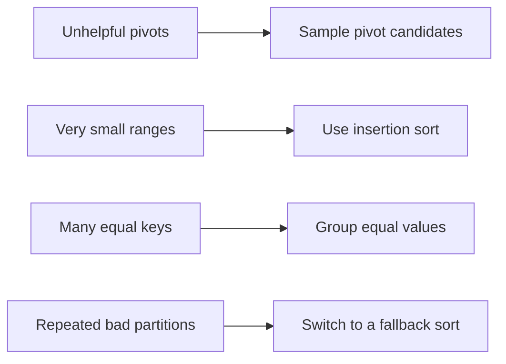
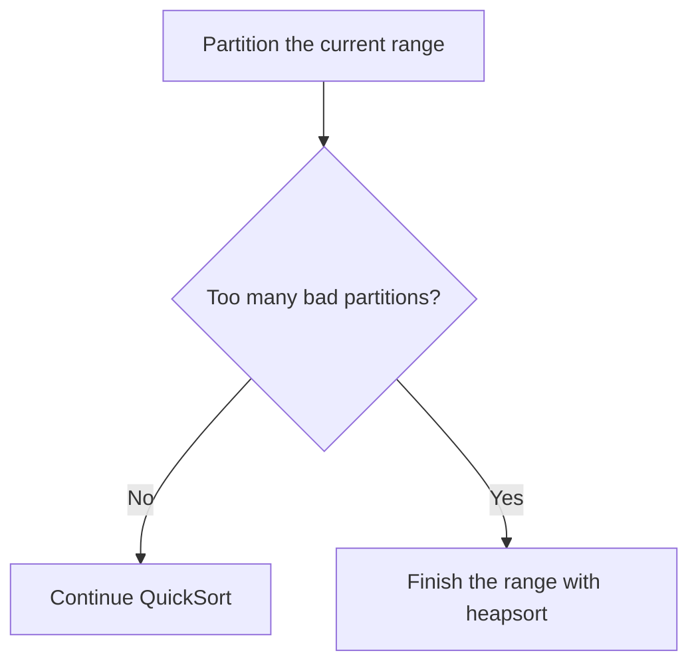
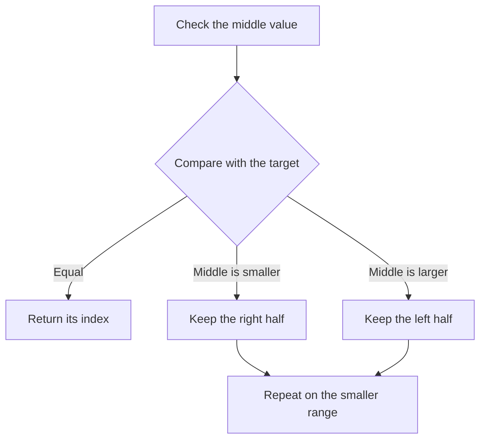
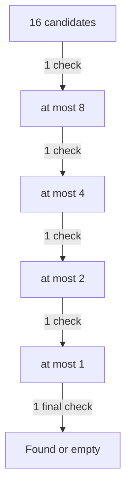

# Data Structures and Algorithms

**Lecture 4: QuickSort and binary search**

Can we sort with less extra memory, then use order to find things faster?

<br><br><br><br><br><br>

---

<br><br><br><br><br><br>

## What did merge sort need?

**Recall `[6, 2, 5, 2, 1]` from Lecture 3.**

```text
Input       [6, 2, 5, 2, 1]
Buffer      [_, _, _, _, _]

Result      [1, 2, 2, 5, 6]
```

- What does the buffer store?
- How much extra space does it need as `n` grows?
- Can we sort by moving values inside the input array?

<br><br><br><br><br><br>

---

<br><br><br><br><br><br>

## Merge-sort memory cost

**The array version we used needs `O(n)` extra space.**

```text
Input array       n positions          already supplied
Shared buffer     n extra positions   O(n)
Active calls      O(log n) frames      O(log n)
                                      --------
Total extra space                     O(n)
```

- We allocate the buffer once and reuse it.
- Only the active call path is on the stack at one time.
- Its best-case and worst-case time are `O(n log n)`.

Source: [Lecture 3: Merge-sort memory cost](03-sorting-and-merge-sort-student.md#merge-sort-memory-cost).

<br><br><br><br><br><br>

---

<br><br><br><br><br><br>

## Can we remove the merge buffer?

**Yes. QuickSort can partition the input array by swapping values.**



- No second array of `n` values is needed.
- Recursive calls still need stack space.
- We exchange a guaranteed time bound for a dependence on the partitions.

This solves the buffer problem. It does not remove every memory cost.

<br><br><br><br><br><br>

---

<br><br><br><br><br><br>

## QuickSort

**QuickSort chooses a pivot, partitions the array, then sorts the two sides.**

A **pivot** is a value used to separate smaller values from other values.

```text
Before      [ values in no order ]

Partition   [ values < pivot | pivot | values >= pivot ]
                              ^
                         final position

Then        Sort the left side. Sort the right side.
```

The sides do not need to be sorted before partitioning.
No merge is needed after the recursive calls.

Source: [Open Data Structures, Section 11.1.2: Quicksort](https://opendatastructures.org/ods-python/11_1_Comparison_Based_Sorti.html#SECTION001412000000000000000).
The source also shows a partition scheme that groups equal values separately.

<br><br><br><br><br><br>

---

<br><br><br><br><br><br>

## Which value should be the pivot?

**Would the first value always make two useful parts?**

```text
[6, 2, 5, 2, 1]       first value = 6

All four other values are smaller than 6.
```

- A pivot near the middle by value tends to give more balanced parts.
- A middle array index does not guarantee a middle value.
- For our trace, choose the **first value of each current range**.

We will return to random pivots and practical choices after the trace.

<br><br><br><br><br><br>

---

<br><br><br><br><br><br>

## The same input and range boundaries

```text
Index        0    1    2    3    4     5
          +----+----+----+----+----+
Value     | 6  | 2  | 5  | 2  | 1  |   end
          +----+----+----+----+----+
             ^                       ^
            lo                       hi
```

- Use the range **`[lo, hi)`**: include `lo`, exclude `hi`.
- Start with `lo = 0`, `hi = 5`.
- The range size is `hi - lo`.
- Zero or one value is already sorted.

We pass indexes. We do not copy the subarrays.

<br><br><br><br><br><br>

---

<br><br><br><br><br><br>

## Partition: four regions

**Keep the pivot at `lo` while scanning left to right.**

```text
[ pivot | values < pivot | values >= pivot | not checked ]
   lo               boundary              scan        hi
```

- Start `boundary = lo` and `scan = lo + 1`.
- Indexes `lo + 1` through `boundary` hold values `< pivot`.
- Indexes `boundary + 1` through `scan - 1` hold values `>= pivot`.
- Indexes `scan` through `hi - 1` are not checked yet.

A region can be empty. The pivot stays outside these regions until the end.

<br><br><br><br><br><br>

---

<br><br><br><br><br><br>

## Partition: one decision per value



Repeat for every remaining value. Then swap the pivot with `values[boundary]`.
This final swap puts the pivot at index `boundary`.
The groups on either side still need sorting.

<br><br><br><br><br><br>

---

<br><br><br><br><br><br>

## First partition: pivot 6

**Start with `pivot = 6`, `boundary = 0`.**

```text
Scan  Value  Test       New boundary  Swap indexes  Array after swap
  1     2    2 < 6          1            1, 1       [6, 2, 5, 2, 1]
  2     5    5 < 6          2            2, 2       [6, 2, 5, 2, 1]
```

```text
After scan 2      [6 | 2, 5 | 2, 1]
                  pivot  <6   not checked
```

A swap of a position with itself leaves the array unchanged.
It still extends the region known to contain smaller values.

<br><br><br><br><br><br>

---

<br><br><br><br><br><br>

## First partition: put 6 in place

```text
Scan  Value  Test       New boundary  Swap indexes  Array after swap
  3     2    2 < 6          3            3, 3       [6, 2, 5, 2, 1]
  4     1    1 < 6          4            4, 4       [6, 2, 5, 2, 1]

Final swap: indexes 0 and 4

Before      [6, 2, 5, 2, 1]
After       [1, 2, 5, 2 | 6 |]
                         ^
                     pivot fixed
```

- Return pivot index `p = 4`.
- Sort `[0, 4)`. The right range `[5, 5)` is empty.
- `6` is in its final position. The left side is not sorted yet.

<br><br><br><br><br><br>

---

<br><br><br><br><br><br>

## Second partition: pivot 1

**Sort only `[1, 2, 5, 2]`, at indexes `[0, 4)`.**

```text
pivot = 1, boundary = 0

scan 1: 2 < 1? No       [1, 2, 5, 2 | 6]
scan 2: 5 < 1? No       [1, 2, 5, 2 | 6]
scan 3: 2 < 1? No       [1, 2, 5, 2 | 6]

Final swap: indexes 0 and 0
Result                  [| 1 | 2, 5, 2 | 6]
```

- Return `p = 0`. The left range `[0, 0)` is empty.
- The next nonempty range is `[1, 4)`, containing `[2, 5, 2]`.
- The fixed `6` stays outside this work.

<br><br><br><br><br><br>

---

<br><br><br><br><br><br>

## Predict the partition with pivot 2

```text
Fixed       Active range       Fixed
 [1]        [2, 5, 2]           [6]
             ^
           pivot
```

1. Does the other `2` belong to the `< pivot` region?
2. Does `boundary` move during this scan?
3. Which values still need sorting afterward?

Use the strict comparison **`value < pivot`**.

<br><br><br><br><br><br>

---

<br><br><br><br><br><br>

## Third partition: pivot 2

**The active range is `[1, 4)`.**

```text
pivot = 2, boundary = 1

scan 2: 5 < 2? No       [1 | 2, 5, 2 | 6]
scan 3: 2 < 2? No       [1 | 2, 5, 2 | 6]

Final swap: indexes 1 and 1
Result                  [1 | 2 | 5, 2 | 6]
```

- Equal values go to the `>= pivot` region in this version.
- Return `p = 1`.
- The left range `[1, 1)` is empty. Sort the right range `[2, 4)`.

<br><br><br><br><br><br>

---

<br><br><br><br><br><br>

## Fourth partition: pivot 5

```text
Active range [2, 4): [5, 2]
pivot = 5, boundary = 2

scan 3: 2 < 5? Yes
boundary = 3; swap indexes 3 and 3
                         [1, 2 | 5, 2 | 6]

Final swap: indexes 2 and 3
                         [1, 2 | 2 | 5 | 6]
```

- Return `p = 3`.
- `[2, 3)` has one value. `[4, 4)` is empty.
- Both are base cases. All waiting calls can return.

**Final result: `[1, 2, 2, 5, 6]`.**

<br><br><br><br><br><br>

---

<br><br><br><br><br><br>

## The full QuickSort tree



Each recursive call excludes the pivot that its parent fixed.
Our example gives uneven partitions. A short input can show a bad pattern.

<br><br><br><br><br><br>

---

<br><br><br><br><br><br>

## Why is QuickSort correct?

```text
Partition     [ smaller values | pivot | other values ]
Sort sides    [ sorted smaller | pivot | sorted other ]
Result        [              sorted range            ]
```

- Swaps preserve every value and its count.
- Partition puts all values `< pivot` on the left and `>= pivot` on the right.
- Sorting each side makes the whole range sorted.

**Why does it finish?**

The pivot is excluded from both recursive calls.
Each new range is smaller. Size `0` or `1` returns immediately.

<br><br><br><br><br><br>

---

<br><br><br><br><br><br>

## Complete QuickSort programs

Read and run the same algorithm in [Python](examples/04-quicksort.py)
and [C](examples/04-quicksort.c).

```text
quick_sort: start with range [0, n)

For each range with at least two values:
    p = partition the range using its first value
    sort [lo, p)
    sort [p + 1, hi)
```

Both programs change the original array. Neither creates subarray copies.
The examples use the simple first-pivot version from our trace.

Run from the student repository's root folder:

```text
python3 slides/examples/04-quicksort.py
cc -std=c11 -Wall -Wextra slides/examples/04-quicksort.c -o /tmp/quicksort
/tmp/quicksort
```

Output: Python prints `[1, 2, 2, 5, 6]`; C prints `1 2 2 5 6`.

<br><br><br><br><br><br>

---

<br><br><br><br><br><br>

## Cost of one partition

**A range with `m` values checks the other `m - 1` values once.**

```text
Scan         m - 1 comparisons with the pivot
Swaps        At most m - 1 scan swaps, then 1 final swap
Storage      pivot, boundary, scan, and one saved swap value
```

- Time: **`O(m)`**.
- Extra space for partition alone: **`O(1)`**.
- Self-swaps change the amount of work, not its growth rate.

Assume integer comparisons, swaps, and array indexing take constant time.
We must also count the recursive calls for the full sort.

<br><br><br><br><br><br>

---

<br><br><br><br><br><br>

## Balanced partitions

**Suppose pivots keep the two sides close in size.**



Each partition fixes one pivot. The two sides share the remaining values.
Other size-3 ranges split in the same way as the one shown.

A path has sizes `15 -> 7 -> 3 -> 1`: only a few levels.

<br><br><br><br><br><br>

---

<br><br><br><br><br><br>

## Why balanced QuickSort is O(n log n)

```text
Partition level     Total values in active ranges
       0            15
       1             7 + 7             = 14
       2             3 + 3 + 3 + 3     = 12
       3             one-value ranges: return

Work per level      O(n)
Levels              O(log n)
Total time          O(n log n)
```

Balanced partitions give the **best-case growth** for this version.
Unlike merge sort, QuickSort does not guarantee balanced parts.

Source: [Open Data Structures: Quicksort analysis](https://opendatastructures.org/ods-python/11_1_Comparison_Based_Sorti.html#SECTION001412000000000000000).

<br><br><br><br><br><br>

---

<br><br><br><br><br><br>

## What if we always pick the smallest value?

**Try the first-pivot rule on an already sorted array.**

```text
[1, 2, 3, 4, 5]
 ^
pivot
```

- How many values are smaller than the pivot?
- What are the two remaining range sizes?
- Does the same problem happen in the next call?

<br><br><br><br><br><br>

---

<br><br><br><br><br><br>

## Uneven partitions repeat the large scan



Each pivot leaves an empty left side and a right side of size `m - 1`.
The picture omits the empty calls.

We remove one value per level instead of about half.

<br><br><br><br><br><br>

---

<br><br><br><br><br><br>

## Worst-case QuickSort time

```text
For 5 values      4 + 3 + 2 + 1 = 10 pivot comparisons

For n values      (n - 1) + (n - 2) + ... + 1
                = n(n - 1) / 2
```

**Worst-case time: `O(n^2)`.**

- Sorted input causes this with our first-pivot rule.
- Reverse-sorted distinct input also causes extreme partitions.
- An array of equal values causes the same range sizes in our scheme.

QuickSort's name does not promise fast results for every input.

<br><br><br><br><br><br>

---

<br><br><br><br><br><br>

## Random pivots and equal values

**Choose a random index from the current range, then move its value to `lo`.**

The rest of our partition algorithm can stay the same.

```text
Distinct values       Input order does not control every pivot choice.
All equal values      [2, 2, 2, 2, 2]
Any chosen pivot      2
Result                [empty | 2 | four other values]
```

- Uniform random pivots give **expected `O(n log n)` time for distinct keys**.
- Expected means an average over random choices for a fixed input.
- The worst case is still `O(n^2)`.
- Randomness alone does not fix equal values in this two-way scheme.

Source: [Open Data Structures: Random pivots and equal-key grouping](https://opendatastructures.org/ods-python/11_1_Comparison_Based_Sorti.html#SECTION001412000000000000000).

<br><br><br><br><br><br>

---

<br><br><br><br><br><br>

## QuickSort stack space

**Our two recursive calls run one after the other.**

```text
Balanced path        n -> about n/2 -> about n/4 -> ... -> 1
Active calls         O(log n)

Worst-case path      n -> n-1 -> n-2 -> ... -> 1
Active calls         O(n)
```

- Partition uses `O(1)` extra space.
- The full simple recursive sort uses **`O(log n)` stack space when balanced**.
- Its worst-case stack space is **`O(n)`**.

An in-place partition does not make the whole recursive sort `O(1)` space.
The Python example can reach its recursion limit on a large bad input.

<br><br><br><br><br><br>

---

<br><br><br><br><br><br>

## QuickSort characteristics

- **Comparison sort:** Compare keys to decide where values belong.
- **In-place partition:** Rearrange the input with a few temporary variables.
- **Divide and conquer:** Partition, then solve smaller problems.
- **Often good array locality:** Scan nearby positions in the same array.
- **Not stable in our version:** Equal keys can change relative order.

```text
Merge sort       Sort the halves, then combine them.
QuickSort        Separate by pivot, then sort the sides.
```

Performance also depends on comparison cost, swaps, and the implementation.

Source: [VisuAlgo: Sorting properties](https://visualgo.net/en/sorting).

**Do equal records always keep their input order?**

<br><br><br><br><br><br>

---

<br><br><br><br><br><br>

## Equal records can change order

**Equal keys need not keep their input order.**

```text
Input             [3, 2A, 2B]
Pivot              3
Scan               Both values are < 3; both scan swaps are self-swaps.
Final pivot swap  [2B, 2A, 3]

Next pivot         2B; 2A is equal, so it stays on the right.
Final output      [2B, 2A, 3]
```

`2A` came before `2B` in the input. The output reverses them.

Our merge sort takes the left record on a tie, so it is stable.
Use a stable library sort when the order of equal records matters.

<br><br><br><br><br><br>

---

<br><br><br><br><br><br>

## Merge sort and simple QuickSort

| Property | Merge sort from Lecture 3 | QuickSort from this trace |
| --- | --- | --- |
| Main extra storage | Shared buffer | Active recursive calls |
| Best-case time | `O(n log n)` | `O(n log n)` |
| Worst-case time | `O(n log n)` | `O(n^2)` |
| Extra space | `O(n)` | Balanced `O(log n)`; worst `O(n)` |
| Stable | Yes | No |

Random pivots improve the expected time for distinct keys.
They do not change the worst-case bound of the simple algorithm.

<br><br><br><br><br><br>

---

<br><br><br><br><br><br>

## How do engineers improve QuickSort?

**Different input patterns cause different problems.**



Production implementations often combine several methods.
No single pivot rule is best for every type of input.

<br><br><br><br><br><br>

---

<br><br><br><br><br><br>

## Optimization: sample pivot candidates

**Instead of always choosing the first value, inspect a few candidates.**

```text
Sample values        9    2    5
In value order       2    5    9
Chosen pivot              5
```

- **Median of three:** Use the middle value of three candidates.
- A larger sample can improve pivot choices for large ranges.
- Random selection is a simple way to reduce dependence on input order.
- Sampling is useful, but does not by itself guarantee balanced partitions.

Example: [Go 1.23.0 pivot selection](https://github.com/golang/go/blob/go1.23.0/src/slices/zsortordered.go#L258-L296)
uses median-of-three and larger samples for large ranges.

<br><br><br><br><br><br>

---

<br><br><br><br><br><br>

## Optimization: insertion sort for small ranges

```text
Large range     Partition it.
Small range     Finish with insertion sort.
```

- Small ranges do not need many shifts.
- A simple loop can avoid more partition and function-call overhead.
- The threshold is an engineering choice, not a universal constant.

Example: [Go 1.23.0](https://github.com/golang/go/blob/go1.23.0/src/slices/zsortordered.go#L63-L77)
uses insertion sort for ranges with at most `12` values.

This reuses the algorithm from Lecture 3.

<br><br><br><br><br><br>

---

<br><br><br><br><br><br>

## Optimization: three-way partition

**Give equal values their own region.**

```text
Two-way       [ < pivot | one pivot | >= pivot ]

Three-way     [ < pivot | == pivot | > pivot ]

Example       [1, 2, 2, 2, 2, 5]     pivot = 2
              [1 | 2, 2, 2, 2 | 5]
               ^               ^
          sort this        sort this
```

- Do not recurse into the equal region.
- An all-equal array finishes after one linear partition pass.
- This addresses the duplicate problem in our simple scheme.

Source: [Open Data Structures: Three-way QuickSort](https://opendatastructures.org/ods-python/11_1_Comparison_Based_Sorti.html#SECTION001412000000000000000).

<br><br><br><br><br><br>

---

<br><br><br><br><br><br>

## Optimization: a fallback for bad partitions



- A fallback limits the damage from repeated uneven partitions.
- Heapsort has an `O(n log n)` worst-case time bound.
- We do not need its implementation to understand this safety mechanism.

**Introsort** limits partition depth. Pattern-defeating QuickSort also
responds to bad partitions and input patterns.

Example: [Go 1.23.0 fallback](https://github.com/golang/go/blob/go1.23.0/src/slices/zsortordered.go#L63-L89).

<br><br><br><br><br><br>

---

<br><br><br><br><br><br>

## Optimization: limit the call stack

**Recurse on the smaller side. Process the larger side with a loop.**

```text
One partition      [ 3 values | pivot | 96 values ]
Recursive call       ^
Loop continues                             ^
```

- A new nested call receives at most about half of its caller's range.
- This limits the active stack to **`O(log n)`**, even with bad splits.
- It does not fix quadratic time by itself.

Example: [Go 1.23.0 smaller-side recursion](https://github.com/golang/go/blob/go1.23.0/src/slices/zsortordered.go#L116-L130).

Our teaching programs keep both recursive calls to match the trace.

<br><br><br><br><br><br>

---

<br><br><br><br><br><br>

## A real implementation: Go slices.Sort

**Go 1.23.0 uses pattern-defeating QuickSort for `slices.Sort`.**

```text
Pivot samples                 Better pivot choices
Insertion sort                Small ranges
Equal-value handling          Many duplicates
Pattern checks                Sorted or patterned input
Heapsort fallback             Repeated bad partitions
Smaller-side recursion        Limited call-stack growth
```

The implementation is more than the short textbook algorithm.
These details are for the named version; library internals can change.

Sources: [Go 1.23.0 Sort entry point](https://github.com/golang/go/blob/go1.23.0/src/slices/sort.go#L12-L19)
and [implementation](https://github.com/golang/go/blob/go1.23.0/src/slices/zsortordered.go).

<br><br><br><br><br><br>

---

<br><br><br><br><br><br>

## A real implementation: Java Arrays.sort

**OpenJDK 21 uses Dual-Pivot QuickSort for `Arrays.sort(int[])`.**

Two pivots can separate values into three parts.

```text
[ values below p | p | values between p and q | q | values above q ]
```

- The implementation selects pivots from a small sample.
- It uses insertion sort for small ranges.
- It can merge existing ordered runs.
- It falls back to heapsort when partition recursion goes too deep.

This is the integer-array implementation. Other overloads can use other methods.

Sources: [OpenJDK 21 Arrays.sort(int[])](https://github.com/openjdk/jdk/blob/jdk-21-ga/src/java.base/share/classes/java/util/Arrays.java#L84-L101)
and [DualPivotQuicksort](https://github.com/openjdk/jdk/blob/jdk-21-ga/src/java.base/share/classes/java/util/DualPivotQuicksort.java#L168-L214).

<br><br><br><br><br><br>

---

<br><br><br><br><br><br>

## Libraries also use other sorting methods

**CPython 3.13.0 uses an adaptive, stable merge sort for lists.**

```text
Existing ordered runs -> extend short runs -> merge the runs
```

- It uses order already present in the data.
- It uses insertion sort to extend short runs.
- Its merge scheduling uses the Powersort strategy.
- It preserves the order of equal keys.

Choose a library function by its documented behavior and your needs.
Do not assume every function called `sort` uses QuickSort.

Source: [CPython 3.13.0 sorting design](https://github.com/python/cpython/blob/v3.13.0/Objects/listsort.txt).

<br><br><br><br><br><br>

---

<br><br><br><br><br><br>

## Watch QuickSort step by step

**Use [VisuAlgo: Sorting](https://visualgo.net/en/sorting).**

1. Press `Esc` if e-Lecture Mode opens.
2. Choose **Quick Sort** (`QUI`).
3. Open **Create(A)**. Enter `6,2,5,2,1`, then choose **Go**.
4. Choose **Sort**, then **Show depth**. Pause and use previous/next-frame controls.
5. Choose **Random Quick Sort** (`R-Q`) and create the input again.
6. Compare sorted input `1,2,3,4,5` and equal input `2,2,2,2,2`.

Predict the next comparison or swap before stepping forward.
The tool randomly sends some equal values to the left region.
Its duplicate traces can differ from our strict `<` rule.
Use our program when you need the exact trace from these slides.

<br><br><br><br><br><br>

---

<br><br><br><br><br><br>

## Why did we sort in the first place?

**Return to the library shelf from Lecture 3. Find DUNE.**

```text
[BIRDS] [DUNE] [MOON] [RIVERS]
                 ^
              look here
```

- DUNE comes before MOON.
- Can we ignore MOON and every later title?
- How should we choose the next position to check?

The order gives information about values we have not read.

<br><br><br><br><br><br>

---

<br><br><br><br><br><br>

## Binary search

**Binary search checks the middle candidate and keeps only the possible half.**



- The input must be sorted using the same comparison rule.
- If no candidates remain, the target is absent.

Source: [CS50x: Binary Search](https://cs50.harvard.edu/x/notes/3/#binary-search).

<br><br><br><br><br><br>

---

<br><br><br><br><br><br>

## Search the sorted output

**Find target `5` in `[1, 2, 2, 5, 6]`.**

```text
Index        0    1    2    3    4     5
          +----+----+----+----+----+
Value     | 1  | 2  | 2  | 5  | 6  |   end
          +----+----+----+----+----+
             ^                       ^
            lo                       hi
```

Use `[lo, hi)` again. Start with `lo = 0`, `hi = 5`.

```text
mid = lo + (hi - lo) // 2
```

The `//` operator means integer division in Python. C uses `/` for these
nonnegative integer indexes. `hi` is a boundary, not a valid index to read.

<br><br><br><br><br><br>

---

<br><br><br><br><br><br>

## Find 5: first check

```text
lo = 0, hi = 5
mid = 0 + (5 - 0) // 2 = 2

Index       0    1    2    3    4
Value      [1,   2,   2,   5,   6]
                     ^
                  middle

2 < 5: discard indexes 0, 1, and 2.
New range: [3, 5)
```

Every value at or left of `mid` is at most `2`.
None can be the target `5`.

Set **`lo = mid + 1`**.

<br><br><br><br><br><br>

---

<br><br><br><br><br><br>

## Find 5: second check

```text
lo = 3, hi = 5
mid = 3 + (5 - 3) // 2 = 4

Index       0    1    2    3    4
Value      [1,   2,   2,   5,   6]
Keep                     [5,   6]
                              ^
                           middle

6 > 5: discard index 4.
New range: [3, 4)
```

Every value at or right of `mid` is at least `6`.
Set **`hi = mid`**. In `[lo, hi)`, this excludes `mid`.

<br><br><br><br><br><br>

---

<br><br><br><br><br><br>

## Find 5: third check

```text
lo = 3, hi = 4
mid = 3 + (4 - 3) // 2 = 3

Index       0    1    2    3    4
Value      [1,   2,   2,   5,   6]
Keep                     [5]
                          ^
                       middle

5 == 5: return index 3.
```

We checked indexes `2`, `4`, and `3`.
We never needed to read indexes `0` or `1`.

The returned index is in the original array. We did not copy any range.

<br><br><br><br><br><br>

---

<br><br><br><br><br><br>

## Predict a missing-target search

**Start again. Search for `4`.**

```text
[1, 2, 2, 5, 6]
```

1. Which middle indexes will we check?
2. What happens when only `[5]` remains?
3. How can the algorithm report absence without checking every value?

<br><br><br><br><br><br>

---

<br><br><br><br><br><br>

## Search for 4: no candidates remain

```text
lo  hi  mid  Value  Decision                     Next range
 0   5    2     2   2 < 4: lo = mid + 1          [3, 5)
 3   5    4     6   6 > 4: hi = mid              [3, 4)
 3   4    3     5   5 > 4: hi = mid              [3, 3)

lo == hi: the candidate range is empty. Return -1.
```

```text
[1, 2, 2]     gap     [5, 6]
 all < 4    target 4   all > 4
```

The order proves that the discarded positions cannot contain `4`.
We do not need to inspect them one by one.

<br><br><br><br><br><br>

---

<br><br><br><br><br><br>

## Empty input, endpoints, and duplicates

| Input | Target | Result |
| --- | ---: | --- |
| `[]` | `5` | `-1`: the loop does not start |
| `[5]` | `5` | `0` |
| `[5]` | `4` | `-1` |
| `[1, 2, 2, 5, 6]` | `1` | `0`: first index can be found |
| `[1, 2, 2, 5, 6]` | `6` | `4`: last index can be found |
| `[1, 2, 2, 5, 6]` | `2` | `2` in our trace |

With duplicates, this version returns **a matching index**.
It does not promise the first matching index.

A target below the minimum or above the maximum also gives `-1`.

<br><br><br><br><br><br>

---

<br><br><br><br><br><br>

## Complete binary-search programs

Read and run the index-based method in [Python](examples/04-binary-search.py)
and [C](examples/04-binary-search.c).

```text
while lo < hi:
    check mid = lo + (hi - lo) // 2
    equal:          return mid
    value < target: lo = mid + 1
    value > target: hi = mid
return -1
```

The input must already be sorted. Neither program creates array slices.
The C example uses a nonnegative length and indexes that fit in `int`.

Run from the student repository's root folder:

```text
python3 slides/examples/04-binary-search.py
cc -std=c11 -Wall -Wextra slides/examples/04-binary-search.c -o /tmp/binary-search
/tmp/binary-search
```

Both print `target 5: index 3` and `target 4: index -1`.

<br><br><br><br><br><br>

---

<br><br><br><br><br><br>

## Why is binary search correct?

**Invariant: If the target is present, a match remains inside `[lo, hi)`.**

```text
Middle < target     [discard <= middle | keep right]
Middle > target     [keep left | discard >= middle]
Middle = target     Return its index.
```

- Initially, the range includes the whole array.
- Sorted order makes each discarded region impossible.
- An empty range means no match exists.

**Why does it finish?** Each unsuccessful check removes `mid` and at least
half the candidates. The remaining range is strictly smaller.

Using `lo = mid` instead of `mid + 1` can prevent that progress.

<br><br><br><br><br><br>

---

<br><br><br><br><br><br>

## How many times can we remove half?

**Imagine `16` possible positions.**



Four halvings reduce `16` to `1`. The last candidate may need one more check.

For `n >= 1`, this version checks at most **`floor(log2(n)) + 1` middle values**.
That is **`O(log n)` worst-case time**.

<br><br><br><br><br><br>

---

<br><br><br><br><br><br>

## The intuition behind logarithms

**`log2(n)` asks how many times we double `1` to reach `n`.**

```text
Doubling       1 -> 2 -> 4 -> 8 -> 16 -> 32
Steps               1    2    3     4     5

2^5 = 32, so log2(32) = 5.
```

Read the arrows backward: five halvings reduce `32` to `1`.

- Linear search removes one candidate per failed check.
- Binary search removes at least half per failed check.
- **Doubling the input adds at most one worst-case middle-value check.**

Source: [CS50x: Running Time](https://cs50.harvard.edu/x/notes/3/#running-time).

<br><br><br><br><br><br>

---

<br><br><br><br><br><br>

## A large array can need few checks

| Number of values `n` | Linear search: at most | Binary search: at most |
| ---: | ---: | ---: |
| 8 | 8 | 4 |
| 1,024 | 1,024 | 11 |
| 1,048,576 | 1,048,576 | 21 |

These count **positions inspected**, not seconds or individual CPU instructions.
A middle-value check can use more than one comparison in the code.

At about one million values, binary search needs at most `21` such checks.
The input must already be sorted.

<br><br><br><br><br><br>

---

<br><br><br><br><br><br>

## Binary-search time and space

```text
Best case        First middle value matches.       O(1) time
Worst case       Repeatedly halve the candidates.  O(log n) time
Extra storage    lo, hi, mid, and target           O(1) space
```

- These costs assume constant-time array indexing and key comparisons.
- Use indexes instead of copying smaller array slices.
- A linked list does not give constant-time access to its middle index.
- String comparisons can add work based on the string lengths.

Binary search processes one remaining half at each step.
Sorting algorithms process both parts, which is why their cost is larger.

<br><br><br><br><br><br>

---

<br><br><br><br><br><br>

## Sort once, search many times

**Sorting has a cost. Include it in the full task.**

```text
Unsorted array, q searches:
    linear searches                 O(q * n) worst-case time

Sort once with merge sort, then q binary searches:
    sorting + searching             O(n log n + q log n)
```

- For one search, a linear scan is usually the simpler choice.
- For many searches in unchanged data, sorted order can repay its cost.
- QuickSort with random pivots gives the same expected total for distinct keys.
- Our simple first-pivot sort can still add `O(n^2)` sorting time.

If the data changes, include the cost of maintaining the sorted order.

<br><br><br><br><br><br>

---

<br><br><br><br><br><br>

## Watch binary search step by step

**Use [University of San Francisco: Binary and Linear Search](https://www.cs.usfca.edu/~galles/visualization/Search.html).**

1. Use **Small** for a readable array.
2. Enter a target in the box. Choose **Binary Search**.
3. Choose **Pause**, then **Step Forward** or **Step Back**.
4. Try a target visible in the array, then a value that is absent.
5. Use **Linear Search** to compare the number of checked positions.

The tool supplies its own sorted array. Use the slides for our exact input.
It uses inclusive upper bounds, so its `high` updates differ from our `hi`.

Both versions remove the middle position after an unsuccessful check.

<br><br><br><br><br><br>

---

<br><br><br><br><br><br>

## Check your understanding

1. What memory cost does in-place QuickSort remove from our merge sort?
2. Why do recursive calls exclude the pivot's final position?
3. Why can first-pivot QuickSort be slow on an already sorted array?
4. Do random pivots fix all-equal input in our two-way scheme?
5. Why can binary search discard values it has not read?
6. Why must the right-half update use `lo = mid + 1`?
7. Why does doubling `n` add so little work to binary search?

Use a trace or diagram from this lesson to explain each answer.

<br><br><br><br><br><br>

---

<br><br><br><br><br><br>

## Check your answers

1. It removes the `O(n)` merge buffer. Recursive stack space remains.
2. The pivot is already fixed. Excluding it makes both ranges smaller.
3. Each pivot is the smallest remaining value, leaving a range of size `n - 1`.
4. No. Every pivot value is equal. Group equal values to avoid repeated work.
5. Sorted order proves that a discarded region cannot contain the target.
6. `mid` is already checked. Removing it guarantees a smaller range.
7. One extra halving cancels one doubling of the input size.

<br><br><br><br><br><br>

---

<br><br><br><br><br><br>

## Read and explore

- [Open Data Structures (Python), Section 11.1.2: Quicksort](https://opendatastructures.org/ods-python/11_1_Comparison_Based_Sorti.html#SECTION001412000000000000000): random pivots, partitioning, and analysis.
- [CS50x: Binary Search](https://cs50.harvard.edu/x/notes/3/#binary-search): a visual introduction to sorted search.
- [Donald Knuth, The Art of Computer Programming, Vol. 3, 2nd edition: Sorting and Searching](https://www.informit.com/store/art-of-computer-programming-volume-3-sorting-and-searching-9780201896855): deeper reading on sorting and search.
- [Go 1.23.0 sorting source](https://github.com/golang/go/blob/go1.23.0/src/slices/zsortordered.go): practical QuickSort improvements.
- [OpenJDK 21 integer-array sorting source](https://github.com/openjdk/jdk/blob/jdk-21-ga/src/java.base/share/classes/java/util/DualPivotQuicksort.java): Dual-Pivot QuickSort and its helper algorithms.
- [CPython 3.13.0 sorting design](https://github.com/python/cpython/blob/v3.13.0/Objects/listsort.txt): an adaptive stable merge sort.
