# Data Structures and Algorithms

**Lecture 5: HashMap and HashSet**


<br><br><br><br><br><br>

---

<br><br><br><br><br><br>

## Count repeated names

**A list records people who entered a classroom.**

```text
Names: ["Alice", "Brad", "Alice", "Collin", "Brad", "Alice"]

Wanted:
    Alice     3
    Brad      2
    Collin    1
```

- Count every occurrence of each name.
- Then find how many **different names appear more than once**.
- Treat spelling and letter case as exact matches.

How would you solve this with only a list and loops?

<br><br><br><br><br><br>

---

<br><br><br><br><br><br>

## Scan the list for each name

```python
names = ["Alice", "Brad", "Alice", "Collin", "Brad", "Alice"]

for name in names:
    count = 0
    for other in names:
        if other == name:
            count += 1
    print(name, count)
```

```text
Alice 3    Brad 2    Alice 3    Collin 1    Brad 2    Alice 3
```

The counts are correct, but we repeat scans and output.

<br><br><br><br><br><br>

---

<br><br><br><br><br><br>

## The repeated work

```text
For Alice:   [Alice, Brad, Alice, Collin, Brad, Alice]   6 checks
For Brad:    [Alice, Brad, Alice, Collin, Brad, Alice]   6 checks
For Alice:   [Alice, Brad, Alice, Collin, Brad, Alice]   6 checks
...                                                     ...

6 names x 6 checks = 36 name comparisons
n names x n checks = n^2 name comparisons
```

Time: **`O(n^2)`**, when each name comparison takes constant time.

Could we read each occurrence once and update its saved count?

<br><br><br><br><br><br>

---

<br><br><br><br><br><br>

## A running count

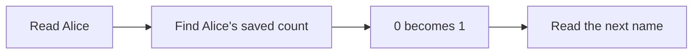

```text
Read name       Saved counts after this step
Alice           Alice: 1
Brad            Alice: 1, Brad: 1
Alice           Alice: 2, Brad: 1
Collin          Alice: 2, Brad: 1, Collin: 1
Brad            Alice: 2, Brad: 2, Collin: 1
Alice           Alice: 3, Brad: 2, Collin: 1
```

We need to find a count **by name**, without scanning all saved names.

<br><br><br><br><br><br>

---

<br><br><br><br><br><br>

## HashMap: a value for each key

**A map stores key/value pairs. Each key has one associated value.**

A **HashMap**, also called a hash map, uses hashing to find a pair's location.

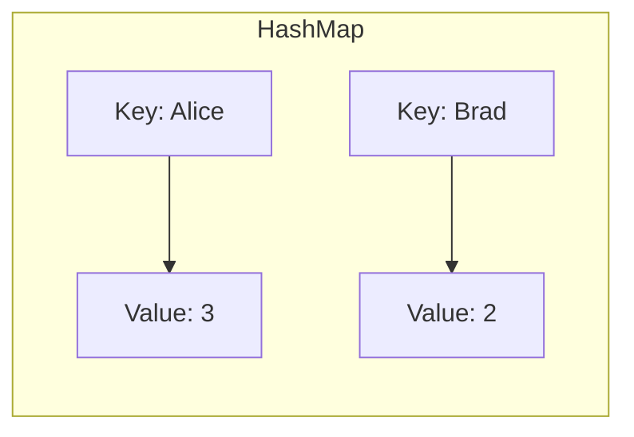

- The **key** identifies the item: a name.
- The **value** is the data we store for it: a count.
- Setting an existing key replaces its value.

Source: [Open Data Structures (Python), Chapter 5: Hash Tables](https://opendatastructures.org/ods-python/5_Hash_Tables.html).

<br><br><br><br><br><br>

---

<br><br><br><br><br><br>

## Count names with Python's dict

**Python's `dict` is a hash map. `{}` creates an empty dictionary.**

```python
def count_names(names):
    counts = {}
    for name in names:
        if name in counts:
            counts[name] += 1
        else:
            counts[name] = 1
    return counts

names = ["Alice", "Brad", "Alice", "Collin", "Brad", "Alice"]
counts = count_names(names)
print(counts)
```

```text
{'Alice': 3, 'Brad': 2, 'Collin': 1}
```

`name in counts` checks whether the name is a key in the dictionary.

Source: [Python: Dictionaries](https://docs.python.org/3/tutorial/datastructures.html#dictionaries).

<br><br><br><br><br><br>

---

<br><br><br><br><br><br>

## How many names repeat?

```python
repeated_names = []
for name in counts:
    if counts[name] > 1:
        repeated_names.append(name)

print(repeated_names)
print(len(repeated_names))
```

```text
['Alice', 'Brad']
2
```

**Two different names repeat.** Alice occurs three times; Brad occurs twice.
We visit each saved key once. We do not scan the original list again.

<br><br><br><br><br><br>

---

<br><br><br><br><br><br>

## Use 1: a contact list

**How can a messaging app find a contact's phone number?**

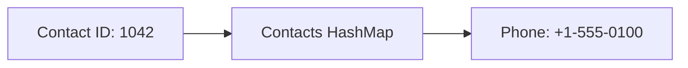

```python
contacts = {1042: "+1-555-0100", 2081: "+1-555-0101"}
phone = contacts[1042]
```

- **Key:** contact ID. **Value:** phone number.
- Use an ID because two people can have the same name.
- A phone-number change updates the value for that ID.

<br><br><br><br><br><br>

---

<br><br><br><br><br><br>

## Use 2: a shopping basket

**How can a shop keep one quantity for each product?**

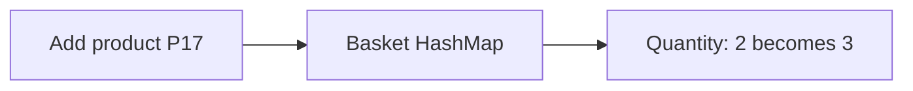

```python
basket = {"P17": 2, "P42": 1}
basket["P17"] = basket.get("P17", 0) + 1
```

- **Key:** product ID. **Value:** quantity.
- This is the same counting pattern as the classroom names.

<br><br><br><br><br><br>

---

<br><br><br><br><br><br>

## Use 3: a cache

**Can a program reuse a result instead of calculating it again?**

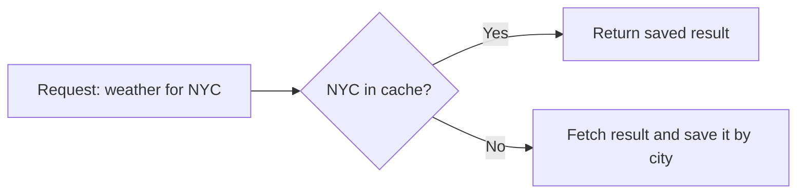

- **Key:** city. **Value:** a saved weather result.
- A cache saves work when the same request returns.
- Real caches also need rules for expiry and size.

These three examples are possible application designs.

<br><br><br><br><br><br>

---

<br><br><br><br><br><br>

## HashMap operations in Python

```python
cities = {}
cities["Alice"] = "NYC"
cities["Brad"] = "Chicago"
cities["Alice"] = "Boston"

print(cities["Alice"])             # Boston
print(cities.get("Collin", "?"))   # ?
print("Brad" in cities)            # True
del cities["Brad"]
```

- `cities[key]` reads a value; an absent key raises `KeyError`.
- `cities.get(key, default)` gives a default for an absent key.
- `key in cities` tests **keys**, not values.
- An update keeps one pair for the key.

Source: [Python: Mapping Types - dict](https://docs.python.org/3.13/library/stdtypes.html#mapping-types-dict).

<br><br><br><br><br><br>

---

<br><br><br><br><br><br>

## HashMap time complexity

**Let `n` be the number of stored pairs.**

| Operation | Expected time | Worst-case time |
| --- | --- | --- |
| Read by key | `O(1)` | `O(n)` |
| Test key membership | `O(1)` | `O(n)` |
| Update a value | `O(1)` | `O(n)` |
| Insert without resizing | `O(1)` | `O(n)` |
| Remove without resizing | `O(1)` | `O(n)` |
| Visit all pairs | `O(n)` | `O(n)` |

Assume constant-time key hashing/comparison, a suitable hash function,
and enough free space. Storage is **`O(n)`**.

With growth included, insertion is **expected amortized `O(1)`**.
We will examine the cost of a rebuild separately.

Source: [Open Data Structures (Python), Chapter 5](https://opendatastructures.org/ods-python/5_Hash_Tables.html).

<br><br><br><br><br><br>

---

<br><br><br><br><br><br>

## Do we always need a value?

**An event gate must know whether a ticket was already scanned.**

```text
Scan T17     First visit: allow entry
Scan T42     First visit: allow entry
Scan T17     Already scanned: reject this repeat
```

We need to remember ticket IDs. We do not need a count or a city.

Which question must the structure answer?

<br><br><br><br><br><br>

---

<br><br><br><br><br><br>

## HashSet: unique values

**A set stores distinct elements. A HashSet uses hashing for membership.**

Python's built-in hash set is `set`.

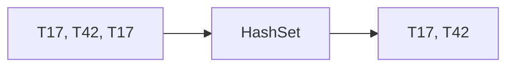

- Adding the same element again does not add a second copy.
- Use a **HashMap** for associated values or counts.
- Use a **HashSet** to ask, "Is this element present?"
- A set does not keep a position order.

Source: [Python: Sets](https://docs.python.org/3/tutorial/datastructures.html#sets).

<br><br><br><br><br><br>

---

<br><br><br><br><br><br>

## HashSet operations and costs

```python
scanned = set()
scanned.add("T17")
scanned.add("T42")
scanned.add("T17")
print("T17" in scanned)       # True
print(len(scanned))          # 2
scanned.discard("T42")
```

| Operation | Expected time | Worst-case time |
| --- | --- | --- |
| Membership: `x in scanned` | `O(1)` | `O(n)` |
| Add: `scanned.add(x)` | Amortized `O(1)` | `O(n)` |
| Remove: `scanned.discard(x)` | Amortized `O(1)` | `O(n)` |

Same hashing assumptions as a HashMap; `n` stored elements need `O(n)` space.
`discard` also works if the element is absent. An empty set is `set()`, not `{}`.

<br><br><br><br><br><br>

---

<br><br><br><br><br><br>

## A HashMap built with a dynamic array

**How could we store key/value pairs in an array?**

- Each slot is empty or holds one key/value pair.
- An integer index lets us read a slot directly.
- Grow the array when we need more space.

```text
Index             0          1
              +----------+----------+
Pair          | Alice: 3 | Brad: 2  |
              +----------+----------+
```

How can we convert a string such as `"Alice"` into an array index?

<br><br><br><br><br><br>

---

<br><br><br><br><br><br>

## Hashing has two phases

**How can a string key select an array slot?**

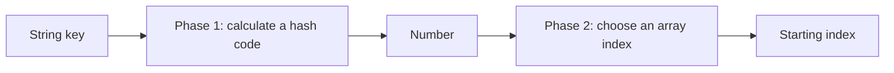

- **Phase 1:** convert the string into an integer hash code.
- **Phase 2:** convert that number into a valid array index.
- Equal keys must give equal hash codes within the same table.

First, examine **phase 2** with keys that are already numbers.

Source: [Open Data Structures (Python), Section 5.3: Hash Codes](https://opendatastructures.org/ods-python/5_3_Hash_Codes.html).

<br><br><br><br><br><br>

---

<br><br><br><br><br><br>

## Phase 2: a HashMap with number keys

**Store a city for each person ID. The IDs are integer keys.**

```text
Wanted HashMap:
    4 -> "NYC"
    7 -> "Chicago"

Underlying array before insertion:
Index      0          1
       +----------+----------+
Pair   |  empty   |  empty   |
       +----------+----------+
```

- For this example, use the number itself as its hash code.
- We have **two slots**, indexed `0` and `1`.
- Use **`key % 2`** because the array has two slots.

<br><br><br><br><br><br>

---

<br><br><br><br><br><br>

## Use % 2 to store the first pair

**`%` gives the remainder after division.**

```text
Insert: key = 4, value = "NYC"

4 / 2 = 2 with remainder 0
4 % 2 = 0

Index      0          1
       +----------+----------+
Pair   | 4: NYC   |  empty   |
       +----------+----------+
```

Store the **key and value together** at index `0`.

**Predict:** which index will key `7` select?

<br><br><br><br><br><br>

---

<br><br><br><br><br><br>

## Use % 2 to store the second pair

```text
Insert: key = 7, value = "Chicago"

7 / 2 = 3 with remainder 1
7 % 2 = 1

Index      0          1
       +----------+----------+
Pair   | 4: NYC   |7: Chicago|
       +----------+----------+
```

Both pairs now have a slot. The two-slot array is full.

<br><br><br><br><br><br>

---

<br><br><br><br><br><br>

## Use the same rule to read a value

```text
Request     Calculation     Read slot     Check key     Return value
get(4)      4 % 2 = 0       0             4 == 4        "NYC"
get(7)      7 % 2 = 1       1             7 == 7        "Chicago"
```

- Calculate the index from the **key**.
- Check the saved key, then return its value.
- Use the same index rule for storing and reading.

**For an array of length `m`, use `hash code % m`.**

<br><br><br><br><br><br>

---

<br><br><br><br><br><br>

## Phase 1: names as keys, cities as values

**What number could represent a name such as `"Alice"`?**

```python
cities = HashMap()
cities.put("Alice", "NYC")
cities.put("Brad", "Chicago")
cities.put("Collin", "Seattle")
```

```text
Key       Value
Alice     NYC
Brad      Chicago
Collin    Seattle
```

For this string-key example, also start with **two slots**.
`put` means set or update a key's value. The city is the stored value.

<br><br><br><br><br><br>

---

<br><br><br><br><br><br>

## Add the character codes

**For our ASCII names, add the code of each character.**

```text
"Alice"

Character      A     l     i     c     e
ASCII code    65   108   105    99   101

Sum = 65 + 108 + 105 + 99 + 101 = 478
```

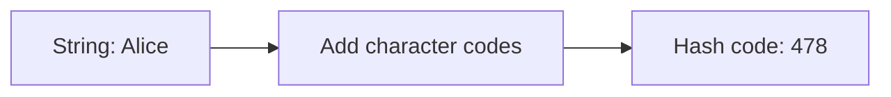

Python's `ord(char)` returns a Unicode code point. For ASCII characters,
this is the ASCII code. Letter case changes the codes.

Source: [Python: ord](https://docs.python.org/3/library/functions.html#ord).

<br><br><br><br><br><br>

---

<br><br><br><br><br><br>

## Calculate the starting index

**Combine the phases: add character codes, then use `% capacity`.**

```python
def name_index(name, capacity):
    total = 0
    for char in name:
        total += ord(char)
    return total % capacity
```

```text
Name     Character-code sum                  % 2    % 4
Alice    65 + 108 + 105 + 99 + 101 = 478         0      2
Brad     66 + 114 + 97 + 100 = 377               1      1
Collin   67 + 111 + 108 + 108 + 105 + 110 = 609  1      1
```

The key is still `"Alice"`. `0` or `2` is an **array index**, not a new key.
This simple function is for learning. Python's `dict` uses a different hash.

<br><br><br><br><br><br>

---

<br><br><br><br><br><br>

## Set Alice's city

**Start with an array of length 2.**

```text
put("Alice", "NYC")
478 % 2 = 0

Index     Before              After
  0       empty               ("Alice", "NYC")
  1       empty               empty
```

1. Calculate the starting index from `"Alice"`.
2. The slot is empty. Store the **key and value** together.
3. Increase the number of stored pairs to `1`.

Why must we save the key as well as the city?

<br><br><br><br><br><br>

---

<br><br><br><br><br><br>

## Get Alice's city

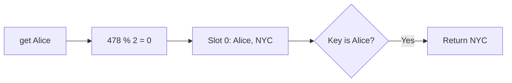

- Use the same hash rule as insertion.
- Compare the stored key with the requested key.
- Return the value only when the keys match.

One matching index alone does not prove that we found the right person.

<br><br><br><br><br><br>

---

<br><br><br><br><br><br>

## Set Brad's city

```text
put("Brad", "Chicago")
377 % 2 = 1

Index     Pair
  0       ("Alice", "NYC")
  1       ("Brad", "Chicago")
```

Both slots now hold a pair. The array is full.

**Predict:** Collin has sum `609`. Where does `609 % 2` start?
What happens if we write Collin there?

<br><br><br><br><br><br>

---

<br><br><br><br><br><br>

## Collision: two keys, one starting index

**A collision occurs when different keys select the same starting slot.**

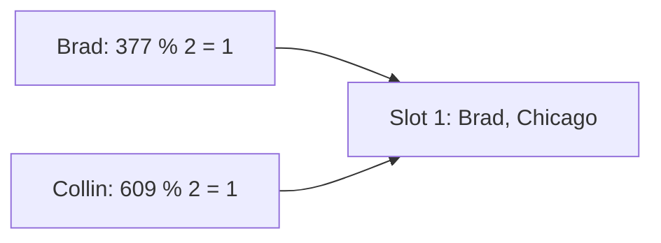

- Brad and Collin are different keys.
- Replacing Brad would lose a pair. It is not a valid insertion.
- We need a collision rule. We also need space in the array.

First, make more space. Then check whether the collision is gone.

Source: [Open Data Structures (Python), Chapter 5: Hash Tables](https://opendatastructures.org/ods-python/5_Hash_Tables.html).

<br><br><br><br><br><br>

---

<br><br><br><br><br><br>

## Resize and rehash

**Double the capacity from 2 to 4, as with a dynamic array.**

But the starting index depends on the capacity. Calculate it again.

```text
Old array, capacity 2        New array, capacity 4
0: Alice -> NYC              0: empty
1: Brad  -> Chicago          1: Brad  -> Chicago   377 % 4 = 1
                            2: Alice -> NYC       478 % 4 = 2
                            3: empty
```

- **Resize:** allocate a larger array.
- **Rehash:** place every saved pair using the new capacity.
- Keep each key/value pair together.

<br><br><br><br><br><br>

---

<br><br><br><br><br><br>

## Why copying to the same index fails

```text
Wrong: copy Alice to old index 0 in the new array.

get("Alice") now calculates 478 % 4 = 2.
It checks index 2, which is empty, and misses Alice.
```

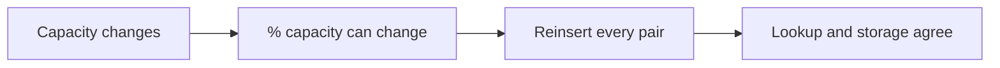

The character-code sum can stay `478`. The array index can change.

Source: [Open Data Structures (Python), Section 5.2: Linear Probing](https://opendatastructures.org/ods-python/5_2_LinearHashTable_Linear_.html).

<br><br><br><br><br><br>

---

<br><br><br><br><br><br>

## A larger array can still have a collision

```text
Brad:    377 % 4 = 1
Collin:  609 % 4 = 1

Index      0        1        2        3
        +--------+--------+--------+--------+
Key     | empty  | Brad   | Alice  | empty  |
        +--------+--------+--------+--------+
                   ^
             Collin starts here
```

There is free space. Resizing did not separate these two starting indexes.

Can we use another slot in **this same array**?

<br><br><br><br><br><br>

---

<br><br><br><br><br><br>

## Linear probing

**On a collision, check the next slot. Continue until a slot is empty.**

```text
put("Collin", "Seattle")       609 % 4 = 1

Check index 1     Brad      Different key: continue
Check index 2     Alice     Different key: continue
Check index 3     empty     Store ("Collin", "Seattle")

Index      0        1        2        3
        +--------+--------+--------+--------+
Key     | empty  | Brad   | Alice  | Collin |
        +--------+--------+--------+--------+
```

This is **open addressing with linear probing**.
The starting index stays `1`; the actual storage index is `3`.

Source: [Open Data Structures (Python), Section 5.2: Linear Probing](https://opendatastructures.org/ods-python/5_2_LinearHashTable_Linear_.html).

<br><br><br><br><br><br>

---

<br><br><br><br><br><br>

## Get must follow the same path

**Predict:** which slots does `get("Collin")` check?

```text
Index     Pair
  0       empty
  1       ("Brad", "Chicago")
  2       ("Alice", "NYC")
  3       ("Collin", "Seattle")
```

Does a different key at index `1` mean Collin is absent?

<br><br><br><br><br><br>

---

<br><br><br><br><br><br>

## Lookup with probing

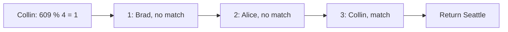

For a lookup:

1. Calculate the starting index.
2. Compare keys at each occupied slot on the probing path.
3. Return the value at a matching key.
4. Stop at an empty slot if the key is absent.

The lookup path must agree with the insertion path.

<br><br><br><br><br><br>

---

<br><br><br><br><br><br>

## Wrap around at the end

**Find Bob before we insert him. `Bob` has sum `275`.**

```text
275 % 4 = 3

Index 3     Collin     Different key
Index 0     empty      Stop: Bob is absent

Next index = (index + 1) % capacity
           = (3 + 1) % 4 = 0
```

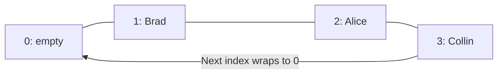

An empty slot ends the search because insertion would have used it.
This rule assumes that we have not deleted pairs by making holes.

<br><br><br><br><br><br>

---

<br><br><br><br><br><br>

## Other probing strategies

**Must we always check the next slot?**

Other forms of **open addressing** keep pairs in the same array:

| Strategy | How it chooses the next slot |
| --- | --- |
| Linear probing | Move forward by one slot |
| Quadratic probing | Use jumps that grow with the probe count |
| Double hashing | Use a second hash function to choose the step size |

- Insert and lookup must follow the same sequence.
- The jump rule and table size must work together to reach enough slots.

Explore: [USF: Closed Hashing](https://www.cs.usfca.edu/~galles/visualization/ClosedHash.html).

<br><br><br><br><br><br>

---

<br><br><br><br><br><br>

## Separate chaining

**What if one array slot could hold several pairs?**

Each array slot leads to a **bucket**, which can be a linked list of pairs.

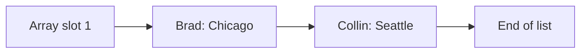

- Brad and Collin both select bucket `1`.
- Store both pairs in that bucket.
- To find Collin, select bucket `1`, then compare keys in its list.

Source: [Open Data Structures (Python), Section 5.1: Chaining](https://opendatastructures.org/ods-python/5_1_ChainedHashTable_Hashin.html).

<br><br><br><br><br><br>

---

<br><br><br><br><br><br>

## Python's dict: CPython 3.13

**Which hash function and storage rules does Python use?**

- **String hashing:** typical builds use **SipHash 1-3** with a secret seed.
  It mixes the string's bytes into a hash code. The seed is random by default.
- **Storage:** an array of indexes points to a compact array of entries.
  A normal dictionary stores keys and values in those entries.
- **Collisions:** open addressing. A hash-dependent probe sequence chooses
  the next slot, rather than always moving forward by one.
- The entries also let `dict` preserve insertion order.

These are CPython 3.13 implementation details. Other key types have other hashes.

Sources: CPython 3.13 [hash selection](https://github.com/python/cpython/blob/v3.13.0/Include/pyhash.h),
[string hashing](https://github.com/python/cpython/blob/v3.13.0/Python/pyhash.c),
and [dictionary storage and probing](https://github.com/python/cpython/blob/v3.13.0/Objects/dictobject.c).

<br><br><br><br><br><br>

---

<br><br><br><br><br><br>

## Java's HashMap: OpenJDK 21

- **Hashing:** call the key's `hashCode()` method, then mix its bits.
- **String hashing:** start at `0`. For each UTF-16 code unit, calculate
  `h = 31 * h + code`, using 32-bit integer arithmetic.
- **Storage:** an array of buckets. A bucket normally holds a linked list
  of key/value nodes.
- **Collisions:** add nodes to the same bucket. A large bucket can become
  a balanced tree when the array is also large enough.

Java uses **separate chaining** for these buckets.

Sources: Java 21 [String.hashCode](https://docs.oracle.com/en/java/javase/21/docs/api/java.base/java/lang/String.html#hashCode())
and OpenJDK 21 [HashMap source](https://github.com/openjdk/jdk/blob/jdk-21-ga/src/java.base/share/classes/java/util/HashMap.java).

<br><br><br><br><br><br>

---

<br><br><br><br><br><br>

## Rust's HashMap: Rust 1.90

- **Default hashing:** **SipHash 1-3**, with a random seed.
  Programs can select a different hasher.
- **Storage:** a flat array of key/value pairs plus small **control bytes**.
  These bytes mark slot states and help select keys to compare.
- **Collisions:** open addressing with **quadratic probing** between groups
  of slots. It checks control bytes for several slots together.

This design is based on **SwissTable**. The default hasher can change by version.

Sources: Rust 1.90 [HashMap documentation in source](https://github.com/rust-lang/rust/blob/1.90.0/library/std/src/collections/hash/map.rs)
and [SwissTable design notes](https://abseil.io/about/design/swisstables).

<br><br><br><br><br><br>

---

<br><br><br><br><br><br>

## Set can also update

**Return to our name/city HashMap with linear probing.**

```text
put("Brad", "Boston")
377 % 4 = 1

Before:    1: ("Brad", "Chicago")
After:     1: ("Brad", "Boston")
```

- The stored key matches. Replace its value.
- Do not add a second Brad.
- The number of pairs stays `3`.

**Different key:** probe forward. **Same key:** update.

<br><br><br><br><br><br>

---

<br><br><br><br><br><br>

## How full should the array become?

**The load factor is the number of pairs divided by the capacity.**

```text
Load factor = size / capacity

3 pairs / 4 slots = 0.75
4 pairs / 4 slots = 1.00    No empty slot remains
```

- Linear probing can form long groups of occupied slots, called **clusters**.
- More occupied slots usually mean more checks.
- Our class grows when a new insertion makes the load factor **greater than 0.75**.
- This is our teaching rule. It is not Python's `dict` resize rule.

The earlier two-slot table grows as soon as Brad makes it full.

Source: [Open Data Structures (Python), Section 5.2](https://opendatastructures.org/ods-python/5_2_LinearHashTable_Linear_.html).

<br><br><br><br><br><br>

---

<br><br><br><br><br><br>

## Insert Bob, then grow

```text
Bob: 275 % 4 = 3. Slot 3 is occupied; slot 0 is empty.
Store Bob at 0. Now 4 / 4 > 0.75: grow to 8 slots.

Before rehash, capacity 4      After rehash, capacity 8
0: Bob    -> Miami            0: empty
1: Brad   -> Boston           1: Brad   -> Boston
2: Alice  -> NYC              2: Collin -> Seattle
3: Collin -> Seattle          3: Bob    -> Miami
                              4: empty
                              5: empty
                              6: Alice  -> NYC
                              7: empty
```

Reinsert in old index order: Bob, Brad, Alice, Collin.
Brad and Collin both start at `1`; Collin probes to `2`.
After rehashing, the load factor is `4 / 8 = 0.5`.

<br><br><br><br><br><br>

---

<br><br><br><br><br><br>

## Build the small HashMap

**An array stores either `None` or a `(key, value)` pair.**

```python
class HashMap:
    def __init__(self):
        self.slots = [None, None]
        self.size = 0

    def _index(self, key):
        total = 0
        for char in key:
            total += ord(char)
        return total % len(self.slots)
```

- Each code block adds methods to this same class.
- Keys are strings. Values can be any Python value.
- This class supports set, update, get, and growth. It omits deletion.

Complete program: [Python examples](examples/05-hash-maps.py).

<br><br><br><br><br><br>

---

<br><br><br><br><br><br>

## Find an empty slot or a matching key

```python
    def _find_slot(self, key):
        index = self._index(key)
        checked = 0
        while checked < len(self.slots):
            pair = self.slots[index]
            if pair is None or pair[0] == key:
                return index
            index = (index + 1) % len(self.slots)
            checked += 1
        raise RuntimeError("HashMap is full")
```

- `pair[0]` is the key; `pair[1]` is its value.
- Insert and get share the same probing rule.
- The loop checks at most one full turn through the array.
- Our growth rule leaves empty slots between public operations.

<br><br><br><br><br><br>

---

<br><br><br><br><br><br>

## Set or update a pair

```python
    def put(self, key, value):
        index = self._find_slot(key)
        if self.slots[index] is None:
            self.size += 1
        self.slots[index] = (key, value)
        if self.size * 4 > len(self.slots) * 3:
            self._resize()
```

```text
Empty slot     -> add a pair; size increases
Matching key   -> replace its value; size stays the same

size * 4 > capacity * 3 means size / capacity > 0.75
```

We grow after placing a new pair. The next operation sees the larger array.

<br><br><br><br><br><br>

---

<br><br><br><br><br><br>

## Get a value or a default

```python
    def get(self, key, default=None):
        index = self._find_slot(key)
        pair = self.slots[index]
        if pair is None:
            return default
        return pair[1]
```

```python
print(cities.get("Collin"))          # Seattle
print(cities.get("Bob", "Unknown"))  # Unknown, before Bob is inserted
```

`_find_slot` returns a matching key or the first empty slot on its path.
It never returns a slot containing a different key.

<br><br><br><br><br><br>

---

<br><br><br><br><br><br>

## Rehash every saved pair

```python
    def _resize(self):
        old_slots = self.slots
        self.slots = [None] * (2 * len(old_slots))
        self.size = 0
        for pair in old_slots:
            if pair is not None:
                self.put(pair[0], pair[1])
```

1. Keep the old array while we build the new one.
2. Double the capacity. Start with empty slots.
3. Reinsert each old pair with the new `% capacity` calculation.

Resetting `size` avoids counting each reinserted pair twice.
The larger array has enough space, so reinsertion does not trigger another grow.

<br><br><br><br><br><br>

---

<br><br><br><br><br><br>

## Why these methods work

```text
Insertion path:    start -> check -> next -> ... -> first empty slot
Lookup path:       start -> check -> next -> ... -> same key or empty
```

- Every pair is on its key's probing path, before the first empty slot.
- An update replaces a matching pair. It does not create duplicate keys.
- Rehashing rebuilds this rule for the new capacity.
- Each search loop is bounded by the capacity, so it cannot loop forever.

Our class never removes a pair. In a fuller implementation, deletion needs
extra care: making a slot empty can break a later key's search path.

<br><br><br><br><br><br>

---

<br><br><br><br><br><br>

## Hashing and collision costs

```text
Lookup work = hash the key + check slots on the probing path

Good spread, enough free space:   Few checks on average
Many keys with the same start:    Up to O(n) checks
```

- Expected `O(1)` needs a suitable hash function and a controlled load factor.
- Our sum function hashes a length-`L` string in `O(L)` time.
- `"abc"` and `"cab"` have the same sum. Resizing cannot separate their sums.
- Comparing long string keys can also take more than constant time.

The small implementation explains the mechanism. Its weak hash does **not**
guarantee expected `O(1)` on arbitrary input. Use Python's `dict` in normal code.

<br><br><br><br><br><br>

---

<br><br><br><br><br><br>

## Rehashing and amortized time

**Some insertions rebuild the table. Most insertions do not.**

```text
Capacities:          2 -> 4 -> 8 -> 16 -> ...
Rebuild work:        2 + 4 + 8 + ... + n < 2n
```

- With good hashing and constant-time key processing, one rebuild has
  **expected `O(n)` time** and needs `O(n)` new space.
- Across `n` insertions, geometric growth adds expected `O(n)` total rebuild work.
- This gives **expected amortized `O(1)` insertion**, including growth.
- A single insertion can still take `O(n)`. Bad collisions can make reinsertion
  in our simple class take `O(n^2)`.

**Expected** concerns hash distribution. **Amortized** spreads growth cost
across a sequence of operations.

<br><br><br><br><br><br>

---

<br><br><br><br><br><br>

## Watch linear probing

**Use [University of San Francisco: Closed Hashing](https://www.cs.usfca.edu/~galles/visualization/ClosedHash.html).**

1. Keep **Hash Integer** and **Linear Probing** selected.
2. In the box beside **Insert**, insert `1`, then `30`, then `59`.
3. All three start at index `1`: the tool uses **29 slots** and `% 29`.
4. Choose **Pause**, then **Step Forward** to follow a collision.
5. Enter `59` in the box beside **Find**. Follow the same path again.
6. Find `88`. Why does the search stop at an empty slot?

```text
1 % 29 = 1     30 % 29 = 1     59 % 29 = 1     88 % 29 = 1
```

The tool shows keys, without our city values. Its string hash differs from
our ASCII-sum rule. Use the slides for the exact names-and-cities trace.

<br><br><br><br><br><br>

---

<br><br><br><br><br><br>

## Run the Python examples

**Download or clone the course repository. Run from its root folder.**

```text
python3 slides/examples/05-hash-maps.py
```

The [complete Python program](examples/05-hash-maps.py) contains the name
counter, the small HashMap, and the two problem solutions below.

- Follow the printed arrays as capacity changes from `2` to `4` to `8`.
- Compare an absent key with a key stored after a collision.
- Update Brad's city. Does the number of pairs increase?

The public student repository has `slides/` at its root.

<br><br><br><br><br><br>

---

<br><br><br><br><br><br>

## Contains Duplicate

**[LeetCode 217: Contains Duplicate](https://leetcode.com/problems/contains-duplicate/description/)**

Return `True` if any integer appears more than once. Otherwise return `False`.

```text
[1, 2, 3, 1]       True
[1, 2, 3, 4]       False
```

We only need to find **one** repeat.

How can a HashMap tell us whether we saw the current number earlier?

<br><br><br><br><br><br>

---

<br><br><br><br><br><br>

## Duplicate detection: remember earlier numbers

**Use the number as the key. Store `True` as its value.**

```text
Input: [1, 2, 3, 1]

Read    Keys before this step    Already present?    Action
 1      {}                      no                  save 1
 2      {1}                     no                  save 2
 3      {1, 2}                  no                  save 3
 1      {1, 2, 3}               yes                 return True
```

Check membership **before** saving the current number.
Otherwise, every number would appear to be a repeat of itself.

<br><br><br><br><br><br>

---

<br><br><br><br><br><br>

## Contains Duplicate: Python HashMap solution

```python
class Solution:
    def containsDuplicate(self, nums):
        seen = {}
        for number in nums:
            if number in seen:
                return True
            seen[number] = True
        return False
```

- Before each step, the map contains exactly the earlier distinct numbers.
- A present key proves that the number occurred earlier.
- The loop ends at the first repeat or after all numbers.

The runnable file calls this class `DuplicateSolution` so both solutions
can share one file. Use `Solution` in the LeetCode editor.

<br><br><br><br><br><br>

---

<br><br><br><br><br><br>

## Contains Duplicate: costs and a set option

**For `n` fixed-size integers:**

- Expected time: **`O(n)`** for the full scan.
- Extra space: **`O(n)`** at most.
- Earliest return: `O(1)` when the first two numbers match.
- Worst-case time with bad collisions: `O(n^2)`.

We never read the saved `True` values. A HashSet is enough:

```python
seen = set()
for number in nums:
    if number in seen:
        return True
    seen.add(number)
return False
```

This alternative body goes inside `containsDuplicate` and has the same bounds.

<br><br><br><br><br><br>

---

<br><br><br><br><br><br>

## Valid Anagram

**[LeetCode 242: Valid Anagram](https://leetcode.com/problems/valid-anagram/description/)**

An anagram uses the same characters the same number of times,
possibly in a different order.

```text
"aab" and "aba"       True
"aab" and "abb"       False
```

The base problem uses lowercase English letters.

Would comparing two sets of characters be enough?

<br><br><br><br><br><br>

---

<br><br><br><br><br><br>

## Anagrams need counts

```text
String      Set of letters      Counts
"aab"       {a, b}              a: 2, b: 1
"abb"       {a, b}              a: 1, b: 2
```

**Equal sets and equal lengths are not enough.**

Use a HashMap: **character -> number of occurrences**.

1. Reject different lengths.
2. Count each character in the first string.
3. Use one saved occurrence for each character in the second string.
4. Reject a character whose saved count is already zero or absent.

This is the same frequency-counting idea as our list of names.

<br><br><br><br><br><br>

---

<br><br><br><br><br><br>

## Anagram trace

```text
s = "aab", t = "aba"

Build counts from s:      a: 2, b: 1

Read from t      Change             Counts after step
a                a: 2 -> 1         a: 1, b: 1
b                b: 1 -> 0         a: 1, b: 0
a                a: 1 -> 0         a: 0, b: 0

Every required character was available. Return True.
```

For `t = "abb"`, the second `b` finds a count of `0`.
Return `False` at that step.

<br><br><br><br><br><br>

---

<br><br><br><br><br><br>

## Valid Anagram: count the first string

```python
class Solution:
    def isAnagram(self, s, t):
        if len(s) != len(t):
            return False
        counts = {}
        for char in s:
            counts[char] = counts.get(char, 0) + 1
```

At this point, `counts[char]` is the number of times `char` appears in `s`.

Next, continue this same method. Use the counts while reading `t`.

<br><br><br><br><br><br>

---

<br><br><br><br><br><br>

## Valid Anagram: use the saved counts

```python
        for char in t:
            if counts.get(char, 0) == 0:
                return False
            counts[char] -= 1
        return True
```

- Each remaining count equals the occurrences in `s` not yet used by `t`.
- Never let a count become negative.
- Equal lengths mean a completed scan used every occurrence exactly once.
- Both loops finish because they process finite strings.

The runnable file combines the two code blocks in `AnagramSolution`.
Use `Solution` when submitting this problem.

<br><br><br><br><br><br>

---

<br><br><br><br><br><br>

## Valid Anagram: time and space

**Let `p = len(s)`, `q = len(t)`, and `k` be the distinct letters in `s`.**

```text
Count s         p updates
Read t          At most q checks and updates

Expected time   O(p + q)
Extra space     O(k)
```

- The base problem has only 26 possible keys, so `k <= 26` and space is **`O(1)`**.
- With this fixed alphabet, even checking all stored keys is bounded by 26;
  the worst-case time is also **`O(p + q)`** under constant-time key processing.
- For a variable alphabet, `O(k)` space can grow. Bad collisions can increase
  time to `O((p + q) * k)`.

**Names, products, letters: the same HashMap pattern counts each key.**
