# Data Structures and Algorithms

**Lecture 6: Trees and Binary Search Trees**

A linked list gives each node one next link.

What can we build when a node has more than one child?

<br><br><br><br><br><br>

---

<br><br><br><br><br><br>

## Nodes and edges in a linked list

**What does each box store? What does each arrow mean?**

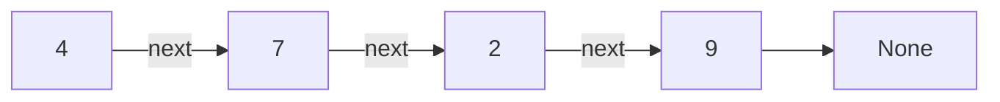

- A **node** stores a value and a link.
- An **edge** connects two nodes. Here, a `next` reference represents it.
- `None` means there is no next node. It is not a data node.

The arrows show the direction in which we can follow the links.

<br><br><br><br><br><br>

---

<br><br><br><br><br><br>

## A node with two children

**How could we connect one more node below `1`?**

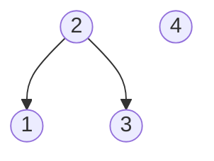

Keep both existing links. Add one new link.

Which nodes will have no children after the change?

<br><br><br><br><br><br>

---

<br><br><br><br><br><br>

## A rooted tree

A **rooted tree** has these characteristics:

- Exactly one **root**, with no parent.
- Exactly one **parent** for every other node.
- Exactly one **path** from the root to each node.
- No **cycles**.

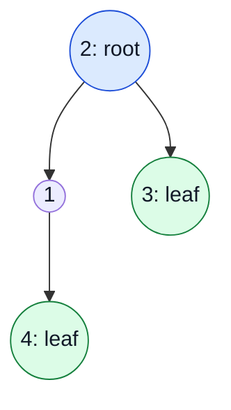

- Draw the **root** at the top. It has no parent.
- A **leaf** has no children. This tree has two leaves: `3` and `4`.
- Leaves can be at different distances from the root.

Source: [Open Data Structures (Python), Chapter 6](https://opendatastructures.org/ods-python/6_Binary_Trees.html).

What relationship connects `1` and `3`?

<br><br><br><br><br><br>

---

<br><br><br><br><br><br>

## Parents, children, and siblings

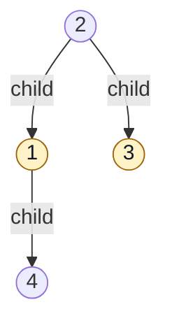

- A **parent** connects directly to its **child**.
- `2` is the parent of `1` and `3`.
- `1` and `3` are **siblings**: they have the same parent.
- `1` is both a child of `2` and the parent of `4`.

Source: [Open Data Structures (Python), Chapter 6](https://opendatastructures.org/ods-python/6_Binary_Trees.html).

<br><br><br><br><br><br>

---

<br><br><br><br><br><br>

## Links go from parent to child

**Our nodes will store child links only.**

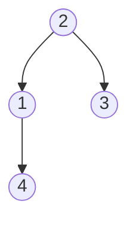

- Start at `2`. Follow a child link to `1`, then to `4`.
- A child has no stored link back to its parent in this representation.
- No child link leads back to an earlier node on the path: **no cycles**.
- Two parents cannot share the same child in a tree.

Other implementations can also store a parent reference.

<br><br><br><br><br><br>

---

<br><br><br><br><br><br>

## How far is a node from the root?


- How many edges connect the root to `4`?
- How many edges connect the root to `3`?
- What about the root itself?

Count **edges**, not nodes.

<br><br><br><br><br><br>

---

<br><br><br><br><br><br>

## Depth counts edges from the root

The **depth** of a node is the number of edges on its path from the root.

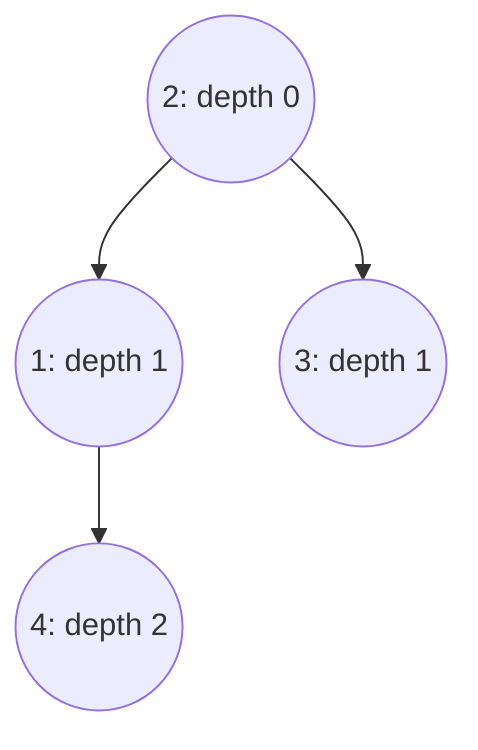

```text
Path to 4:    2 -> 1 -> 4     2 edges     depth 2
Path to 3:    2 -> 3          1 edge      depth 1
```

Source: [Open Data Structures (Python), Chapter 6](https://opendatastructures.org/ods-python/6_Binary_Trees.html).

<br><br><br><br><br><br>

---

<br><br><br><br><br><br>

## Height counts edges to the farthest leaf

**How far down can we go from each node?**

The **height** of a node is the number of edges on its longest downward
path to a leaf. The tree's height is the root's height.

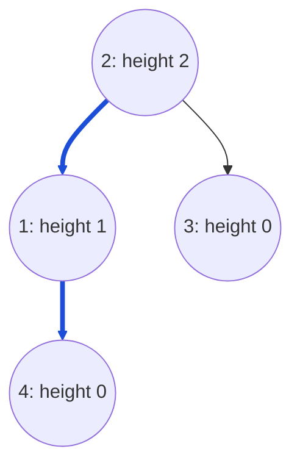

- Every leaf has height `0`.
- A tree with one node has height `0`. Its root is also a leaf.
- In this deck, both depth and height count **edges**.

Source: [Open Data Structures (Python), Chapter 6](https://opendatastructures.org/ods-python/6_Binary_Trees.html).

<br><br><br><br><br><br>

---

<br><br><br><br><br><br>

## Depth and height: your turn

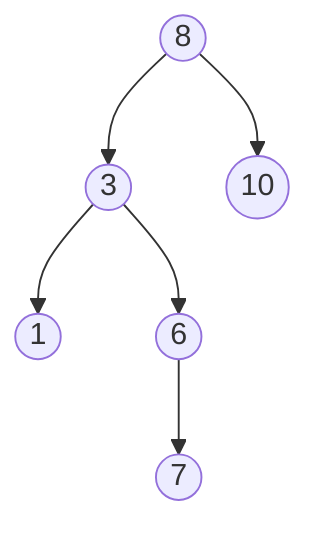

- What are the depth and height of `3`?
- What are the depth and height of `10`?
- What is the height of the whole tree?

<br><br><br><br><br><br>

---

<br><br><br><br><br><br>

## Depth and height: answers

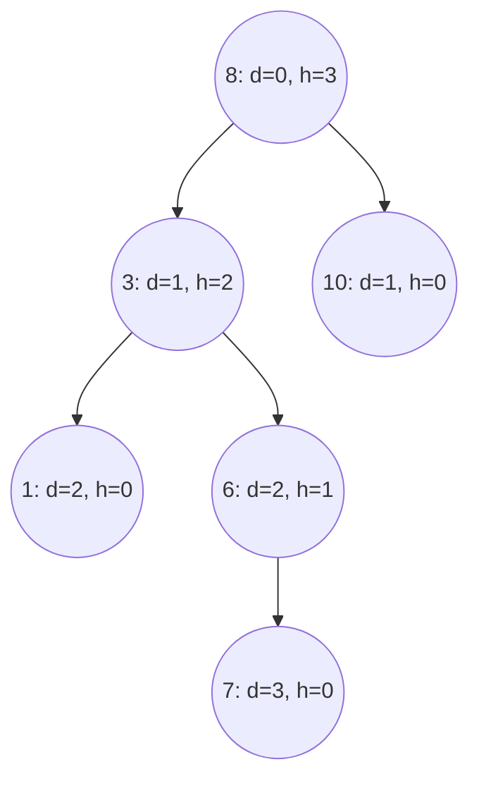

- For `3`, count from the root for depth: `8 -> 3`.
- Count toward its farthest leaf for height: `3 -> 6 -> 7`.
- The whole tree has height `3`: `8 -> 3 -> 6 -> 7`.

<br><br><br><br><br><br>

---

<br><br><br><br><br><br>

## Relationships along a path

**Which nodes come before `4` on the path from the root?**

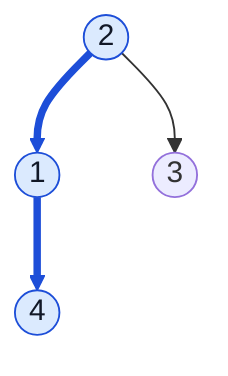

- Which nodes can we reach below `2`?
- Is `3` on the path to `4`?

<br><br><br><br><br><br>

---

<br><br><br><br><br><br>

## Ancestors and descendants

- An **ancestor** lies earlier on the path from the root to a node.
- A **descendant** lies below a node, through one or more child links.
- Here, we exclude the node itself from both terms.

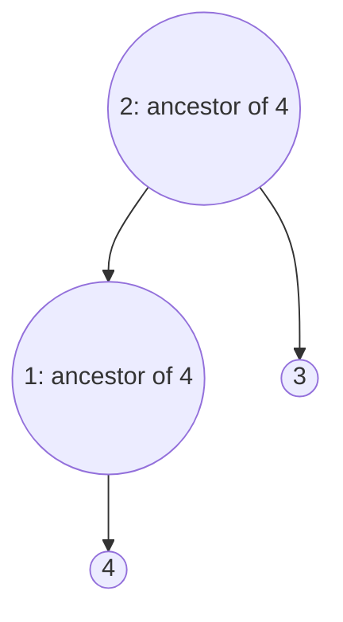

- Ancestors of `4`: `2` and `1`. Its **parent** is only `1`.
- Descendants of `2`: `1`, `3`, and `4`.
- `3` is not an ancestor of `4`.

Source: [Open Data Structures (Python), Chapter 6](https://opendatastructures.org/ods-python/6_Binary_Trees.html).

<br><br><br><br><br><br>

---

<br><br><br><br><br><br>

## How many children can one node have?

**Could `2` have a third child?**

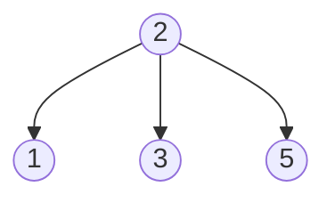

A general tree can have a node with three children.

What restriction would make a tree **binary**?

<br><br><br><br><br><br>

---

<br><br><br><br><br><br>

## A binary tree

A **binary tree** gives each node at most two children:
a **left child** and a **right child**.

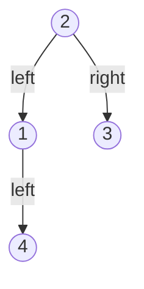

- A node can have `0`, `1`, or `2` children.
- A single child can be on either side.
- This tree is binary. Its values do not have to be in sorted order.

Source: [Open Data Structures (Python), Chapter 6](https://opendatastructures.org/ods-python/6_Binary_Trees.html).

<br><br><br><br><br><br>

---

<br><br><br><br><br><br>

## A binary-tree node in Python

<table>
<tr>
<td width="55%" valign="top">

```python
class TreeNode:
    def __init__(self, value):
        self.value = value
        self.left = None
        self.right = None
```

</td>
<td width="45%" valign="top">


</td>
</tr>
</table>

- Linked-list node: `value` and `next`.
- Binary-tree node: `value`, `left`, and `right`.
- `None` means no child. A new node starts as a leaf.

The class stores links. We must connect them so they form a tree.

<br><br><br><br><br><br>

---

<br><br><br><br><br><br>

## Build the four-node tree

<table>
<tr>
<td width="55%" valign="top">

```python
root = TreeNode(2)
root.left = TreeNode(1)
root.right = TreeNode(3)
root.left.left = TreeNode(4)

print(root.left.left.value)
print(root.right.left is None)
```

</td>
<td width="45%" valign="top">

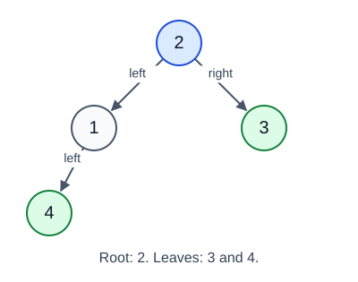

</td>
</tr>
</table>

```text
4
True
```

`root` refers to the top node. An empty tree uses `root = None`.
The leaves `3` and `4` each have `left = None` and `right = None`.

<br><br><br><br><br><br>

---

<br><br><br><br><br><br>

## A smaller tree inside the tree

**If we start at `1`, which nodes belong to its tree?**

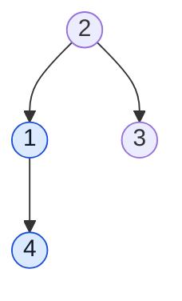

A **subtree rooted at a node** contains that node and all its descendants.
The highlighted nodes form the subtree rooted at `1`.

We will use the terms **left subtree** and **right subtree** to state a
search rule.

Source: [Open Data Structures (Python), Chapter 6](https://opendatastructures.org/ods-python/6_Binary_Trees.html).

<br><br><br><br><br><br>

---

<br><br><br><br><br><br>

## Could the values guide a search?

**Find `6`. Which child of `4` should we follow first?**

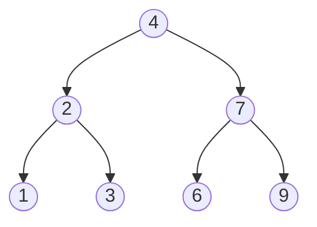

Look at all values to the left of `4`. Then look at all values to its right.

What rule would let us skip a whole subtree?

<br><br><br><br><br><br>

---

<br><br><br><br><br><br>

## A Binary Search Tree

A **Binary Search Tree (BST)** is a binary tree with this rule at **every node**:

- Every value in its **left subtree is smaller** than the node's value.
- Every value in its **right subtree is larger** than the node's value.

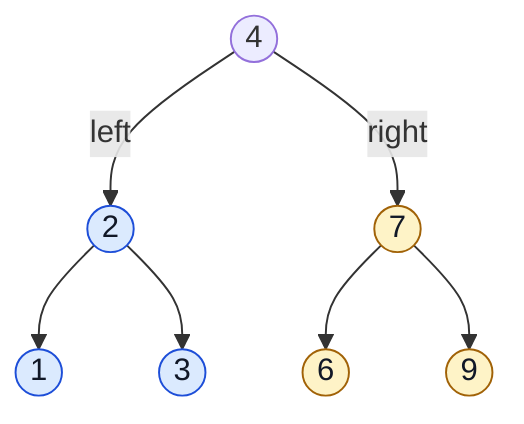

Our examples use **distinct integers**. We do not store duplicate values.

Source: [Open Data Structures (Python), Section 6.2](https://opendatastructures.org/ods-python/6_2_BinarySearchTree_Unbala.html).

<br><br><br><br><br><br>

---

<br><br><br><br><br><br>

## Is this a valid BST?

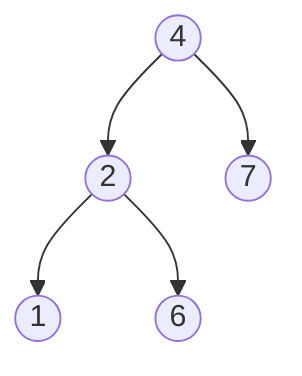

- `2 < 4` and `7 > 4`.
- `1 < 2` and `6 > 2`.

Each child passes a check against its direct parent.

Is that enough?

<br><br><br><br><br><br>

---

<br><br><br><br><br><br>

## The rule covers the whole subtree

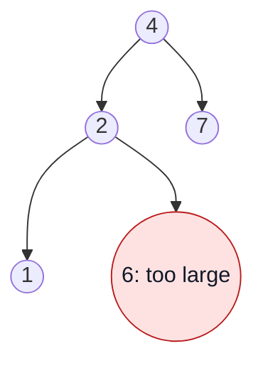

**This is a binary tree, but it breaks the BST rule.**

- `6` is in the **left subtree of `4`**. It must be smaller than `4`.
- As the right child of `2`, it must also be larger than `2`.
- Both conditions apply: `2 < value < 4`.

A check against the direct parent alone can miss an error.

<br><br><br><br><br><br>

---

<br><br><br><br><br><br>

## Search for 6: first comparison

**Start at the root: `4`.**

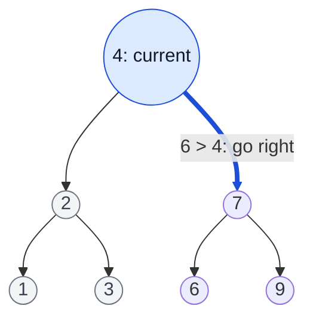

`6 > 4`. Every value in the left subtree is too small. Skip that subtree.

At `7`, which link should we follow?

<br><br><br><br><br><br>

---

<br><br><br><br><br><br>

## Search for 6: left, then match

```mermaid
flowchart TD
    A((4)) --> B((2))
    A --> C((7))
    B --> D((1))
    B --> E((3))
    C -->|"6 < 7: go left"| F(("6: found"))
    C --> G((9))
    classDef found fill:#dcfce7,stroke:#15803d,color:#111827;
    class F found;
    linkStyle 1,4 stroke:#1d4ed8,stroke-width:4px;
```

```text
Current value    Compare target 6    Action
4                6 > 4               Go right
7                6 < 7               Go left
6                6 == 6              Return True
```

We examine **3 nodes**. We do not visit `1`, `2`, `3`, or `9`.

<br><br><br><br><br><br>

---

<br><br><br><br><br><br>

## What if the target is absent?

**Predict the search path for `5`. Where does it stop?**

```mermaid
flowchart TD
    A((4)) --> B((2))
    A --> C((7))
    B --> D((1))
    B --> E((3))
    C --> F((6))
    C --> G((9))
```

What should a search return for an empty tree?

<br><br><br><br><br><br>

---

<br><br><br><br><br><br>

## Search for 5 reaches None

```mermaid
flowchart TD
    A((4)) --> B((2))
    A -->|"5 > 4"| C((7))
    B --> D((1))
    B --> E((3))
    C -->|"5 < 7"| F((6))
    C --> G((9))
    F -->|"5 < 6"| N["None: return False"]
    classDef absent fill:#fee2e2,stroke:#b91c1c,color:#111827;
    class N absent;
    linkStyle 1,4,6 stroke:#1d4ed8,stroke-width:4px;
```

```text
search path:    4 -> 7 -> 6 -> None
result:        False
```

`None` means the remaining subtree is empty. An empty tree also returns `False`.

<br><br><br><br><br><br>

---

<br><br><br><br><br><br>

## Build the example BST

**Use the same `TreeNode` class. Connect these seven nodes.**

<table>
<tr>
<td width="55%" valign="top">

```python
bst = TreeNode(4)
bst.left = TreeNode(2)
bst.right = TreeNode(7)
bst.left.left = TreeNode(1)
bst.left.right = TreeNode(3)
bst.right.left = TreeNode(6)
bst.right.right = TreeNode(9)
```

</td>
<td width="45%" valign="top">

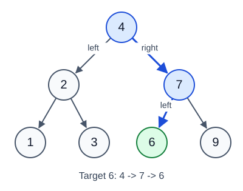

</td>
</tr>
</table>

The node class is unchanged. The **placement of the values** makes this a BST.

<br><br><br><br><br><br>

---

<br><br><br><br><br><br>

## Recursive BST search in Python

<table>
<tr>
<td width="60%" valign="top">

```python
def search(root, target):
    if root is None:
        return False
    if target == root.value:
        return True
    if target < root.value:
        return search(root.left, target)
    return search(root.right, target)
```

</td>
<td width="40%" valign="top">


</td>
</tr>
</table>

- Each call searches the subtree whose root is the current `root`.
- A recursive call passes one child. The target stays the same.
- `return` sends the child's result back to the caller.

Source: [Open Data Structures (Python), Section 6.2.1](https://opendatastructures.org/ods-python/6_2_BinarySearchTree_Unbala.html#SECTION00921000000000000000).

<br><br><br><br><br><br>

---

<br><br><br><br><br><br>

## Search takes O(h) time

**What controls the number of nodes we visit?**


- Let `h` be the tree's **height**. Search follows one downward path.
- A path has at most `h + 1` data nodes. We write the growing cost as **`O(h)`**.
- Recursive search also uses **`O(h)` extra stack space** in the worst case.

Empty and one-node searches take `O(1)`. We assume constant-time comparisons.

Source: [Open Data Structures (Python), Section 6.2](https://opendatastructures.org/ods-python/6_2_BinarySearchTree_Unbala.html).

<br><br><br><br><br><br>

---

<br><br><br><br><br><br>

## Worst case: one branch all the way down

**Find `9` in this BST. How many nodes must we check?**

<table>
<tr>
<td width="45%" valign="top">


</td>
<td width="55%" valign="top">

- This is a valid BST. Every value is larger than the value above it.
- It has `n = 7` nodes and height `h = 6`.
- Finding `9` checks all `7` nodes.
- In general, a chain has `h = n - 1`: **search takes `O(n)` in the worst case**.

</td>
</tr>
</table>

How could we keep the paths short as the tree grows?

<br><br><br><br><br><br>

---

<br><br><br><br><br><br>

## A balanced Binary Search Tree

A **balanced BST** keeps its height proportional to `log n`.
The values still follow the same BST ordering rule.

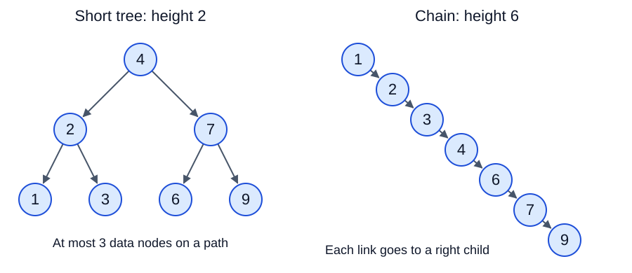

- Short paths give **`O(log n)` search**.
- A **self-balancing BST** keeps this height bound after insertions and removals.
- AVL trees and red-black trees are examples. We will use the idea only.

The Python functions below implement an ordinary BST. They do not restore balance.

Source: [Open Data Structures (Python), Chapter 9: Red-Black Trees](https://opendatastructures.org/ods-python/9_Red_Black_Trees.html).

<br><br><br><br><br><br>

---

<br><br><br><br><br><br>

## Why use trees if we can use arrays for the same search?

**A sorted array already gives us `O(log n)` binary search.**

```text
[1, 2, 3, 4, 6, 7, 9]
```

- What happens when we insert `5` and keep the array sorted?
- What happens when we remove `3` and keep the remaining values in order?
- Would a linked list make those changes easier?

Think about both **finding the position** and **changing the structure**.

<br><br><br><br><br><br>

---

<br><br><br><br><br><br>

## Array updates can shift many elements

**Keep the array in order.**

```text
Insert 5:
Before    [1, 2, 3, 4,    6, 7, 9]
                         Shift 6, 7, 9 right.
After     [1, 2, 3, 4, 5, 6, 7, 9]

Then remove 3:
Before    [1, 2, 3, 4, 5, 6, 7, 9]
                   Shift 4, 5, 6, 7, 9 left.
After     [1, 2,    4, 5, 6, 7, 9]
```

- Binary search finds the position in `O(log n)`.
- Inserting or removing an element can still take **`O(n)`** because of shifts.
- At a dynamic array's end, append and removal take `O(1)` amortized time.
  Appending keeps sorted order only when the new value belongs at the end.

Source: [Open Data Structures (Python), Section 2.1: ArrayStack](https://opendatastructures.org/ods-python/2_1_ArrayStack_Fast_Stack_O.html).

<br><br><br><br><br><br>

---

<br><br><br><br><br><br>

## Linked-list updates change links

**Suppose we already have the node holding `4`.**

```mermaid
flowchart LR
    A["4"] --> B["6"]
    B --> C["7"]
```

Insert `5` after `4`:

```mermaid
flowchart LR
    A["4"] --> N["5: new"]
    N --> B["6"]
    B --> C["7"]
```

- Insertion needs **`O(1)` link changes**. The other nodes stay in place.
- Removal also needs `O(1)` link changes when we have the required references.
  In a singly linked list, removing a middle node needs its **predecessor**.
- Finding a position or a value can take **`O(n)`**. Changing the head is `O(1)`.

Source: [Open Data Structures (Python), Section 3.1: Singly Linked Lists](https://opendatastructures.org/ods-python/3_1_SLList_Singly_Linked_Li.html).

<br><br><br><br><br><br>

---

<br><br><br><br><br><br>

## Search and updates together

**For `n` distinct values, compare worst-case time.**

| Structure | Find a value | Insert a value | Remove a value |
| --- | --- | --- | --- |
| Sorted dynamic array | `O(log n)` | `O(n)` | `O(n)` |
| Sorted singly linked list | `O(n)` | `O(n)` | `O(n)` |
| Balanced BST with balance maintenance | `O(log n)` | `O(log n)` | `O(log n)` |

- The table includes finding the position. For a linked list, the link changes
  alone can take `O(1)` once we have the required references.
- A balanced BST combines short search paths with changes to node links.
- For data that rarely changes, a sorted array can be a good choice.

How can we add or remove a BST node while keeping its ordering rule?

<br><br><br><br><br><br>

---

<br><br><br><br><br><br>

## Insert 5: where does it belong?

```mermaid
flowchart TD
    A((4)) --> B((2))
    A --> C((7))
    B --> D((1))
    B --> E((3))
    C --> F((6))
    C --> G((9))
```

- Which path would a search for `5` follow?
- Which empty child link should hold the new node?
- Must any existing values move?

<br><br><br><br><br><br>

---

<br><br><br><br><br><br>

## Insert 5 at the empty link


```text
5 > 4     Go right.
5 < 7     Go left.
5 < 6     Go left.
None      Create a node holding 5 here.
```

The new node starts as a leaf. Existing nodes keep their values.
If the value already exists, our implementation leaves the tree unchanged.

Source: [Open Data Structures (Python), Section 6.2.2: Addition](https://opendatastructures.org/ods-python/6_2_BinarySearchTree_Unbala.html#SECTION00922000000000000000).

<br><br><br><br><br><br>

---

<br><br><br><br><br><br>

## Insertion in Python

<table>
<tr>
<td width="60%" valign="top">

```python
def insert(root, value):
    if root is None:
        return TreeNode(value)
    if value < root.value:
        root.left = insert(root.left, value)
    elif value > root.value:
        root.right = insert(root.right, value)
    return root
```

</td>
<td width="40%" valign="top">


</td>
</tr>
</table>

- Each call returns the root of the **updated subtree**.
- Save that result in the parent's `left` or `right` link.
- Equal values reach `return root`. We do not create duplicates.

<br><br><br><br><br><br>

---

<br><br><br><br><br><br>

## The root can change

**What should happen if we insert into an empty tree?**

```mermaid
flowchart LR
    A["None"] -->|"insert 5"| B(("5: new root"))
```

```python
tree = None
tree = insert(tree, 5)
print(tree.value)
```

```text
5
```

Use **`tree = insert(tree, value)`** to keep the returned root.
The same rule will apply to removal.

<br><br><br><br><br><br>

---

<br><br><br><br><br><br>

## Removal has three cases

**Continue with the tree after inserting `5`.**


1. Remove `3`: it is a **leaf**.
2. Then remove `6`: it has **one child**, `5`.
3. Then remove `4`: it has **two children**.

What must happen to the remaining children in each case?

<br><br><br><br><br><br>

---

<br><br><br><br><br><br>

## Remove a leaf

**Remove `3`. It has no children.**


- Find `3` with the usual search rule.
- Replace its parent's right link with `None`.
- The other nodes and links stay the same.

The recursive call for `3` returns `None` to its parent, `2`.

Source: [Open Data Structures (Python), Section 6.2.3: Removal](https://opendatastructures.org/ods-python/6_2_BinarySearchTree_Unbala.html#SECTION00923000000000000000).

<br><br><br><br><br><br>

---

<br><br><br><br><br><br>

## Remove a node with one child

**Next remove `6`. Its only child is `5`.**

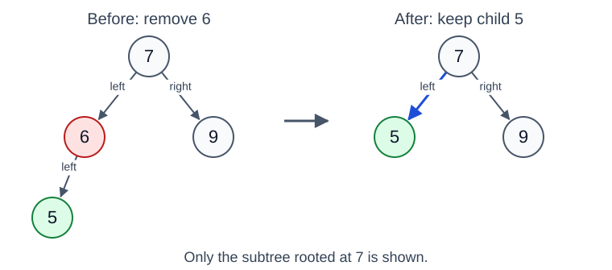

- Replace the link to `6` with a link to `5`.
- The recursive call returns the child as the new subtree root.
- This also works when the only child is on the right.

Every value in the promoted subtree was already in the correct range.

<br><br><br><br><br><br>

---

<br><br><br><br><br><br>

## Return the remaining child

**These branches run after we find the value to remove.**

```python
if root.left is None:
    return root.right
if root.right is None:
    return root.left
```

```text
No left child      Return the right child.
No right child     Return the left child.
No children        The first branch returns None.
```

The caller saves the returned reference in its child link.
If we remove the whole tree's root, the caller updates the root variable.

<br><br><br><br><br><br>

---

<br><br><br><br><br><br>

## Remove a node with two children

**Now remove `4`. What value could replace it?**


- The replacement must be larger than every value in the left subtree.
- It must be smaller than every value that remains in the right subtree.

Would copying the right child, `7`, keep this rule?

<br><br><br><br><br><br>

---

<br><br><br><br><br><br>

## The successor is the next larger value

For a node with two children, its **successor** is the smallest value
in its right subtree.

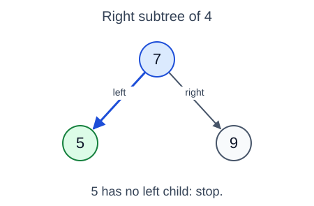

- Start at the right child, `7`. Follow left links until there are no more.
- Here the successor is **`5`**.
- Copying `7` would leave `5` in its right subtree, which breaks the BST rule.

Source: [Open Data Structures (Python), Section 6.2.3: Removal](https://opendatastructures.org/ods-python/6_2_BinarySearchTree_Unbala.html#SECTION00923000000000000000).

<br><br><br><br><br><br>

---

<br><br><br><br><br><br>

## Find the minimum node

**The input subtree must be nonempty.**

<table>
<tr>
<td width="60%" valign="top">

```python
def min_node(root):
    current = root
    while current.left is not None:
        current = current.left
    return current
```

</td>
<td width="40%" valign="top">


</td>
</tr>
</table>

- Moving left always reaches a smaller value.
- Stop at the first node whose `left` is `None`.
- Return the **node**, so the caller can read its `value`.

During two-child removal, `root.right` is guaranteed to be nonempty.

<br><br><br><br><br><br>

---

<br><br><br><br><br><br>

## Copy the successor, then remove its old node

**Replace the value `4` with `5`. Then remove the old `5` from the right subtree.**

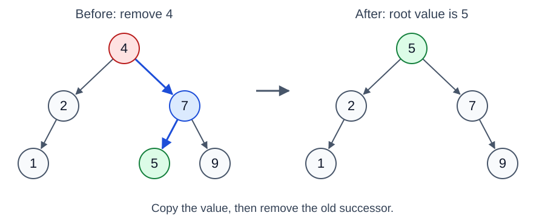

1. Keep the root node and its links. Change its stored value to `5`.
2. Remove the original successor node from the right subtree.

The successor has no left child. Its removal uses one of the simpler cases.
If it has a right child, keep that child.

<br><br><br><br><br><br>

---

<br><br><br><br><br><br>

## Removal in Python

<table>
<tr>
<td width="65%" valign="top">

```python
def remove(root, value):
    if root is None:
        return None
    if value < root.value:
        root.left = remove(root.left, value)
    elif value > root.value:
        root.right = remove(root.right, value)
    else:
        if root.left is None:
            return root.right
        if root.right is None:
            return root.left
        successor = min_node(root.right)
        root.value = successor.value
        root.right = remove(root.right, successor.value)
    return root
```

</td>
<td width="35%" valign="top">


</td>
</tr>
</table>

Each call returns the updated subtree root. A missing value reaches `None`
and leaves the existing tree unchanged.

- The first two branches handle zero or one child, including the successor's removal.
- The successor step runs only when both children exist.

<br><br><br><br><br><br>

---

<br><br><br><br><br><br>

## Insert and remove take O(h) time

**The height controls these operations too.**

| Operation | Main work | Worst-case time |
| --- | --- | --- |
| Insert | Find a value or an empty child link | `O(h)` |
| Remove | Find the node, then possibly its successor | `O(h)` |

- Finding the successor stays within one downward path. It does not scan
  every node in the right subtree.
- Our recursive implementations use **`O(h)` extra stack space**.
- A chain makes these operations **`O(n)`** in the worst case.
- A self-balancing BST maintains `h = O(log n)`, with balance maintenance
  included in its `O(log n)` update bounds.

Our functions preserve the ordering rule. They do not guarantee logarithmic height.
Empty-tree operations take `O(1)`.

Sources: [BST operations](https://opendatastructures.org/ods-python/6_2_BinarySearchTree_Unbala.html),
[red-black tree bounds](https://opendatastructures.org/ods-python/9_Red_Black_Trees.html).

<br><br><br><br><br><br>

---

<br><br><br><br><br><br>

## Watch search and updates

**[University of San Francisco: Binary Search Tree Visualization](https://www.cs.usfca.edu/~galles/visualization/BST.html)**

1. On a fresh page, **Insert** `4`, `2`, `7`, `1`, `3`, `6`, `9`, in that order.
2. **Find** `6`, then `5`. Use **Pause** and **Step Forward** to follow the paths.
3. **Insert** `5`. Then **Delete** `3` and **Delete** `6`.
4. Before deleting `4`, predict the two-child case.

The tool uses the **largest value in the left subtree** for two-child removal.
Our Python code uses the **smallest value in the right subtree**.
Both choices preserve the BST rule, but the final root can differ.

Source: [USF visualizer implementation](https://www.cs.usfca.edu/~galles/visualization/AlgorithmLibrary/BST.js).
Use our code and diagrams for the exact successor trace.

<br><br><br><br><br><br>

---

<br><br><br><br><br><br>

## How can we visit every node?

**Search followed one path. How could we print all seven values?**

```mermaid
%%{init: {"themeVariables": {"fontSize": "26px"}}}%%
flowchart TD
    A((4)) --> B((2))
    A --> C((7))
    B --> D((1))
    B --> E((3))
    C --> F((6))
    C --> G((9))
```

Use the original BST again, before insertion and removal.

- Where should we start?
- Which child should we follow first?
- When should we print the current node?

<br><br><br><br><br><br>

---

<br><br><br><br><br><br>

## Depth-first traversal (DFS)

A **traversal** processes every node once in a chosen order.
**Depth-first search (DFS)** completes one child's subtree before the next.

```mermaid
flowchart LR
    A["Enter the current node's call"] --> B["Traverse the left subtree"]
    B --> C["Traverse the right subtree"]
    C --> D["Return to the caller"]
```

- Our recursive functions use the **call stack** to remember where to return.
- Here, **visit** means print the node's value. A call can start before it prints.
- Put the visit before, between, or after the two child calls.

These traversals work on any binary tree. A BST adds the ordering rule.

Source: [Open Data Structures (Python), Section 6.1.2](https://opendatastructures.org/ods-python/6_1_BinaryTree_Basic_Binary.html#SECTION00912000000000000000).

<br><br><br><br><br><br>

---

<br><br><br><br><br><br>

## Inorder: when should we print the root?

**Rule: left subtree, current node, right subtree.**

```mermaid
%%{init: {"themeVariables": {"fontSize": "26px"}}}%%
flowchart TD
    A((4)) --> B((2))
    A --> C((7))
    B --> D((1))
    B --> E((3))
    C --> F((6))
    C --> G((9))
```

Apply the same rule inside each subtree.

Predict the full output. Which value appears first? Where does `4` appear?

Source: [Inorder traversal](https://visualgo.net/en/bst).

<br><br><br><br><br><br>

---

<br><br><br><br><br><br>

## Inorder in Python

**Left, node, right.** Each small blue badge shows the visit step.

<table>
<tr>
<td width="60%" valign="top">

```python
def inorder(root):
    if root is None:
        return
    inorder(root.left)
    print(root.value, end=" ")
    inorder(root.right)
```

</td>
<td width="40%" valign="top">

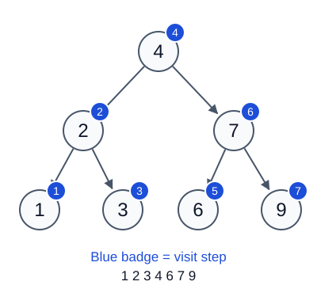

</td>
</tr>
</table>

```text
inorder(bst) prints:  1 2 3 4 6 7 9
```

`None` returns without output. `end=" "` keeps the values on one line.

<br><br><br><br><br><br>

---

<br><br><br><br><br><br>

## Trace the first inorder calls

**A call starts at `4`, but the first printed value is `1`.**

```text
inorder(4)
    inorder(2)
        inorder(1)
            inorder(None) -> return
            print 1
            inorder(None) -> return
        print 2
        inorder(3)        -> print 3, then return
    print 4
    inorder(7)            -> print 6, then 7, then 9
```

- The call for `4` waits while its whole left subtree runs.
- Each return resumes the caller at its next line.
- No child links change during traversal.

<br><br><br><br><br><br>

---

<br><br><br><br><br><br>

## Preorder: what if we print first?

**Rule: current node, left subtree, right subtree.**

```mermaid
%%{init: {"themeVariables": {"fontSize": "26px"}}}%%
flowchart TD
    A((4)) --> B((2))
    A --> C((7))
    B --> D((1))
    B --> E((3))
    C --> F((6))
    C --> G((9))
```

The first value is `4`. Predict the next six values.

Finish all of the left subtree before starting the right subtree.

Source: [Preorder traversal](https://visualgo.net/en/bst).

<br><br><br><br><br><br>

---

<br><br><br><br><br><br>

## Preorder in Python

**Node, left, right.** The visit happens before either child call.

<table>
<tr>
<td width="60%" valign="top">

```python
def preorder(root):
    if root is None:
        return
    print(root.value, end=" ")
    preorder(root.left)
    preorder(root.right)
```

</td>
<td width="40%" valign="top">


</td>
</tr>
</table>

```text
preorder(bst) prints:  4 2 1 3 7 6 9
```

Each parent prints before its descendants.

<br><br><br><br><br><br>

---

<br><br><br><br><br><br>

## Postorder: what if we print last?

**Rule: left subtree, right subtree, current node.**

```mermaid
%%{init: {"themeVariables": {"fontSize": "26px"}}}%%
flowchart TD
    A((4)) --> B((2))
    A --> C((7))
    B --> D((1))
    B --> E((3))
    C --> F((6))
    C --> G((9))
```

Which value prints last? Predict the output of each subtree first.

Source: [Postorder traversal](https://visualgo.net/en/bst).

<br><br><br><br><br><br>

---

<br><br><br><br><br><br>

## Postorder in Python

**Left, right, node.** The visit happens after both child calls return.

<table>
<tr>
<td width="60%" valign="top">

```python
def postorder(root):
    if root is None:
        return
    postorder(root.left)
    postorder(root.right)
    print(root.value, end=" ")
```

</td>
<td width="40%" valign="top">


</td>
</tr>
</table>

```text
postorder(bst) prints:  1 3 2 6 9 7 4
```

Each parent prints after its descendants.

<br><br><br><br><br><br>

---

<br><br><br><br><br><br>

## Compare the three DFS orders

**The position of the visit gives the traversal its name.**

| Order | Rule | Output for our BST |
| --- | --- | --- |
| Preorder | Node, left, right | `4 2 1 3 7 6 9` |
| Inorder | Left, node, right | `1 2 3 4 6 7 9` |
| Postorder | Left, right, node | `1 3 2 6 9 7 4` |

**Why is inorder sorted for a BST?**

- Every left-subtree value is smaller than the current value.
- Every right-subtree value is larger.
- Inorder applies this rule at every node.

Inorder also works on a binary tree without the BST rule, but its output
is not guaranteed to be sorted.

<br><br><br><br><br><br>

---

<br><br><br><br><br><br>

## How could we visit one level at a time?

**Print the root, then depth 1, then depth 2.**

```mermaid
%%{init: {"themeVariables": {"fontSize": "26px"}}}%%
flowchart TD
    A((4)) --> B((2))
    A --> C((7))
    B --> D((1))
    B --> E((3))
    C --> F((6))
    C --> G((9))
```

Predict the output, with left before right at each level.

Which structure can keep nodes waiting in **first in, first out** order?

<br><br><br><br><br><br>

---

<br><br><br><br><br><br>

## Breadth-first traversal (BFS)

**Breadth-first search (BFS)** visits nodes by depth, starting at the root.
It is also called **level-order traversal**.

<table>
<tr>
<td width="50%" valign="top">

- Use a **FIFO queue**. Start with the root.
- Remove the front node and visit it.
- Add its left child, then its right child, at the back, if they exist.

</td>
<td width="50%" valign="top">


</td>
</tr>
</table>

Source: [Open Data Structures (Python), Section 6.1.2](https://opendatastructures.org/ods-python/6_1_BinaryTree_Basic_Binary.html#SECTION00912000000000000000).

<br><br><br><br><br><br>

---

<br><br><br><br><br><br>

## Follow the BFS queue

**The front is on the left.** These are node values; the queue stores node references.

```text
Visit       Queue after adding the node's children
-----       -------------------------------------
(start)     [4]
4           [2, 7]
2           [7, 1, 3]
7           [1, 3, 6, 9]
1           [3, 6, 9]
3           [6, 9]
6           [9]
9           []
```

`7` was waiting before `1` and `3`, so it leaves first.
The empty queue ends the traversal.

<br><br><br><br><br><br>

---

<br><br><br><br><br><br>

## BFS in Python

<table>
<tr>
<td width="60%" valign="top">

```python
from collections import deque

def bfs(root):
    if root is None:
        return
    queue = deque([root])
    while queue:
        current = queue.popleft()
        print(current.value, end=" ")
        if current.left is not None:
            queue.append(current.left)
        if current.right is not None:
            queue.append(current.right)
```

</td>
<td width="40%" valign="top">


</td>
</tr>
</table>

```text
bfs(bst) prints:  4 2 7 1 3 6 9
```

Use `popleft()` to remove from the front and `append()` to add at the back.
Both take `O(1)` time. A Python list's `pop(0)` needs `O(n)` shifts.

Source: [Python documentation: deque](https://docs.python.org/3/library/collections.html#collections.deque).

<br><br><br><br><br><br>

---

<br><br><br><br><br><br>

## How can BFS mark each level?

**At the start of a level, the queue contains exactly that level's nodes.**

```text
Level    Queue at start       Save level_size    Queue after this level
-----    -----------------    ---------------    ----------------------
0        [4]                  1                  [2, 7]
1        [2, 7]               2                  [1, 3, 6, 9]
2        [1, 3, 6, 9]         4                  []
```

1. Save `level_size = len(queue)` before processing the level.
2. Remove exactly `level_size` nodes. Append their children as usual.
3. Those children form the next level. Increase `level` by `1`.

Why must the number of removals stay fixed while the queue changes?

<br><br><br><br><br><br>

---

<br><br><br><br><br><br>

## BFS by level in Python

<table>
<tr>
<td width="60%" valign="top">

```python
def bfs_levels(root):
    if root is None:
        return
    queue = deque([root])
    level = 0
    while queue:
        level_size = len(queue)
        print("Level", level, end=": ")
        for _ in range(level_size):
            current = queue.popleft()
            print(current.value, end=" ")
            if current.left is not None:
                queue.append(current.left)
            if current.right is not None:
                queue.append(current.right)
        print()
        level += 1
```

</td>
<td width="40%" valign="top">


</td>
</tr>
</table>

Use the same `deque` import. `_` means the loop counter is not used.
The saved `level_size` keeps newly added children for the next loop of `while`.

<br><br><br><br><br><br>

---

<br><br><br><br><br><br>

## Traversal time and extra memory

Let `n` be the number of nodes, `h` the height, and `w` the largest level size.

| Full traversal | Time | Extra working memory |
| --- | --- | --- |
| Recursive DFS | `O(n)` | `O(h)` call stack |
| BFS | `O(n)` | `O(w)` queue |

- Every node prints once. A balanced BST still needs `O(n)` time for a full traversal.
- A chain can use `O(n)` stack space. A wide tree can use `O(n)` queue space.
- Saving all values in a result list adds `O(n)` output storage.

Height counts edges. Empty-tree and one-node calls use `O(1)` memory.
Python limits recursion depth. A very deep tree can cause `RecursionError`.

Sources: [Tree traversal and recursion depth](https://opendatastructures.org/ods-python/6_1_BinaryTree_Basic_Binary.html#SECTION00912000000000000000),
[Python recursion limit](https://docs.python.org/3/library/sys.html#sys.getrecursionlimit).

<br><br><br><br><br><br>

---

<br><br><br><br><br><br>

## Watch the three DFS orders

**[VisuAlgo: Binary Search Tree](https://visualgo.net/en/bst)** animates inorder, preorder, and postorder.

1. Use **Exploration Mode** and the ordinary **BST** view.
2. Use the same displayed tree for all three traversal animations.
3. Predict the next printed value, then step forward.
4. Compare where each traversal prints the root.

The tree can differ from our seven-node example. Use its current values
when you predict the output.

For BFS, follow the queue trace and run `bfs` or `bfs_levels` in our Python example.

<br><br><br><br><br><br>

---

<br><br><br><br><br><br>

## Run the Python example

Download or clone the course repository. Run from its root folder:

```text
python3 slides/examples/06-trees.py
```

The [complete Python program](examples/06-trees.py) builds both trees and runs
search, insertion, removal, and all four traversal orders.
It rebuilds the original seven-node BST before the traversal calls.

Compare the printed visit orders:

```text
Inorder:    1 2 3 4 6 7 9
Preorder:   4 2 1 3 7 6 9
Postorder:  1 3 2 6 9 7 4
BFS:        4 2 7 1 3 6 9

Level 0: 4
Level 1: 2 7
Level 2: 1 3 6 9
```

The public student repository has `slides/` at its root.

<br><br><br><br><br><br>

---

<br><br><br><br><br><br>

## LeetCode: tree traversals

- [94. Binary Tree Inorder Traversal](https://leetcode.com/problems/binary-tree-inorder-traversal/) - **Easy**.
  Return the node values in inorder.
- [144. Binary Tree Preorder Traversal](https://leetcode.com/problems/binary-tree-preorder-traversal/) - **Easy**.
  Return the node values in preorder.
- [145. Binary Tree Postorder Traversal](https://leetcode.com/problems/binary-tree-postorder-traversal/) - **Easy**.
  Return the node values in postorder.
- [102. Binary Tree Level Order Traversal](https://leetcode.com/problems/binary-tree-level-order-traversal/) - **Medium**.
  Return the values level by level, with one list per level.

<br><br><br><br><br><br>

---

<br><br><br><br><br><br>

## LeetCode: BST search and updates

- [700. Search in a Binary Search Tree](https://leetcode.com/problems/search-in-a-binary-search-tree/) - **Easy**.
  Return the matching node, or `None` if the value is absent.
- [701. Insert into a Binary Search Tree](https://leetcode.com/problems/insert-into-a-binary-search-tree/) - **Medium**.
  Insert a new value and return the updated root.
- [450. Delete Node in a BST](https://leetcode.com/problems/delete-node-in-a-bst/) - **Medium**.
  Remove a value and return the updated root.

<br><br><br><br><br><br>

---

<br><br><br><br><br><br>

## LeetCode: depth and BST order

- [104. Maximum Depth of Binary Tree](https://leetcode.com/problems/maximum-depth-of-binary-tree/) - **Easy**.
  Find the number of **nodes** on the longest root-to-leaf path.
  This problem counts nodes; our lecture's height counts edges.
- [98. Validate Binary Search Tree](https://leetcode.com/problems/validate-binary-search-tree/) - **Medium**.
  Check whether the whole tree follows the strict BST rule.
- [230. Kth Smallest Element in a BST](https://leetcode.com/problems/kth-smallest-element-in-a-bst/) - **Medium**.
  Return the `k`th smallest value. Counting starts at `1`.
