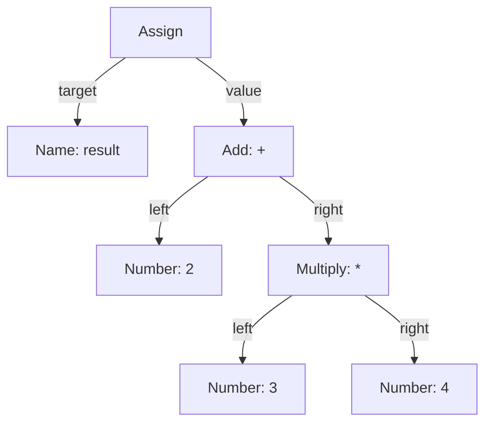
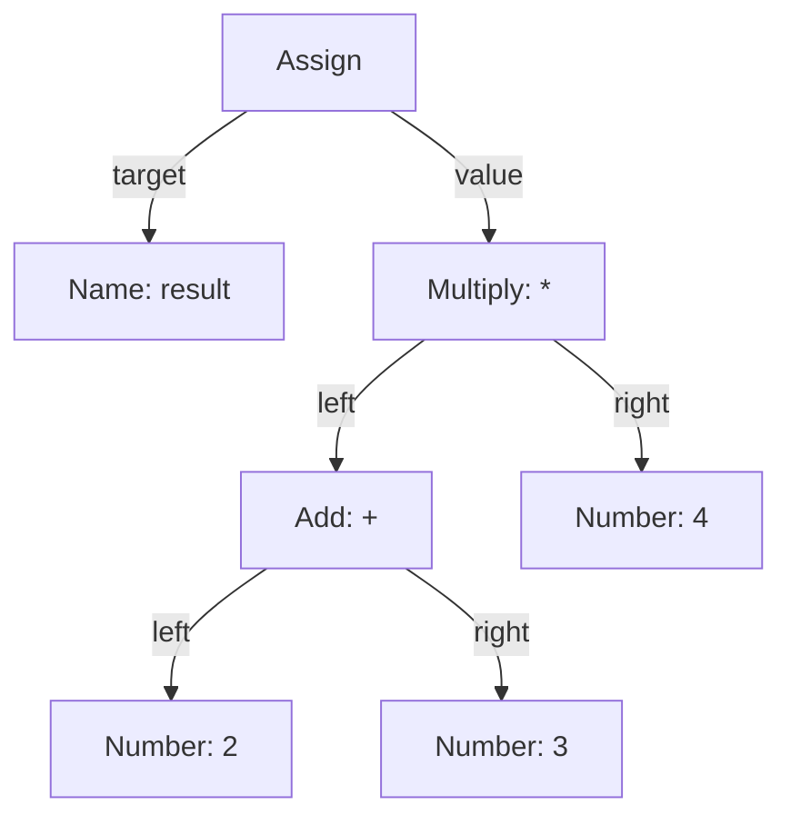
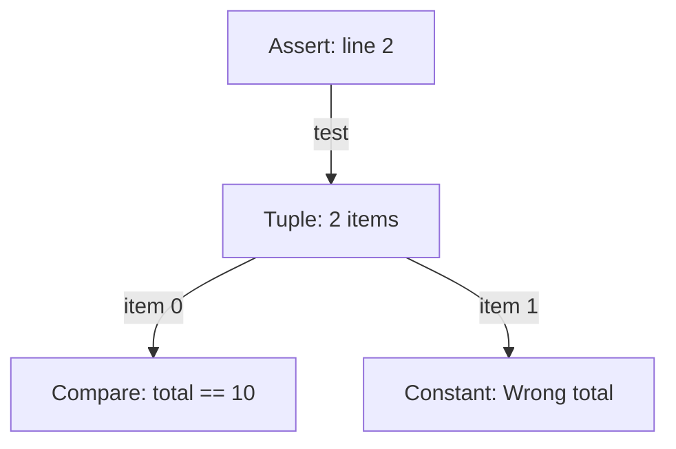
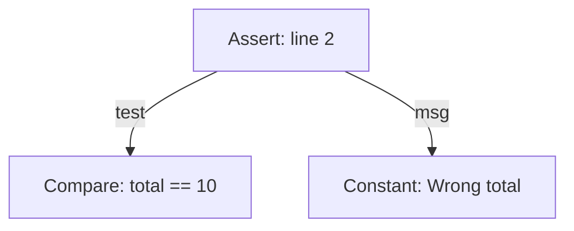
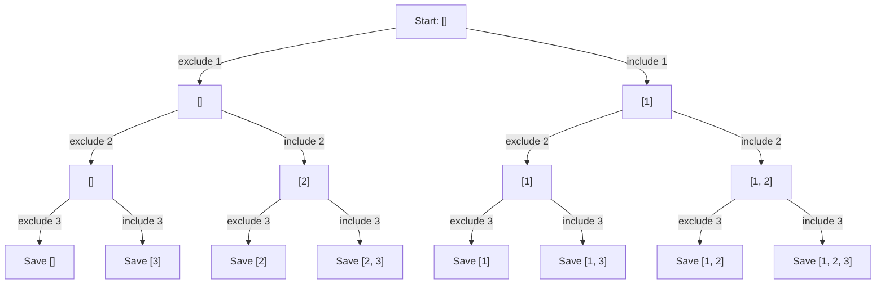
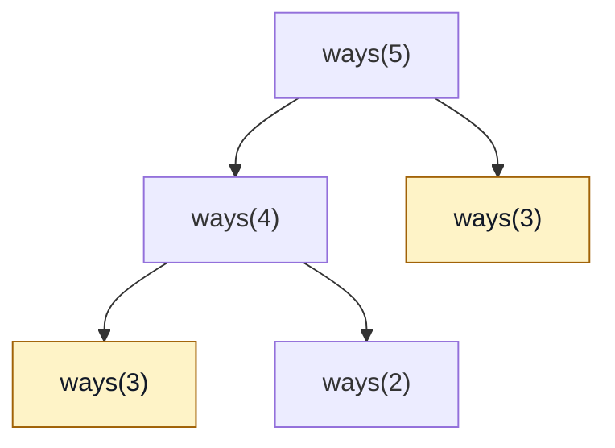
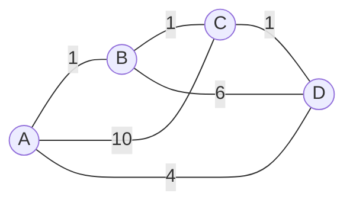
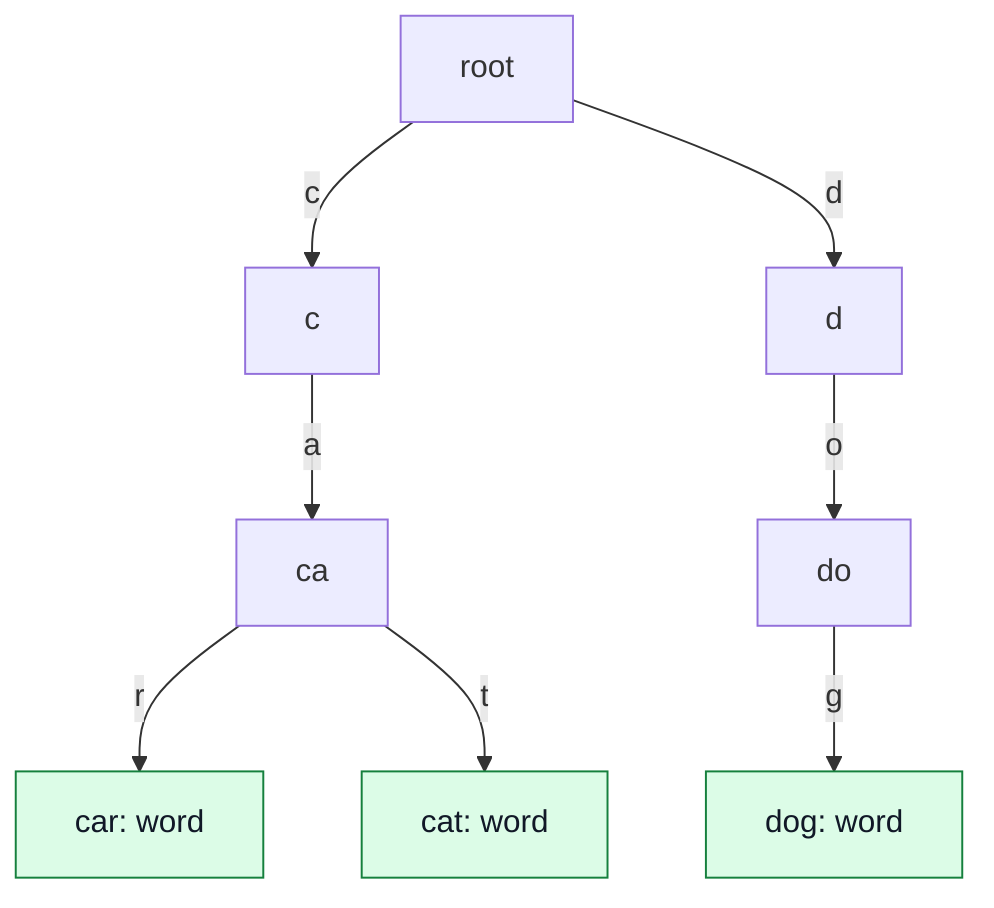

# Data Structures and Algorithms

**Lecture 7: Further study**

<br><br><br><br><br><br>

---

<br><br><br><br><br><br>

## Today's subjects

1. Trees and AST.
2. Bit manipulation.
3. Backtracking.
4. Dynamic programming.
5. Weighted routes: Dijkstra and city tours.
6. Tries.
7. Bloom filters.
8. Practice and further study.

<br><br><br><br><br><br>

---

<br><br><br><br><br><br>

## Our earlier tools

- Arrays store values by position.
- Maps and sets support lookup by key.
- Recursion solves smaller problems.
- Trees share paths between nodes.
- BFS visits a graph by number of edges from the start.

<br><br><br><br><br><br>

---

<br><br><br><br><br><br>

## Part 1: Trees and AST

- Store trees with nodes and child references.
- Represent code with an abstract syntax tree.
- Visit the AST to find a real lint error.

<br><br><br><br><br><br>

---

<br><br><br><br><br><br>

## How can we store a tree in code?

We have used nodes in linked lists and binary trees.

- What data does one node need?
- How does it reach its children?
- Must every node have two children?

Think of a folder with several files and subfolders.

<br><br><br><br><br><br>

---

<br><br><br><br><br><br>

## Linked tree nodes

A **linked tree implementation** stores data and child references in nodes.

- A binary node has `left` and `right` child references.
- A general tree node can store a list of child references.
- A missing child is `None` in Python or `NULL` in C.
- Keep a reference to the root to reach the tree.

Each non-root node has one parent. Child links must not form cycles.

Sources: [Open Data Structures: BinaryTree](https://opendatastructures.org/ods-python/6_1_BinaryTree_Basic_Binary.html),
[CS50x: Trees](https://cs50.harvard.edu/x/notes/5/#trees).

<br><br><br><br><br><br>

---

<br><br><br><br><br><br>

## How can a tree represent code?

```python
result = 2 + 3 * 4
```

- Which operation must produce a value before the addition?
- Which parts could become nodes?
- How could child links show the grouping?

Sketch a tree before you look at the next slides.

<br><br><br><br><br><br>

---

<br><br><br><br><br><br>

## Abstract syntax tree

An **abstract syntax tree (AST)** represents the structure of source code.

- Nodes represent parts such as assignments, operations, names, and values.
- Child links show which parts belong to each larger part.
- "Abstract" means it leaves out details such as spaces and grouping parentheses.
  The tree shape keeps the grouping.

A **parser** reads code and builds this structure.
Compilers and code-checking tools can then process the nodes.

Source: [Python 3.13: AST node types](https://docs.python.org/3.13/library/ast.html#node-classes).

<br><br><br><br><br><br>

---

<br><br><br><br><br><br>

## An AST for a simple assignment

```python
result = 2 + 3 * 4
```



This diagram uses short labels. It omits Python's module and context fields.
The multiplication is a child of the addition.

<br><br><br><br><br><br>

---

<br><br><br><br><br><br>

## Child results before parent results

For `result = 2 + 3 * 4`:

```text
Number 2 returns 2.
Number 3 returns 3.
Number 4 returns 4.
Multiply uses 3 and 4: 3 * 4 = 12.
Add uses 2 and 12:     2 + 12 = 14.
Assign stores 14 in result.
```

Computing children before their parent is **postorder traversal**.

How would the tree change for `result = (2 + 3) * 4`?

<br><br><br><br><br><br>

---

<br><br><br><br><br><br>

## Parentheses change the tree

```python
result = (2 + 3) * 4
```



Addition now produces `5` before multiplication produces `20`.
The parentheses do not need their own nodes.

<br><br><br><br><br><br>

---

<br><br><br><br><br><br>

## An expression tree in Python

Build the expression part of `2 + 3 * 4` by hand:

```python
class ExpressionNode:
    def __init__(self, label, left=None, right=None):
        self.label = label
        self.left = left
        self.right = right


multiply = ExpressionNode("*", ExpressionNode("3"), ExpressionNode("4"))
root = ExpressionNode("+", ExpressionNode("2"), multiply)
```

Number nodes are leaves. Operator nodes link to two operands.
This small class stores labels; it does not parse or execute code.

<br><br><br><br><br><br>

---

<br><br><br><br><br><br>

## An expression tree in C

```c
typedef struct ExpressionNode {
    const char *label;
    struct ExpressionNode *left;
    struct ExpressionNode *right;
} ExpressionNode;

ExpressionNode two = {"2", NULL, NULL};
ExpressionNode three = {"3", NULL, NULL};
ExpressionNode four = {"4", NULL, NULL};
ExpressionNode multiply = {"*", &three, &four};
ExpressionNode add = {"+", &two, &multiply};
ExpressionNode *root = &add;
```

`&three` gives a pointer to the existing node.
These local nodes stay valid while their function runs. Include `<stddef.h>` for `NULL`.

<br><br><br><br><br><br>

---

<br><br><br><br><br><br>

## Run the C expression tree

[Complete C example](examples/07-expression-tree.c)

From the student repository root:

```sh
cc -std=c11 -Wall -Wextra -pedantic \
  slides/examples/07-expression-tree.c -o /tmp/expression-tree
/tmp/expression-tree
```

```text
Root: +
Left child: 2
Right child: *
Multiply operands: 3, 4
```

The output confirms the child links. This example does not evaluate the expression.

<br><br><br><br><br><br>

---

<br><br><br><br><br><br>

## Build the AST with Python's parser

```python
import ast

source = "result = 2 + 3 * 4"
tree = ast.parse(source)
assignment = tree.body[0]
print(ast.dump(assignment.value, indent=2))
```

- `tree.body[0]` is the first statement: the assignment.
- `assignment.value` is its expression: `2 + 3 * 4`.
- `ast.dump` prints the node types and their fields.

Parsing builds nodes. It does not execute this assignment.

Source: [Python 3.13: ast.parse](https://docs.python.org/3.13/library/ast.html#ast.parse).

<br><br><br><br><br><br>

---

<br><br><br><br><br><br>

## Python's expression nodes

```text
BinOp(
  left=Constant(value=2),
  op=Add(),
  right=BinOp(
    left=Constant(value=3),
    op=Mult(),
    right=Constant(value=4)))
```

- `BinOp` is a binary operation. Its `op` field stores the operator.
- Its `left` and `right` fields hold the operand nodes.
- `Constant` stores a literal value.

An AST is not a BST: child links follow code structure, without a sorted-value rule.
An AST need not be binary: a function call can have many arguments.

<br><br><br><br><br><br>

---

<br><br><br><br><br><br>

## Can this assertion catch a wrong total?

```python
total = 9
assert (total == 10, "Wrong total")
```

In normal Python execution, `assert condition, message` raises
`AssertionError` when the condition is false.

- Here, `total == 10` is false.
- Will this assertion raise an error?
- What do the comma and parentheses create?

<br><br><br><br><br><br>

---

<br><br><br><br><br><br>

## A real rule: assert-tuple (F631)

A **linter** checks source code for likely mistakes.
[Ruff's F631 rule](https://docs.astral.sh/ruff/rules/assert-tuple/)
flags an `assert` whose test is a non-empty tuple literal.

A **tuple** is an ordered collection of values.
The comma makes `(total == 10, "Wrong total")` a tuple with two items.

```text
total == 10                    -> False
(total == 10, "Wrong total")    -> (False, "Wrong total")
Truth value of this tuple      -> True
```

The assertion passes. Its test is the whole tuple.

<br><br><br><br><br><br>

---

<br><br><br><br><br><br>

## Parse the code we want to check

```python
import ast

source = '''total = 9
assert (total == 10, "Wrong total")
'''
tree = ast.parse(source)
```

1. Read the program as text.
2. Use the parser to build its AST.
3. Visit the nodes and apply the lint rule.

`ast.parse` does not run the program. The checker reads its structure.

<br><br><br><br><br><br>

---

<br><br><br><br><br><br>

## The AST exposes the mistake

For `assert (total == 10, "Wrong total")`:



- `Assert.test` is a `Tuple` node.
- `Tuple.elts` is the list of its item nodes.
- `Assert.msg` is `None`: the string is inside the tuple.

This diagram omits the module, assignment, and comparison's child nodes.

<br><br><br><br><br><br>

---

<br><br><br><br><br><br>

## Find matching nodes in Python

```python
def find_assert_tuples(tree):
    warnings = []
    for node in ast.walk(tree):
        if isinstance(node, ast.Assert):
            test = node.test
            if isinstance(test, ast.Tuple) and len(test.elts) > 0:
                warnings.append(node.lineno)
    return warnings
```

- `ast.walk` visits the root and its descendants.
- Check the node type, test type, and tuple item count.
- Save the source line for each match.

Source: [Python 3.13: ast.walk](https://docs.python.org/3.13/library/ast.html#ast.walk).

<br><br><br><br><br><br>

---

<br><br><br><br><br><br>

## Report the warning

```python
for line in find_assert_tuples(tree):
    print(f"Line {line}: F631 assert test is a non-empty tuple")
```

```text
Node is Assert?          Yes
Its test is Tuple?       Yes
Tuple has items?         Yes: 2

Line 2: F631 assert test is a non-empty tuple
```

The checker finds the mistake without calculating `total == 10`.
This is a small teaching implementation of the rule.

<br><br><br><br><br><br>

---

<br><br><br><br><br><br>

## Fix the assertion

```python
total = 9
assert total == 10, "Wrong total"
```



Parse the corrected text and run the same check: **no F631 warnings**.

Now the test is the comparison. In normal execution, it raises
`AssertionError: Wrong total` for `total = 9`.

<br><br><br><br><br><br>

---

<br><br><br><br><br><br>

## The same tree check in C

```c
void check_ast(const Node *node)
{
    if (node->kind == ASSERT_NODE) {
        const Node *test = node->children[0];
        if (test->kind == TUPLE_NODE && test->child_count > 0) {
            printf("Line %d: F631 assert test is a non-empty tuple\n", node->line);
        }
    }
    for (size_t i = 0; i < node->child_count; i++) {
        check_ast(node->children[i]);
    }
}
```

This version visits supplied nodes. An assertion's first child is its test.
The complete C demo builds the simplified AST by hand; it has no Python parser.

<br><br><br><br><br><br>

---

<br><br><br><br><br><br>

## Run the AST lint examples

[Python: parse source and run the check](examples/07-ast-lint.py)

From the student repository root:

```sh
python3 slides/examples/07-ast-lint.py
```

```text
Before fix
Line 2: F631 assert test is a non-empty tuple
After fix
No F631 warnings.
```

[C: visit the supplied AST](examples/07-ast-lint.c)

```sh
cc -std=c11 slides/examples/07-ast-lint.c -o /tmp/ast-lint
/tmp/ast-lint
```

<br><br><br><br><br><br>

---

<br><br><br><br><br><br>

## Why check the AST?

```python
text = 'assert (False, "Wrong total")'
# assert (False, "Wrong total")
assert (total == 10), "Wrong total"
```

- Text inside a string is not an `Assert` node. Comments are not AST nodes.
- Grouping parentheses around the comparison do not create a tuple.
- The checker applies the rule to code structure, independent of spacing.

Each visited node is checked once. For `n` AST nodes, the scan takes `O(n)` time.
The AST, traversal, and warning list use `O(n)` memory in the worst case.

No F631 warning means this rule found no match. It does not prove the program correct.

<br><br><br><br><br><br>

---

<br><br><br><br><br><br>

## Part 2: Bit manipulation

- Store flags in individual bits.
- Use XOR to find a value without a pair.

<br><br><br><br><br><br>

---

<br><br><br><br><br><br>

## How can one number store several flags?

A program needs two permissions:

- Read a file.
- Write a file.

Each permission can be on or off.

How could we store both in one integer?

<br><br><br><br><br><br>

---

<br><br><br><br><br><br>

## Bits and bit manipulation

A **bit** has value `0` or `1`.

**Bit manipulation** reads or changes bit positions with operators.

```text
Bit position:    3  2  1  0
Binary value:    0  1  0  1
Place value:     8  4  2  1

0101 = 4 + 1 = 5
```

A **bitmask** uses separate bits as separate flags.

Source: [Python: integer bitwise operations](https://docs.python.org/3/library/stdtypes.html#bitwise-operations-on-integer-types).

<br><br><br><br><br><br>

---

<br><br><br><br><br><br>

## AND, OR, and XOR

| Input bits | AND `&` | OR `\|` | XOR `^` |
| --- | --- | --- | --- |
| `0`, `0` | `0` | `0` | `0` |
| `0`, `1` | `0` | `1` | `1` |
| `1`, `0` | `0` | `1` | `1` |
| `1`, `1` | `1` | `1` | `0` |

- **AND:** both bits are `1`.
- **OR:** at least one bit is `1`.
- **XOR:** the bits differ.

Apply the rule at each bit position.

<br><br><br><br><br><br>

---

<br><br><br><br><br><br>

## Bit operators on integers

```text
5 = 0101
3 = 0011

0101 & 0011 = 0001 = 1
0101 | 0011 = 0111 = 7
0101 ^ 0011 = 0110 = 6
```

Left shift `<<` moves bits left and adds zeros on the right:

```text
1 << 0 = 0001 = 1
1 << 1 = 0010 = 2
1 << 2 = 0100 = 4
```

In Python, `^` means XOR. Use `**` for exponentiation.

<br><br><br><br><br><br>

---

<br><br><br><br><br><br>

## File permissions in Linux

Linux uses three permission bits for each group: owner, group, and others.

**Read = 4, write = 2, execute = 1.** So `6 = 4 + 2` means read and write.

```text
                  Owner   Group   Others
Permissions       rw-     r--     r--
Bits              110     100     100
Numeric value     6       4       4
```

```sh
chmod 644 notes.txt
```

This gives the owner read/write permissions and the group and others read-only permissions.

Further exploration: [Linux chmod manual](https://man7.org/linux/man-pages/man1/chmod.1.html).

<br><br><br><br><br><br>


---

<br><br><br><br><br><br>

## Set, check, and toggle a flag

```text
Start:          00
Set read:       00 | 01 = 01
Set write:      01 | 10 = 11
Check write:    11 & 10 = 10 -> True
Toggle write:   11 ^ 10 = 01
Check write:    01 & 10 = 00 -> False
```

- OR sets the selected bit without clearing other bits.
- AND checks that bit.
- XOR toggles that bit. A second toggle turns it back on.

<br><br><br><br><br><br>

---

<br><br><br><br><br><br>

## LeetCode: one value without a pair

[136. Single Number](https://leetcode.com/problems/single-number/) - **Easy**

- Every value appears twice, except one value that appears once.
- Find that one value.
- Use linear time and constant extra space.

```text
Input:  [4, 1, 2, 1, 2]
Output: 4
```

Can XOR remove the equal pairs?

<br><br><br><br><br><br>

---

<br><br><br><br><br><br>

## Equal values cancel with XOR

```text
x ^ x = 0
x ^ 0 = x

4 ^ 1 ^ 2 ^ 1 ^ 2
= 4 ^ (1 ^ 1) ^ (2 ^ 2)
= 4 ^ 0 ^ 0
= 4
```

- Equal bits XOR to `0`.
- XOR order and grouping do not change the answer.
- The unpaired value remains.

<br><br><br><br><br><br>

---

<br><br><br><br><br><br>

## Single Number in Python

```python
def single_number(nums):
    result = 0
    for value in nums:
        result ^= value
    return result
```

1. Start at `0`, which leaves the first value unchanged.
2. XOR each value into the running result.
3. Return the value left after all pairs cancel.

<br><br><br><br><br><br>

---

<br><br><br><br><br><br>

## Follow the XOR total

```text
Value read:       4   1   2   1   2
Running result:   4   5   7   6   4
```

**Invariant:** the result is the XOR of all values read so far.

- One finite scan finishes the calculation.
- Time: `O(n)`. Extra space: `O(1)` for bounded-size integers.
- Python supports larger integers. Their bit operations and storage cost more.

The method depends on the equal-pair rule.

<br><br><br><br><br><br>

---

<br><br><br><br><br><br>

## Part 3: Backtracking

- Explore a tree of choices.
- Undo a choice before exploring the next branch.

<br><br><br><br><br><br>

---

<br><br><br><br><br><br>

## How can we list every selection?

You may choose each item in `[1, 2, 3]`, or leave it out.

- What selections can you make?
- Does choosing nothing count?
- How can a program explore every choice?

Draw one branch for each decision.

<br><br><br><br><br><br>

---

<br><br><br><br><br><br>

## Backtracking

**Backtracking** builds an answer one choice at a time and returns to try
other choices.

- Explore one branch of a decision tree.
- Restore shared state before the next branch.
- Pattern: **choose, explore, undo**.

**Pruning** skips a branch that cannot produce a valid answer.

Uses include puzzles, permutations, and subsets.

Source: [Stanford CS106B: Backtracking and Enumeration](https://web.stanford.edu/class/archive/cs/cs106b/cs106b.1244/lectures/11-backtracking1/).

<br><br><br><br><br><br>

---

<br><br><br><br><br><br>

## LeetCode: all subsets

[78. Subsets](https://leetcode.com/problems/subsets/description/) - **Medium**

- Input values are distinct.
- Return every subset, without duplicate subsets.
- Answer order does not matter.

```text
Input: [1, 2, 3]
```

At each value, choose **exclude** or **include**.

Explanation: https://www.youtube.com/watch?v=REOH22Xwdkk

<br><br><br><br><br><br>

---

<br><br><br><br><br><br>

## A subset decision tree



Each root-to-leaf path describes one subset.

<br><br><br><br><br><br>

---

<br><br><br><br><br><br>

## Subsets in Python

```python
def subsets(nums):
    result = []
    path = []

    def visit(index):
        if index == len(nums):
            result.append(path.copy())
            return
        visit(index + 1)
        path.append(nums[index])
        visit(index + 1)
        path.pop()

    visit(0)
    return result
```

`path` holds the current selection. `result` holds completed answers.

<br><br><br><br><br><br>

---

<br><br><br><br><br><br>

## Exclude first, then include

Inside `visit(index)`:

```python
visit(index + 1)

path.append(nums[index])
visit(index + 1)
path.pop()
```

1. The first call excludes this value.
2. `append` chooses to include it. The next call explores that choice.
3. `pop` undoes the choice before returning to the caller.

Each recursive call moves to the next index.

<br><br><br><br><br><br>

---

<br><br><br><br><br><br>

## Follow the exclude-1 branch

```text
Action                   path       new answer
Exclude 1                []
  Exclude 2              []
    Exclude 3, save      []         []
    Include 3            [3]
      Save               [3]        [3]
    Undo 3               []
  Include 2              [2]
    Exclude 3, save      [2]        [2]
    Include 3            [2, 3]
      Save               [2, 3]     [2, 3]
    Undo 3               [2]
  Undo 2                 []
```

The branch finishes with `path` back at `[]`.

The next branch can include `1` without an unwanted `2` or `3`.

<br><br><br><br><br><br>

---

<br><br><br><br><br><br>

## Follow the include-1 branch

```text
Action                   path       new answer
Include 1                [1]
  Exclude 2              [1]
    Exclude 3, save      [1]        [1]
    Include 3            [1, 3]
      Save               [1, 3]     [1, 3]
    Undo 3               [1]
  Include 2              [1, 2]
    Exclude 3, save      [1, 2]     [1, 2]
    Include 3            [1, 2, 3]
      Save               [1, 2, 3]  [1, 2, 3]
    Undo 3               [1, 2]
  Undo 2                 [1]
Undo 1                   []
```

```text
Final result:
[[], [3], [2], [2, 3],
 [1], [1, 3], [1, 2], [1, 2, 3]]
```

Every call restores the selection it received.

<br><br><br><br><br><br>

---

<br><br><br><br><br><br>

## Why must we copy each answer?

At the base case:

```python
result.append(path.copy())
```

What would happen with this version?

```python
result.append(path)
```

Think about the later `append` and `pop` operations.

<br><br><br><br><br><br>

---

<br><br><br><br><br><br>

## Shared lists and saved answers

- `append(path)` saves a reference to the same mutable list.
- Later changes affect every saved reference to that list.
- After all choices are undone, those references point to an empty list.
- `path.copy()` gives each answer a separate list.

```text
With a copy:
[[], [3], [2], [2, 3],
 [1], [1, 3], [1, 2], [1, 2, 3]]

Without a copy:
[[], [], [], [], [], [], [], []]
```

The input values are integers, so a shallow list copy is enough here.

<br><br><br><br><br><br>

---

<br><br><br><br><br><br>

## Backtracking cost and limits

- Each distinct value has two choices: there are `2^n` subsets.
- Copying all answers takes `O(n * 2^n)` time and output storage.
- The current path and call stack use `O(n)` extra space.
- The increasing index reaches the base case and ends each branch.

For local input `[]`, the answer is `[[]]`.

All subsets are valid here. Constraint problems can prune invalid branches.

<br><br><br><br><br><br>

---

<br><br><br><br><br><br>

## Part 4: Dynamic programming

- Describe a problem with smaller states.
- Save results and reuse them.

<br><br><br><br><br><br>

---

<br><br><br><br><br><br>

## Dynamic programming

**Dynamic programming (DP)** solves smaller subproblems and stores their
answers for reuse.

- A **state** describes one subproblem.
- A **transition** relates its answer to smaller states.
- **Base cases** give starting answers.
- **Overlapping subproblems** occur when branches need the same state.

Source: [MIT 6.006: Dynamic Programming, Part 1](https://ocw.mit.edu/courses/6-006-introduction-to-algorithms-spring-2020/resources/lecture-15-dynamic-programming-part-1-srtbot-fib-dags-bowling/).

<br><br><br><br><br><br>

---

<br><br><br><br><br><br>

## Divide and conquer and DP

Both express a problem through smaller problems.

| Example | Smaller problems | What repeats? |
| --- | --- | --- |
| Merge sort | Separate left and right index ranges | Each range belongs to its own branch |
| Climbing Stairs | Smaller step counts | Different branches request the same step count |

DP reuses the answers to overlapping states.

A bottom-up DP table can run without recursion.

<br><br><br><br><br><br>

---

<br><br><br><br><br><br>

## Factorial: recursion vs tabulation

For a nonnegative integer `n`: `0! = 1` and `n! = n * (n - 1)!`.

```python
def factorial_recursive(n):
    if n == 0:
        return 1
    return n * factorial_recursive(n - 1)


def factorial_dp(n):
    fact = [1] * (n + 1)
    for i in range(1, n + 1):
        fact[i] = i * fact[i - 1]
    return fact[n]
```

Both return `120` for `n = 5`. The table is `[1, 1, 2, 6, 24, 120]`.

This shows a DP table's bottom-up order. Factorial has no repeated subproblems,
so storing results saves no repeated work.

[C versions for `0 <= n <= 20`](examples/07-factorial.c).
Reference: [Python: factorial](https://docs.python.org/3.13/library/math.html#math.factorial).

<br><br><br><br><br><br>

---

<br><br><br><br><br><br>

## Counting and optimization

DP can store different kinds of answers:

- **Count:** how many valid ways exist?
- **Minimum:** what is the cheapest valid choice?
- **Maximum:** what is the largest valid value?

For optimization, **optimal substructure** means that an optimal answer can
use optimal answers to suitable smaller problems.

For counting, split answers into groups with no omissions or double counting.

Source: [Runestone: Dynamic Programming](https://runestone.academy/ns/books/published/pythonds3/Recursion/DynamicProgramming.html).

<br><br><br><br><br><br>

---

<br><br><br><br><br><br>

## LeetCode: Climbing Stairs

[70. Climbing Stairs](https://leetcode.com/problems/climbing-stairs/) - **Easy**

Each move climbs `1` or `2` steps.

How many sequences of moves climb exactly `3` steps?

```text
Input: n = 3
```

Does changing the order of the moves make a different sequence?

Explanation: https://www.youtube.com/watch?v=Y0lT9Fck7qI

<br><br><br><br><br><br>

---

<br><br><br><br><br><br>

## State and base cases

For `n = 3`:

```text
[1, 1, 1]
[1, 2]
[2, 1]

Output: 3
```

- **State:** `ways(i)` counts sequences that climb exactly `i` steps.
- `ways(0) = 1`: one empty sequence of moves.
- `ways(1) = 1`: one move of one step.

The local zero-step state supports the recurrence.

<br><br><br><br><br><br>

---

<br><br><br><br><br><br>

## The last move defines the transition

A sequence reaching step `i` ends with:

- One step from `i - 1`.
- Two steps from `i - 2`.

```text
ways(i) = ways(i - 1) + ways(i - 2), for i >= 2
```

The groups are disjoint and cover every valid sequence.

```text
ways(3) = ways(2) + ways(1) = 2 + 1 = 3
```

<br><br><br><br><br><br>

---

<br><br><br><br><br><br>

## Repeated recursive states



Both highlighted requests need the same answer.

A plain recursive calculation expands that state's calls again.

<br><br><br><br><br><br>

---

<br><br><br><br><br><br>

## Memoization and tabulation

**Memoization:**

- Ask for the original state.
- Compute missing answers recursively and save them in a cache.
- Return a saved answer when the state appears again.

**Tabulation:**

- Fill base cases first.
- Compute states in an order where their dependencies are ready.

Both methods use the same recurrence.

<br><br><br><br><br><br>

---

<br><br><br><br><br><br>

## Memoization in Python

```python
def climb_stairs_memo(n):
    memo = {0: 1, 1: 1}

    def ways(steps):
        if steps in memo:
            return memo[steps]
        memo[steps] = ways(steps - 1) + ways(steps - 2)
        return memo[steps]

    return ways(n)
```

The key is the complete state: the number of steps required.

<br><br><br><br><br><br>

---

<br><br><br><br><br><br>

## Follow the memoized calls

For `climb_stairs_memo(5)`:

```text
Base answers:     {0: 1, 1: 1}

Save ways(2):     1 + 1 = 2
Save ways(3):     2 + 1 = 3
Save ways(4):     3 + 2 = 5
Save ways(5):     5 + 3 = 8
```

When `ways(5)` later requests `ways(3)`, return the cached `3`.

Each state expands its recurrence once.

<br><br><br><br><br><br>

---

<br><br><br><br><br><br>

## A bottom-up table in Python

```python
def climb_stairs(n):
    ways = [0] * (n + 1)
    ways[0] = 1
    if n >= 1:
        ways[1] = 1

    for step in range(2, n + 1):
        ways[step] = ways[step - 1] + ways[step - 2]

    return ways[n]
```

`range(2, n + 1)` includes state `n`.

<br><br><br><br><br><br>

---

<br><br><br><br><br><br>

## Follow the table order

```text
step:     0  1  2  3  4  5
ways:     1  1  2  3  5  8

Input:  n = 5
Output: 8
```

1. Allocate states `0` through `n`.
2. Fill the two base cases.
3. Add the two smaller counts at each step.
4. Return the entry for `n`.

Before each iteration, the smaller entries are already correct.

<br><br><br><br><br><br>

---

<br><br><br><br><br><br>

## DP cost and limits

- Plain recursion repeats work and takes exponential time.
- Both shown DP methods take `O(n)` time and `O(n)` extra space.
- Two recent counts are enough for an `O(1)` storage improvement.
- Memoization also uses the call stack. The table avoids recursion depth limits.

These costs assume constant-time arithmetic on small integers.

Python integers grow with the answer. Very large counts cost more to store
and add.

<br><br><br><br><br><br>

---

<br><br><br><br><br><br>

## A state must contain enough information

- `ways(3)` always means the same counting problem.
- In Subsets, index `1` can occur with `path = []` or `path = [1]`.
- Those partial selections need different output subsets.

Caching Subsets by index alone would lose required answers.

**Define the state from the output you need.**

<br><br><br><br><br><br>

---

<br><br><br><br><br><br>

## Part 5: Weighted routes

- Use Dijkstra to find shortest paths with nonnegative costs.
- Compare a shortest path with a tour that visits every city.

<br><br><br><br><br><br>

---

<br><br><br><br><br><br>

## One city route or a tour of all cities?

A salesperson starts in city A.

- Task 1: reach city D as cheaply as possible.
- Task 2: visit every city exactly once, then return to A.

Do these tasks require the same answer?

What does each task need to remember?

<br><br><br><br><br><br>

---

<br><br><br><br><br><br>

## Weighted paths and the traveling salesman problem

- A **weighted graph** gives each edge a cost.
- A path's cost is the sum of its edge costs.
- A **shortest path** minimizes that cost from a start to a destination.
- **Dijkstra** finds shortest paths from one start with nonnegative weights.
- The classic **traveling salesman problem (TSP)** chooses a cheapest tour
  through every city and back to the start.

TSP must also choose the visit order.

Sources: [VisuAlgo: shortest paths](https://visualgo.net/en/sssp) and
[University of Waterloo: TSP](https://www.math.uwaterloo.ca/tsp/).

<br><br><br><br><br><br>

---

<br><br><br><br><br><br>

## A four-city map



- Each connection works in both directions.
- The labels are abstract travel costs.
- All costs are nonnegative.

Which route from A to D has the smallest total cost?

<br><br><br><br><br><br>

---

<br><br><br><br><br><br>

## Shortest route and full tour

```text
Shortest route A to D:
A -> B -> C -> D       1 + 1 + 1     = 3
Direct A -> D                         = 4

One complete tour:
A -> B -> C -> D -> A  1 + 1 + 1 + 4 = 7
```

- Dijkstra finds shortest routes from A.
- A TSP solver compares visit orders for a full tour.
- Knowing shortest routes between city pairs still leaves a tour-order problem.

<br><br><br><br><br><br>

---

<br><br><br><br><br><br>

## Comparing the small TSP tours

Fix the start at A. Reversed tours have the same cost on this symmetric map.

```text
Tour                       Cost
A -> B -> C -> D -> A         7
A -> B -> D -> C -> A        18
A -> C -> B -> D -> A        21
```

The minimum tour costs `7`.

Backtracking can explore visit orders. Later, a DP state can contain
`(visited cities, current city)`.

The following code solves shortest routes, while TSP remains further study.

<br><br><br><br><br><br>

---

<br><br><br><br><br><br>

## Tentative distances, settled cities, and relaxation

- A **tentative distance** is the cheapest route cost found so far.
- A **settled distance** is final.
- **Relaxation** tests a route through the current city.

```text
candidate = distance[current] + edge_cost

If candidate is smaller:
    update the neighbor's distance
    record its predecessor
```

Dijkstra settles the smallest tentative distance next.

<br><br><br><br><br><br>

---

<br><br><br><br><br><br>

## The city graph in Python

```python
graph = {
    "A": [("B", 1), ("C", 10), ("D", 4)],
    "B": [("A", 1), ("C", 1), ("D", 6)],
    "C": [("A", 10), ("B", 1), ("D", 1)],
    "D": [("A", 4), ("B", 6), ("C", 1)],
}
```

- The dictionary is an **adjacency list**.
- Each pair contains `(neighbor, cost)`.
- Store both directions for each connection.
- Every city appears as a dictionary key.

<br><br><br><br><br><br>

---

<br><br><br><br><br><br>

## Dijkstra: initialize the state

The start of `dijkstra(graph, start)`:

```python
def dijkstra(graph, start):
    distance = {city: float("inf") for city in graph}
    previous = {city: None for city in graph}
    settled = set()
    distance[start] = 0
```

- `inf` means that we have not found a route yet.
- The start costs `0` to reach.
- `previous` stores route links. `settled` begins empty.

The next slides continue inside this function.

<br><br><br><br><br><br>

---

<br><br><br><br><br><br>

## Dijkstra: select the next city

Inside `dijkstra`, after initialization:

```python
while True:
    current = None
    for city in graph:
        if city in settled:
            continue
        if current is None or distance[city] < distance[current]:
            current = city

    if current is None or distance[current] == float("inf"):
        break
```

- Scan the unsettled cities for the smallest distance.
- Stop when no unsettled city has a finite distance.

<br><br><br><br><br><br>

---

<br><br><br><br><br><br>

## Dijkstra: settle and relax

Continue inside the `while` loop:

```python
settled.add(current)
for neighbor, cost in graph[current]:
    if neighbor in settled:
        continue
    candidate = distance[current] + cost
    if candidate < distance[neighbor]:
        distance[neighbor] = candidate
        previous[neighbor] = current
```

- Settle the selected city's distance.
- Test each route through it to an unsettled neighbor.
- Save a cheaper distance and its predecessor together.

After the loop, the function returns `distance, previous`.

<br><br><br><br><br><br>

---

<br><br><br><br><br><br>

## Settle A, then B

```text
Action      A    B    C    D
Initialize  0  inf  inf  inf
Settle A    0    1   10    4
Settle B    0    1    2    4
```

- From A, discover direct routes to B, C, and D.
- B has the smallest tentative distance: `1`.
- Through B, C improves from `10` to `1 + 1 = 2`.
- Through B, D would cost `1 + 6 = 7`. Keep its earlier `4`.

What changes when we settle C?

<br><br><br><br><br><br>

---

<br><br><br><br><br><br>

## Settle C, then D

```text
Action      A    B    C    D
Settle B    0    1    2    4
Settle C    0    1    2    3
Settle D    0    1    2    3
```

- Through C, D improves from `4` to `2 + 1 = 3`.
- Record `previous[D] = C`.
- D now has the smallest remaining distance. Settle it.

Final distances: A is `0`, B is `1`, C is `2`, D is `3`.

<br><br><br><br><br><br>

---

<br><br><br><br><br><br>

## Reconstruct the route

For reachable destination D:

```python
distance, previous = dijkstra(graph, "A")
route = []
city = "D"
while city is not None:
    route.append(city)
    city = previous[city]
route.reverse()
```

```text
Follow predecessors:  D, C, B, A
Reverse the list:     A, B, C, D
```

For a general destination, check that its distance is finite first.

<br><br><br><br><br><br>

---

<br><br><br><br><br><br>

## Why can Dijkstra settle a distance?

- Choose the smallest tentative distance among unsettled cities.
- A later route through an unsettled city starts at an equal or larger cost.
- Nonnegative edges cannot reduce that cost on the way back to this city.

Therefore, the selected distance is final.

Each iteration settles a new city, so there are at most `V` settlements.

A negative edge breaks the settling argument. Zero-cost edges are valid.

<br><br><br><br><br><br>

---

<br><br><br><br><br><br>

## BFS, scans, and heaps

- BFS minimizes edge count. It would choose the direct A-to-D connection.
- Dijkstra minimizes the sum of nonnegative costs.
- Our scan version takes `O(V^2 + E)` time.
- It uses `O(V)` working space, plus `O(V + E)` graph storage.
- An indexed binary min-heap with decrease-key gives
  `O((V + E) log V)` time.

These costs assume constant-size labels and expected constant-time map/set
operations.

A city becomes settled when selected, not when first discovered.

<br><br><br><br><br><br>

---

<br><br><br><br><br><br>

## LeetCode: Network Delay Time

[743. Network Delay Time](https://leetcode.com/problems/network-delay-time/description/) - **Medium**

- Edges are directed and have nonnegative costs.
- Send a signal from one source to all nodes.
- Return the largest shortest distance.
- Return `-1` if any node is unreachable.

```text
Shortest distances: 0, 2, 1
Network delay:     max(0, 2, 1) = 2
```

This applies Dijkstra to a different graph contract.

Explanation: https://www.youtube.com/watch?v=EaphyqKU4PQ

<br><br><br><br><br><br>

---

<br><br><br><br><br><br>

## Part 6: Tries

- Share paths for common word prefixes.
- Distinguish a complete word from a prefix.

<br><br><br><br><br><br>

---

<br><br><br><br><br><br>

## How can words share their starting letters?

We store:

```text
car
cat
dog
```

- Do we have the complete word `ca`?
- Does any stored word start with `ca`?

How could a tree represent this difference?

<br><br><br><br><br><br>

---

<br><br><br><br><br><br>

## A trie

A **trie**, pronounced "try", is a prefix tree.

- Each edge represents one character.
- Words with a common prefix share a starting path.
- A **word marker** records where a complete word ends.
- One node can end a word and still have children.

Uses include dictionary lookup and prefix checks.

Source: [CS50x: Tries](https://cs50.harvard.edu/x/notes/5/#tries).

<br><br><br><br><br><br>

---

<br><br><br><br><br><br>

## Paths for car, cat, and dog



The node labels show full prefixes. Each edge adds only one character.

<br><br><br><br><br><br>

---

<br><br><br><br><br><br>

## Use case: a word dictionary

A dictionary app stores `car`, `cat`, and `dog`, with their meanings.

```text
Look up "cat":
root -> c -> a -> t -> complete word
Meaning: "a small animal often kept as a pet"

Type the prefix "ca":
root -> c -> a -> matching words: car, cat
```

- Store each meaning at its word-marked node.
- `ca` is only a prefix here, so it has no word marker.
- To suggest words, visit the word-marked nodes below `ca`.

<br><br><br><br><br><br>

---

<br><br><br><br><br><br>

## LeetCode: Implement Trie

[208. Implement Trie](https://leetcode.com/problems/implement-trie-prefix-tree/description/) - **Medium**

Implement:

- `insert(word)`: store a complete word.
- `search(word)`: check an exact stored word.
- `startsWith(prefix)`: check a prefix of a stored word.

The problem uses nonempty lowercase English words and prefixes.

<br><br><br><br><br><br>

---

<br><br><br><br><br><br>

## A trie node in Python

```python
class TrieNode:
    def __init__(self):
        self.children = {}
        self.is_word = False


class Trie:
    def __init__(self):
        self.root = TrieNode()
```

- `children` maps the next character to its child node.
- `is_word` marks a complete inserted word.
- The root represents the empty starting prefix.

<br><br><br><br><br><br>

---

<br><br><br><br><br><br>

## Trie insertion in Python

Add this method inside `Trie`:

```python
def insert(self, word):
    node = self.root
    for char in word:
        if char not in node.children:
            node.children[char] = TrieNode()
        node = node.children[char]
    node.is_word = True
```

1. Begin at the root.
2. Follow each character, creating a missing child when needed.
3. Mark the final node as a complete word.

<br><br><br><br><br><br>

---

<br><br><br><br><br><br>

## Follow the insertions

```text
insert("car"): create c, a, r; mark car
insert("cat"): reuse c, a; create t; mark cat
insert("dog"): create d, o, g; mark dog
```

Shared prefixes need only one path.

After these insertions, the `ca` node exists, but its word marker is `False`.

What changes if we insert `ca`?

<br><br><br><br><br><br>

---

<br><br><br><br><br><br>

## A prefix can also be a complete word

```text
insert("ca"): follow c, a; mark ca

ca:   is_word = True
      still has children r and t
```

- No existing child disappears.
- `car` and `cat` remain stored.
- A word marker does not have to be at a leaf.

<br><br><br><br><br><br>

---

<br><br><br><br><br><br>

## Follow a character path in Python

Add this helper inside `Trie`:

```python
def _find_node(self, text):
    node = self.root
    for char in text:
        if char not in node.children:
            return None
        node = node.children[char]
    return node
```

- A missing child stops the lookup.
- Otherwise, return the node at the end of the path.
- This helper reads links without changing them.

<br><br><br><br><br><br>

---

<br><br><br><br><br><br>

## Word lookup and prefix lookup

Add these methods inside `Trie`:

```python
def search(self, word):
    node = self._find_node(word)
    return node is not None and node.is_word


def startsWith(self, prefix):
    return self._find_node(prefix) is not None
```

- Exact search needs the path **and the word marker**.
- Prefix lookup needs only the path under this nonempty-prefix contract.
- Python's `and` avoids reading `is_word` when the node is `None`.

<br><br><br><br><br><br>

---

<br><br><br><br><br><br>

## Follow the trie operations

After inserting `car`, `cat`, and `dog`:

```text
search("car")    -> True
search("ca")     -> False
startsWith("ca") -> True

insert("ca")
search("ca")     -> True
```

After each character, the current node represents exactly the prefix read.

<br><br><br><br><br><br>

---

<br><br><br><br><br><br>

## Trie cost and autocomplete

- Each operation follows at most `L` characters: `O(L)` time.
- The fixed 26-letter alphabet bounds each child dictionary's size.
- The trie uses up to `O(S)` nodes for `S` total inserted characters.
- A character path and a word marker make exact lookup correct.

`startsWith` returns a boolean.

Autocomplete must also visit descendant words and produce output.

<br><br><br><br><br><br>

---

<br><br><br><br><br><br>

## Part 7: Bloom filters

- Use bits and hashes to check possible membership.
- Confirm possible matches with an exact lookup.

<br><br><br><br><br><br>

---

<br><br><br><br><br><br>

## Can a small check avoid an expensive lookup?

A large data file stores many keys.

Most requests ask for keys that are absent.

Could a small structure let us skip the file read for an absent key?

What if a possible match still needs an exact check?

<br><br><br><br><br><br>

---

<br><br><br><br><br><br>

## A Bloom filter

A **Bloom filter** is a probabilistic membership structure.

- It stores bits and hash rules instead of the original keys.
- Hash rules select several bit positions for each key.
- Insert a key by setting all its selected bits.
- Query a key by checking those same positions.

Source: [Redis: Bloom filter](https://redis.io/docs/latest/develop/data-types/probabilistic/bloom-filter/).

<br><br><br><br><br><br>

---

<br><br><br><br><br><br>

## Definitely absent or possibly present

- If any selected bit is `0`, the key is **definitely absent** from the filter.
- If every selected bit is `1`, the key is **possibly present**.

A **false positive** is a possible match for a key we never inserted.

Successfully inserted keys keep all their bits set.
With consistent hashes and no lost or cleared bits, they cannot give a
false negative.

<br><br><br><br><br><br>

---

<br><br><br><br><br><br>

## An eight-bit example

Use these supplied hash outputs:

```text
Key    Positions
cat    [1, 4]
dog    [2, 4]
owl    [3, 6]
cow    [1, 2]
```

Each whole key selects two positions in `0..7`.

The table lets us trace the bits. A practical implementation hashes keys
internally.

<br><br><br><br><br><br>

---

<br><br><br><br><br><br>

## Insert cat, then dog

```text
Index:               0 1 2 3 4 5 6 7
Empty:               0 0 0 0 0 0 0 0
Insert cat: [1, 4]   0 1 0 0 1 0 0 0
Insert dog: [2, 4]   0 1 1 0 1 0 0 0
```

- Set bits 1 and 4 for `cat`.
- Set bits 2 and 4 for `dog`.
- Shared bit 4 stays set.

What will queries for `owl` and `cow` report?

<br><br><br><br><br><br>

---

<br><br><br><br><br><br>

## An absent key and a false positive

```text
owl: [3, 6] -> bit 3 is 0 -> definitely absent
cow: [1, 2] -> both are 1 -> possibly present
```

- We never inserted `cow`.
- Other keys set both of its required positions.
- A possible match therefore needs an exact follow-up lookup.

The bit checks cannot identify which keys set those bits.

<br><br><br><br><br><br>

---

<br><br><br><br><br><br>

## Bloom filter insertion in Python

```python
class TinyBloomFilter:
    def __init__(self):
        self.bits = 0

    def add_positions(self, positions):
        for position in positions:
            self.bits |= 1 << position
```

- One small integer represents our eight bits.
- `1 << position` selects one bit.
- OR sets it without clearing other bits.

The helper receives hash positions, rather than whole keys.

<br><br><br><br><br><br>

---

<br><br><br><br><br><br>

## Bloom filter lookup in Python

Add this method inside `TinyBloomFilter`:

```python
def might_contain_positions(self, positions):
    for position in positions:
        if (self.bits & (1 << position)) == 0:
            return False
    return True
```

1. Check each selected bit with AND.
2. Return `False` immediately when any required bit is zero.
3. Return `True` after all bits pass: a possible match.

<br><br><br><br><br><br>

---

<br><br><br><br><br><br>

## The exact lookup stays separate

```python
bloom = TinyBloomFilter()
exact_keys = {"cat", "dog"}
bloom.add_positions([1, 4])
bloom.add_positions([2, 4])

possible = bloom.might_contain_positions([1, 2])
print(possible)
if possible:
    print("cow" in exact_keys)
```

```text
Bloom check:  True
Exact check:  False
```

The filter itself does not store `exact_keys`.

<br><br><br><br><br><br>

---

<br><br><br><br><br><br>

## Why Bloom filter negatives work

- Insertion sets every position needed by a key.
- Later insertions only set more bits.
- A required zero bit rules out a successful insertion of that key.

An external store needs a filter that includes all its keys.
A stale filter cannot prove absence from that store.

Do not clear shared bits to delete a key. That could hide another inserted key.

<br><br><br><br><br><br>

---

<br><br><br><br><br><br>

## Bloom filter cost and limits

- Space: `m` bits for the filter.
- Insert/query: `O(k)` bit probes for `k` positions, plus hashing cost.
- A practical filter uses a packed bit array.
- A large Python integer mask adds costs that depend on its width.
- For fixed `m` and `k`, more keys generally increase false positives.

Use an exact check for possible matches when the answer must be certain.

<br><br><br><br><br><br>

---

<br><br><br><br><br><br>

## Part 8: Practice and further study

- Run the examples and choose one practice problem.
- Find a source for the topic you want to study next.

<br><br><br><br><br><br>

---

<br><br><br><br><br><br>

## Run the Python examples

[Complete Python examples](examples/07-algorithm-patterns.py)

From the student repository root:

```sh
python3 slides/examples/07-algorithm-patterns.py
```

The file contains the expression tree and the bits, backtracking, DP, routes,
trie, and Bloom filter examples.

Use the Python template supplied by LeetCode for judge submissions.

<br><br><br><br><br><br>

---

<br><br><br><br><br><br>

## More LeetCode practice

- [136. Single Number](https://leetcode.com/problems/single-number/) - Easy.
- [78. Subsets](https://leetcode.com/problems/subsets/description/) - Medium.
- [70. Climbing Stairs](https://leetcode.com/problems/climbing-stairs/) - Easy.
- [743. Network Delay Time](https://leetcode.com/problems/network-delay-time/description/) - Medium.
- [208. Implement Trie](https://leetcode.com/problems/implement-trie-prefix-tree/description/) - Medium.

Pick one topic and trace a small input before coding.

<br><br><br><br><br><br>

---

<br><br><br><br><br><br>

## Further backtracking and DP problems

[22. Generate Parentheses](https://leetcode.com/problems/generate-parentheses/description/) - Medium.

Generate valid parenthesis sequences.

Prune a branch when it would close more parentheses than it has opened.

[322. Coin Change](https://leetcode.com/problems/coin-change/description/) - Medium.

Find the minimum number of coins.

```text
Coins: [1, 3, 4]  Amount: 6
Best:  3 + 3     -> 2 coins
Largest first:   4 + 1 + 1 -> 3 coins
```

<br><br><br><br><br><br>

---

<br><br><br><br><br><br>

## Beginner review and Python reading

- [CS50x: Algorithms](https://cs50.harvard.edu/x/notes/3/)
  explains search, sorting, recursion, and running time.
- [CS50x: Data Structures](https://cs50.harvard.edu/x/notes/5/)
  explains linked lists, trees, hash tables, and tries, with C examples.
- [Runestone: Problem Solving with Algorithms and Data Structures using Python](https://runestone.academy/ns/books/published/pythonds3/index.html),
  3rd edition, gives Python explanations and exercises.

Start with a topic you want to understand better.

<br><br><br><br><br><br>

---

<br><br><br><br><br><br>

## Animations and deeper courses

- [VisuAlgo](https://visualgo.net/en): trace sorts, heaps, graph traversal,
  and shortest paths on small inputs.
- [Open Data Structures](https://opendatastructures.org/ods-python/):
  Chapters 5 (hash tables), 10 (heaps), and 12 (graphs).
- [MIT 6.006, Spring 2020](https://ocw.mit.edu/courses/6-006-introduction-to-algorithms-spring-2020/):
  Lecture 8 (heaps), 13 (Dijkstra), and 15-18 (DP).

These resources add more correctness arguments and analysis.

<br><br><br><br><br><br>

---

<br><br><br><br><br><br>

## Explore specialized topics

- [Stanford CS106B: Backtracking and Enumeration](https://web.stanford.edu/class/archive/cs/cs106b/cs106b.1244/lectures/11-backtracking1/)
  explains subset choices and undo, with C++ examples.
- [University of Waterloo: Traveling Salesman Problem](https://www.math.uwaterloo.ca/tsp/)
  introduces full tours and harder routing problems.
- [Redis: Bloom filter](https://redis.io/docs/latest/develop/data-types/probabilistic/bloom-filter/)
  shows membership guarantees and practical sizing choices.

<br><br><br><br><br><br>

---

<br><br><br><br><br><br>

## Books for later study

- [CLRS: Introduction to Algorithms, 4th edition](https://mitpress.mit.edu/9780262046305/introduction-to-algorithms/)
  covers design, proofs, and analysis.
  Start with Chapter 14 (DP) or Section 22.3 (Dijkstra).
- [Knuth: The Art of Computer Programming](https://www-cs-faculty.stanford.edu/~knuth/taocp.html)
  is an advanced reference.
  Explore Volume 3 (Sorting and Searching) or Volume 4A
  (Combinatorial Algorithms, Part 1).

Choose a book section for a specific problem you want to study.

<br><br><br><br><br><br>

---

<br><br><br><br><br><br>

## A routine for further study

1. Write a small input and its expected output.
2. Trace the algorithm before writing code.
3. Explain what stays true while it runs.
4. Check small, empty, and difficult inputs.
5. Compare time, working memory, and output storage.
6. Solve one related problem, then continue to another topic.
